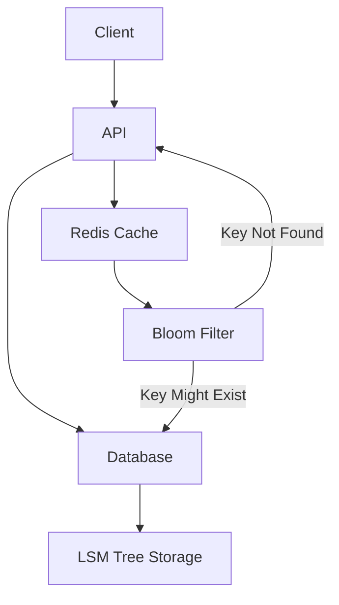

# Big Data Structures

## 📚 Overview

Specialized probabilistic, streaming-friendly, and verification-friendly data structures help systems handle massive datasets where exact computation, full comparison, or prefix scans are too expensive in memory, latency, or cost.

These structures are interview-relevant because they change architecture shape, not just implementation details.

## 📑 Index Table

| Structure | Use When | Read Next |
|-----------|----------|-----------|
| Bloom Filter | Fast negative checks, tiny memory. | [Deep Dive](../data-structures/big-data-structures.md#1-bloom-filters) |
| HyperLogLog | Compact distinct count. | [Deep Dive](../data-structures/big-data-structures.md#3-hyperloglog) |
| Count-Min Sketch | Stream-friendly heavy-hitter detection. | [Deep Dive](../data-structures/big-data-structures.md#2-count-min-sketch) |
| LSM Tree | Write-optimized storage. | [Deep Dive](../data-structures/big-data-structures.md#4-lsm-trees-log-structured-merge-trees) |
| Skip List | Probabilistic sorted map. | [Deep Dive](../data-structures/big-data-structures.md#5-skip-lists) |
| Merkle Tree | Integrity proofs, anti-entropy. | [Merkle Tree](./merkle-tree.md) |
| Trie | Prefix lookup, autocomplete. | [Trie](./trie.md) |

---

## 1. Bloom Filter

### What is it?
A probabilistic set-membership structure with:
- **No false negatives**
- **Possible false positives**

### Why use it?
Prevents expensive lookups when data is definitely absent.

### Typical placement
- Before DB or object-store reads
- In LSM-based systems to skip SSTables
- In crawlers to avoid duplicate fetches

### Complexity and behavior
- Insert: `O(k)`
- Lookup: `O(k)`
- Space: `O(m)` bits

### Interview trade-off
You trade occasional false positives for large memory and I/O savings.

### Worked Numeric Example
If we use 10 bits per element, the false positive rate is roughly 1%.
For 1 billion elements, we need 10 billion bits ≈ 1.2 GB of memory.

---

## 2. HyperLogLog

### What is it?
A probabilistic cardinality estimator for counting distinct values in streams.

### Why use it?
Exact distinct counting often needs huge hash sets; HLL gives small-memory approximate counts suitable for analytics.

### Key properties
- Fixed, tiny memory footprint
- Mergeable across partitions
- Controlled error bounds

### Typical use cases
- Unique users/day
- Unique devices/events
- Distinct IDs across distributed logs

### Worked Numeric Example
To count 1 billion unique users exactly with 8-byte IDs, we need ~8 GB.
With HLL, standard error of 2% requires `m=16384` buckets. Each bucket uses 6 bits. Total space: 16384 * 6 bits = 12 KB.

---

## 3. Count-Min Sketch

### What is it?
A compact sketch for approximate frequency counting in high-volume streams.

### Why use it?
Track heavy hitters and approximate counts without storing full key maps.

### Key properties
- Fast updates and queries
- One-sided error in insertion-only mode (overestimation)
- Merge-friendly for distributed pipelines

### Typical use cases
- Trending query terms
- Abuse hot keys/IPs
- Feature frequency estimation

---

## 4. Approximate Quantiles (t-digest / KLL style)

### What is it?
Streaming structures that estimate percentiles (P50/P95/P99) without storing all samples.

### Why use it?
Latency and metric dashboards need percentile visibility at scale.

### Typical use cases
- Service latency SLOs
- Distribution summaries for observability
- Real-time analytics on large event streams

---

## 5. Reservoir Sampling

### What is it?
A method to maintain a uniform sample from an unbounded stream with fixed memory.

### Why use it?
Useful when full storage is impossible but you still need representative samples for debugging or offline analysis.

---

## 6. How these fit modern systems

### TSDB / stream pipeline crossover
- Bloom filters reduce read amplification in LSM-style storage.
- Sketches keep dashboard/alert aggregates cheap.
- Approximate structures support near-real-time analytics while controlling cost.

### Interview framing tip
Use approximate structures only when scale pressure justifies them. Mention fallback to exact structures for small datasets.

---

## 7. Integrity and Prefix Indexes

Not every large-scale data structure is approximate. Some are exact structures that make a specific distributed-systems operation cheap enough to use in production.

### Canonical reading order

1. Start on this overview page for interview framing and selection cues.
2. Read [Merkle Tree](./merkle-tree.md) and [Trie](./trie.md) when the prompt needs proof paths, replica repair, prefix search, or autocomplete.
3. Use the [Extended Big Data Structures Notes](../data-structures/big-data-structures.md) for deeper LSM Tree, Skip List, and storage-engine context.

---

## ⚖️ Decision Cheatsheet

| Problem | Data Structure | Why |
|--------|----------------|-----|
| “Have we seen this key?” | Bloom Filter | Fast negative checks, tiny memory |
| “How many unique users?” | HyperLogLog | Compact distinct count |
| “What are top frequent items?” | Count-Min Sketch (+ heap) | Stream-friendly heavy-hitter detection |
| “What is P99 latency?” | Quantile sketch | Percentiles without full retention |
| “Need representative stream samples” | Reservoir Sampling | Fixed-memory unbiased sample |
| “Which replica ranges differ?” | Merkle Tree | Descend through mismatched hashes |
| “Find every key with this prefix” | Trie | Prefix walk then subtree/ranking logic |

---

## 🏗️ Architecture Visualization

---

## 🎤 Interview Q&A (Tiered)

### 🟢 Junior Level
**Q:** Why use a Bloom filter instead of a Hash Set?
**A:** A Hash Set stores the actual data keys, requiring memory proportional to the size of the keys and the number of elements. A Bloom filter only uses a bit array, saving huge amounts of memory at the cost of some false positives (but never false negatives). It tells us if something is "definitely not" in a set.

### 🟡 Senior Level
**Q:** Explain how Space Amplification behaves in an LSM Tree vs a B-Tree.
**A:** B-Trees typically have lower Space Amplification (often 1.5x-3x) because they update blocks in place. LSM Trees write new data sequentially and use compaction, meaning the same key can exist in multiple SSTables until compacted. This results in higher Space Amplification (10x-30x depending on Leveled vs. Size-Tiered compaction strategies) but significantly better Write Amplification than B-Trees.

### 🔴 Staff Level
**Q:** How would you implement a distributed real-time distinct counting system for a streaming pipeline?
**A:** For exact counting, you need a distributed Hash Set and sharding, which is memory intensive. Instead, use a HyperLogLog structure per time-window partition (e.g., in Flink or Kafka Streams). HLL states are associative and commutative, so you can easily merge them across nodes in a map-reduce fashion, reducing communication overhead and allowing constant memory usage even for unbounded cardinality.

---

## 🚩 Common Pitfalls

1. Using probabilistic structures when exactness is mandatory.
2. Ignoring error bounds and confidence when presenting numbers.
3. Missing merge semantics in distributed pipelines.
4. Over-engineering early-stage systems with low cardinality/volume.

---

## 🔗 Related Content

- [Extended Big Data Structures Notes](../data-structures/big-data-structures.md)
- [Merkle Tree](./merkle-tree.md)
- [Trie](./trie.md)
- [Time Series Databases](../../03-hld-concepts/time-series-databases/)
- [Kafka](../../03-hld-concepts/kafka/)
- [Monitoring & Observability](../../03-hld-concepts/monitoring-observability/)
- [Database Indexing](../database-concepts/indexing.md)
