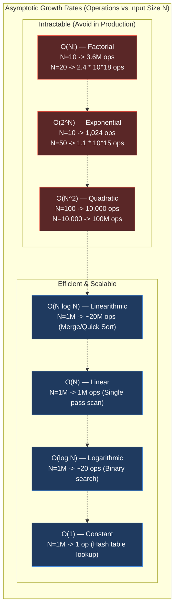

# Big O Notation

Understanding time and space complexity is fundamental for coding interviews, algorithm design, and distributed systems architecture.

---

## 📖 What is Big O?

> **Big O notation describes the asymptotic upper bound of an algorithm's execution time or memory footprint as input size ($n$) approaches infinity.**

**Beginner Intuition**: Imagine finding a word in a dictionary. Scanning page by page is $O(n)$ (Linear), but opening to the middle and halving the search space is $O(\log n)$ (Logarithmic). Shaking someone's hand in a room is $O(1)$ per person, but everyone shaking everyone else's hand is $O(n^2)$ (Quadratic).

**Versioned Primary Citations**:
- **Java 11+ SE**: Relies on `java.util` collections and native arrays.
- **Python 3.8+**: Relies on built-ins and the `typing` module for static analysis.

```
O(n) means: As input grows, execution time/space grows proportionally.

For input size n:
- O(1):       Constant — runtime is independent of input size
- O(log n):   Logarithmic — runtime grows very slowly (divides problem in half)
- O(n):       Linear — runtime grows proportionally to n
- O(n log n): Linearithmic — standard divide-and-conquer sorting bound
- O(n²):      Quadratic — nested iterations; acceptable only for small n
- O(2^n):     Exponential — search over all subsets; intractable for n > 30
- O(n!):      Factorial — search over all permutations; intractable for n > 12
```

### 🔬 Worked Trace: Binary Search $O(\log n)$
**Premise**: We have a sorted array `[2, 5, 8, 12, 16, 23, 38, 56, 72, 91]` and want to find `23`.
1. **Initial State**: $n = 10$. Middle is `16`.
2. **Step 1**: $23 > 16$, search right half `[23, 38, 56, 72, 91]` ($n = 5$).
3. **Step 2**: Middle is `56`. $23 < 56$, search left half `[23, 38]` ($n = 2$).
4. **Step 3**: Middle is `23`. Found!
We halved the search space at each step, taking 3 steps for $n=10$, which aligns with $\log_2(10) \approx 3.32$.

### ⚠️ Boundary/Counterexample: The Constant Factor Trap
While $O(n)$ is asymptotically better than $O(n^2)$, a $O(n^2)$ algorithm with a very small constant factor might outperform an $O(n)$ algorithm with a massive constant factor for small values of $n$. For instance, for $n < 50$, Insertion Sort ($O(n^2)$) often beats Merge Sort ($O(n \log n)$) due to lower constant overhead, which is why hybrid algorithms like Timsort use Insertion Sort for small boundaries.

### 🚀 Staff Extension: Amortized Complexity
Amortized complexity averages the time required for a sequence of operations. For example, appending to a dynamic array (like Python's `list` or Java's `ArrayList`) is $O(1)$ amortized. Even though a resize operation takes $O(n)$ time to copy elements, it happens so infrequently (e.g., doubling capacity) that the average cost per append over a long sequence remains $O(1)$.

---

## 📊 Visual Big-O Growth Curves



### Relative Performance Comparison

| Complexity | Class Name | Operations for $n=10$ | Operations for $n=100$ | Operations for $n=1,000,000$ |
|:---|:---|:---|:---|:---|
| **$O(1)$** | Constant | 1 | 1 | 1 |
| **$O(\log n)$** | Logarithmic | ~3.3 | ~6.6 | ~20 |
| **$O(n)$** | Linear | 10 | 100 | 1,000,000 |
| **$O(n \log n)$** | Linearithmic | 33 | 664 | 20,000,000 |
| **$O(n^2)$** | Quadratic | 100 | 10,000 | $10^{12}$ (Stalls CPU) |
| **$O(2^n)$** | Exponential | 1,024 | $1.26 \times 10^{30}$ | Intractable |
| **$O(n!)$** | Factorial | 3,628,800 | $9.33 \times 10^{157}$ | Intractable |

---

## 🔍 Time Complexity Analysis & Code Parity

### 1. O(1) - Constant Time

#### Java
```java
// Array indexing, map lookup, arithmetic
int value = array[5];
User user = userMap.get("alice");
int result = a + b * c;
```

#### Python
```python
# List indexing, dict lookup, arithmetic
value = array[5]
user = user_map.get("alice")
result = a + b * c
```

---

### 2. O(log n) - Logarithmic Time

#### Java
```java
int binarySearch(int[] arr, int target) {
    int left = 0, right = arr.length - 1;
    while (left <= right) {
        int mid = left + (right - left) / 2;
        if (arr[mid] == target) return mid;
        if (arr[mid] < target) left = mid + 1;
        else right = mid - 1;
    }
    return -1;
}
```

#### Python
```python
from typing import List

def binary_search(arr: List[int], target: int) -> int:
    left, right = 0, len(arr) - 1
    while left <= right:
        mid = (left + right) // 2
        if arr[mid] == target:
            return mid
        elif arr[mid] < target:
            left = mid + 1
        else:
            right = mid - 1
    return -1
```

---

### 3. O(n) - Linear Time

#### Java
```java
int findMax(int[] arr) {
    int max = arr[0];
    for (int num : arr) {
        if (num > max) max = num;
    }
    return max;
}
```

#### Python
```python
from typing import List

def find_max(arr: List[int]) -> int:
    max_val = arr[0]
    for num in arr:
        if num > max_val:
            max_val = num
    return max_val
```

---

### 4. O(n log n) - Linearithmic Time

#### Java
```java
// Sorting primitives (Dual-Pivot Quicksort / TimSort)
Arrays.sort(arr);

// Outer linear loop with inner logarithmic search
for (int i = 0; i < n; i++) {
    binarySearch(arr, target);
}
```

#### Python
```python
# Timsort in Python
arr.sort()

# Outer linear iteration with inner binary search
for i in range(n):
    binary_search(arr, target)
```

---

### 5. O(n²) - Quadratic Time

#### Java
```java
// Nested iterations over dataset
void bubbleSort(int[] arr) {
    int n = arr.length;
    for (int i = 0; i < n; i++) {
        for (int j = 0; j < n - i - 1; j++) {
            if (arr[j] > arr[j + 1]) {
                int temp = arr[j];
                arr[j] = arr[j + 1];
                arr[j + 1] = temp;
            }
        }
    }
}
```

#### Python
```python
from typing import List

def bubble_sort(arr: List[int]) -> None:
    n = len(arr)
    for i in range(n):
        for j in range(0, n - i - 1):
            if arr[j] > arr[j + 1]:
                arr[j], arr[j + 1] = arr[j + 1], arr[j]
```

---

### 6. O(2^n) - Exponential Time

#### Java
```java
// Naive Fibonacci recursion (branches into 2 subproblems)
int fib(int n) {
    if (n <= 1) return n;
    return fib(n - 1) + fib(n - 2);
}
```

#### Python
```python
def fib(n: int) -> int:
    if n <= 1:
        return n
    return fib(n - 1) + fib(n - 2)
```

---

### 7. O(n!) - Factorial Time

#### Java
```java
// Generating all permutations
void permute(int[] arr, int start) {
    if (start == arr.length) {
        process(arr);
        return;
    }
    for (int i = start; i < arr.length; i++) {
        swap(arr, start, i);
        permute(arr, start + 1);
        swap(arr, start, i);
    }
}
```

#### Python
```python
from typing import List

def permute(arr: List[int], start: int = 0) -> None:
    if start == len(arr):
        process(arr)
        return
    for i in range(start, len(arr)):
        arr[start], arr[i] = arr[i], arr[start]
        permute(arr, start + 1)
        arr[start], arr[i] = arr[i], arr[start]
```

---

## 📐 Space Complexity & Memory Parity

### O(1) Auxiliary Space

#### Java
```java
int sum = 0;
for (int num : arr) {
    sum += num;
}
```

#### Python
```python
total = 0
for num in arr:
    total += num
```

---

### O(n) Auxiliary Space

#### Java
```java
// Allocation proportional to input size
int[] copy = new int[n];
for (int i = 0; i < n; i++) {
    copy[i] = arr[i];
}

// Linear recursion call stack (depth n)
void recurse(int n) {
    if (n <= 0) return;
    recurse(n - 1);
}
```

#### Python
```python
# Allocation proportional to input size
copy_list = [x for x in arr]


# Linear recursion call stack (depth n)
def recurse(n: int) -> None:
    if n <= 0:
        return
    recurse(n - 1)
```

---

### O(log n) Space Complexity

#### Java
```java
// Recursive Binary Search call stack depth = log2(n)
int binarySearchRec(int[] arr, int left, int right, int target) {
    if (left > right) return -1;
    int mid = left + (right - left) / 2;
    if (arr[mid] == target) return mid;
    if (arr[mid] < target) return binarySearchRec(arr, mid + 1, right, target);
    return binarySearchRec(arr, left, mid - 1, target);
}
```

#### Python
```python
from typing import List

def binary_search_rec(arr: List[int], left: int, right: int, target: int) -> int:
    if left > right:
        return -1
    mid = (left + right) // 2
    if arr[mid] == target:
        return mid
    elif arr[mid] < target:
        return binary_search_rec(arr, mid + 1, right, target)
    return binary_search_rec(arr, left, mid - 1, target)
```

---

## 🔧 Essential Rules for Complexity Calculation

1. **Drop Constant Factors**: $O(3n + 50) \implies O(n)$. Constants do not alter the growth rate at scale.
2. **Drop Lower-Order Terms**: $O(n^2 + 5n + 100) \implies O(n^2)$. As $n \to \infty$, $n^2$ dominates.
3. **Multiple Variables Require Separate Terms**: If an algorithm iterates through an array of length $A$ and nested over list of length $B$, complexity is $O(A \times B)$, not $O(N^2)$.
4. **Master Theorem for Divide-and-Conquer Recurrences**:
   $$T(n) = aT(n/b) + O(n^d)$$
   * If $d < \log_b a \implies O(n^{\log_b a})$
   * If $d = \log_b a \implies O(n^d \log n)$ (e.g. Merge Sort: $a=2, b=2, d=1 \implies O(n \log n)$)
   * If $d > \log_b a \implies O(n^d)$

---

## 🎯 Interview Practice Questions

### Q1: What is the complexity of nested loop with geometric increments?

#### Java
```java
for (int i = 1; i < n; i *= 2) {
    for (int j = 0; j < n; j++) {
        // O(1) operation
    }
}
```

#### Python
```python
i = 1
while i < n:
    for j in range(n):
        pass  # O(1) operation
    i *= 2
```
**Answer**: **$O(n \log n)$**. The outer loop executes $\log_2(n)$ times; the inner loop executes $n$ times for each outer step.

---

### Q2: Subsets Backtracking Complexity

#### Java
```java
List<List<Integer>> result = new ArrayList<>();
void subsets(int[] nums, int index, List<Integer> current) {
    if (index == nums.length) {
        result.add(new ArrayList<>(current));
        return;
    }
    subsets(nums, index + 1, current);
    current.add(nums[index]);
    subsets(nums, index + 1, current);
    current.remove(current.size() - 1);
}
```

#### Python
```python
result = []


from typing import List

def subsets(nums: List[int], index: int, current: List[int]) -> None:
    if index == len(nums):
        result.append(list(current))
        return
    subsets(nums, index + 1, current)
    current.append(nums[index])
    subsets(nums, index + 1, current)
    current.pop()
```
**Answer**:
* **Time Complexity**: **$O(n \times 2^n)$**. Generates $2^n$ distinct subsets, each requiring $O(n)$ time to copy into the result array.
* **Space Complexity**: **$O(n)$** recursion stack depth (or $O(n \times 2^n)$ including result storage).
