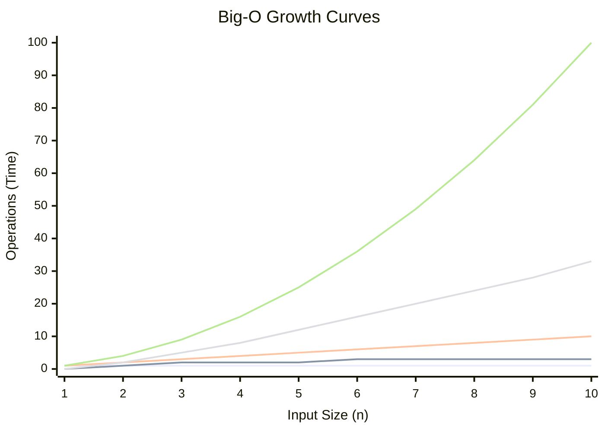

# Common Algorithm Complexities

Quick reference for time and space complexity of commonly used algorithms in technical interviews.

---

## 🎯 Introduction to Big-O

**Beginner Intuition**: Think of algorithm complexity like scaling a recipe. If you need to feed 1 person vs 100 people:
- $O(1)$: Reading the recipe (takes the same time regardless of guests).
- $O(n)$: Peeling potatoes (1 potato per guest).
- $O(n^2)$: Everyone shaking hands with everyone else at the dinner party.

### Visual Big-O Growth Curves


### Trace & Boundary Conditions
- **Worked Trace (Binary Search)**:
  - *Premises*: Sorted array `[1, 3, 5, 7, 9]`, searching for `7`.
  - *Step 1*: Mid is `5`. `5 < 7`, so search right half `[7, 9]`.
  - *Step 2*: Mid is `7`. Found! Time taken grows logarithmically.
- **Counterexample/Boundary Condition**: Quicksort is typically $O(n \log n)$, but if the array is already sorted and we pick the last element as the pivot, it degrades to $O(n^2)$.

**Optional Staff Extension**: Beyond abstract operations, real-world complexity is dominated by memory hierarchy (cache locality) and I/O. A sequential $O(n)$ disk read often outperforms a random-access $O(\log n)$ disk read.

**Versioned Primary Citations**: The examples below demonstrate strict parity using Java 11+ SE and Python 3.8+ standard libraries without external frameworks.

---

## 🔢 Sorting Algorithms

| Algorithm | Best | Average | Worst | Space | Stable |
|:---|:---|:---|:---|:---|:---|
| **Bubble Sort** | O(n) | O(n²) | O(n²) | O(1) | Yes |
| **Selection Sort** | O(n²) | O(n²) | O(n²) | O(1) | No |
| **Insertion Sort** | O(n) | O(n²) | O(n²) | O(1) | Yes |
| **Merge Sort** | O(n log n) | O(n log n) | O(n log n) | O(n) | Yes |
| **Quick Sort** | O(n log n) | O(n log n) | O(n²) | O(log n) | No |
| **Heap Sort** | O(n log n) | O(n log n) | O(n log n) | O(1) | No |
| **Counting Sort** | O(n + k) | O(n + k) | O(n + k) | O(k) | Yes |
| **Radix Sort** | O(nk) | O(nk) | O(nk) | O(n + k) | Yes |

---

## 🔍 Search Algorithms

| Algorithm | Best | Average | Worst | Space | Requirement |
|:---|:---|:---|:---|:---|:---|
| **Linear Search** | O(1) | O(n) | O(n) | O(1) | None |
| **Binary Search** | O(1) | O(log n) | O(log n) | O(1) | Sorted Array |
| **Jump Search** | O(1) | O(√n) | O(√n) | O(1) | Sorted Array |
| **Hash Table** | O(1) | O(1) | O(n) | O(n) | Hashable Keys |

### Binary Search Template

#### Java
```java
public class SearchAlgorithms {
    public static int binarySearch(int[] arr, int target) {
        int left = 0, right = arr.length - 1;
        while (left <= right) {
            int mid = left + (right - left) / 2;
            if (arr[mid] == target) return mid;
            else if (arr[mid] < target) left = mid + 1;
            else right = mid - 1;
        }
        return -1;
    }
}
```

#### Python
```python
from typing import List

def binary_search(arr: List[int], target: int) -> int:
    left, right = 0, len(arr) - 1
    while left <= right:
        mid = left + (right - left) // 2
        if arr[mid] == target:
            return mid
        elif arr[mid] < target:
            left = mid + 1
        else:
            right = mid - 1
    return -1
```

---

## 🌳 Tree Algorithms

| Operation | Binary Tree | BST (balanced) | BST (unbalanced) |
|:---|:---|:---|:---|
| **Search** | O(n) | O(log n) | O(n) |
| **Insert** | O(n) | O(log n) | O(n) |
| **Delete** | O(n) | O(log n) | O(n) |
| **Traversal** | O(n) | O(n) | O(n) |

### Tree Traversals (All O(n) time, O(h) space)

#### Java
```java
import java.util.LinkedList;
import java.util.Queue;

public class TreeAlgorithms {
    static class Node {
        int val;
        Node left, right;
        Node(int val) { this.val = val; }
    }

    static void process(Node node) { /* Implementation */ }

    // Inorder: Left -> Root -> Right
    public static void inorder(Node node) {
        if (node == null) return;
        inorder(node.left);
        process(node);
        inorder(node.right);
    }

    // Level-order: BFS
    public static void levelOrder(Node root) {
        if (root == null) return;
        Queue<Node> queue = new LinkedList<>();
        queue.offer(root);
        while (!queue.isEmpty()) {
            Node node = queue.poll();
            process(node);
            if (node.left != null) queue.offer(node.left);
            if (node.right != null) queue.offer(node.right);
        }
    }
}
```

#### Python
```python
from collections import deque
from typing import Optional

class Node:
    def __init__(self, val: int = 0):
        self.val = val
        self.left: Optional['Node'] = None
        self.right: Optional['Node'] = None

def process(node: Node) -> None:
    pass  # Implementation

# Inorder: Left -> Root -> Right
def inorder(node: Optional[Node]) -> None:
    if not node:
        return
    inorder(node.left)
    process(node)
    inorder(node.right)

# Level-order: BFS
def level_order(root: Optional[Node]) -> None:
    if not root:
        return
    queue = deque([root])
    while queue:
        node = queue.popleft()
        process(node)
        if node.left:
            queue.append(node.left)
        if node.right:
            queue.append(node.right)
```

---

## 🕸️ Graph Algorithms

| Algorithm | Time | Space | Primary Use Case |
|:---|:---|:---|:---|
| **BFS** | O(V + E) | O(V) | Shortest path on unweighted graphs |
| **DFS** | O(V + E) | O(V) | Topological sort, cycle detection, connected components |
| **Dijkstra** | O((V + E) log V) | O(V) | Single-source shortest path (non-negative weights) |
| **Bellman-Ford** | O(V × E) | O(V) | Shortest path with negative edge weights |
| **Floyd-Warshall** | O(V³) | O(V²) | All-pairs shortest path |
| **Kruskal's MST** | O(E log E) | O(V) | Minimum spanning tree (Disjoint Set) |
| **Prim's MST** | O((V + E) log V) | O(V) | Minimum spanning tree (Min-Heap) |

### BFS & DFS Templates

#### Java
```java
import java.util.LinkedList;
import java.util.List;
import java.util.Queue;

public class GraphAlgorithms {
    static void process(int u) { /* Implementation */ }

    public static void bfs(List<List<Integer>> adj, int start, int V) {
        boolean[] visited = new boolean[V];
        Queue<Integer> queue = new LinkedList<>();
        visited[start] = true;
        queue.offer(start);
        while (!queue.isEmpty()) {
            int u = queue.poll();
            process(u);
            for (int v : adj.get(u)) {
                if (!visited[v]) {
                    visited[v] = true;
                    queue.offer(v);
                }
            }
        }
    }

    public static void dfs(List<List<Integer>> adj, int u, boolean[] visited) {
        visited[u] = true;
        process(u);
        for (int v : adj.get(u)) {
            if (!visited[v]) {
                dfs(adj, v, visited);
            }
        }
    }
}
```

#### Python
```python
from collections import deque
from typing import List

def process(u: int) -> None:
    pass  # Implementation

def bfs(adj: List[List[int]], start: int, V: int) -> None:
    visited = [False] * V
    queue = deque([start])
    visited[start] = True
    while queue:
        u = queue.popleft()
        process(u)
        for v in adj[u]:
            if not visited[v]:
                visited[v] = True
                queue.append(v)

def dfs(adj: List[List[int]], u: int, visited: List[bool]) -> None:
    visited[u] = True
    process(u)
    for v in adj[u]:
        if not visited[v]:
            dfs(adj, v, visited)
```

---

## 📊 Heap Operations & Top-K Extraction

| Operation | Time Complexity | Notes |
|:---|:---|:---|
| **Build Heap** | O(n) | Bottom-up sift-down algorithm |
| **Insert / Push** | O(log n) | Sift-up |
| **Extract Min/Max** | O(log n) | Sift-down |
| **Peek** | O(1) | Root inspection |

### Finding K Largest Elements ($O(n \log k)$ time, $O(k)$ space)

#### Java
```java
import java.util.PriorityQueue;

public class HeapOperations {
    public static void findKLargest(int[] nums, int k) {
        PriorityQueue<Integer> minHeap = new PriorityQueue<>();
        for (int num : nums) {
            minHeap.offer(num);
            if (minHeap.size() > k) {
                minHeap.poll();
            }
        }
    }
}
```

#### Python
```python
import heapq
from typing import List

def find_k_largest(nums: List[int], k: int) -> None:
    min_heap = []
    for num in nums:
        heapq.heappush(min_heap, num)
        if len(min_heap) > k:
            heapq.heappop(min_heap)
```
