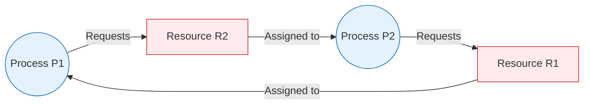

# Deadlock Theory, Coffman Conditions & Concurrency Safety

Deadlock is a state in concurrent computing where a set of processes or threads are permanently blocked because each process holds a resource that another process needs, and no process can proceed.

---

## 1. The 4 Coffman Conditions (E. G. Coffman 1971)

A deadlock can arise if and only if all four of the following conditions hold simultaneously:

| Condition | Formal Definition | Real-World Software Analogy |
|---|---|---|
| **1. Mutual Exclusion** | At least one resource must be held in a non-shareable mode. Only one thread can use the resource at any given time. | An exclusive database write lock or synchronized block. |
| **2. Hold and Wait** | A thread must currently hold at least one resource while waiting to acquire additional resources held by other threads. | Thread 1 holds `Lock(AccountA)` and attempts to acquire `Lock(AccountB)`. |
| **3. No Preemption** | Resources cannot be forcibly revoked from a thread; they can only be released voluntarily after the thread has completed its task. | OS or runtime cannot steal a mutex from an active thread without terminating it. |
| **4. Circular Wait** | A closed chain of threads $\{T_1, T_2, \dots, T_n\}$ exists such that $T_1$ waits for a resource held by $T_2$, $T_2$ waits for $T_3$, $\dots$, and $T_n$ waits for $T_1$. | Thread 1 holds Lock A, wants Lock B; Thread 2 holds Lock B, wants Lock A. |

> **Fundamental Invariant:** To prevent deadlocks, eliminating **any single one** of the four Coffman conditions is sufficient.

---

## 2. Resource Allocation Graphs (RAG) & Cycle Detection

A **Resource Allocation Graph (RAG)** is a directed bipartite graph $G = (V, E)$ where vertices are partitioned into processes $P = \{P_1, P_2, \dots\}$ and resources $R = \{R_1, R_2, \dots\}$.

- **Request Edge ($P_i \to R_j$):** Process $P_i$ is currently waiting to acquire resource $R_j$.
- **Assignment Edge ($R_j \to P_i$):** Resource $R_j$ has been allocated to and is currently held by process $P_i$.



### Single-Unit vs Multi-Unit Resources
- **Single-Unit Resources:** Every resource type has exactly 1 instance. In this case, **a directed cycle in the RAG is a necessary and sufficient condition for deadlock**.
- **Multi-Unit Resources:** Resources have multiple interchangeable units. A cycle is necessary, but not sufficient (other processes holding units of the resource may finish and release them, resolving the cycle).

### Cycle Detection Algorithm (Tarjan's SCC / DFS)
In runtime deadlock detectors (e.g., PostgreSQL deadlock detector or JVM thread dump analyzer), the engine periodically constructs the wait-for graph ($P_i \to P_j$ meaning $P_i$ is waiting for a lock held by $P_j$) and executes Depth-First Search with 3-color node tracking (White = unvisited, Gray = visiting/ancestor, Black = visited):
- If DFS encounters a **Gray** node, a back-edge exists, confirming a directed cycle and an active deadlock.

---

## 3. Deadlock vs Livelock vs Starvation

| Concurrency Hazard | CPU Activity | State Progress | Recovery Mechanism |
|---|---|---|---|
| **Deadlock** | 0% (Threads blocked in OS sleep state) | Permanent freeze | External kill/abort of one process |
| **Livelock** | 100% (Threads actively spinning / busy-waiting) | No progress; threads actively respond to each other by undoing actions | Randomized backoff (jitter) |
| **Starvation** | Normal | System makes global progress, but a specific low-priority thread never gets scheduled | Fair queueing / aging priorities |

---

## 4. Deadlock Prevention: Breaking Circular Wait

The most robust engineering strategy to eliminate deadlocks is enforcing a **Global Total Lock Ordering Hierarchy**:

$$\text{For any two locks } L_a \text{ and } L_b, \text{ acquire } L_a \text{ before } L_b \iff \text{ID}(L_a) < \text{ID}(L_b)$$

If every thread acquires multiple locks strictly in ascending order of their unique identifier (e.g., UUID, primary key, or memory address), a circular wait condition is mathematically impossible ($L_1 < L_2 < \dots < L_n < L_1$ is a contradiction).

### Java 11+ Implementation: Safe Lock Ordering
```java
package concurrency;

import java.util.concurrent.locks.ReentrantLock;

public class SafeAccountTransfer {

    public static class Account {
        private final long id;
        private double balance;
        final ReentrantLock lock = new ReentrantLock();

        public Account(long id, double balance) {
            this.id = id;
            this.balance = balance;
        }

        public long getId() { return id; }
        public double getBalance() { return balance; }
        public void debit(double amount) { this.balance -= amount; }
        public void credit(double amount) { this.balance += amount; }
    }

    public static void transfer(Account from, Account to, double amount) {
        if (from == to) return;

        // Break Circular Wait: enforce strict ascending lock acquisition order
        Account firstLock = from.getId() < to.getId() ? from : to;
        Account secondLock = from.getId() < to.getId() ? to : from;

        firstLock.lock.lock();
        try {
            secondLock.lock.lock();
            try {
                if (from.getBalance() >= amount) {
                    from.debit(amount);
                    to.credit(amount);
                }
            } finally {
                secondLock.lock.unlock();
            }
        } finally {
            firstLock.lock.unlock();
        }
    }
}
```

### Python 3.8+ Implementation: Context Manager with Object Sorting
```python
from contextlib import contextmanager
import threading
from typing import Generator, List


class Account:
    def __init__(self, account_id: int, balance: float) -> None:
        self.id = account_id
        self.balance = balance
        self.lock = threading.Lock()

    def debit(self, amount: float) -> None:
        self.balance -= amount

    def credit(self, amount: float) -> None:
        self.balance += amount


@contextmanager
def acquire_in_order(*accounts: Account) -> Generator[None, None, None]:
    """Acquires multiple locks in strictly sorted order by ID to prevent circular wait."""
    # Deduplicate and sort accounts strictly by ID
    sorted_accounts = sorted(set(accounts), key=lambda acc: acc.id)
    acquired_locks: List[threading.Lock] = []
    try:
        for acc in sorted_accounts:
            acc.lock.acquire()
            acquired_locks.append(acc.lock)
        yield
    finally:
        # Release in reverse order
        for lock in reversed(acquired_locks):
            lock.release()


def transfer(from_acc: Account, to_acc: Account, amount: float) -> bool:
    if from_acc.id == to_acc.id:
        return False

    with acquire_in_order(from_acc, to_acc):
        if from_acc.balance >= amount:
            from_acc.debit(amount)
            to_acc.credit(amount)
            return True
        return False
```

---

## 5. Deadlock Avoidance: Dijkstra's Banker's Algorithm

While prevention restricts how requests are made, **Deadlock Avoidance** dynamically examines each resource allocation request and only grants it if the system remains in a **Safe State**.

### Mathematical Formulation
Let:
- $n$: number of processes, $m$: number of resource types.
- $\text{Available}[m]$: vector of available units per resource type.
- $\text{Max}[n][m]$: maximum demand matrix of each process.
- $\text{Allocation}[n][m]$: current allocation matrix.
- $\text{Need}[n][m] = \text{Max}[i][j] - \text{Allocation}[i][j]$.

**Safety Condition:** A state is safe if there exists a sequence $\langle P_1, P_2, \dots, P_n \rangle$ such that for each $P_i$, the resources that $P_i$ can still request can be satisfied by the current $\text{Available}$ plus the resources held by all prior $P_j$ ($j < i$).

---

## 6. Database Deadlock Schemes: Wait-Die vs Wound-Wait

In distributed transactional databases (e.g., Spanner, CockroachDB, VoltDB), transactions are assigned a unique monotonically increasing timestamp $T(T_i)$ when they start. Older transactions have smaller timestamps (higher priority).

When transaction $T_{old}$ and $T_{young}$ contend for the same row lock:

```mermaid
flowchart TD
    Contention{"Transaction Ti requests a lock held by Tj"}

    Contention -->|Wait-Die Protocol (Non-Preemptive)| WD{"Is Ti older than Tj?\n[T(Ti) < T(Tj)]"}
    WD -->|Yes: Older waits| WD_Wait["Ti is allowed to WAIT"]
    WD -->|No: Younger dies| WD_Die["Ti DIES (Rollback & restart with original timestamp)"]

    Contention -->|Wound-Wait Protocol (Preemptive)| WW{"Is Ti older than Tj?\n[T(Ti) < T(Tj)]"}
    WW -->|Yes: Older preempts| WW_Wound["Ti WOUNDS Tj (Tj is aborted and rolled back)"]
    WW -->|No: Younger waits| WW_Wait["Ti is allowed to WAIT"]

    style WD_Wait fill:#e8f5e9,stroke:#2e7d32
    style WD_Die fill:#ffebee,stroke:#c62828
    style WW_Wound fill:#fff3e0,stroke:#e65100
    style WW_Wait fill:#e8f5e9,stroke:#2e7d32
```

### Key Differences
- **Wait-Die:** Non-preemptive. Older transactions wait; younger transactions die immediately. As transactions age through restarts, they become older and eventually run to completion without dying.
- **Wound-Wait:** Preemptive. Older transactions wound (preempt/abort) younger transactions immediately. Generally results in fewer restarts than Wait-Die.

---

## 7. Interview Summary & Best Practices

1. **State the 4 Coffman Conditions:** Mutual Exclusion, Hold and Wait, No Preemption, Circular Wait.
2. **First Line of Defense:** Lock ordering hierarchy (sort by primary key or entity ID before acquisition).
3. **Timeout Strategy:** Always use bounded lock acquisition (`tryLock(timeout, TimeUnit.MILLISECONDS)`) to prevent indefinite thread blockage.
4. **Database Strategy:** Use optimistic locking (`version` column) or database-native deadlock detection over application-level locks wherever possible.

---

## Cross-References

- [Lock-Free Data Structures & ABA Problem](./lock-free-data-structures-and-aba.md)
- [ACID Isolation Levels & Anomalies](../database-concepts/acid-properties.md)
- [Distributed 2PC & Saga Patterns](../database-concepts/sharding.md)
