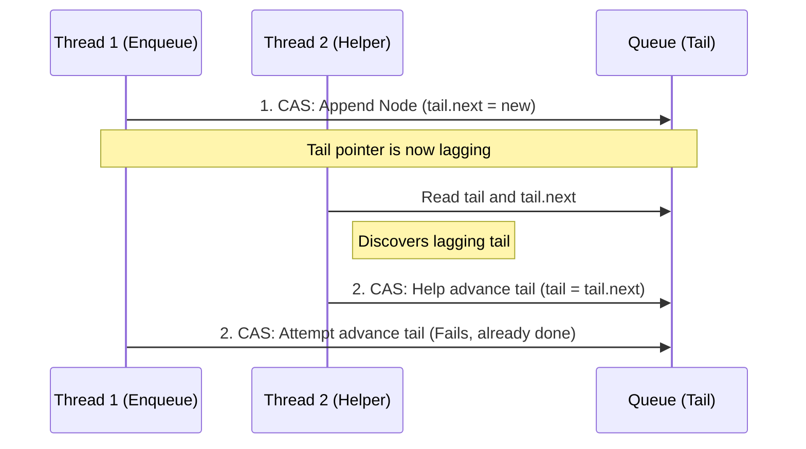
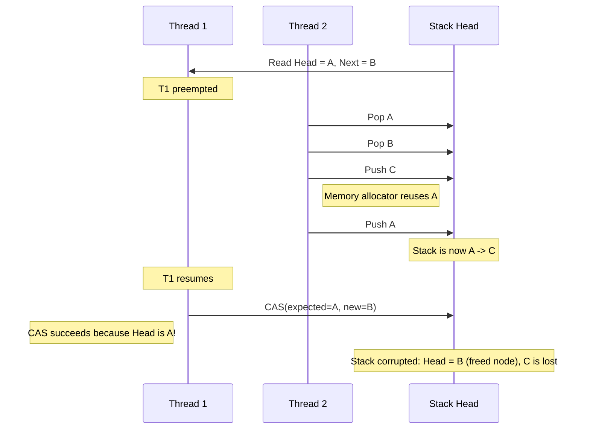

# Non-Blocking and Lock-Free Data Structures: The ABA Problem

## 1. Lock-Free Guarantees: Herlihy Progress Hierarchy

In concurrent programming, non-blocking algorithms ensure that threads competing for a shared resource do not have their execution indefinitely postponed by mutual exclusion. Maurice Herlihy formalized this into a hierarchy of progress guarantees.

**Obstruction-Free**: A thread is guaranteed to make progress if it executes in isolation. It is the weakest non-blocking guarantee. If all other threads are suspended, the active thread will complete its operation.

**Lock-Free**: At least one thread operating on the data structure is guaranteed to make progress in a finite number of steps. It guarantees system-wide progress but allows individual threads to starve.

**Wait-Free**: Every thread operating on the data structure is guaranteed to complete its operation in a finite number of steps, regardless of the execution speed of other threads. This is the strongest guarantee and provides bound execution times.

## 2. The Treiber Stack (Treiber 1986)

The Treiber Stack, introduced by R. Kent Treiber in 1986, is a simple lock-free stack implementation. It relies on a singly linked list and an atomic Compare-And-Swap (CAS) operation to manage the head of the stack.

The push operation allocates a new node, sets its `next` pointer to the current head, and attempts to CAS the head to the new node. If the CAS fails, it means another thread modified the head, and the operation retries.

The pop operation reads the current head, reads its `next` pointer, and attempts to CAS the head to the `next` pointer. Like push, it loops until the CAS succeeds.

## 3. The Michael-Scott Queue (Michael & Scott 1996)

The Michael-Scott Queue, presented by Maged Michael and Michael Scott in 1996, is a practical non-blocking queue using a singly linked list with `head` and `tail` pointers.

Enqueue operations require two CAS steps: linking the new node to the end of the list, and updating the tail pointer. Because a thread might crash between these steps, the algorithm employs a "helping" mechanism.

If a thread notices that the tail is lagging (the tail's `next` pointer is not null), it helps advance the tail pointer before proceeding with its own operation. Dequeue operations use a CAS to advance the head pointer, ensuring correctness.

### Queue Advancement Diagram



## 4. The ABA Problem Deep-Dive

The ABA problem is a critical flaw in many lock-free algorithms. It occurs when a location is read twice, has the same value both times, and "same value" is used to infer "nothing has changed." However, another thread can change the value and then change it back between the two reads.

Consider a lock-free stack: Thread 1 reads the head pointer `A` and its next node `B`. Before Thread 1 can perform its CAS, Thread 2 preempts it.

Thread 2 pops `A`, then pops `B`, and then allocates a new node `C`. Then, Thread 2 pushes `A` back onto the stack (perhaps the memory allocator reused `A`). The stack is now `A -> C`.

Thread 1 resumes. Its CAS checks if the head is still `A`. It is! The CAS succeeds, setting the head to `B`. However, `B` is no longer in the stack, and `C` is lost. This causes severe memory corruption.

### ABA Sequence Diagram



## 5. Mitigation Strategies

### Tagged Pointers and Version Counters
The most common solution is to attach a version number (or tag) to the pointer. Each time the pointer is modified, the version is incremented. A CAS must compare both the pointer and the version. In Java, this is implemented using `AtomicStampedReference`.

### Hazard Pointers
Introduced by Maged Michael, Hazard Pointers allow threads to announce which nodes they are currently reading. A thread publishes a pointer in a shared array. Other threads must check this array before freeing memory. If a node is protected by a hazard pointer, it is retired but not reclaimed until no hazard pointers reference it.

### Epoch-Based Reclamation (EBR)
EBR groups memory operations into epochs. A global epoch counter is maintained. Threads announce when they enter and leave an epoch. Memory retired in a specific epoch is only reclaimed when all threads have advanced past that epoch.

### RCU (Read-Copy-Update)
Widely used in the Linux Kernel, RCU allows multiple readers to access data without locking. Writers create a copy of the data, update it, and then swap the pointer. Old data is reclaimed only after all readers that might have a reference to it have completed their critical sections.

## 6. Code Parity Implementation

### Java Implementation

Below is a full Java 11+ implementation of a Treiber Stack that prevents the ABA problem using `AtomicStampedReference`.

```java
import java.util.concurrent.atomic.AtomicStampedReference;

public class TreiberStack<T> {
    private static class Node<T> {
        public final T value;
        public Node<T> next;

        public Node(T value) {
            this.value = value;
        }
    }

    private final AtomicStampedReference<Node<T>> head = 
        new AtomicStampedReference<>(null, 0);

    public void push(T value) {
        Node<T> newHead = new Node<>(value);
        int[] stampHolder = new int[1];
        while (true) {
            Node<T> currentHead = head.get(stampHolder);
            int currentStamp = stampHolder[0];
            newHead.next = currentHead;
            if (head.compareAndSet(currentHead, newHead, currentStamp, currentStamp + 1)) {
                return;
            }
        }
    }

    public T pop() {
        int[] stampHolder = new int[1];
        while (true) {
            Node<T> currentHead = head.get(stampHolder);
            int currentStamp = stampHolder[0];
            if (currentHead == null) {
                return null;
            }
            Node<T> nextNode = currentHead.next;
            if (head.compareAndSet(currentHead, nextNode, currentStamp, currentStamp + 1)) {
                return currentHead.value;
            }
        }
    }
}
```

### Python Implementation

This Python 3.8+ implementation mirrors the tagged pointer approach to prevent ABA using a monotonic version counter and thread-safe locks for the check-and-set sequence.

```python
import threading

class Node:
    def __init__(self, value):
        self.value = value
        self.next = None

class StampedReference:
    def __init__(self, reference, stamp):
        self.reference = reference
        self.stamp = stamp

class TreiberStack:
    def __init__(self):
        self.head = StampedReference(None, 0)
        self._lock = threading.Lock()

    def compare_and_set(self, expected_ref, new_ref, expected_stamp, new_stamp):
        """Custom compare and set logic wrapped in a lock for atomicity."""
        with self._lock:
            if (self.head.reference is expected_ref and 
                self.head.stamp == expected_stamp):
                self.head = StampedReference(new_ref, new_stamp)
                return True
            return False

    def push(self, value):
        new_node = Node(value)
        while True:
            current_head_ref = self.head.reference
            current_stamp = self.head.stamp
            new_node.next = current_head_ref
            
            if self.compare_and_set(current_head_ref, new_node, current_stamp, current_stamp + 1):
                return

    def pop(self):
        while True:
            current_head_ref = self.head.reference
            current_stamp = self.head.stamp
            
            if current_head_ref is None:
                return None
                
            next_node = current_head_ref.next
            if self.compare_and_set(current_head_ref, next_node, current_stamp, current_stamp + 1):
                return current_head_ref.value
```
