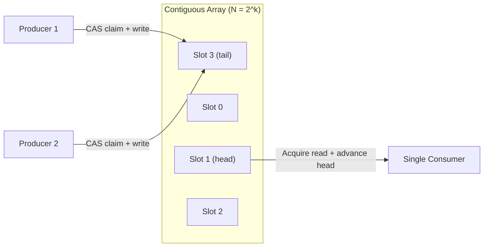

# 🔄 Lock-Free Ring Buffers

A **ring buffer** (circular buffer) is a fixed-capacity, contiguous array paired with monotonic `head` (consumer) and `tail` (producer) cursors that wrap around the array bounds. In low-latency systems—market-data feeds, audio pipelines, kernel I/O rings, and LMAX Disruptor-style event processors—ring buffers replace dynamically allocated queues with pre-allocated memory and lock-free coordination.

---

## 1. 🧵 SPSC vs. MPSC Ring Buffers

Synchronization overhead depends on how many threads write to each cursor.

### Single-Producer, Single-Consumer (SPSC)
The producer exclusively writes `tail` and the consumer exclusively writes `head`, so no Compare-And-Swap (CAS) loop is needed:
- **Enqueue:** Read local `tail` and remote `head`. If `tail - head == capacity`, the ring is full; otherwise write to `slots[tail & mask]` and advance `tail`.
- **Dequeue:** Read local `head` and remote `tail`. If `head == tail`, the ring is empty; otherwise read `slots[head & mask]` and advance `head`.

Both operations are **wait-free**, completing in bounded instructions without retries.

### Multi-Producer, Single-Consumer (MPSC)
With multiple producers, plain stores to `tail` race. MPSC splits publishing into two steps:
1. **Claim:** Producers atomically reserve a sequence via CAS (or fetch-and-add) on a shared `claim_tail` cursor after checking free capacity against `head`.
2. **Publish:** If Producer A stalls after claiming sequence `k` while Producer B finishes `k + 1`, the consumer must not read past `k`. Implementations use **per-slot sequence numbers** or a **publication barrier** (as in the LMAX Disruptor) so the consumer only advances across contiguous committed slots.

MPSC is **lock-free** on slot claims, though a stalled producer can delay contiguous consumer visibility.

---

## 2. ⚡ Power-of-Two Capacity and Bitwise Masking

Ring buffers require `capacity = 2^k` so wrapping a monotonic 64-bit sequence `seq` uses a single-cycle bitwise AND—`seq & (capacity - 1)`—instead of an expensive integer modulo (`seq % capacity`).

Keeping `head` and `tail` as **unbounded monotonic 64-bit counters** (masked only when indexing) also removes the classic ambiguity where `head == tail` could mean full or empty. Occupancy is always `tail - head`, every slot is usable without a wasted sentinel, and 64-bit overflow takes centuries even at billions of events per second.

---

## 3. 🧩 False Sharing and Cache-Line Padding

CPUs move memory between cores in **64-byte cache lines** (128 bytes on some ARM64 chips) via MESI-family coherence protocols. When `head` and `tail` share a cache line, producer updates to `tail` invalidate the consumer's cached `head`, and consumer updates to `head` invalidate the producer's `tail`.

This **false sharing** causes coherence ping-pong that slashes throughput by an order of magnitude. **Cache-line padding** (explicit alignment or padding fields around each cursor) isolates `head`, `tail`, and array metadata onto distinct cache lines. Producers and consumers also keep a **cached shadow copy** of the remote cursor (`cached_head` / `cached_tail`), reloading the shared cursor only when the local bound says full or empty.

---

## 4. 🧱 Memory Ordering for `head` and `tail`

Cross-core correctness requires **acquire-release** ordering, not just atomic accesses:
- **Producer:** Writes payload to `slots[tail & mask]`, then executes a **release store** to `tail` so payload writes cannot reorder past the cursor publish.
- **Consumer:** Executes an **acquire load** of `tail` before reading `slots[head & mask]`, then a **release store** to `head` after reading so the producer cannot overwrite the slot early.
- **Owned cursor:** A thread reads its own exclusive cursor with **relaxed** ordering.

On x86-64 (Total Store Order), acquire-release mostly reduces to compiler barriers; on weakly ordered ARM64/POWER CPUs, hardware fences (`ldar`/`stlr` or `dmb`) are required to prevent silent data corruption.

---

## 5. ⚖️ Ring Buffer vs. Lock-Based Queue

| Dimension | Lock-Free Ring Buffer | Lock-Based Bounded Queue |
|-----------|-----------------------|--------------------------|
| **Allocation** | Pre-allocated array; zero per-event GC/malloc | Node-allocated or mutex-guarded array |
| **Tail latency** | Sub-microsecond; no kernel futex on fast path | Microseconds to milliseconds under contention |
| **Waiting** | Explicit wait strategy (spin, yield, or park) | Native condition-variable sleep; zero idle CPU |
| **Sizing** | Fixed power-of-two capacity | Easily resized or unbounded |
| **Best fit** | Telemetry, trading, audio, kernel I/O rings | I/O-bound services, variable bursts, general queues |

Default to a lock-based queue when workers perform disk or network I/O or must sleep cleanly when idle; reach for a ring buffer when cross-thread handoff itself dominates latency.

---

## 6. 🚨 Common Interview Traps

- **Shared `size` counter:** Both sides writing `size` breaks SPSC lock-freedom and introduces false sharing; compute size from `tail - head`.
- **Unpadded cursors:** Adjacent `head` and `tail` suffer L1 invalidation storms despite having zero locks.
- **Arbitrary capacities:** Non-power-of-two sizes forfeit bitwise masking and complicate wrap-around math.
- **Assuming x86 ordering everywhere:** Plain loads/stores break on ARM64 and under compiler reordering without acquire-release barriers.
- **Calling MPSC wait-free:** CAS contention on claims and stalled publishers blocking contiguous publication mean MPSC is not wait-free.

---

## Cross-References

- [Memory Models & Cache Coherence](../system-design-fundamentals/memory-models-and-cache-coherence.md)
- [Lock-Free Data Structures & ABA Problem](./lock-free-data-structures-and-aba.md)
- [Synchronization Primitives & Barriers](./synchronization-primitives-and-barriers.md)
- [Ring Buffers & Gorilla Compression](../data-structures/ring-buffers-and-gorilla-compression.md)
