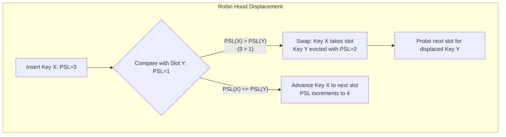
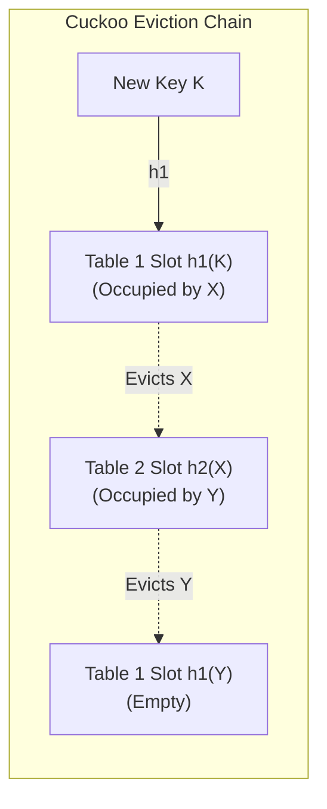
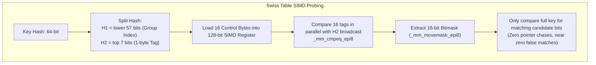

# Advanced Hash Tables in Low-Latency Systems

Hash tables are fundamental to high-throughput data infrastructure, in-memory caches (Redis, Memcached), database indexes, and modern language runtimes (Google Abseil, Rust `hashbrown`). In high-performance engineering, textbook hash tables with separate chaining suffer from severe CPU cache inefficiencies and memory pointer overhead.

This guide explores advanced open-addressing paradigms and modern low-latency hash table designs: **Robin Hood Hashing**, **Hopscotch Hashing**, **Cuckoo Hashing**, and **Swiss Tables**.

---

## 1. The Open Addressing vs. Separate Chaining Paradigm

### Separate Chaining Limitations
Textbook implementations (e.g., standard `java.util.HashMap`) use separate chaining: an array of bucket pointers, each referencing a linked list or red-black tree node.

- **Pointer Overhead & Memory Fragmentation:** Every node requires 16–24 bytes of pointer and header overhead (`next`, `hash`, alignment), creating severe heap fragmentation.
- **CPU Cache Misses:** Following pointers causes pointer chasing across arbitrary memory addresses. A single lookup may induce 2–3 L1/L2/L3 cache misses and DRAM stalls (which cost 50–100ns each).

### Open Addressing Advantages
In open addressing, all key-value entries reside directly inside a contiguous flat memory array.

- **Spatial & Temporal Locality:** Contiguous memory reads exploit CPU cache lines (64 bytes). Fetching one slot loads adjacent slots into L1 cache for free.
- **Zero Heap Allocations:** Insertions do not allocate separate node objects, minimizing GC pressure and memory allocator contention.

### Clustering Challenges in Probing
- **Primary Clustering (Linear Probing):** When collisions resolve via `(hash + i) % capacity`, contiguous blocks of occupied slots form long runs. Long runs attract more collisions, degrading average probe lengths from $O(1)$ to $O(n)$ as load factor $\alpha \to 1$.
- **Secondary Clustering (Quadratic Probing):** Keys hashing to the same initial index follow identical probe sequences, reducing clustering slightly but failing to eliminate collision cascades.

---

## 2. Robin Hood Hashing

Robin Hood hashing is a variant of open addressing with linear probing that drastically reduces lookup variance and eliminates long probe sequences by enforcing a fairness invariant: **"Steal from the rich and give to the poor."**

### Probe Sequence Length (PSL)
The **Probe Sequence Length (PSL)** measures the distance (in slots) between an entry's ideal home bucket (`hash(key) % capacity`) and its current slot:
$$\text{PSL}(k) = (\text{current\_index} - \text{home\_index}) \pmod{\text{capacity}}$$

- An entry with $\text{PSL} = 0$ is "rich" (it sits in its ideal bucket).
- An entry with $\text{PSL} = 5$ is "poor" (it was displaced 5 slots away).

### The Invariant & Displacement Mechanism
During an insert:
1. Probe sequentially starting from the key's home bucket, incrementing the incoming key's current PSL.
2. If an empty slot is encountered, place the key.
3. If an occupied slot is encountered:
   - Compare $\text{PSL}_{\text{incoming}}$ with $\text{PSL}_{\text{existing}}$.
   - If $\text{PSL}_{\text{incoming}} > \text{PSL}_{\text{existing}}$: Swap the incoming key with the existing key ("steal from the rich, give to the poor"). The displaced key becomes the new incoming key, and linear probing continues with its own PSL.
   - If $\text{PSL}_{\text{incoming}} \le \text{PSL}_{\text{existing}}$: Advance to the next slot and increment $\text{PSL}_{\text{incoming}}$.

### Robin Hood Displacement Diagram

### Fast Early-Exit Lookups
Robin Hood hashing enables exceptionally fast negative lookups (key not found):
- While probing for key $K$, if you encounter an occupied slot whose $\text{PSL} < \text{PSL}_{\text{current}}$, **terminate immediately**.
- Because the invariant guarantees that any key with a higher PSL would have displaced the resident key, key $K$ cannot exist further down the probe chain.

---

## 3. Hopscotch Hashing

Hopscotch hashing combines open addressing with a bounded neighborhood concept to deliver deterministic, cache-bounded lookups and wait-free concurrent read operations.

### Neighborhood Bitmap ($H$)
- A small constant neighborhood size $H$ is chosen (typically $H = 32$ or $64$ bits, matching word sizes).
- Any key hashing to bucket $i$ must reside in one of the $H$ consecutive slots $[i, i + H - 1]$.
- Each bucket maintains an $H$-bit bitmap indicating which of the $H$ relative slots hold keys belonging to its home bucket.

### Bounded Lookup & Displacement
1. **Lookup:** Compute $i = \text{hash}(key) \pmod C$. Inspect the $H$-bit bitmap of bucket $i$. Probe only the slots corresponding to set bits in the bitmap. Since $H$ is small and fits in 1–2 CPU cache lines, lookup completes in guaranteed $O(H)$ time.
2. **Insertion & Shifting:**
   - Probe forward using linear probing until an empty slot $E$ is found.
   - If $E - i < H$, place the key directly and set bit $E - i$ in bucket $i$'s bitmap.
   - If $E - i \ge H$, locate an existing key between $i$ and $E$ that can be safely shifted forward into $E$ without exceeding its own neighborhood boundary. Iteratively "hop" items forward until the empty slot moves within $H$ of $i$.
   - If no valid hops exist, trigger a table resize.

---

## 4. Cuckoo Hashing

Cuckoo hashing guarantees **worst-case $O(1)$ lookup time** by using multiple independent hash functions and allowing keys to displace each other across distinct table partitions.

### Mechanism
- Two independent hash functions $h_1(k)$ and $h_2(k)$ map to two separate tables $T_1$ and $T_2$ (or distinct halves of a single table).
- Any key $k$ is stored in either $T_1[h_1(k)]$ or $T_2[h_2(k)]$, and **nowhere else**.

### Worst-Case $O(1)$ Lookup
Lookup simply checks two exact array locations:
$$\text{val} = \begin{cases} T_1[h_1(k)], & \text{if present} \\ T_2[h_2(k)], & \text{if present} \\ \text{None}, & \text{otherwise} \end{cases}$$
Lookup inspects at most 2 slots in the worst case, completely independent of table load factor.

### Displacement Cycles & Rehashing
When inserting key $k$:
1. Place $k$ into $T_1[h_1(k)]$.
2. If $T_1[h_1(k)]$ was occupied by key $x$, evict $x$ (like a cuckoo bird displacing an egg).
3. Insert $x$ into its alternative location in $T_2[h_2(x)]$.
4. If that slot is also occupied, repeat the eviction chain.
5. If an eviction cycle is detected (or max chain length is exceeded), trigger an automatic rehash with new hash seed functions.

### Cuckoo Hashing Displacement Diagram

---

## 5. Swiss Tables (Google Abseil & Rust `hashbrown`)

Swiss Tables represent the pinnacle of modern SIMD-accelerated open-addressing hash tables, developed by Google in Abseil (`absl::flat_hash_map`) and adopted as the default hash table in the Rust standard library (`hashbrown`).

### Control Byte Array (Metadata Separation)
Swiss Tables separate metadata from the actual key-value payload:
1. **Control Byte Array (`ctrl`):** An array of 1-byte tags where each byte represents the state of a corresponding slot:
   - `0b11111111` (`0xFF`): Empty slot.
   - `0b10000000` (`0x80`): Deleted (tombstone) slot.
   - `0b0xxxxxxx` (`0x00`–`0x7F`): Occupied slot containing the top 7 bits of the key's hash ($H_2$).
2. **Slot Array:** Contiguous array of actual key-value pairs.

### SIMD Group-of-16 Parallel Probing
Modern x86/ARM CPUs provide SIMD vector instructions (SSE2 `_mm_cmpeq_epi8`, AVX2, NEON). Swiss Tables group control bytes into 16-byte blocks:

### Performance Characteristics
- **Single Instruction Probing:** Checks 16 slots simultaneously in ~1 CPU cycle.
- **High Load Factors:** Maintains sub-2 probe operations even at 87.5% load factor ($\alpha = 7/8$).
- **Cache Friendly:** Dense control bytes pack 16 slots into a single 16-byte memory read, fitting entirely within a fraction of one L1 cache line (64 bytes).

---

## 6. Architecture Comparison Matrix

| Mechanism | Lookup Worst-Case | Lookup Average | Max Load Factor ($\alpha$) | SIMD Acceleration | Best Used For |
|---|---|---|---|---|---|
| **Linear Probing** | $O(n)$ | $O(1)$ | ~50%–70% | None | Simple, small embedded tables |
| **Robin Hood** | $O(n)$ (low variance) | $O(1)$ | ~85%–90% | Low | Read-heavy, low latency variance |
| **Hopscotch** | $O(H)$ bounded | $O(1)$ | ~90% | Moderate | High-concurrency locked/lock-free reads |
| **Cuckoo Hashing** | $O(1)$ deterministic | $O(1)$ | ~50% (2-way), ~90% (4-way) | Low | Real-time networking, hardware routers |
| **Swiss Tables** | $O(n)$ | $O(1)$ (~1 probe) | **87.5%–90%** | **Full (SSE2/AVX2/NEON)** | General-purpose low-latency memory engines |

---

## 7. Interview Summary & Cheat Sheet

- **Why avoid separate chaining in low-latency systems?** Memory fragmentation, pointer dereference overhead, and DRAM cache misses from pointer chasing.
- **Robin Hood Core Concept:** Equalize probe sequence lengths across keys. Evict when $\text{PSL}_{\text{new}} > \text{PSL}_{\text{resident}}$. Early-exit when $\text{PSL}_{\text{probe}} > \text{PSL}_{\text{slot}}$.
- **Cuckoo Hashing Core Concept:** Constant-time $O(1)$ worst-case lookup by checking at most 2 independent table locations. Evictions can form cycles requiring dynamic rehashing.
- **Swiss Table Secret:** Decoupled 1-byte control metadata scanned 16 slots at a time using 128-bit SIMD registers, avoiding key comparisons until a 7-bit hash match is proven.
