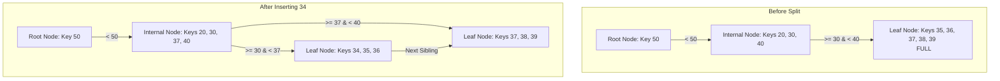
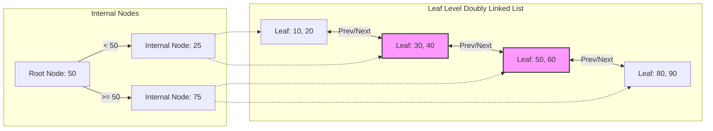

# B-Trees and B+ Trees: Theoretical Foundation for Systems Design

In the realm of database systems and storage engines, the choice of data structure is paramount to ensuring high performance, efficient disk I/O, and fast query execution. B-Trees and their more ubiquitous variant, B+ Trees, serve as the foundational backbone for relational databases (like PostgreSQL, MySQL/InnoDB) and many other persistent storage systems. Understanding these structures is crucial for any systems engineer, as they govern how data is indexed, retrieved, and stored on disk.

## 1. Core Definitions & Invariants

A B-Tree (Balanced Tree) is a self-balancing tree data structure that maintains sorted data and allows searches, sequential access, insertions, and deletions in logarithmic time. Unlike binary search trees, which have a branching factor of 2, B-Trees are designed to have a massive branching factor, making them uniquely suited for storage systems that read and write large blocks of data (pages).

### Node Order and Branching Factor

The fundamental parameter of a B-Tree is its order or **Branching factor** (denoted as $M$). The branching factor defines the maximum number of child pointers a node can contain. A high branching factor ensures the tree remains exceptionally shallow, minimizing the number of disk accesses required to reach the leaf nodes.

### Key Bounds and Structural Invariants

To maintain balance and guarantee logarithmic performance, B-Trees strictly enforce the following invariants:

- **Key Capacity:** Every node (with the exception of the root node) must contain at least $\lceil M/2 \rceil - 1$ keys and at most $M - 1$ keys.
- **Pointer Capacity:** Consequently, every internal node (except the root) has at least $\lceil M/2 \rceil$ child pointers and at most $M$ child pointers.
- **Root Node Exception:** The root node must have at least 1 key (and therefore 2 child pointers if it is an internal node), unless the tree is completely empty.
- **Balanced Height:** The defining characteristic of a B-Tree is that it is perfectly balanced from the bottom up. All leaf nodes reside at exactly the same depth. This ensures predictable worst-case performance for all operations.

## 2. B-Tree vs. B+ Tree

While the original B-Tree is a powerful structure, modern storage engines almost exclusively utilize the B+ Tree variant. The distinction between the two lies in how they manage data pointers and structure the leaf level.

### Data Placement Differences

In a standard **B-Tree**, every node (both internal nodes and leaf nodes) stores keys along with the data associated with those keys, or pointers to the actual data records. This means a search operation might terminate early if the desired key is found in an internal node.

In contrast, a **B+ Tree** strictly isolates data storage. Internal nodes (often called index nodes) store *only* keys and child pointers, which serve merely as navigational signposts. All actual data records or pointers to data records are stored exclusively in the leaf nodes.

### High Fanout and Shallower Trees

Because B+ Tree internal nodes do not store bulky data payloads or row pointers alongside the keys, they can pack significantly more keys and child pointers into a single standard-sized disk page (e.g., 8KB). This dramatically increases the branching factor. A higher branching factor results in a shallower tree topology. Shallower trees require fewer disk I/O operations to traverse from the root to a leaf, which is a massive performance optimization given the high latency of disk access compared to CPU cache or RAM.

### Sequential Range Scans

Another defining feature of the B+ Tree is the structure of its leaf level. All leaf nodes are linked together using sibling pointers (typically forming a doubly linked list). This design allows for extremely efficient range queries. Once the starting key is located via a logarithmic tree traversal, a sequential scan can simply follow the sibling pointers across the leaf nodes to retrieve subsequent records in $O(K)$ time (where $K$ is the number of elements in the range), entirely bypassing the need to traverse back up and down the tree structure.

## 3. Algorithms: Search, Insert, and Delete

The operations that mutate a B+ Tree are carefully designed to preserve its strict structural invariants, particularly the balanced height constraint.

### Search Operation

Searching for a specific key in a B+ Tree is a straightforward process of navigation.
1. The search begins at the root node.
2. At each internal node, the algorithm performs a binary search within the node's sorted keys to determine the appropriate child pointer to follow.
3. This root-to-leaf traversal continues until a leaf node is reached.
4. Finally, a binary search is conducted within the leaf node to find the exact key and its associated data.

### Insertion Operation

Data is always inserted into the leaf nodes.
1. **Leaf Insertion:** Traverse the tree to find the correct leaf node for the new key and insert it.
2. **Node Overflow:** If the leaf node has sufficient capacity (fewer than $M-1$ keys), the operation completes. However, if the node exceeds its maximum capacity ($M$ keys), it triggers a node overflow condition.
3. **Splitting at Median:** The overflowing node is split into two separate nodes. The keys are distributed evenly, splitting at the median key.
4. **Promoting Median:** To link the newly created node into the tree hierarchy, the median key (or a copy of it, in the case of a leaf split in a B+ Tree) is promoted to the parent node.
5. **Cascading Splits:** If the parent node also overflows as a result of the promotion, the split process cascades recursively upwards. If the root node overflows, it splits, and a new root is created, increasing the overall height of the tree by exactly one level.

### Deletion Operation

Deletion is generally more complex than insertion because it must handle node underflow.
1. **Leaf Deletion:** The target key is located in a leaf node and removed.
2. **Node Underflow:** If the deletion causes the node's key count to drop below the required minimum ($\lceil M/2 \rceil - 1$), a structural violation occurs.
3. **Key Borrowing:** The node first attempts to borrow a key from its immediate left or right sibling. If a sibling has spare capacity, keys are shifted, and the routing key in the parent node is updated accordingly.
4. **Merging with Siblings:** If borrowing is impossible because the siblings are also at minimum capacity, the underflowing node is merged with one of its siblings. This process pulls a routing key down from the parent node into the merged node.
5. **Root Collapse:** Merging reduces the number of child pointers in the parent. If this causes the parent to underflow, the merging process cascades upwards. In the rare event that the root node is reduced to zero keys (and one child pointer) due to cascading merges, the root node is discarded, and its single child becomes the new root, decreasing the tree's overall height by one level.

## 4. Mathematical Sizing Calculus

Understanding the physical limits of a B+ Tree requires calculating its capacity based on standard hardware parameters. Let's model a B+ Tree index with the following characteristics:

- **Page Size:** 8KB (8192 bytes)
- **Key Size:** 8 bytes (e.g., a standard 64-bit BIGINT)
- **Pointer Size:** 8 bytes (a typical page ID reference)

### Sizing Formulas

The maximum branching factor (fanout) $M$ can be calculated by determining how many key-pointer pairs can fit into a single database page.
For an internal node, each child pointer is associated with a routing key (with one extra pointer for the edge case).
Roughly, the calculation is: Page Size / (Key Size + Pointer Size).
Max fanout $M \approx 8192 / (8 + 8) = 8192 / 16 = 512$.

Therefore, an internal node can hold up to 512 child pointers and 511 routing keys.

### Capacity by Tree Height

Assuming the maximum branching factor of 512, we can calculate the staggering storage capacity of a B+ Tree at various heights.

- **Height 1 (Root node is also the leaf):**
  Capacity: $512^1 = 512$ records.

- **Height 2 (Root + 1 level of leaves):**
  Capacity: $512^2 = 262,144$ records.

- **Height 3 (Root + 1 internal level + leaves):**
  Capacity: $512^3 = 134,217,728$ records (Over 134 million records).

- **Height 4 (Root + 2 internal levels + leaves):**
  Capacity: $512^4 = 68,719,476,736$ records (Over 68 billion records).

This mathematical calculus demonstrates why B+ Trees are so effective. A tree with a height of just 4 can index nearly 69 billion records, requiring at most 4 disk I/O operations (often fewer, as the root and upper internal nodes are frequently cached in memory) to pinpoint any single row in a massive database.

## 5. Diagrams

### B+ Tree Node Split Propagation

This diagram illustrates how a leaf node split cascades upwards when the parent node is also full.

### Range Scan Traversal

This diagram demonstrates how a range query exploits the doubly-linked list structure of the leaf nodes, bypassing internal nodes during the scan.

*Note on Range Scan Diagram:* A query for `WHERE key BETWEEN 35 AND 65` would traverse from the Root to Internal Node 25, then to Leaf2 to find the starting point. From there, it simply follows the `Next` pointer to Leaf3, efficiently collecting the continuous range of values without revisiting the internal nodes.

