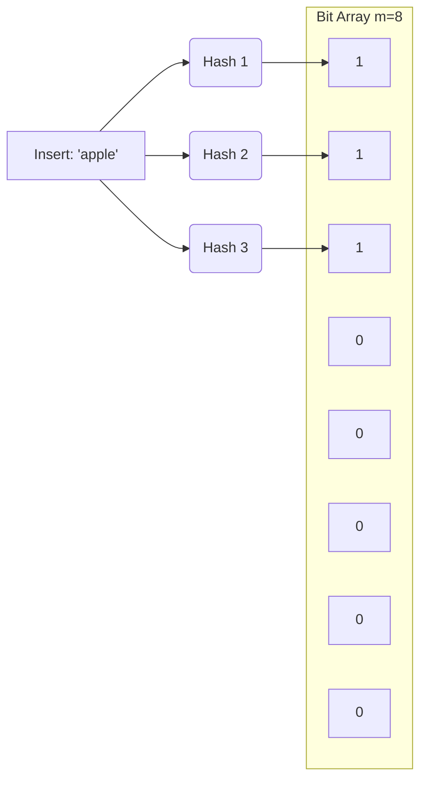
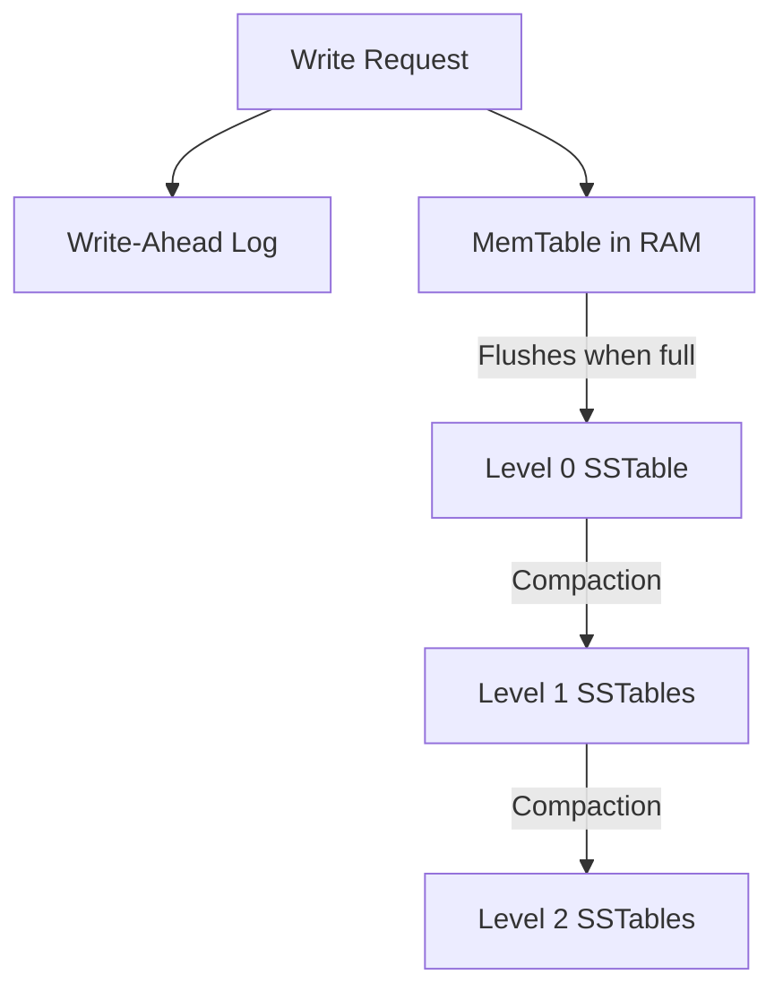

# Big Data Structures

## Overview

Traditional data structures (arrays, hash tables, trees) are designed for exact operations and fit-in-memory datasets. **Big data structures** are specialized for scenarios where:
- Data is too large for exact processing
- Approximate answers are acceptable
- Space efficiency is critical
- Write-heavy workloads dominate

This guide covers probabilistic and space-efficient data structures essential for distributed systems and big data processing.

> Start with the [Big Data Structures overview](../big-data-structures/) for the current interview-oriented path. This page keeps deeper notes for LSM trees, skip lists, and consistent hashing.

---

## 1. Bloom Filters

### What is it?

A **Bloom filter** is a space-efficient probabilistic data structure that tests whether an element is a member of a set. It can produce **false positives** but never false negatives.

```
Question: "Is X in the set?"
Bloom Filter answers:
✓ "Definitely not" (100% accurate)
✓ "Probably yes" (might be wrong)
```

### How it works

```
Initialize: Bit array of m bits (all 0)
          [0, 0, 0, 0, 0, 0, 0, 0]

Hash functions: k different hash functions (h1, h2, h3)

Insert "apple":
h1("apple") = 2 → Set bit 2 to 1
h2("apple") = 5 → Set bit 5 to 1
h3("apple") = 7 → Set bit 7 to 1

Result: [0, 0, 1, 0, 0, 1, 0, 1]

Query "apple":
Check bits 2, 5, 7 → All are 1 → "Probably in set"

Query "banana":
h1("banana") = 1 → Bit is 0 → "Definitely not in set"
```

### Complexity

| Operation | Time | Space |
|-----------|------|-------|
| Insert | O(k) | O(m) |
| Query | O(k) | O(1) |

*k = number of hash functions, m = size of bit array*

### False Positive Rate

The probability of false positives depends on:
1. Size of bit array (`m`)
2. Number of elements inserted (`n`)
3. Number of hash functions (`k`)

Formula: `P ≈ (1 - e^(-kn/m))^k`

**Optimal k**: `(m/n) * ln(2)`

### Use Cases

**1. Database Read Optimization**
```
Client asks for missing key
├─ Hash Set: O(1) memory lookup, but needs 10GB RAM
├─ Disk DB: O(log n) disk seek, slow
└─ Bloom Filter: O(1) bit check, skips disk if missing (99% of time)
```

**2. Content Delivery Networks (CDNs)**
```
Akamai's one-hit wonder problem:
├─ Web objects accessed only once pollute cache
└─ Bloom filter remembers seen objects. Only cache on second hit.
Saves ~75% of disk reads.
```

**3. Malicious URL Checking**
```
Browser needs to check if URL is malicious (list is huge):
├─ Local Bloom Filter quickly says "probably safe" (no network call)
└─ If "maybe unsafe", do expensive API call to verify
```

**4. Crawler Loop Prevention**
```
Has web crawler seen this URL before?
├─ Bloom Filter fits billions of URLs in MBs
└─ False positive just means skipping a valid URL (acceptable)
```

### Real-world Examples

- **Cassandra/HBase**: Bloom filters for SSTables to avoid disk reads for missing keys
- **Postgres**: Bloom index extension
- **Chrome**: Safe browsing malicious URL checks
- **Medium**: Reading history (have you read this article?)

### Visualization



---

## 2. Count-Min Sketch

### What is it?

**Count-Min Sketch** is a probabilistic data structure for estimating the frequency of events in a data stream. It overestimates sometimes, but never underestimates.

```
Question: "How many times did X happen?"
Count-Min Sketch answers:
✓ "At least 0" (never under-counts)
✓ "Maybe 5" (might over-count due to hash collisions)
```

### How it works

```
Initialize: 2D array of counters (d rows, w columns)
            Hash function per row (h1, h2, ..., hd)

Insert "user1" (happens twice):
h1("user1") = 2 → Array[row 1][col 2] += 1
h2("user1") = 0 → Array[row 2][col 0] += 1

Query "user1":
Check h1("user1"), h2("user1")...
Return the MINIMUM value found.
(Because collisions only ADD to a cell, MIN is the most accurate).
```

### Complexity

| Operation | Time | Space |
|-----------|------|-------|
| Update | O(d) | O(d × w) |
| Query | O(d) | O(1) |

*d = number of hash functions (rows), w = width of array (cols)*

### Use Cases

**1. Heavy Hitters (Top K)**
```
Find top trending hashtags on Twitter:
├─ Keep min-heap of size K
├─ Stream incoming tags through Count-Min Sketch
└─ If estimate > heap min, insert into heap
```

**2. Network Traffic Analysis**
```
Detecting DDoS (Top IP addresses):
├─ Stream millions of packets/sec
├─ Count-Min Sketch estimates freq of each IP
└─ Alert if IP exceeds threshold
```

### Real-world Examples

- **Redis**: Top-K module uses HeavyKeeper (variant of Count-Min)
- **Networking**: Router packet frequency estimation

---

## 3. HyperLogLog

### What is it?

**HyperLogLog** (HLL) estimates the cardinality (number of distinct elements) in a massive dataset using very little memory.

```
Question: "How many UNIQUE users visited today?"
Hash Set: 1 billion IDs = 8 GB memory
HyperLogLog: 1 billion IDs = 12 KB memory (with ~2% error)
```

### How it works

Based on probability and the pattern of binary hashes.

Observation:
"The more leading zeros in hashed values, the more unique items"

Example:
hash("user1") = 001101... (2 leading zeros)
hash("user2") = 101010... (0 leading zeros)
hash("user3") = 000011... (4 leading zeros)

Max leading zeros = 4 → Estimate ≈ 2^4 = 16 unique items

HyperLogLog uses multiple buckets for accuracy:
├─ Split hash space into m buckets
├─ Track max leading zeros per bucket
└─ Harmonic mean of 2^max values

### Complexity

| Operation | Time | Space |
|-----------|------|-------|
| Add | O(1) | O(m) ≈ 1.5 KB |
| Count | O(m) | O(1) |
| Merge | O(m) | O(1) |

**Error rate**: ~1.04/√m (typically 2% with m=16384)

### Use Cases

**1. Unique Visitor Counting**
```
Track daily active users (DAU):
├─ Add user_id to HyperLogLog
└─ Estimate distinct count (vs storing all IDs)

Redis: HyperLogLog for 1 billion users = 12 KB
HashSet: 1 billion users = ~8 GB
```

**2. Database Cardinality Estimation**
```
SELECT COUNT(DISTINCT user_id) FROM events;

Instead of exact count:
├─ HyperLogLog sketch per shard
└─ Merge sketches for global estimate
```

**3. A/B Test Metrics**
```
Unique users in experiment group:
├─ HyperLogLog per variant
└─ Merge across servers for total

Handles millions of experiments with constant memory
```

**4. Ad Impression Reach**
```
How many unique users saw this ad?
├─ HyperLogLog at each ad server
└─ Merge for campaign reach estimate
```

### Real-world Examples

- **Redis**: `PFADD`, `PFCOUNT` commands
- **Google Analytics**: Unique visitor counts
- **Facebook**: Aggregated Logs (counting unique users)
- **Datadog**: Counting unique trace IDs

---

## 4. LSM Trees (Log-Structured Merge Trees)

### What is it?

**LSM Trees** are write-optimized data structures that buffer writes in memory and periodically flush to disk in sorted runs. Designed for write-heavy workloads.

```
Traditional B-tree:     Random disk writes (slow)
LSM Tree:               Sequential writes → Sort later (fast)
```

### How it works

```
Write Path:
1. Write → MemTable (in-memory sorted structure)
2. MemTable full → Flush to SSTable (Sorted String Table) on disk
3. Background compaction merges SSTables

┌─────────────────────────────────────────────┐
│              MemTable (RAM)                 │
│  Red-Black Tree or Skip List               │
│  Sorted: [a:1, b:2, z:3]                   │
└────────────────┬────────────────────────────┘
                 │ Flush when full
                 ▼
┌─────────────────────────────────────────────┐
│         SSTables (Disk)                     │
│  Level 0: [SSTable1, SSTable2, SSTable3]    │
│  Level 1: [SSTable4, SSTable5]              │
│  Level 2: [SSTable6]                        │
└─────────────────────────────────────────────┘
            ▲
            │ Compaction (merge + deduplicate)
            └─────────────────────────────────

Read Path:
1. Check MemTable
2. Check Level 0 SSTables (newest)
3. Check Level 1, 2, ... (older)
4. Bloom filters skip missing keys
```

### Complexity

| Operation | Write | Read | Space Amplification |
|-----------|-------|------|---------------------|
| LSM Tree | O(1) amortized | O(log n) × levels | 10-30x |
| B-tree | O(log n) | O(log n) | 1.5-3x |

*Note: LSM Trees generally have a space amplification of 10-30x compared to the 1.5-3x of B-Trees due to periodic compactions and keeping old versions of records around until they are merged.*

### Use Cases

**1. Write-Heavy Databases**
```
Time-series data, logs, events:
├─ Append-only workload
├─ LSM Tree: Sequential writes (100K writes/sec)
└─ B-tree: Random writes (10K writes/sec)

Used by: InfluxDB, Prometheus
```

**2. NoSQL Databases**
```
Cassandra, HBase, RocksDB:
├─ High write throughput
├─ Acceptable read latency
└─ Compaction manages disk space
```

**3. Key-Value Stores**
```
RocksDB (Facebook), LevelDB (Google):
├─ Embedded KV store
├─ Powers Chrome's IndexedDB
└─ Bitcoin Core uses LevelDB
```

### Trade-offs

| Aspect | LSM Tree | B-tree |
|--------|----------|--------|
| **Writes** | Very fast (sequential) | Slower (random I/O) |
| **Reads** | Slower (multiple levels) | Faster (single lookup) |
| **Space** | Higher (multiple copies during compaction) | Lower |
| **Compaction** | Required (CPU/disk overhead) | Not needed |
| **Best for** | Write-heavy, append-only | Balanced read/write |

### Real-world Examples

- **Cassandra**: LSM with compaction strategies
- **RocksDB**: Facebook's embedded DB (Instagram, WhatsApp)
- **LevelDB**: Google Chrome, Bitcoin
- **ScyllaDB**: High-performance Cassandra alternative

### Visualization



---

## 5. Skip Lists

### What is it?

A **Skip List** is a probabilistic alternative to balanced trees. It uses multiple levels of linked lists with express lanes for fast search.

```
Level 3: 1 ──────────────────────────────────→ 9
Level 2: 1 ─────────→ 4 ──────────→ 7 ───────→ 9
Level 1: 1 ──→ 2 ──→ 4 ──→ 5 ──→ 7 ──→ 8 ──→ 9
Level 0: 1 → 2 → 3 → 4 → 5 → 6 → 7 → 8 → 9 → 10

Search for 7:
1. Start at top level
2. Jump forward until next > 7
3. Drop down one level
4. Repeat until found
```

### How it works

**Insertion**:
```
1. Insert at Level 0 (base level)
2. Flip coin:
   ├─ Heads → Promote to Level 1 (50% chance)
   └─ Tails → Stop

3. If promoted, flip again:
   ├─ Heads → Promote to Level 2 (25% chance)
   └─ Tails → Stop

Expected height: log₂(n)
```

### Complexity

| Operation | Average | Worst Case | Space |
|-----------|---------|------------|-------|
| Search | O(log n) | O(n) | O(n) |
| Insert | O(log n) | O(n) | O(n) |
| Delete | O(log n) | O(n) | O(n) |

### Use Cases

**1. In-Memory Sorted Maps**
```
Redis Sorted Sets (ZSET):
├─ Skip list for score-based ordering
├─ ZADD, ZRANGE, ZRANK operations
└─ Faster than balanced trees for range queries
```

**2. Concurrent Data Structures**
```
Skip lists are easier to lock than trees:
├─ Lock-free implementations possible
├─ Better for multi-threaded access
└─ Java's ConcurrentSkipListMap
```

**3. Database Indexing**
```
Alternative to B-trees:
├─ Simpler implementation
├─ Good cache performance
└─ Easier to implement lock-free
```

### Real-world Examples

- **Redis**: ZSET implementation
- **LevelDB/RocksDB**: MemTable (LSM Tree)
- **Java**: `ConcurrentSkipListMap`
- **Cassandra**: MemTable structure

---

## 6. Consistent Hashing

See detailed coverage at [Consistent Hashing](../../03-hld-concepts/consistent-hashing/)

### Quick Overview

**Consistent hashing** minimizes key remapping when nodes are added/removed in distributed systems.

```
Traditional hashing:
server = hash(key) % num_servers
Problem: Adding/removing server remaps ~75% of keys

Consistent hashing:
├─ Hash keys and servers onto a ring
├─ Key assigned to next server clockwise
└─ Adding/removing server remaps ~1/n keys
```

### Use Cases

- **Distributed Caches**: Memcached, Redis Cluster
- **NoSQL Databases**: Cassandra, DynamoDB
- **Load Balancers**: Nginx, HAProxy
- **CDNs**: Content distribution

**Cross-reference**: See [Consistent Hashing](../../03-hld-concepts/consistent-hashing/) for full details, including virtual nodes and implementation.

---

## Comparison Table

| Data Structure | Purpose | Space | Error Rate | Operations |
|----------------|---------|-------|------------|------------|
| **Bloom Filter** | Set membership | O(m) bits | False positive only | Add, Query |
| **Count-Min Sketch** | Frequency count | O(d × w) | Overestimate | Update, Query |
| **HyperLogLog** | Cardinality | O(m) ≈ 1.5 KB | ~2% | Add, Count, Merge |
| **LSM Tree** | Write-optimized storage | O(n) × amplification | Exact | Insert, Query, Scan |
| **Skip List** | Sorted map | O(n) | Exact (probabilistic structure) | Insert, Delete, Search |
| **Consistent Hash** | Key distribution | O(n) | Exact | Add/Remove nodes |

---

## When to Use What?

### Use Bloom Filter when:
- Need to check existence (with false positives OK)
- Memory is constrained
- Avoiding expensive lookups is valuable
- Examples: Cache existence, crawled URLs, spam filtering

### Use Count-Min Sketch when:
- Counting frequent items (top-K problems)
- Overestimation is acceptable
- Exact counts not needed
- Examples: Trending topics, DDoS detection, network monitoring

### Use HyperLogLog when:
- Counting unique items at scale
- 2% error is acceptable
- Memory is limited (billions of items in KB)
- Examples: DAU/MAU metrics, ad reach, database cardinality

### Use LSM Tree when:
- Write-heavy workload
- Sequential writes preferable to random
- Acceptable read latency
- Examples: Time-series, logs, NoSQL databases

### Use Skip List when:
- Need sorted data structure
- Simpler than balanced trees
- Concurrent access (lock-free)
- Examples: In-memory indexes, Redis ZSET

### Use Consistent Hashing when:
- Distributed system with dynamic nodes
- Minimize data movement during scaling
- Cache or database sharding
- Examples: Distributed cache, NoSQL ring topology

---

## Key Takeaways

1. **Trade accuracy for space**: Big data structures sacrifice exact answers for massive space savings

2. **Probabilistic ≠ unreliable**: Bloom filters and HyperLogLog have mathematically bounded error rates

3. **Write vs Read optimization**: LSM trees optimize writes; B-trees balance both

4. **Combine structures**: Real systems use multiple (Cassandra: LSM + Bloom + Consistent Hashing)

5. **Know the guarantees**:
   - Bloom Filter: No false negatives
   - Count-Min Sketch: Never underestimate
   - HyperLogLog: Bounded error rate

6. **Context matters**: Choose based on workload (writes vs reads, space vs accuracy)

---

## Related Concepts

- [Caching](../../03-hld-concepts/caching/) - Bloom filters for cache existence checks
- [Consistent Hashing](../../03-hld-concepts/consistent-hashing/) - Key distribution in distributed systems
- [Database Sharding](../../03-hld-concepts/database-sharding/) - LSM trees in sharded NoSQL databases
- [NoSQL Databases](../../03-hld-concepts/nosql-databases/) - (if exists) LSM trees in Cassandra, HBase
- [Rate Limiting](../../03-hld-concepts/rate-limiting/) - Count-Min Sketch for request counting
- [Monitoring & Observability](../../03-hld-concepts/monitoring-observability/) - HyperLogLog for metrics cardinality

## Additional Deep Dive Considerations

### Probabilistic Constraints
When designing big data systems, understanding the mathematical constraints of probabilistic data structures is paramount.
For instance, Bloom Filters require careful sizing of `m` (bits) and `k` (hashes). If `m` is too small, the false positive rate climbs unacceptably high. Conversely, oversizing `m` wastes valuable cache memory. Similarly, for HyperLogLog, the number of buckets `m` defines the memory footprint (e.g. 12 KB for 16,384 buckets) and the standard error (1.04/sqrt(m)). Engineering these trade-offs requires profiling expected data scales beforehand to guarantee production stability and predictable error boundaries. Ensure you fully evaluate insertion growth rates to avoid saturation!

### LSM Tree Compaction Strategies
In production, LSM Trees must be tuned specifically for the workload via compaction strategies.
- **Size-Tiered Compaction**: Better for write-heavy workloads as it delays merges until a tier is full. It incurs high space amplification (up to 50%) but lower write amplification.
- **Leveled Compaction**: Merges data into progressively larger levels, strictly bounding the size of each level. This guarantees much lower space amplification (often 10x or less) and predictable read latency, but increases write amplification.
Choosing the correct compaction strategy depends on whether the system is constrained by disk I/O, storage capacity, or read latencies.

### Distributed Consistent Hashing Examples
In practice, big data structures often rely on consistent hashing to distribute the load across a cluster. When nodes are added or removed, only a small fraction of the data needs to be moved.
To visualize this, imagine a ring where both servers and keys are placed using the same hash function. When a key is inserted, the system walks the ring clockwise to find the first server.
This approach significantly minimizes reorganization overhead and provides an efficient mapping for distributed probabilistic structures like HyperLogLog or Bloom Filters operating at scale.

### Advanced Usage: Stream Processing
When using structures like Count-Min Sketch in stream processing frameworks (e.g., Apache Flink, Apache Spark Streaming), state management becomes a primary concern. The sketch must be small enough to be snapshotted frequently without causing latency spikes.
This is where the predictable memory footprint of probabilistic structures becomes invaluable. A fixed-size Count-Min Sketch can be easily serialized and persisted to distributed storage (like HDFS or S3) as part of a checkpoint, ensuring exactly-once processing semantics without needing to store the entire unbounded stream history.

### Real-time Ad Fraud Detection
Ad fraud detection systems often employ a combination of Bloom Filters and HyperLogLog. A Bloom Filter can quickly check if an IP address or user agent has been flagged in the past. If the filter indicates a potential match, the system can perform a more expensive lookup against a database.
Simultaneously, HyperLogLog can track the number of distinct ad clicks originating from a specific campaign or publisher. If the distinct count grows suspiciously fast, it can trigger an alert for manual review. The minimal memory footprint allows these systems to run entirely in memory for millions of concurrent campaigns.

### The Role of Hash Functions
The efficacy of probabilistic structures heavily relies on the choice of hash functions. Fast, non-cryptographic hash functions like MurmurHash3 or CityHash are typically preferred. These functions provide good avalanche properties, ensuring that similar keys are distributed uniformly across the bit array or counter matrix.
Using slow, cryptographic hash functions (like SHA-256) would introduce unnecessary latency and CPU overhead, defeating the purpose of these highly optimized structures.

### Time-Windowed Probabilistic Structures
In many applications, we only care about recent data (e.g., unique visitors in the last hour). Time-windowed variations of these structures, such as Sliding HyperLogLog or Time-Decaying Count-Min Sketch, address this requirement.
These advanced structures typically involve maintaining multiple smaller sketches for different time slices and merging them, or incorporating a decay factor into the counters, prioritizing recent events over historical data.
