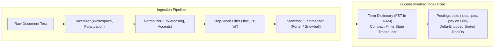
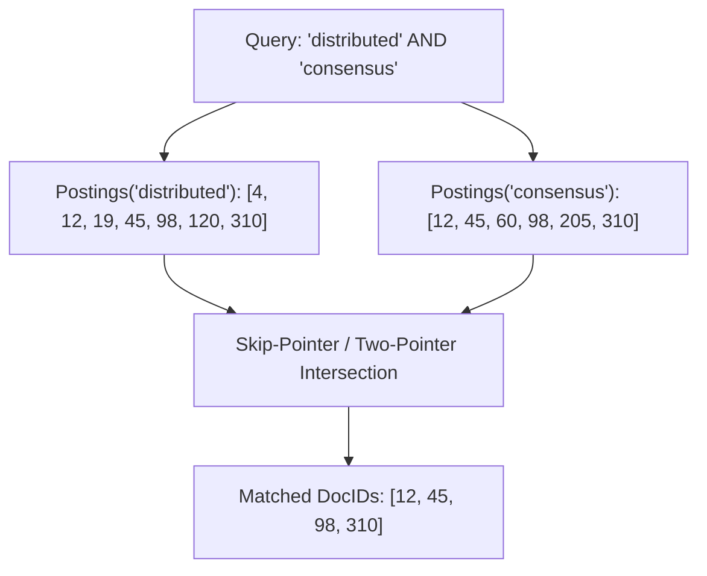
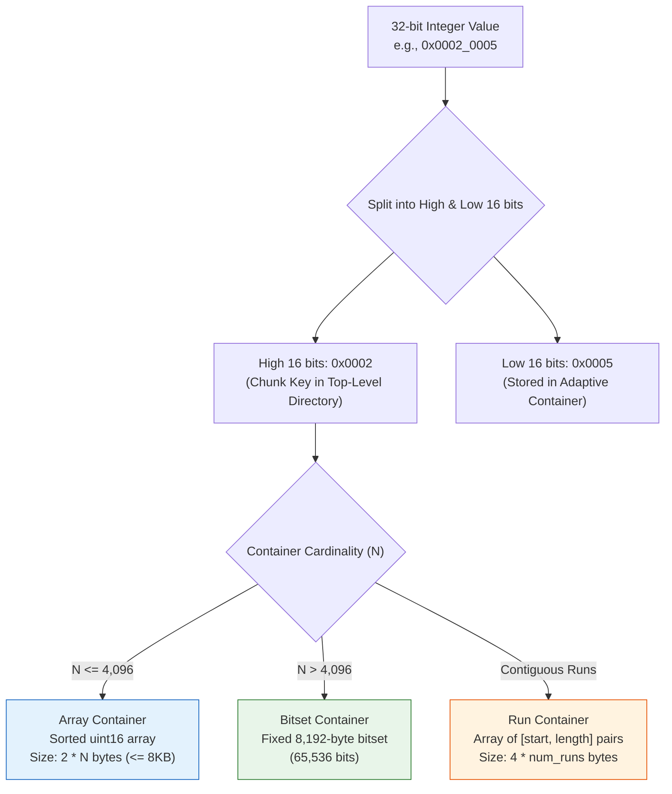

# Inverted Indexes, Postings Compression & Roaring Bitmaps

Inverted indexes and compact bitmap data structures are the algorithmic foundation of modern distributed search engines and analytical databases (Apache Lucene, Elasticsearch, OpenSearch, Apache Pinot, and ClickHouse).

---

## 1. Search Engine Indexing Architecture

A forward index maps document IDs to the terms they contain: $\text{DocID} \to [\text{Term}_1, \text{Term}_2, \dots]$.  
An **inverted index** inverts this relationship to enable sub-millisecond keyword lookup: $\text{Term} \to [\text{DocID}_1, \text{DocID}_2, \dots]$.



### 1. The Term Dictionary & Finite State Transducers (FST)
To search across millions of distinct vocabulary terms, the engine cannot hold a naive hash table in memory. Lucene compresses the entire dictionary into a memory-mapped **Finite State Transducer (FST)**:
- An FST is a directed acyclic graph (DAG) that shares both common prefixes and common suffixes across terms.
- It maps string keys (terms) to byte offsets in the postings file while consuming a fraction of the RAM of a trie or hash map (e.g., millions of terms compressed into tens of megabytes).

### 2. Postings Lists
For each term, the postings list stores:
- **DocIDs:** Monotonically increasing 32-bit integers identifying matching documents.
- **Term Frequencies (TF):** Number of times the term appears in each document.
- **Positions & Offsets:** Byte positions for phrase search (`"system design"`) and snippet highlighting.

---

## 2. Query Intersection & Scoring Algorithms

When an end-user executes a multi-term query like `system AND design`:



### Conjunction (AND) via Skip Lists
Iterating through long postings lists sequentially is prohibitive ($O(N + M)$). Postings lists are divided into blocks (e.g., 128 doc IDs per block in Lucene) with **Skip Pointers**:
- If Pointer 1 is at DocID 12 and Pointer 2 is at DocID 45, the engine checks the skip list for Pointer 1: *"Does the next block start beyond 45?"*
- If yes, the engine skips 128 doc IDs in a single pointer jump, reducing comparisons to $O(\min(N, M) \log(\max(N, M)))$.

### Weak AND (WAND) & Block-Max WAND
When returning only the Top-$K$ relevant documents (e.g., top 10 search results), scoring every matching document using BM25 is wasteful.
- **WAND:** Calculates the maximum possible score contribution ($U_t$) for each query term. It dynamically skips documents that cannot mathematically exceed the score of the current $K$-th best document.
- **Block-Max WAND (BMW):** Stores the maximum BM25 score within each 128-document block header. Entire blocks of documents are skipped without decompressing DocIDs if $\sum U_{\text{block}} < \text{Threshold}_K$.

---

## 3. Postings Compression Techniques

Raw 32-bit DocIDs require 4 bytes per entry. A posting list with 100 million entries would require 400MB. Compression exploits the property that **DocIDs are strictly sorted**.

### 1. Delta Encoding
Instead of storing absolute document IDs, store the difference (gap) between adjacent IDs:
$$\text{Raw DocIDs:} \quad [1000, 1004, 1009, 1011, 1025]$$
$$\text{Delta Gaps:} \quad [1000, 4, 5, 2, 14]$$
Because deltas are very small integers, they can be packed into variable-length encodings.

### 2. Variable Byte (VByte / Varint)
VByte encodes an arbitrary integer into a sequence of 7-bit chunks across bytes. The 8th bit (Most Significant Bit) serves as the **continuation flag**:
- `MSB = 1`: Final byte of the number.
- `MSB = 0`: More bytes follow.

| Integer Value | Binary Representation | VByte Encoded Bytes (Hex) | Byte Count |
|---|---|---|---|
| `5` | `00000101` | `0x85` (MSB set) | 1 byte |
| `127` | `01111111` | `0xFF` (MSB set) | 1 byte |
| `300` | `00000001 00101100` | `0x02 0xAC` | 2 bytes |

---

## 4. Roaring Bitmaps: Hybrid Inverted Index Compression

A standard uncompressed bitset for 32-bit integers requires $\frac{2^{32}}{8} = 512\text{ MB}$ of RAM, even if only 10 integers are present.  
**Roaring Bitmaps** solve this by partitioning the 32-bit integer space into $2^{16} = 65,536$ chunks based on the **high 16 bits**.



### The 4,096 Threshold Math
Why does Roaring Bitmap switch from an Array Container to a Bitset Container at exactly **4,096** elements?
- **Array Container:** Each integer costs 2 bytes (uint16). At $N = 4,096$, size is $4,096 \times 2 = 8,192\text{ bytes}$ (8KB).
- **Bitset Container:** Storing all possible 65,536 values in a bitset requires $\frac{65,536}{8} = 8,192\text{ bytes}$ (8KB).
- **The Invariant:** At $N \le 4,096$, the Array Container is strictly smaller. At $N > 4,096$, the Bitset Container is strictly smaller. Hence, a Roaring Bitmap container **never exceeds 8KB**, regardless of cardinality!

### SIMD Acceleration
Bitset containers execute set operations (`AND`, `OR`, `XOR`, `ANDNOT`) directly using hardware SIMD (AVX-512 / ARM NEON) instructions, processing 512 bits per single CPU clock cycle.

---

## 5. Code Parity: Variable Byte (VByte) Implementation

### Python 3.8+ VByte Encoder & Decoder
```python
from typing import List


def vbyte_encode_number(val: int) -> bytes:
    """Encodes a single unsigned integer using Variable Byte (Varint) encoding."""
    out = bytearray()
    while True:
        out.append(val & 0x7F)
        if val < 128:
            break
        val >>= 7
    # Set MSB on the final byte as termination marker
    out[0] |= 0x80
    out.reverse()
    return bytes(out)


def vbyte_encode(numbers: List[int]) -> bytes:
    """Encodes a list of unsigned integers into a contiguous VByte byte string."""
    buf = bytearray()
    for n in numbers:
        buf.extend(vbyte_encode_number(n))
    return bytes(buf)


def vbyte_decode(data: bytes) -> List[int]:
    """Decodes a VByte-encoded byte sequence back into a list of integers."""
    numbers: List[int] = []
    current_val = 0
    for byte in data:
        current_val = (current_val << 7) | (byte & 0x7F)
        if byte & 0x80:  # MSB set indicates end of current integer
            numbers.append(current_val)
            current_val = 0
    return numbers


# Demonstration & Verification
if __name__ == "__main__":
    original = [5, 127, 300, 100000]
    encoded = vbyte_encode(original)
    decoded = vbyte_decode(encoded)
    assert original == decoded, f"Mismatch: {original} != {decoded}"
    print(f"Original: {original}")
    print(f"Encoded bytes ({len(encoded)} bytes): {encoded.hex()}")
    print(f"Decoded: {decoded}")
```

---

### Java 11+ VByte Encoder & Decoder
```java
package datastructures;

import java.io.ByteArrayOutputStream;
import java.util.ArrayList;
import java.util.List;

public class VByteCodec {

    public static byte[] encode(List<Integer> numbers) {
        ByteArrayOutputStream out = new ByteArrayOutputStream();
        for (int val : numbers) {
            byte[] temp = new byte[5];
            int count = 0;
            while (true) {
                temp[count++] = (byte) (val & 0x7F);
                if (val < 128) break;
                val >>>= 7;
            }
            temp[0] |= 0x80; // MSB set marks final byte
            for (int i = count - 1; i >= 0; i--) {
                out.write(temp[i]);
            }
        }
        return out.toByteArray();
    }

    public static List<Integer> decode(byte[] data) {
        List<Integer> result = new ArrayList<>();
        int currentVal = 0;
        for (byte b : data) {
            currentVal = (currentVal << 7) | (b & 0x7F);
            if ((b & 0x80) != 0) { // MSB set indicates terminal byte
                result.add(currentVal);
                currentVal = 0;
            }
        }
        return result;
    }

    public static void main(String[] args) {
        List<Integer> original = List.of(5, 127, 300, 100000);
        byte[] encoded = encode(original);
        List<Integer> decoded = decode(encoded);
        if (!original.equals(decoded)) {
            throw new AssertionError("Codec validation failed!");
        }
        System.out.println("VByte Java Parity OK. Decoded count: " + decoded.size());
    }
}
```

---

## 6. Interview Summary & Best Practices

1. **Inverted Index Querying:** Explain FST memory compression for lexicon lookup, delta-encoded postings lists, and Skip List jumps for $O(\min(N, M))$ intersections.
2. **Top-K Scoring:** Cite Block-Max WAND as the industry-standard optimization to prune document evaluations.
3. **Roaring Bitmaps:** Explain the high-16/low-16 chunking and the 4,096-element boundary condition where array containers transition to fixed 8KB bitsets.

---

## Cross-References

- [B-Trees & B+ Trees](./b-trees-and-b-plus-trees.md)
- [Advanced Hash Tables & SIMD Swiss Tables](./advanced-hash-tables.md)
- [HLD System: Search Engine Autocomplete](../../04-hld-projects/search-autocomplete/)
