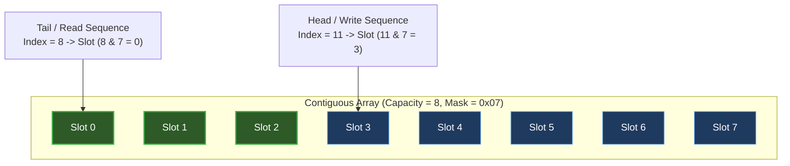
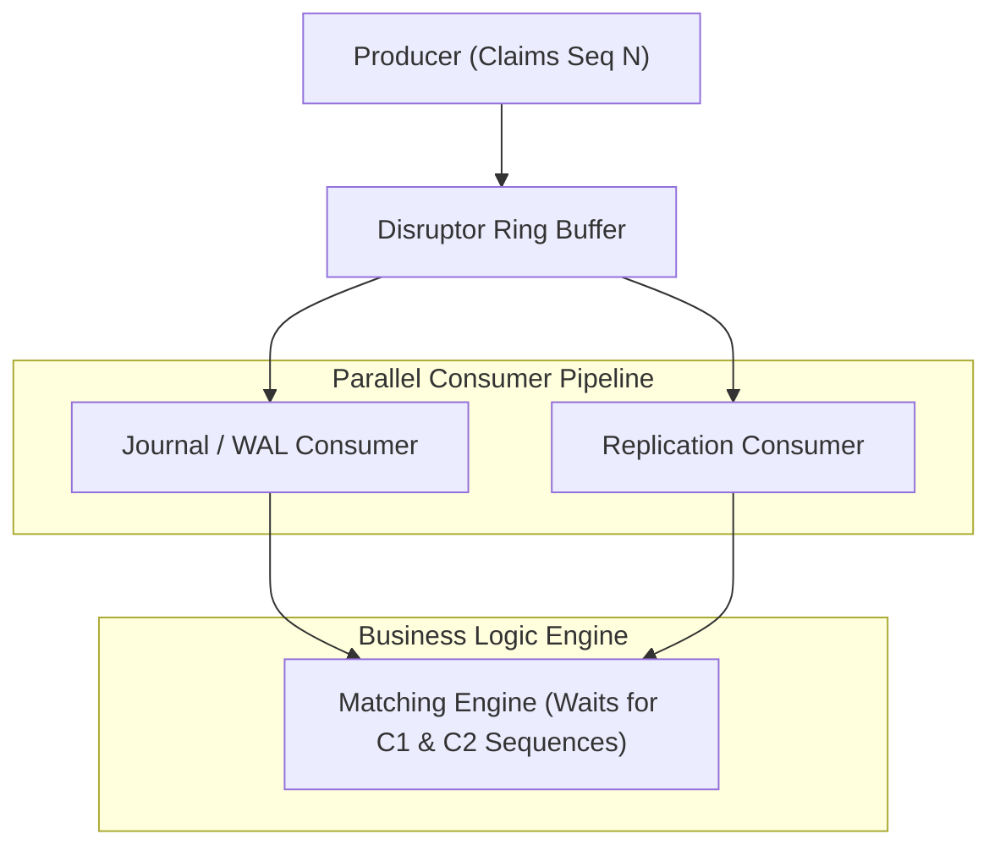
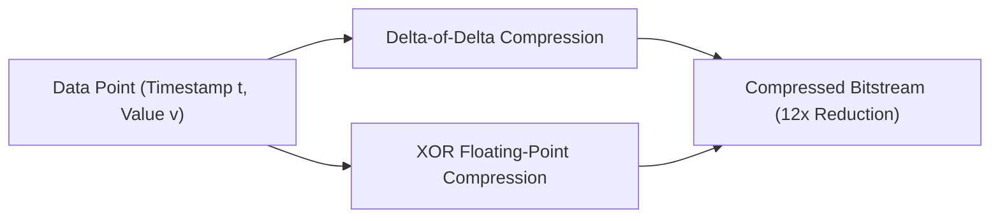

# High-Throughput Ring Buffers, LMAX Disruptor, and Gorilla Compression

Ultra-high-performance ingestion systems—such as high-frequency trading matching engines, metrics collectors (Prometheus, InfluxDB), and event streaming fabrics—cannot afford the latency jitter of lock contention, JVM garbage collection pauses, or uncompressed storage footprints.

This guide explores two foundational architectural pillars of low-latency, high-throughput systems:
1. **Mechanical Sympathy via Circular Ring Buffers & The LMAX Disruptor**: Eliminating lock contention, CPU cache misses, and false sharing.
2. **Facebook Gorilla Time-Series Compression**: Compressing billions of timestamps and floating-point metrics with delta-of-delta and XOR bit-packing.

---

## 1. Circular Ring Buffer Fundamentals

A **Circular Ring Buffer** is a fixed-size queue backed by a contiguous pre-allocated array that wraps around continuously using modular indexing.



### Power-of-Two Sizing & Bitwise Masking

In traditional queues, array wraparound is computed using modulo arithmetic: `slot = sequence % capacity`. On modern x86/ARM processors, integer division (`DIV` / `IDIV`) is expensive, consuming 15–40 CPU cycles.

If capacity is strictly constrained to a power of two ($2^k$, e.g., $1024, 4096, 65536$), the expensive modulo is replaced with a single-cycle bitwise AND mask:

$$\text{slot} = \text{sequence} \ \& \ (\text{capacity} - 1)$$

For example, with capacity 8 ($2^3 = 1000_2$), the mask is $7$ ($0111_2$). A monotonic sequence counter of `11` ($1011_2$) yields:

$$1011_2 \ \& \ 0111_2 = 0011_2 \ (\text{Slot } 3)$$

Because the 64-bit sequence counter increments monotonically, integer overflow rolls over seamlessly in two's complement arithmetic without corrupting array slot indexing.

---

### Eliminating False Sharing via Cache Line Padding

Modern CPU architectures load memory into L1/L2/L3 caches in discrete chunks called **cache lines** (typically 64 bytes on x86-64 and Apple Silicon). 

If the `head` pointer (updated by the consumer) and the `tail` pointer (updated by the producer) reside within the same 64-byte cache line:
* Whenever the producer modifies `tail`, CPU core 1 invalidates the cache line across all other CPU cores via the MESI cache coherence protocol.
* When the consumer on CPU core 2 reads `head`, it suffers an $L3$ or main memory cache miss, stalling execution.
* This phenomenon is known as **False Sharing**.

```
Without Padding (False Sharing Ping-Pong):
┌────────────────────────────────────────────────────────┐
│             Cache Line (64 bytes total)                │
│  head (8 bytes)  │  tail (8 bytes)  │  unused (48B)    │
└────────────────────────────────────────────────────────┘
       ▲                     ▲
       │ Core 1 writes       │ Core 2 writes
       └──────── MESI Invalidate ───────┘

With 64-Byte Cache Line Padding:
┌──────────────────────────────┬──────────────────────────────┐
│     Cache Line 1 (64 B)      │     Cache Line 2 (64 B)      │
│ head (8B) │ pad (56B)        │ tail (8B) │ pad (56B)        │
└──────────────────────────────┴──────────────────────────────┘
```

**Mitigation**:
* **Java**: Use `@jdk.internal.vm.annotation.Contended` or manually declare dummy `long p1, p2, p3, p4, p5, p6, p7;` fields before and after mutable pointers.
* **C/C++**: `alignas(64) std::atomic<int64_t> head;`.
* **Python**: In C extensions or ctypes, align memory structures to 64-byte boundaries.

---

## 2. The LMAX Disruptor Architecture

Developed by LMAX Exchange for financial trading platforms processing millions of transactions per second with sub-microsecond latencies, the **Disruptor** replaces traditional queues (`ArrayBlockingQueue`, `LinkedBlockingQueue`) with a lock-free, cache-aligned ring buffer.

### Disruptor Core Principles
1. **Pre-allocated Memory (Zero GC Pressure)**: All event objects in the ring buffer are allocated at startup. Producers never allocate new objects; they overwrite existing event slots in-place, eliminating JVM garbage collection pauses.
2. **Lock-Free Sequencers (Memory Barriers)**: Uses CAS (Compare-And-Swap) or single-producer memory barriers (`Volatile` / `Acquire-Release` semantics) without OS mutex locks.
3. **Consumer Dependency Graphs**: Enables complex consumer coordination (parallel processing, diamond dependencies, journal logging before execution) without inter-thread locks.



In the diamond dependency above, the Matching Engine consumer ($C3$) checks gating sequences: it only processes sequence $k$ once both $C1$ and $C2$ have acknowledged completing sequence $k$.

---

## 3. Facebook Gorilla Time-Series Compression

In 2015, Facebook published the landmark paper *"Gorilla: A Fast, Scalable, In-Memory Time Series Database"*. Gorilla introduced streaming algorithms capable of compressing time-series data down to an average of **1.37 bytes per data point** (a 12x reduction), adopted by Prometheus TSDB, InfluxDB, and Uber M3.

A time-series point consists of:
1. An integer unix timestamp $t_i$.
2. A 64-bit IEEE 754 floating-point value $v_i$.



---

### Part A: Delta-of-Delta Timestamp Compression

Because metrics are scraped at regular intervals (e.g., every 15 seconds, 60 seconds), the difference between consecutive timestamps ($D = t_i - t_{i-1}$) is virtually constant.

The **delta-of-delta** is defined as:

$$D = (t_i - t_{i-1}) - (t_{i-1} - t_{i-2})$$

Gorilla encodes $D$ into a variable-length bit sequence:

| Delta-of-Delta Range | Header Bits | Payload Bits | Total Bits | Explanation |
|:---|:---|:---|:---|:---|
| $D = 0$ | `'0'` (1 bit) | None | **1 bit** | Exact regular interval (most common) |
| $-63 \le D \le 64$ | `'10'` (2 bits) | 7 bits | **9 bits** | Minor network jitter ($[-63, 64]$ seconds) |
| $-255 \le D \le 256$ | `'110'` (3 bits) | 9 bits | **12 bits** | Moderate scraping delay |
| $-2047 \le D \le 2048$ | `'1110'` (4 bits) | 12 bits | **16 bits** | Large scrape latency |
| All other values | `'1111'` (4 bits) | 32 bits | **36 bits** | Severe disruption or irregular events |

---

### Part B: XOR Floating-Point Value Compression

Floating-point numbers in time series frequently repeat or change very little. Gorilla computes the bitwise XOR of the current 64-bit float with the previous float:

$$\text{XOR} = v_i \oplus v_{i-1}$$

1. **If $\text{XOR} == 0$**: The value is identical to the previous value. Store a single bit `'0'`.
2. **If $\text{XOR} \ne 0$**: Store bit `'1'`:
   * **Case A (Reused Leading/Trailing Zeros)**: If the number of leading and trailing zeros falls within the block of the previous non-zero XOR, store bit `'0'`, followed by the meaningful bits.
   * **Case B (New Leading/Trailing Zeros)**: Store bit `'1'`, followed by:
     * 5 bits: Number of leading zeros ($0 \le \text{zeros} \le 31$).
     * 6 bits: Length of meaningful bits ($1 \le \text{length} \le 64$).
     * The meaningful bits themselves.

---

## 4. Code Parity Implementation: Gorilla Timestamp Compressor

### Python 3.8+ Implementation

```python
"""Gorilla Delta-of-Delta Timestamp Compressor in Python 3.8+."""

from typing import List, Tuple


class BitWriter:
    """Helper class to write variable-length bit sequences."""

    def __init__(self):
        self._bits: List[int] = []

    def write_bit(self, bit: int) -> None:
        self._bits.append(1 if bit else 0)

    def write_bits(self, value: int, num_bits: int) -> None:
        for i in range(num_bits - 1, -1, -1):
            self.write_bit((value >> i) & 1)

    def to_bit_string(self) -> str:
        return "".join(str(b) for b in self._bits)

    def total_bits(self) -> int:
        return len(self._bits)


class GorillaTimestampCompressor:
    """Implements Facebook Gorilla's delta-of-delta timestamp compression algorithm."""

    def __init__(self):
        self.writer = BitWriter()
        self.prev_timestamp: int = 0
        self.prev_delta: int = 0
        self.count: int = 0

    def add_timestamp(self, timestamp: int) -> None:
        """Compresses and appends a Unix timestamp."""
        if self.count == 0:
            # First timestamp: write full 32-bit header
            self.prev_timestamp = timestamp
            self.writer.write_bits(timestamp, 32)
            self.count += 1
            return

        if self.count == 1:
            # Second timestamp: write initial delta using 14 bits
            delta = timestamp - self.prev_timestamp
            self.writer.write_bits(delta, 14)
            self.prev_delta = delta
            self.prev_timestamp = timestamp
            self.count += 1
            return

        current_delta = timestamp - self.prev_timestamp
        dod = current_delta - self.prev_delta

        if dod == 0:
            # Code '0': exactly on schedule
            self.writer.write_bit(0)
        elif -63 <= dod <= 64:
            # Code '10' + 7 bits (bias +63)
            self.writer.write_bits(0b10, 2)
            self.writer.write_bits(dod + 63, 7)
        elif -255 <= dod <= 256:
            # Code '110' + 9 bits (bias +255)
            self.writer.write_bits(0b110, 3)
            self.writer.write_bits(dod + 255, 9)
        elif -2047 <= dod <= 2048:
            # Code '1110' + 12 bits (bias +2047)
            self.writer.write_bits(0b1110, 4)
            self.writer.write_bits(dod + 2047, 12)
        else:
            # Code '1111' + full 32-bit delta-of-delta
            self.writer.write_bits(0b1111, 4)
            self.writer.write_bits(dod & 0xFFFFFFFF, 32)

        self.prev_delta = current_delta
        self.prev_timestamp = timestamp
        self.count += 1
```

---

### Java 11+ Parity Implementation

```java
import java.util.ArrayList;
import java.util.List;

public class GorillaTimestampCompressor {
    private final BitWriter writer = new BitWriter();
    private long prevTimestamp = 0;
    private long prevDelta = 0;
    private int count = 0;

    public void addTimestamp(long timestamp) {
        if (count == 0) {
            // First timestamp: write raw 32-bit integer
            prevTimestamp = timestamp;
            writer.writeBits((int) timestamp, 32);
            count++;
            return;
        }

        if (count == 1) {
            // Second timestamp: write first delta using 14 bits
            long delta = timestamp - prevTimestamp;
            writer.writeBits((int) delta, 14);
            prevDelta = delta;
            prevTimestamp = timestamp;
            count++;
            return;
        }

        long currentDelta = timestamp - prevTimestamp;
        long dod = currentDelta - prevDelta;

        if (dod == 0) {
            // Header '0' (1 bit)
            writer.writeBit(0);
        } else if (dod >= -63 && dod <= 64) {
            // Header '10' + 7 bits payload
            writer.writeBits(0b10, 2);
            writer.writeBits((int) (dod + 63), 7);
        } else if (dod >= -255 && dod <= 256) {
            // Header '110' + 9 bits payload
            writer.writeBits(0b110, 3);
            writer.writeBits((int) (dod + 255), 9);
        } else if (dod >= -2047 && dod <= 2048) {
            // Header '1110' + 12 bits payload
            writer.writeBits(0b1110, 4);
            writer.writeBits((int) (dod + 2047), 12);
        } else {
            // Header '1111' + 32-bit payload
            writer.writeBits(0b1111, 4);
            writer.writeBits((int) dod, 32);
        }

        prevDelta = currentDelta;
        prevTimestamp = timestamp;
        count++;
    }

    public int getTotalBits() {
        return writer.size();
    }

    public static class BitWriter {
        private final List<Integer> bits = new ArrayList<>();

        public void writeBit(int bit) {
            bits.add(bit != 0 ? 1 : 0);
        }

        public void writeBits(int value, int numBits) {
            for (int i = numBits - 1; i >= 0; i--) {
                writeBit((value >> i) & 1);
            }
        }

        public int size() {
            return bits.size();
        }
    }
}
```

---

## 5. Architectural Summary & Production Applications

| Pattern / Algorithm | Core Mechanism | Memory / Latency Benefit | Production Systems |
|:---|:---|:---|:---|
| **Circular Ring Buffer** | Pre-allocated array, bitwise power-of-2 index | Single-cycle modulo, zero allocations | Linux kernel `kfifo`, DPDK |
| **False Sharing Padding** | 64-byte spacing between mutable sequences | Eliminates CPU cache invalidation ping-pong | Netty, JCTools, Akka |
| **LMAX Disruptor** | Lock-free ring buffer with gating sequences | Sub-microsecond latency, millions of ops/sec | LMAX Exchange, Apache Log4j 2 AsyncLogger |
| **Gorilla Delta-of-Delta**| Variable-length encoding of timestamp acceleration | 1 bit per point for regular scrapes | Prometheus TSDB, InfluxDB, M3DB |
| **Gorilla Float XOR** | Bitwise XOR with leading/trailing zero reuse | Up to 1.37 bytes per metric sample | Facebook Gorilla, ClickHouse DoubleDelta |
