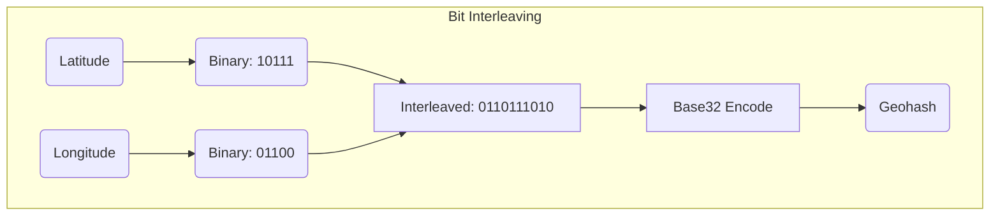
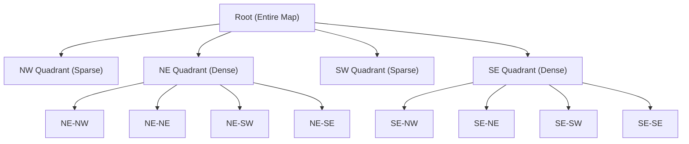
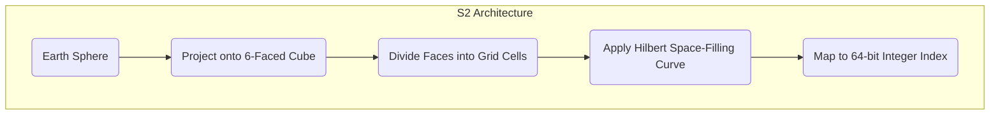

# Spatial and Multidimensional Indexing

Geospatial and multidimensional indexing structures are foundational for location-based services. In system design interviews for companies like Uber, Lyft, DoorDash, Yelp, and Tinder, you must efficiently query geographic data at scale.

Traditional 1D indexes (like B-Trees) are insufficient for 2D or 3D coordinate data. Mapping multi-dimensional coordinates to a 1D space while preserving spatial locality requires specialized data structures.

## Spatial Query Requirements

When designing location-aware systems, you typically need to support several core query patterns.

**Bounding Box Search**

This query finds all points or regions that fall within a specific rectangular area. The bounding box is defined by two coordinates: the bottom-left (min latitude, min longitude) and the top-right (max latitude, max longitude). It is commonly used for map viewport rendering, such as fetching all restaurants visible on the user's current map screen.

**Radius / Proximity Search**

A radius search identifies all entities within a specified distance from a central point. For example, finding all available drivers within a 3-mile radius of a rider's location. This often involves drawing a bounding box that encapsulates the circular area, querying the index for points in the box, and then filtering out points that exceed the actual radius using the Haversine formula.

**k-Nearest Neighbors (k-NN)**

The k-NN query locates the exact *k* closest points to a given origin. Instead of specifying a fixed radius, the search expands outward from the query point until *k* entities are discovered. This is critical for matching algorithms, such as pairing a rider with the three absolute closest drivers.

## Geohash

Geohash is a public domain geocoding system that converts 2D coordinates into a short string of letters and digits.

### Mechanism and Encoding

Geohash works by recursively dividing the Earth into a grid. It uses binary partition, interleaving latitude and longitude bits. First, the longitude is split in half (giving a 0 or 1 bit), then the latitude is split, and this process repeats.

The resulting binary sequence is then converted into a text string using Base32 encoding. Each character in the Geohash string represents 5 bits of precision. The longer the Geohash string, the smaller the geographic bounding box it represents, allowing for highly granular location tracking.

### Hierarchical Prefix Matching

Geohashes are hierarchical. A common prefix implies geographic proximity. If two Geohashes share a long prefix, they are guaranteed to be close to each other. For example, `9q8yy` is completely contained within `9q8y`. 

This property allows databases to use standard prefix-matching queries (like SQL `LIKE '9q8y%'`) or Trie structures to find all entities within a broader region.

### Edge Effect & Boundary Anomalies

A critical limitation of Geohash is the edge effect. Two locations separated by only a few meters might have completely different Geohashes if they lie on opposite sides of a major grid boundary. They share no prefix despite being neighbors.

To solve this boundary anomaly, systems implement an 8-neighbor expansion algorithm. When performing a proximity search, the system computes the Geohash of the target location and also calculates the Geohashes of the 8 surrounding grid cells. Searching across all 9 cells guarantees no nearby entities are missed due to grid boundaries.

### Geohash Diagram

## Quadtrees

A Quadtree is a tree data structure in which each internal node has exactly four children. They are extensively used to partition a two-dimensional space by recursively subdividing it into four quadrants or regions.

### Structure and Variants

The basic structure involves recursive 2D spatial decomposition into 4 quadrants: North-West (NW), North-East (NE), South-West (SW), and South-East (SE). 

There are two main variants. A Region Quadtree divides space into equal-sized quadrants regardless of data density. A Point Quadtree splits space at the specific coordinates of inserted points, adapting its shape directly to the data distribution.

### Dynamic Splitting and Memory

Quadtrees handle high-density areas through dynamic splitting on node capacity overflow. A node is configured with a maximum capacity (e.g., 50 locations). When a node exceeds this limit, it splits into four children, distributing its locations among them. Empty quadrants consume minimal memory.

In distributed memory caches, managing Quadtree memory footprint requires careful tuning of the split threshold and maximum tree depth. Deep trees in dense urban areas can cause memory bloat and increase query latency. To scale, large Quadtrees are often sharded across multiple cache nodes based on high-level regional boundaries.

### Quadtree Diagram

## R-Trees

R-Trees are tree data structures similar to B-Trees but specifically designed for spatial access methods. They are widely used in spatial databases like PostGIS.

### Minimum Bounding Boxes

R-Trees group nearby objects and represent them with their minimum bounding rectangle (MBR) in the next higher level of the tree. The tree maintains a hierarchy of these overlapping Minimum Bounding Boxes. A query traverses down the tree only if the search area intersects with a node's MBR.

### Split Algorithms

When an R-Tree node overflows, it must be split. Linear split algorithms are fast, executing in $O(n)$ time, but may produce highly overlapping MBRs, reducing query efficiency. Quadratic split algorithms take $O(n^2)$ time but group objects more effectively, minimizing MBR overlap and improving long-term query performance.

### Spatial Joins

R-Trees are exceptionally efficient for spatial joins, such as finding all overlapping polygons between two datasets. By synchronously traversing the R-Tree hierarchies of both datasets, the system can quickly eliminate non-intersecting MBRs, heavily optimizing complex geospatial analytics.

## Google S2 Geometry

Google S2 Geometry is a powerful library for manipulating geographic data, offering significant advantages over Geohash and Quadtrees for global scale applications.

### Cube Projection

S2 begins by projecting a sphere (the Earth) onto the 6 faces of a cube. This projection method minimizes the severe distortion that occurs near the poles in standard flat-map projections (like Mercator). Each face of the cube is then represented as a 2D grid.

### Hilbert Space-Filling Curve

To map the 2D grid onto a 1D index, S2 uses a Hilbert Space-Filling Curve. Unlike Geohash's Z-order curve, the Hilbert curve strictly preserves 2D locality in a 1D space without large jumps. 

This transformation maps any spatial region to a continuous sequence on the curve, which is then represented as a 1D 64-bit integer space. This allows spatial proximity to be efficiently queried using rapid 1D range scans on integers.

### Hierarchical Cell Levels

S2 defines hierarchical cell levels from Level 0 through 30. Level 0 represents an entire face of the cube (1/6th of the Earth), while Level 30 represents a cell size of about a square centimeter. This immense granularity allows precise modeling of any location on the planet.

### Cell Unions

For complex spatial queries, S2 represents arbitrary polygon search regions as Cell unions. An irregular polygon (like a neighborhood boundary) is approximated using a combination of large and small S2 cells. This discrete mathematical representation enables lightning-fast intersection tests and region-in-region queries.

### S2 and Hilbert Curve Diagram

## System Design Tradeoff Matrix

Choosing the right indexing strategy depends heavily on the read/write patterns and query requirements of the specific application.

| Feature / Requirement | Geohash | Quadtree | Google S2 |
| :--- | :--- | :--- | :--- |
| **Best Use Case** | Places Search (static read-heavy), Simple proximity | Custom map partitions, Game servers | Ride-Sharing (high update velocity), Global scale |
| **Implementation** | Very Simple (Strings) | Medium (Tree structure) | Complex (Library dependency) |
| **Data Format** | Base32 Strings | In-memory Object Nodes | 64-bit Integers |
| **Update Velocity** | Medium (String rewriting) | Slow (Tree rebalancing/locks) | Very High (Fast integer updates) |
| **Edge Cases** | Severe boundary anomalies | Imbalanced trees if unoptimized | Minimal distortion, robust |
| **Range Queries** | String prefix / Trie search | Tree traversal | 1D Integer range scans |

For a read-heavy system like a restaurant discovery app, **Geohash** is often sufficient and integrates easily with standard databases via prefix indexing. 

For high-velocity systems like ride-sharing, where driver locations update every few seconds, **Google S2** excels. Its representation of areas as 64-bit integers allows rapid updates in fast, in-memory datastores without the locking overhead inherent in tree structures like **Quadtrees**.
