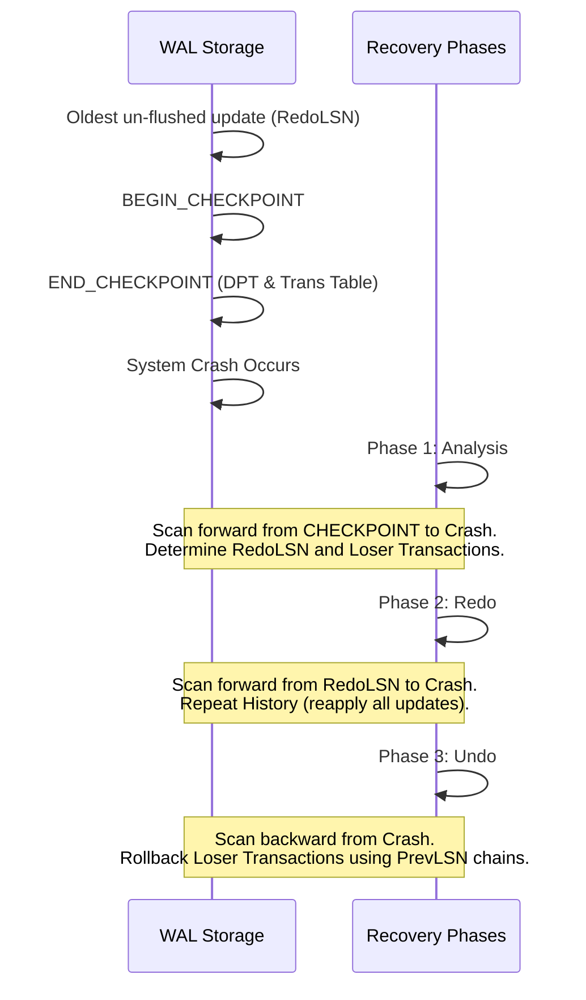
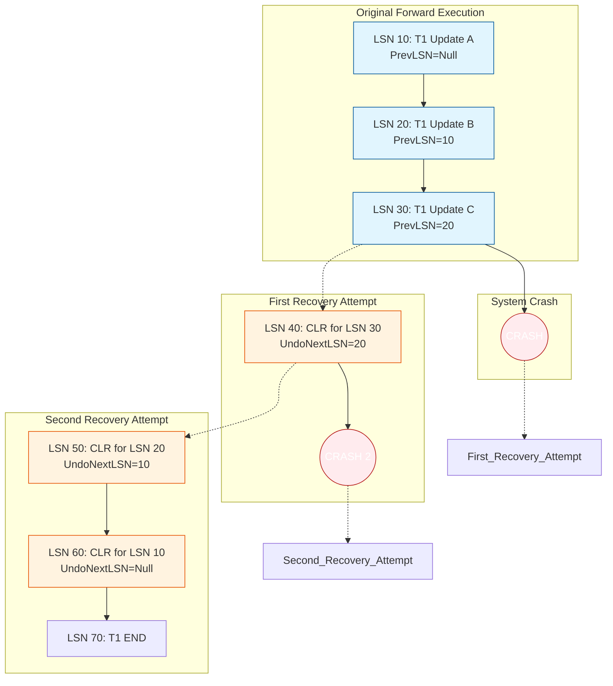

# ARIES Recovery Algorithm

The Algorithms for Recovery and Isolation Exploiting Semantics (ARIES) is a robust crash-recovery protocol developed by C. Mohan et al. at IBM Research. It provides a formal, generalized framework to ensure database consistency in the presence of failures.

ARIES is designed around three fundamental recovery phases: Analysis, Redo, and Undo. By leveraging Write-Ahead Logging (WAL) and exploiting application semantics, ARIES enables high concurrency and guarantees idempotency during recovery.

## Core Principles

ARIES fundamentally relies on Write-Ahead Logging (WAL) to guarantee atomicity and durability. Before a database modification is committed, a log record describing the change must be safely flushed to stable storage.

The WAL protocol enforces a strict invariant: `PageLSN <= FlushedLSN`. A dirty page in memory cannot be flushed to disk until all log records associated with its modifications have been successfully persisted. The `PageLSN` (Log Sequence Number) stored on the page dictates the most recent update applied to it.

ARIES employs physiological logging, which combines the benefits of both physical and logical logging. The log record identifies a specific physical page (physical aspect) but records the logical operation performed within that page (logical aspect). This prevents issues arising from page reorganizations.

ARIES assumes a "Steal/No-Force" buffer management policy. A "Steal" policy allows uncommitted transaction modifications to overwrite existing database pages on disk. This significantly reduces memory pressure but necessitates an "Undo" phase to rollback uncommitted changes if a crash occurs.

Conversely, a "No-Force" policy avoids forcing modified pages to disk immediately upon transaction commit. This drastically improves write performance but requires a "Redo" phase to replay committed changes that were lost from the volatile buffer pool during a crash.

## Data Structures & Log Records

ARIES maintains several in-memory data structures and log record fields to manage transaction state and track dirty pages. These structures are periodically checkpointed and reconstructed during the recovery process.

A typical ARIES Log Record contains several critical fields:
- `LSN`: A monotonically increasing Log Sequence Number.
- `PrevLSN`: The LSN of the previous log record for the same transaction, establishing a backward chain.
- `TransID`: The ID of the transaction performing the operation.
- `Type`: The operation type (UPDATE, COMMIT, ABORT, CLR, END).
- `PageID`: The identifier of the modified database page.
- `UndoNextLSN`: Present only in Compensation Log Records (CLRs), pointing to the next log record that needs to be undone.

The Transaction Table tracks all currently active transactions. It stores the `TransID`, the current `Status` (Running, Committed, Aborting), and the `LastLSN` (the most recent log record written by the transaction).

The Dirty Page Table (DPT) tracks pages in the buffer pool that have been modified but not yet flushed to disk. It contains the `PageID` and the `RecLSN` (Recovery LSN). The `RecLSN` represents the lowest LSN that dirtied the page since it was last flushed, dictating the starting point for redos.

## The Three Recovery Phases

When a database restarts after a crash, ARIES executes a strictly ordered three-phase recovery process. This ensures that the system is restored to a consistent state, rolling back incomplete transactions and persisting committed ones.

### Phase 1: Analysis Pass

The Analysis Pass scans the log forward, starting from the most recent checkpoint. Its primary goal is to reconstruct the Transaction Table and the Dirty Page Table (DPT) to match their state at the exact moment of the crash.

During this forward scan, the protocol updates the Transaction Table by adding new transactions or modifying their status based on COMMIT, ABORT, or END log records. It also updates the DPT whenever an UPDATE log record is encountered for a page not currently in the table.

By the end of the Analysis Pass, ARIES identifies all active "loser" transactions that must be rolled back. Furthermore, it determines the `RedoLSN`, which is the minimum `RecLSN` across all pages in the reconstructed DPT. The `RedoLSN` indicates the oldest un-flushed update, serving as the starting point for the Redo Pass.

### Phase 2: Redo Pass ("Repeating History")

The Redo Pass implements the "repeating history" paradigm. It scans the log forward starting from the `RedoLSN` determined in the Analysis phase up to the end of the log. It unconditionally reapplies all updates, regardless of whether the transaction ultimately committed or aborted.

For every UPDATE log record, the protocol checks if the operation is actually necessary. A redo is skipped if the modified page is not present in the DPT, or if its `RecLSN` in the DPT is greater than the log record's LSN.

Most crucially, ARIES performs a `PageLSN` check to eliminate redundant I/O operations. It fetches the page from disk and compares its `PageLSN` with the log record's LSN. If the on-disk `PageLSN >= Log Record LSN`, the update is already present, and the redo is safely skipped.

### Phase 3: Undo Pass

The Undo Pass scans backward through the log to rollback the active loser transactions identified during the Analysis Phase. ARIES processes the highest `LastLSN` among all active loser transactions, working backward through the `PrevLSN` chain.

When rolling back an update, ARIES writes a Compensation Log Record (CLR). The CLR describes the logical undo operation and contains a critical `UndoNextLSN` pointer, which points to the `PrevLSN` of the original update record being undone.

The use of CLRs with `UndoNextLSN` pointers provides a crucial guarantee: CLRs themselves are never undone. This ensures that the recovery process is strictly idempotent. If the system crashes repeatedly during the Undo phase, ARIES effortlessly bypasses already-undone records, bounding the recovery time and preventing infinite rollback loops.

## Checkpointing

To bound the time required for crash recovery, ARIES periodically writes checkpoints to the WAL. A Sharp Checkpointing strategy forces all dirty pages to disk and momentarily halts transaction processing. This ensures a clean state but introduces severe latency spikes.

Instead, ARIES employs Non-blocking Fuzzy Checkpointing. A fuzzy checkpoint records the current state of the Transaction Table and Dirty Page Table without forcing dirty pages to disk. This allows continuous transaction processing, improving overall throughput.

The fuzzy checkpoint process writes a `BEGIN_CHECKPOINT` record, gathers the necessary table snapshots, and subsequently writes an `END_CHECKPOINT` record containing the serialized tables. The LSN of the `BEGIN_CHECKPOINT` is recorded in a fixed location (the Master Record) to serve as the starting point for the subsequent Analysis phase.

## Recovery Phase Timeline

The following Mermaid diagram illustrates the timeline of Write-Ahead Logging and the boundaries of the Checkpoint, Analysis, Redo, and Undo phases during an ARIES recovery.

## Undo Phase Trace

This step-by-step trace demonstrates the Undo phase generating Compensation Log Records (CLRs) and bypassing already undone operations using `UndoNextLSN` pointers.

