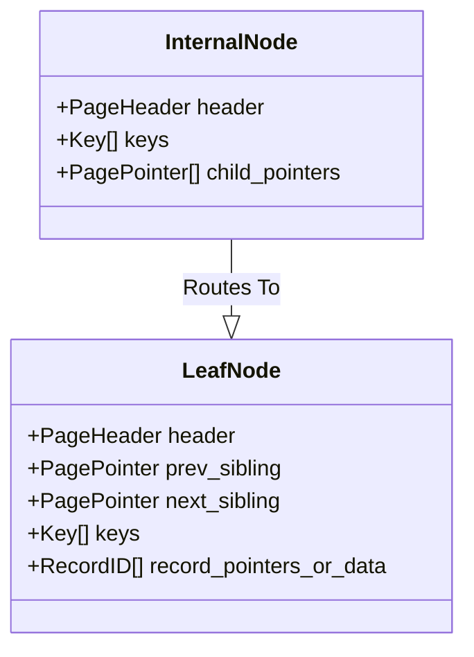
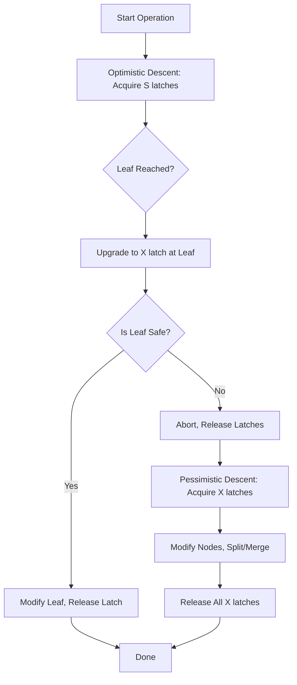

# B+ Tree Indexing and Latch Crabbing

B+ Trees are the backbone of modern database management systems (DBMS), providing efficient, balanced tree structures for disk-oriented storage. This document explores the physical architecture, fanout mathematics, and concurrency control mechanisms, specifically focusing on the latch crabbing protocol.

## Physical Page Architecture

In disk-oriented database systems, data is organized into fixed-size pages. A B+ Tree maps perfectly to this page-based storage, where each node in the tree typically corresponds exactly to one physical database page (e.g., 4KB, 8KB, or 16KB).

### Slotted Page Layout

B+ Trees utilize a slotted page layout within their nodes to store data efficiently and allow dynamic resizing. A slotted page consists of a header at the beginning of the page and slots growing from the front, while actual tuple payloads or pointers grow backward from the end of the page. This prevents fragmentation and allows binary search within the page.

Internal nodes store only search keys and child page pointers. They act solely as routing tables to guide searches down to the leaf level. The keys are kept sorted to enable fast binary searching inside the node.

Leaf nodes, conversely, store the actual data. They contain search keys alongside either record pointers (Record IDs pointing to heap pages) or the full tuple payloads (in a clustered index). Crucially, leaf nodes also contain bidirectional sibling pointers, forming a doubly linked list across the entire leaf level.

### B+ Trees vs B-Trees

B+ Trees dominate database storage over standard B-Trees for two primary reasons. First, the linked leaf nodes enable extremely efficient sequential scans. To scan a range of values, the DBMS only needs to traverse down to the starting leaf node and then follow the sibling pointers, avoiding the need to repeatedly traverse up and down the parent nodes as required in a B-Tree.

Second, because internal nodes in a B+ Tree do not store tuple payloads or record pointers, they can fit significantly more keys and child page pointers per page. This higher fanout results in a much shallower tree depth. A shallower tree means fewer disk I/O operations are required to reach the leaf nodes, drastically improving search performance.

## Fanout and Depth Calculations

The branching factor, or fanout, of a B+ Tree node determines how many child pointers an internal node can hold. Higher fanout leads to a shallower tree, minimizing disk reads.

### Fanout Formula

The theoretical maximum fanout ($F$) can be calculated based on the Page Size ($P$), Key Size ($K$), and Pointer Size ($V$). Ignoring page header overhead for simplicity, the equation is:

$$ F = \lfloor P / (K + V) \rfloor $$

For example, given an 8KB page (8192 bytes), a 64-bit integer key (8 bytes), and a 64-bit page pointer (8 bytes):

$$ F = 8192 / (8 + 8) = 512 $$

This means each internal node can have up to 512 child pointers.

### Concrete Sizing Example

Let's examine how many rows can fit in trees of different depths using a fanout of 512.

In a 3-level B+ Tree (Root $\rightarrow$ Internal $\rightarrow$ Leaf):
The root node has 512 children.
Each of those 512 internal nodes has 512 children.
Total leaf pages = $512 \times 512 = 262,144$ leaf pages.
If each leaf page holds 100 records, the tree can index approximately $26.2$ million rows.

In a 4-level B+ Tree:
Total leaf pages = $512 \times 512 \times 512 = 134,217,728$ leaf pages.
At 100 records per leaf, this 4-level tree can index over $13.4$ billion rows.
Thus, traversing a table with 13 billion rows requires only 4 disk I/O operations, demonstrating the extreme efficiency of high-fanout B+ Trees.

## Concurrency Control: Latch Crabbing Protocol

In a multi-threaded DBMS, multiple transactions may attempt to read and modify the B+ Tree simultaneously. Concurrency control mechanisms are required to prevent physical corruption of the tree structure (e.g., during node splits or merges).

### Latches vs Locks

It is critical to distinguish between latches and locks. Latches are low-level synchronization primitives (like mutexes) used to protect the physical integrity of in-memory data structures (like B+ Tree nodes) for very short durations. Locks are higher-level, logical primitives used by transactions to protect database contents (like tuples) for the duration of a transaction, ensuring ACID isolation. Latch crabbing deals exclusively with latches.

### Search Protocol

The search protocol involves acquiring and releasing Read (Shared or S) latches as the thread traverses down the tree. The thread acquires an S latch on the child node. Once the child latch is successfully acquired, it immediately releases the S latch on the parent node. This hand-over-hand locking is known as "crabbing" or "lock coupling." It allows maximum concurrency for read operations.

### Insert Protocol

The insert protocol requires Write (Exclusive or X) latches. The thread acquires an X latch on the child node. Before releasing the parent's latch, the thread checks if the child node is "safe." A node is considered safe for insertion if it has enough free space to accommodate the new key without triggering a node split.

If the child is safe, all ancestor X latches held by the thread are immediately released, because any modifications will be localized to the child node. If the child is unsafe, the thread must hold onto the ancestor latches, anticipating that a node split might propagate upwards and require modifying the parent nodes.

### Delete Protocol

The delete protocol is similar to insertion but checks for a different safety condition. The thread acquires an X latch on the child. A node is safe for deletion if its current size is strictly greater than the minimum required keys (usually half capacity). This ensures the deletion will not trigger a node merge or borrowing from a sibling. If safe, ancestor latches are released. If unsafe, ancestor latches are held until the merge/borrow propagates.

### Optimistic Latch Crabbing

Holding X latches from the root down creates a massive concurrency bottleneck, especially near the root. Modern systems use Optimistic Latch Crabbing. The thread performs the initial descent using S latches, optimistically assuming the target leaf node will be safe. 

Upon reaching the leaf, it upgrades to an X latch for the modification. Only if the leaf node turns out to be unsafe (e.g., full during an insert) does the thread abort, release its latches, and restart the traversal from the root using the pessimistic X latch crabbing protocol. Since most operations do not trigger structural changes, this significantly improves throughput.

## Leaf Node Sibling Deadlock Risk

The bidirectional sibling pointers in leaf nodes introduce a specific risk of deadlocks, particularly when range scans interact with structural modifications.

A range scan typically traverses the leaf level left-to-right, acquiring S latches on sibling nodes in a forward direction. However, node splits or merges might need to update sibling pointers, which can involve acquiring X latches on adjacent nodes, sometimes in a right-to-left order (e.g., a new node linking back to its previous sibling).

If a range scan holding a latch on node A tries to crab rightward to node B, while a concurrent split holding a latch on node B tries to acquire a latch on node A to update the `prev_sibling` pointer, an AB-BA deadlock occurs. To mitigate this, database systems often implement deadlock detection for latches, or enforce strict directional latching rules, aborting operations that violate the ordering and restarting them.

