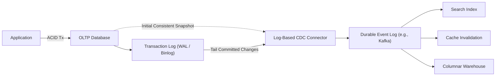

# Change Data Capture (CDC)

Change Data Capture (CDC) tracks row-level inserts, updates, and deletes in an operational database and streams them as ordered events to downstream systems such as search indexes, caches, data warehouses, and microservices.

---

## 📚 Theory

### Capture Mechanisms: Log-Based vs. Trigger-Based vs. Query-Based

Systems generally capture database mutations through one of three mechanisms:

- **Query-Based (Polling)**: A background job periodically runs `SELECT ... WHERE updated_at > last_checkpoint`. It is easy to set up without special database permissions, but it adds read load to the primary, misses hard `DELETE` operations (unless soft deletes are enforced), skips intermediate updates between polls, and breaks if clocks skew or timestamps are not updated atomically.
- **Trigger-Based**: Database triggers fire synchronously on every `INSERT`, `UPDATE`, and `DELETE`, writing change records into an audit or shadow table. It captures deletes and intermediate states, but it runs inside the OLTP write transaction, increasing write latency, lock duration, and operational coupling whenever schemas change.
- **Log-Based**: A dedicated connector (such as Debezium) tails the database's existing transaction log (PostgreSQL logical decoding over WAL, MySQL row-based binlog). Because the database already writes this log for crash recovery and replication, log-based CDC adds minimal overhead to OLTP transactions, captures every committed mutation including hard deletes, and preserves commit order.

### Snapshot + Stream Bootstrap

When attaching a CDC connector to an existing database with years of historical data, the transaction log only retains recent changes. Bootstrapping requires combining a historical **snapshot** with the live **change stream** without losing or corrupting rows:

1. **Consistent Snapshot**: Open a transaction with `REPEATABLE READ` (MVCC snapshot) and record the exact log position (LSN or GTID). Avoid long-held global table locks; modern incremental snapshotting chunks large tables by primary key and interleaves chunks with live log events using low/high watermark signals.
2. **Stream Catch-Up**: Once the snapshot completes, resume tailing the transaction log from the recorded position.
3. **Deduplication Window**: Any row mutated during an incremental snapshot may appear in both a snapshot chunk and the live stream. The connector resolves overlap using watermark boundaries so the newer log event wins, and downstream consumers apply writes idempotently.

### Ordering and Exactly-Once Pitfalls

Log-based CDC reads a linear commit log, but preserving order end-to-end across a distributed pipeline is subtle:

- **Per-Key vs. Global Ordering**: Publishing all tables to one partition preserves global order but bottlenecks throughput. Partitioning the event log by primary key preserves strict per-entity order while scaling horizontally, at the cost of losing cross-table ordering guarantees.
- **At-Least-Once Delivery**: If a connector crashes after publishing an event to the broker but before committing its log offset, restarting replays that event. True end-to-end "exactly-once" across heterogeneous sinks (databases, search indexes, caches) is rarely practical without distributed two-phase commit; instead, pair **at-least-once delivery** with **idempotent consumers** (upserts keyed by primary key plus monotonic LSN/version checks so stale replays are ignored).
- **Transaction Interleaving**: Concurrent transactions write interleaved entries into the physical WAL. Logical decoders buffer changes until a `COMMIT` record arrives and discard rolled-back transactions, preventing uncommitted dirty reads from leaking downstream.

### Schema Evolution

Relational schemas evolve continuously through DDL (`ADD COLUMN`, type widening, column renames). A CDC pipeline must track the exact schema version active at each log offset:
- Maintain a **schema history log** (or schema registry) that records DDL statements alongside the LSN where they took effect.
- Enforce **backward or full compatibility** rules (for example, adding nullable columns with defaults is safe; renaming or dropping a column requires a dual-column expand-and-contract migration).
- Handle before-images explicitly: updating a row's partition key or deleting a row requires the previous key value in the log (such as PostgreSQL `REPLICA IDENTITY FULL` or MySQL `binlog_row_image=FULL`) so downstream sinks know which key to delete.

### CDC vs. Transactional Outbox Pattern

Tailing domain tables directly couples downstream consumers to internal database schemas. In the **Transactional Outbox** pattern, the application writes both its domain state change and an explicit domain event into an `outbox` table inside the same local ACID transaction. A CDC connector then tails *only* the `outbox` table. This decouples public event contracts from private table refactors, eliminates dual-write inconsistency (writing to DB and message broker separately), and lets a single domain event summarize multi-table mutations—at the cost of extra application logic and an additional write per transaction.

### Backfill

When a new downstream service launches or a bug requires rebuilding a derived view, you need a **backfill** without blocking live CDC consumers. Preferred patterns include **incremental snapshotting** triggered via a signaling table (streaming chunked historical rows interleaved with live changes), reading from a separate read replica, or replaying from a compacted/long-retention event log into an isolated consumer group.

---

## 🎯 When to Use

**Strong Fit:**
- Synchronizing OLTP databases with derived stores (search indexes, caches, analytical warehouses) without error-prone dual writes in application code.
- Feeding event-driven microservices via the Transactional Outbox pattern with guaranteed atomicity between state change and event publication.
- Zero-downtime database migrations and cross-engine upgrades.

**When NOT to Use CDC:**
- When synchronous, strongly consistent read-after-write guarantees across two systems are required (CDC is inherently asynchronous).
- When downstream consumers need rich business-intent events that cannot be reconstructed from raw table diffs and the team cannot adopt an outbox table.

---

## ⚖️ Trade-offs

| Approach | Source DB Load | Captures Hard Deletes | Latency | Schema Coupling | Operational Complexity |
| :--- | :--- | :--- | :--- | :--- | :--- |
| **Query Polling** | High (repeated scans) | No (needs soft deletes) | Seconds–minutes | Medium | Low |
| **DB Triggers** | High (in-tx overhead) | Yes | Low (sync write) | High | Medium |
| **Log-Based CDC (Tables)** | Low (async log tail) | Yes | Milliseconds–seconds | High (exposes internal schema) | High (slots, offsets, DDL) |
| **Log-Based CDC + Outbox** | Low–medium (+1 insert) | Explicit domain events | Milliseconds–seconds | Low (versioned contract) | Medium–high |

---

## ⚠️ Failure Modes & Pitfalls

- **Replication Slot / WAL Bloat**: If a log-based CDC connector stalls or is abandoned, the database retains unconsumed WAL segments indefinitely until the primary disk fills up and crashes the database. Always monitor slot lag, configure max slot retention limits, and emit periodic heartbeat writes on low-traffic tables so idle slots advance.
- **Unplanned DDL Breakage**: A destructive `ALTER TABLE` or column type change can halt the connector or corrupt downstream deserializers if schema-compatibility checks are not enforced in CI/CD.
- **Large Transaction Memory Spikes**: A bulk `UPDATE` touching millions of rows in one transaction causes the logical decoder to buffer gigabytes of uncommitted changes before `COMMIT`, causing OOM crashes or severe lag spikes.
- **Missing Delete Tombstones**: Downstream log-compacted topics or search indexes silently retain deleted records if the CDC pipeline drops delete events or omits primary keys in delete payloads.

---

## ❓ Interview Follow-ups

**Q: Why is dual-writing from application code to both a database and Kafka considered an anti-pattern?**  
A: Without a distributed transaction, the app can commit to the database and crash before publishing to Kafka (or publish to Kafka and roll back the DB transaction), leaving systems permanently out of sync. Log-based CDC or the Transactional Outbox eliminates this split.

**Q: How do you prevent a stalled CDC connector from filling up the primary database's disk?**  
A: Set hard WAL retention caps (such as `max_slot_wal_keep_size` in PostgreSQL), alert aggressively on replication lag, run heartbeat updates so slots advance during quiet periods, and have a runbook to drop the slot and re-snapshot if lag exceeds safe bounds.

**Q: What happens if a consumer receives the same CDC event twice during a restart?**  
A: Make consumers idempotent by using deterministic upserts keyed by primary key and storing the source event's LSN/timestamp. If an incoming event has an LSN less than or equal to the stored LSN, safely discard it.

**Q: When would you choose direct table CDC over the Transactional Outbox pattern?**  
A: Choose direct table CDC for data-warehouse ingestion, legacy databases you cannot modify, or 1:1 search/cache mirroring. Choose the Transactional Outbox when publishing domain events across microservice boundaries where internal table schemas must stay private.

**Q: How do you bootstrap a multi-terabyte table into CDC without locking production writes?**  
A: Use incremental chunked snapshotting from a read replica (or MVCC snapshot queries in small primary-key ranges) coordinated with watermark signals in the WAL, buffering overlapping live changes per chunk so production traffic is never blocked.

**Q: How do you handle `UPDATE` operations that change a table's primary key or Kafka partition key?**  
A: Emit a delete (tombstone) for the old key followed by an insert for the new key, and ensure the database logs full before-images so the connector knows the old key value.

---

## 🔗 Cross-References

- **[Database Replication](./replication.md)**: Physical vs. logical replication, row-based logging, and replication lag anomalies.
- **[WAL & LSM-Trees](../distributed-systems/wal-and-lsm-trees.md)**: How write-ahead logs guarantee durability and commit ordering.
- **[Columnar Storage](./columnar-storage.md)**: Common analytical destination for CDC pipelines.
- **[Kafka Storage Internals](../distributed-systems/kafka-storage-internals.md)** and **[Kafka Theory](../../03-hld-concepts/kafka/THEORY.md)**: Durable partitioned logs, offsets, and log compaction for CDC streams.
- **[Stream Processing Theory](../../03-hld-concepts/stream-processing/THEORY.md)**: Transforming and joining CDC streams in real time.
- **[Distributed Transactions, Saga & Outbox](../../03-hld-concepts/distributed-transactions-saga-outbox/THEORY.md)**: Detailed outbox and saga coordination patterns.
- **[Cache Invalidation Patterns](../../03-hld-concepts/cache-invalidation-patterns/THEORY.md)**: Using CDC to evict or refresh cache entries reliably.
