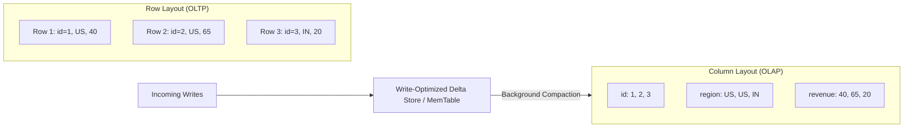

# Columnar Storage

Columnar storage organizes table data by column rather than by row, dramatically reducing disk I/O and improving CPU cache efficiency for analytical (OLAP) queries that scan millions of rows across a handful of columns.

---

## 📚 Theory

### Row-Oriented vs. Column-Oriented Layout

In a **row-oriented** engine (such as PostgreSQL or MySQL InnoDB), all fields of a single record sit contiguously on a disk page. Fetching one user profile by primary key requires a single page read, making transactional (OLTP) point lookups and single-row updates fast.

In a **column-oriented** engine (such as ClickHouse, Apache Parquet, or Amazon Redshift), values for each column are stored contiguously in separate segments or column chunks. For rough illustration, if an events table has 50 columns and an analytical query aggregates only `region` and `revenue`, a columnar engine reads roughly 4% of the table's columns instead of pulling all 50 columns off disk and discarding 48 of them in memory.

### Compression and Encodings

Because adjacent values in a column share the same data type and often exhibit strong locality or repetition, columnar engines achieve far higher compression ratios than row stores before general-purpose codecs (like LZ4 or Zstd) even run:

- **Dictionary Encoding**: Replaces repeated strings or low-cardinality values (such as `country_code` or `status`) with compact integer IDs backed by a per-segment dictionary. Equality filters can compare integer IDs directly without decoding strings.
- **Run-Length Encoding (RLE)**: Collapses consecutive identical values into `(value, run_length)` pairs. Sorting a table by a low-cardinality leading key (such as `event_date` or `tenant_id`) creates long runs that compress dramatically and allow aggregations to multiply by `run_length` directly.
- **Delta Encoding**: Stores the difference between consecutive values instead of full values. Monotonic or slowly varying columns (timestamps, auto-increment IDs, sensor readings) shrink to small integers that pack into just a few bits via bit-packing or frame-of-reference encoding.

### Vectorized Scans

Traditional row engines often use a volcano (tuple-at-a-time) iterator model, invoking a virtual `next()` call for every single row. Branch mispredictions and function-call overhead dominate CPU cycles when scanning millions of records.

Columnar engines use **vectorized execution**: operators process tight, contiguous arrays (vectors) of a few thousand column values at a time (sized to fit inside CPU L1/L2 cache). Tight loops over homogeneous primitive arrays allow modern compilers and CPUs to apply **SIMD** (Single Instruction, Multiple Data) instructions, evaluating predicates or sums across multiple values in a single clock cycle.

### Late Materialization

When a query filters on one column and projects others (for example, `SELECT user_id, amount FROM orders WHERE status = 'REFUNDED' AND region = 'EU'`), **early materialization** reconstructs full rows before applying all filters, wasting memory bandwidth on rows that will be discarded.

**Late materialization** keeps data in columnar form as long as possible:
1. Scan the `status` column (often directly on dictionary-encoded or RLE data) to produce a position bitmap or list of matching row IDs.
2. Intersect that bitmap with the predicate result on `region`.
3. Only for the surviving row positions, seek into the `user_id` and `amount` column chunks to stitch together final output tuples.

### Write Path: Delta Store and LSM-Style Compaction

Updating or inserting a single row inside compressed, immutable column files would require rewriting entire blocks across every column. To avoid crippling random-write amplification, columnar databases decouple writes from read-optimized storage:

- **Write-Optimized Delta Store / LSM MemTable**: Incoming inserts, updates, and deletes land sequentially in a write-ahead log (WAL) and an in-memory buffer or small row-oriented delta store. Deletes are recorded as delete bitmaps or tombstones rather than mutating existing column files in place.
- **Background Merge & Compaction**: Periodically, the engine sorts buffered batches by the table's sort key, encodes and compresses each column into immutable column segments (or row groups), and merges overlapping segments while applying tombstones. Reads reconcile immutable column segments with the active delta store.

---

## 🎯 When to Use

**Strong Fit:**
- Analytical aggregations (`SUM`, `COUNT`, `AVG`, percentiles) over wide tables scanning millions or billions of rows.
- Append-heavy workloads such as clickstreams, telemetry, financial tick history, and data warehouses or lakehouses.
- Workloads where queries read a small subset of columns and benefit from zone maps (min/max metadata per block) and sort-key pruning.

**When NOT to Use Columnar Storage:**
- **OLTP point lookups**: Fetching a wide multi-column record by primary key requires seeking across dozens of separate column files or segments.
- **High-frequency single-row updates and deletes**: Small random mutations force heavy tombstone tracking, delta-store bloat, and expensive background compactions.
- **Wide `SELECT *` queries**: Pulling every column removes the projection advantage and adds tuple-reconstruction overhead.

---

## ⚖️ Trade-offs

| Dimension | Row-Oriented Storage | Column-Oriented Storage |
| :--- | :--- | :--- |
| **Primary Workload** | OLTP (point lookups, short transactions) | OLAP (scans, aggregations, reporting) |
| **Projection I/O** | Reads all columns on the page | Reads only referenced columns |
| **Compression Ratio** | Modest (heterogeneous types per page) | High (homogeneous types, RLE, dictionary, delta) |
| **Single-Row Updates** | Fast in-place page update (B+ Tree) | Expensive; requires delta store + compaction |
| **Point Lookup (`SELECT *`)** | Fast (1 page fetch via index) | Slower (must assemble fields across column chunks) |
| **CPU Efficiency on Scans** | Row-at-a-time overhead, lower cache density | Vectorized batches, SIMD-friendly, high cache density |

---

## ⚠️ Failure Modes & Pitfalls

- **Uncompacted Delta-Store / Too-Many-Parts Explosion**: Trickle-inserting one row per request creates thousands of tiny immutable segments. Compaction falls behind, read latency spikes as queries merge too many parts, and engines may reject new writes to protect stability. Always batch writes.
- **Poor Sort Key Selection**: If the table's physical sort key does not align with common filter predicates (like `tenant_id` or `event_time`), min/max zone maps cannot skip blocks and RLE runs stay short, degrading queries into full scans.
- **High-Cardinality Dictionary Blowup**: Applying dictionary encoding to unique columns (such as UUIDs or free-form URLs) bloats the dictionary without reducing size; engines must detect high cardinality and fall back to plain or general-purpose compression.
- **Delete Tombstone Accumulation**: Frequent `UPDATE` or `DELETE` statements accumulate delete masks that must be checked on every scan until compaction rewrites affected segments.

---

## ❓ Interview Follow-ups

**Q: Why do columnar formats like Parquet organize data into "row groups" instead of storing each column as one giant file?**  
A: Splitting a table into horizontal row groups (for rough illustration, 64 MB to 256 MB chunks) bounds memory during writes, enables parallel reading across worker nodes, and attaches per-group min/max statistics so engines can skip entire groups that cannot match a filter.

**Q: How does sorting a columnar table improve both storage size and query speed?**  
A: Sorting groups identical or close values together, making RLE and delta encoding far more effective. It also narrows the min/max range stored in each block's zone map, allowing the query planner to prune blocks without reading them from disk.

**Q: Why is late materialization not always faster than early materialization?**  
A: When a filter has very low selectivity (almost all rows pass) or the query projects nearly every column, tracking position lists and performing random seeks into remaining columns can cost more than scanning and assembling rows upfront.

**Q: How can a system serve both low-latency OLTP writes and fast OLAP analytics without hurting either?**  
A: Either replicate changes asynchronously from a row-oriented OLTP database into a columnar warehouse via Change Data Capture (CDC), or use an HTAP engine that maintains a transactional row store alongside an asynchronously synchronized columnar replica.

**Q: What happens to compression if you update a single value inside a run-length encoded column?**  
A: Modifying one value in place could split a run and shift every subsequent byte offset in the compressed block. That is why columnar engines treat compressed segments as immutable and stage mutations in a delta store until background compaction rebuilds the segment.

**Q: How do you handle `SELECT *` or point lookups if they are occasionally needed on a columnar store?**  
A: Add a secondary skip index or bloom filter on the lookup key to prune down to a single block, limit projections strictly to needed columns, or offload frequent point lookups to a companion key-value or row-oriented serving store.

---

## 🔗 Cross-References

- **[WAL & LSM-Trees](../distributed-systems/wal-and-lsm-trees.md)**: Append-only write paths, immutable segments, and compaction mechanics shared by many columnar engines.
- **[The RUM Conjecture](./rum-conjecture.md)**: Read, Update, and Memory trade-offs that explain why columnar stores trade update cost for read and space efficiency.
- **[Change Data Capture (CDC)](./change-data-capture.md)**: Streaming mutations from row-oriented OLTP databases into columnar analytical stores.
- **[Inverted Indexes & Roaring Bitmaps](../data-structures/inverted-indexes-and-roaring-bitmaps.md)**: Compressed bitmap structures commonly used for late materialization and predicate intersection.
- **[Ring Buffers & Gorilla Compression](../data-structures/ring-buffers-and-gorilla-compression.md)**: Specialized delta-of-delta and XOR encodings for time-series columns.
- **[Data Partitioning](../../03-hld-concepts/data-partitioning/THEORY.md)**: Horizontal partitioning strategies that pair with columnar storage in distributed warehouses.
