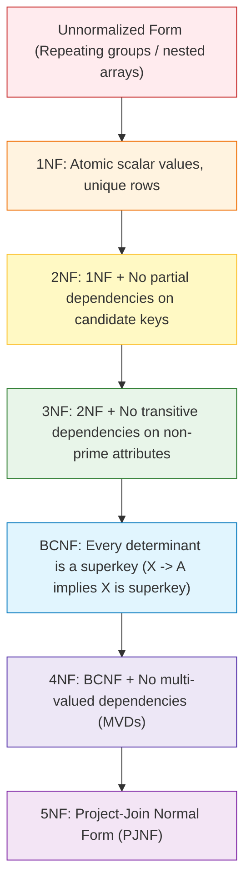
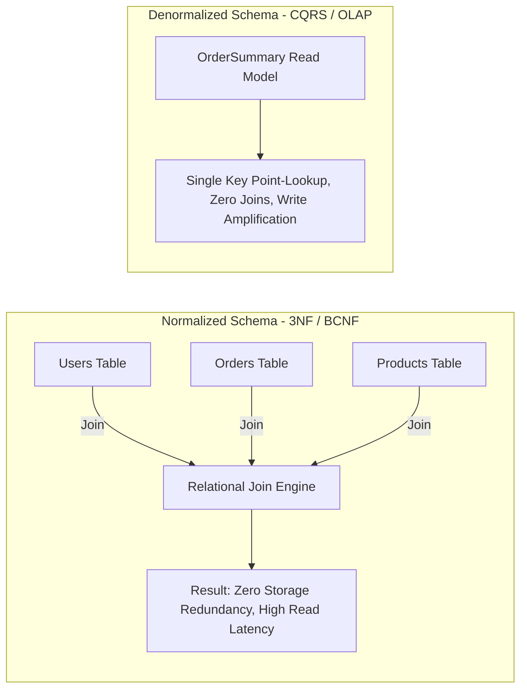

# Relational Database Normalization Theory & Decomposition

Database normalization is the formal mathematical technique used in relational schema design to minimize data redundancy, eliminate update, insertion, and deletion anomalies, and ensure data integrity through functional dependency analysis.

---

## 1. Mathematical Foundations

### Functional Dependencies
Let $R(A_1, A_2, \dots, A_n)$ be a relational schema, and let $X, Y \subseteq R$ be sets of attributes. A **functional dependency** (denoted $X \to Y$) states that whenever two tuples $t_1, t_2 \in r(R)$ agree on their values for attributes in $X$, they must also agree on their values for attributes in $Y$:

$$\forall t_1, t_2 \in r(R), \quad t_1[X] = t_2[X] \implies t_1[Y] = t_2[Y]$$

- $X$ is termed the **determinant**.
- $Y$ is termed the **dependent**.
- A dependency is **trivial** if $Y \subseteq X$ (e.g., $\{A, B\} \to A$).
- A dependency is **non-trivial** if $Y \not\subseteq X$, and **completely non-trivial** if $X \cap Y = \emptyset$.

### Armstrong's Axioms
Armstrong's Axioms form a sound and complete set of inference rules to deduce all valid functional dependencies implied by a given set of dependencies $F$:

1. **Reflexivity Rule**: If $Y \subseteq X$, then $X \to Y$.
2. **Augmentation Rule**: If $X \to Y$, then $XZ \to YZ$ for any attribute set $Z$.
3. **Transitivity Rule**: If $X \to Y$ and $Y \to Z$, then $X \to Z$.

Secondary derived inference rules:
- **Union Rule**: If $X \to Y$ and $X \to Z$, then $X \to YZ$.
- **Decomposition Rule**: If $X \to YZ$, then $X \to Y$ and $X \to Z$.
- **Pseudotransitivity Rule**: If $X \to Y$ and $WY \to Z$, then $WX \to Z$.

### Superkeys, Candidate Keys, and Prime Attributes
- **Superkey**: A subset of attributes $K \subseteq R$ such that $K \to R$ (i.e., values of $K$ uniquely identify every tuple in $r(R)$).
- **Candidate Key**: A minimal superkey. That is, $K \to R$, and for any proper subset $K' \subset K$, $K' \not\to R$.
- **Primary Key**: The designated candidate key chosen by the database designer as the principal tuple identifier.
- **Prime Attribute**: Any attribute $A \in R$ that is a member of *at least one* candidate key for $R$.
- **Non-Prime Attribute**: An attribute that does not belong to any candidate key.

### Attribute Closure Algorithm
The closure of an attribute set $X$ under a set of functional dependencies $F$ (denoted $X^+$) is the set of all attributes that are functionally determined by $X$:

```text
Algorithm: ComputeAttributeClosure(X, F)
Input: Set of attributes X, set of functional dependencies F
Output: X+ (the attribute closure of X under F)

closure := X
repeat
    for each functional dependency (Y -> Z) in F do
        if Y is a subset of closure then
            closure := closure UNION Z
        end if
    end for
until closure does not change

return closure
```

If $X^+ = R$, then $X$ is a superkey of $R$. If no proper subset $X' \subset X$ satisfies $(X')^+ = R$, then $X$ is a candidate key.

---

## 2. Normal Forms Hierarchy

The standard normal forms provide progressively stronger guarantees against anomalies:



### First Normal Form (1NF)
A relation $R$ is in **1NF** if and only if:
1. Every attribute domain contains only atomic (indivisible) scalar values.
2. There are no repeating groups or nested arrays/tables.
3. Every row is identifiable and distinct.

*Violation Example*: Storing comma-separated phone numbers `"555-0100, 555-0199"` in a single column violates 1NF.  
*Resolution*: Decompose into a separate `UserPhones(user_id, phone_number)` table.

### Second Normal Form (2NF)
A relation $R$ is in **2NF** if and only if:
1. $R$ is in 1NF.
2. Every non-prime attribute is **fully functionally dependent** on every candidate key. That is, no non-prime attribute depends on a proper subset of any candidate key (no partial dependencies).

*Violation Example*: Consider `OrderItems(order_id, product_id, quantity, product_name)`.  
Candidate key: `(order_id, product_id)`.  
Dependency `product_id -> product_name` is a partial dependency because `product_id` is a proper subset of the composite candidate key.  
*Resolution*: Decompose into `OrderItems(order_id, product_id, quantity)` and `Products(product_id, product_name)`.

### Third Normal Form (3NF)
A relation $R$ is in **3NF** if and only if:
1. $R$ is in 2NF.
2. For every non-trivial functional dependency $X \to A$ in $F$, at least one of the following holds:
   - $X$ is a superkey of $R$, OR
   - $A$ is a prime attribute (part of some candidate key).

In colloquial terms: *"Every non-prime attribute must depend on the key, the whole key, and nothing but the key (so help me Codd)."*

*Violation Example*: Consider `Employee(emp_id, emp_name, department_id, department_name)`.  
Candidate key: `emp_id`.  
Dependencies: `emp_id -> department_id` and `department_id -> department_name`.  
Here `department_id -> department_name` violates 3NF because `department_id` is not a superkey, and `department_name` is not a prime attribute. This is a **transitive dependency**.  
*Resolution*: Decompose into `Employee(emp_id, emp_name, department_id)` and `Department(department_id, department_name)`.

### Boyce-Codd Normal Form (BCNF)
A relation $R$ is in **BCNF** (often called 3.5NF) if and only if:
For every non-trivial functional dependency $X \to A$ in $F$, **$X$ is a superkey of $R$**.

Notice the distinction from 3NF: BCNF removes the relaxation clause that allowed $A$ to be a prime attribute. If an attribute $A$ is determined by a set $X$ that is not a superkey, the relation cannot be in BCNF even if $A$ is prime.

*Classic BCNF Violation*:
Consider `ClassSchedule(student, course, instructor)`.  
Assumptions:
- For each course, each student has one instructor: `(student, course) -> instructor`.
- Each instructor teaches exactly one course: `instructor -> course`.
Candidate keys: `(student, course)` and `(student, instructor)`.  
Prime attributes: `student`, `course`, `instructor`.  
Because `course` is prime, the dependency `instructor -> course` satisfies 3NF! However, `instructor` is NOT a superkey. Therefore, `ClassSchedule` is in 3NF, but NOT in BCNF.

### Fourth Normal Form (4NF)
A **multi-valued dependency** (MVD) $X \twoheadrightarrow Y$ holds on $R$ if the presence of tuples $(x, y_1, z_1)$ and $(x, y_2, z_2)$ implies that $(x, y_1, z_2)$ and $(x, y_2, z_1)$ must also be present in the relation.

A relation $R$ is in **4NF** if and only if:
For every non-trivial multi-valued dependency $X \twoheadrightarrow Y$, $X$ is a superkey of $R$.

*Violation Example*: `Developer(dev_id, programming_language, spoken_language)`.  
A developer knows multiple programming languages independently of speaking multiple human languages. If Dev 1 knows Java and Python, and speaks English and Spanish, 4 tuples are required:
`{ (1, Java, English), (1, Java, Spanish), (1, Python, English), (1, Python, Spanish) }`.  
*Resolution*: Decompose into `DevProgrammingSkills(dev_id, programming_language)` and `DevLanguages(dev_id, spoken_language)`.

---

## 3. Schema Decomposition Invariants & Theorems

When decomposing a relation $R$ into subrelations $R_1, R_2, \dots, R_k$, the decomposition must satisfy two fundamental theoretical criteria:

### Invariant 1: Lossless-Join Decomposition
A decomposition $D = \{R_1, R_2\}$ of relation $R$ is a **lossless-join decomposition** with respect to functional dependency set $F$ if and only if for every legal instance $r(R)$:

$$\Pi_{R_1}(r) \bowtie \Pi_{R_2}(r) = r$$

**Theorem (Lossless Join for Binary Decomposition)**:  
A decomposition of $R$ into $R_1$ and $R_2$ is lossless with respect to $F$ if and only if the common attributes functionally determine at least one of the relations:

$$(R_1 \cap R_2 \to R_1) \in F^+ \quad \text{OR} \quad (R_1 \cap R_2 \to R_2) \in F^+$$

In other words, the intersection $(R_1 \cap R_2)$ must be a superkey of either $R_1$ or $R_2$.

### Invariant 2: Dependency Preservation
Let $F_i$ be the restriction of $F^+$ to attributes in $R_i$ (i.e., all functional dependencies $X \to Y \in F^+$ such that $X \cup Y \subseteq R_i$).  
A decomposition $D = \{R_1, R_2, \dots, R_k\}$ is **dependency preserving** if:

$$(F_1 \cup F_2 \cup \dots \cup F_k)^+ = F^+$$

If a decomposition preserves dependencies, checking whether an update violates any functional dependency can be performed entirely within individual tables, without computing expensive relational joins.

### The Fundamental Tradeoff: 3NF vs BCNF
There exists a fundamental theoretical boundary in relational database design:

| Property | 3NF Decomposition | BCNF Decomposition |
|---|---|---|
| **Lossless-Join Guarantee** | Always achievable (via 3NF Synthesis Algorithm) | Always achievable (via BCNF Decomposition Algorithm) |
| **Dependency Preservation Guarantee** | Always achievable | **Not always achievable** |
| **Elimination of All Redundancy from FDs** | May retain redundancy when $X \to A$ where $A$ is prime | Guarantees zero redundancy from functional dependencies |

*Why BCNF cannot always preserve dependencies*:  
In the previous `ClassSchedule(student, course, instructor)` example with `(student, course) -> instructor` and `instructor -> course`:  
Decomposing into BCNF yields $R_1(\text{instructor}, \text{course})$ and $R_2(\text{student}, \text{instructor})$. Both $R_1$ and $R_2$ are in BCNF. However, the original dependency `(student, course) -> instructor` spans both tables and cannot be validated without joining $R_1$ and $R_2$. Thus, BCNF is lossless but loses dependency preservation. 3NF retains `ClassSchedule` in a single table, preserving the dependency at the cost of some update redundancy.

---

## 4. Production Engineering & Denormalization Trade-Offs

While theoretical normalization up to BCNF eliminates update anomalies, distributed systems and high-throughput production engines often deliberately introduce controlled denormalization to balance operational trade-offs.



### Engineering Tradeoff Matrix

| Dimension | Fully Normalized (3NF/BCNF) | Controlled Denormalization |
|---|---|---|
| **Read Latency** | High (requires multi-table joins, foreign key lookups) | Low ($O(1)$ single-table point reads or index scans) |
| **Write Amplification** | Low (updates touch only the single canonical tuple) | High (updates must be replicated across redundant copies) |
| **Storage Overhead** | Minimal (no duplicate attribute storage) | Higher (storing duplicate names, avatars, timestamps) |
| **Concurrency & Locks** | Fine-grained row locks across individual entity tables | Risk of lock contention on wide denormalized rows |
| **Sharding Viability** | Difficult (distributed joins across sharded nodes are prohibitive) | High (denormalized parent-child entities share the shard key) |

### Modern Architectural Patterns for Maintaining Integrity in Denormalized Data
1. **Change Data Capture (CDC) with Debezium & Kafka**: The relational OLTP schema remains normalized (3NF) as the single source of truth; CDC streams transaction log changes into Kafka topics that continuously materialize denormalized read views in Redis, Elasticsearch, or ClickHouse.
2. **Command Query Responsibility Segregation (CQRS)**: Write commands execute against a fully normalized domain model with ACID transactional consistency, while query paths read from pre-joined denormalized query projections.
3. **Transactional Materialized Views / Triggers**: Supported natively by relational databases (e.g., PostgreSQL `MATERIALIZED VIEW` or Oracle Fast Refresh) to maintain denormalized aggregates with deterministic latency guarantees.
