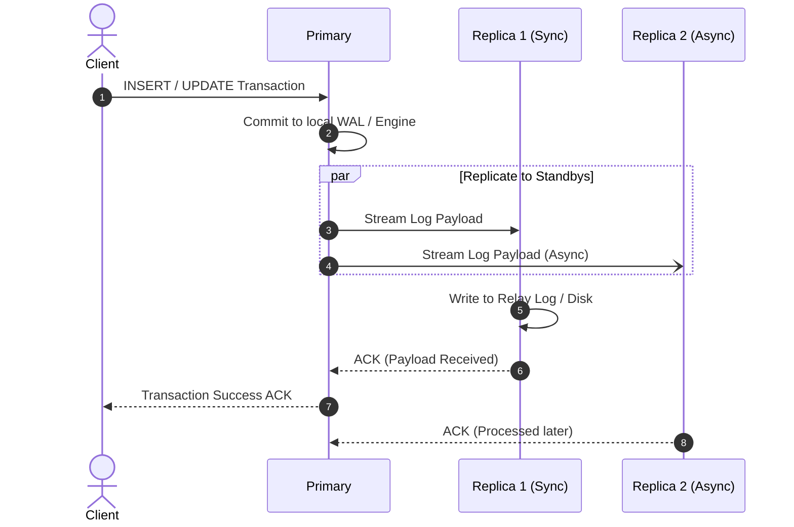
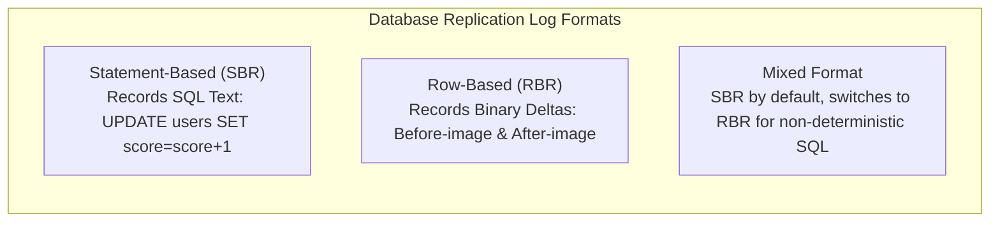
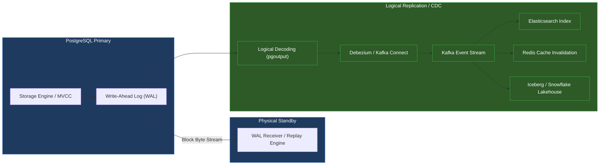
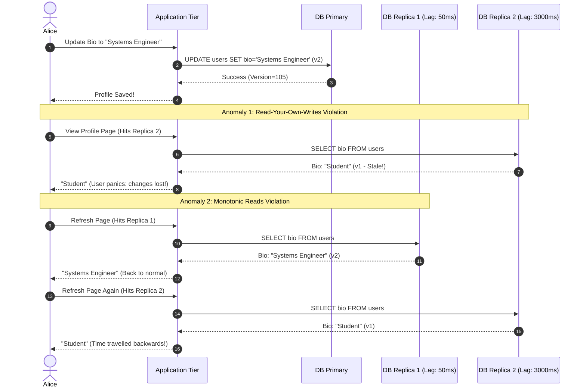
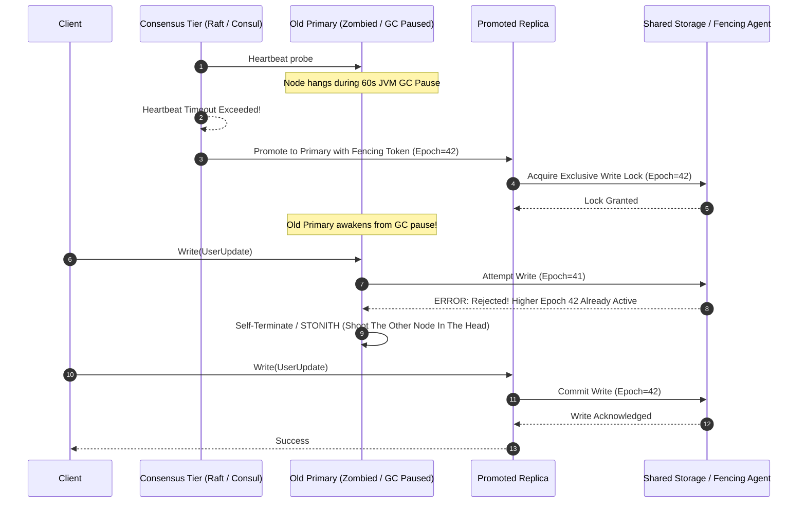

# Database Replication

Understanding replication is essential for designing highly available, fault-tolerant, and scalable data systems.

---

## 📖 What is Replication?

> **Replication is the practice of maintaining synchronized copies of the same data across multiple physical machines to guarantee high availability, survive hardware faults, and scale read throughput.**

```
┌─────────────────────────────────────────────────────────┐
│                   PRIMARY (Leader)                      │
│                    Handles writes                       │
│                         │                               │
│          ┌──────────────┼──────────────┐               │
│          │              │              │               │
│          ▼              ▼              ▼               │
│    ┌──────────┐   ┌──────────┐   ┌──────────┐         │
│    │ Replica 1│   │ Replica 2│   │ Replica 3│         │
│    │ (Follower)   │ (Follower)   │ (Follower)         │
│    └──────────┘   └──────────┘   └──────────┘         │
│         Handles reads (scalable)                       │
│                                                         │
└─────────────────────────────────────────────────────────┘
```

---

## 🏗️ Replication Architectures

### 1. Single-Leader (Primary-Replica)

* All write requests are directed strictly to a single Primary (Leader) node.
* The Primary commits writes to its local storage/Write-Ahead Log (WAL) and streams changes to one or more Replicas (Followers).
* Read requests can be served by any Replica to scale read throughput horizontally.

```
                    ┌──────────┐
    Writes ─────────▶│ Primary  │
                    └────┬─────┘
                         │ Replication Stream
              ┌──────────┼──────────┐
              ▼          ▼          ▼
         ┌────────┐ ┌────────┐ ┌────────┐
  Reads  │Replica1│ │Replica2│ │Replica3│
         └────────┘ └────────┘ └────────┘
```

**Pros:** Simple programming model, deterministic conflict-free writes.  
**Cons:** Single point of failure for write capacity; vulnerable to replication lag on reads.

### 2. Multi-Leader (Primary-Primary)

* Multiple nodes in different datacenters or cloud regions act as leaders, accepting concurrent writes.
* Leaders asynchronously stream mutations to each other.

```
         ┌──────────┐    Cross-DC Sync   ┌──────────┐
Writes ──▶│ Primary 1│◀──────────────────▶│ Primary 2│◀── Writes
         └────┬─────┘                     └────┬─────┘
              │                                │
         ┌────┴────┐                      ┌────┴────┐
         ▼         ▼                      ▼         ▼
      Replica   Replica                Replica   Replica
```

**Pros:** Survives entire datacenter outages; low write latency for geographically distributed users.  
**Cons:** Concurrent write conflicts require resolution mechanisms (Last-Write-Wins, CRDTs, or operational transformation).

### 3. Leaderless (Dynamo-Style)

* No centralized leader; clients or stateless coordinators write directly to multiple replicas using quorum algorithms ($R + W > N$).
* Conflict resolution handled via version vectors, read repair, and hinted handoff.

---

## 🔄 Replication Modes: Sync vs. Async vs. Semi-Sync

Replication modes dictate the durability and latency trade-offs when committing transactions.

### Semi-Synchronous Replication Flow

In **Semi-Synchronous Replication** (e.g., MySQL semi-sync, PostgreSQL synchronous standby), the primary blocks client acknowledgments until at least one synchronized replica confirms that log entries have been received and flushed to its relay log. Remaining replicas sync asynchronously.



### Quantitative Trade-offs

| Aspect | Synchronous | Asynchronous | Semi-Synchronous |
|:---|:---|:---|:---|
| **Write Latency** | High (bounded by slowest replica) | Lowest ($O(1)$ local disk commit) | Moderate (bounded by fastest replica) |
| **Durability** | Guaranteed zero data loss | Risk of RPO > 0 on leader crash | Zero data loss if 1 replica survives |
| **Availability** | Low (single node freeze stalls writes) | Highest (resilient to replica lag) | High (falls back to async if timeout expires) |
| **Read Consistency**| Immediate consistency on sync node | Subject to replication lag | Strong on sync replica, eventual on others |

---

## 🪵 Low-Level Replication Logging Formats

How mutations are encoded in the replication stream fundamentally affects consistency, determinism, and bandwidth.



### 1. Statement-Based Replication (SBR)
* **Mechanism**: The leader logs raw SQL statements as executed (e.g., `UPDATE users SET status = 'active' WHERE signup_date < '2026-01-01'`).
* **Advantages**: Minimal log bandwidth. A statement modifying 1,000,000 rows generates only a few bytes in the binlog.
* **Failure Modes (Non-Determinism)**:
  * Non-deterministic functions: Functions like `NOW()`, `UUID()`, `RAND()`, or `CURRENT_TIMESTAMP` produce different values when re-evaluated on followers.
  * Autoincrement / Trigger ordering: Without strict locks, multi-threaded statement execution order can interleave differently on followers.
  * Limit without Order By: `DELETE FROM jobs LIMIT 10` can delete entirely different sets of rows on primary and follower.

### 2. Row-Based Replication (RBR)
* **Mechanism**: The leader records individual row mutations: the primary key, the column values before the modification ("before-image"), and the column values after ("after-image").
* **Advantages**: Strictly deterministic. Guarantees bit-for-bit consistency between primary and followers regardless of triggers, stored procedures, or non-deterministic SQL functions.
* **Trade-off**: High network and storage bandwidth. A batch operation like `UPDATE inventory SET stock = 0` affecting 10 million rows generates gigabytes of row change events.

### 3. Mixed Replication
* Uses SBR for safe deterministic queries to save log bandwidth, and automatically promotes to RBR when detecting unsafe SQL constructs (e.g., `UUID()`, user-defined functions, or system variables).

---

## 🚀 Physical vs. Logical Replication & Change Data Capture (CDC)

Modern data platforms distinguish between **physical replication** (for disaster recovery and read replicas) and **logical replication / Change Data Capture (CDC)** (for heterogeneous data movement).



### 1. Physical Streaming Replication
* **How it works**: Replicas stream raw byte-level disk changes directly from the leader's Write-Ahead Log (WAL). Followers apply bytes directly to local disk blocks.
* **Characteristics**:
  * Extremely fast with negligible CPU decoding overhead.
  * Identical disk format: Follower must run the exact same major database version, architecture, and byte-endianness as the primary.
  * Coarse granularity: Entire cluster/database must be replicated; cannot replicate a single table or filter columns.

### 2. Logical Replication & Change Data Capture (CDC)
* **How it works**: A logical decoding plugin (e.g., `pgoutput` in PostgreSQL, MySQL binlog reader) decodes WAL bytes into logical change records: `INSERT`, `UPDATE`, `DELETE` events containing typed table schemas and row payloads.
* **Change Data Capture (CDC) with Debezium**:
  * Debezium tails the database log non-invasively without polling `SELECT` queries.
  * Changes are published as structured JSON or Avro events to Apache Kafka topics.
  * **Key Use Cases**:
    1. **Search Indexing**: Continuously update Elasticsearch/OpenSearch indexes without dual-writing from application code.
    2. **Cache Invalidation**: Evict stale keys in Redis when row mutations occur.
    3. **Microservice Event Sourcing**: Outbox pattern without 2-phase distributed commits.
    4. **Zero-Downtime Database Upgrades**: Stream data across major database versions.

---

## ⚠️ Replication Lag Anomalies & Mitigations

Asynchronous replication introduces **Replication Lag**: the time delta between a write committing on the leader and that mutation applying on a follower. This lag introduces severe consistency anomalies in applications:



### 1. Read-Your-Own-Writes Consistency (Causal Read Consistency)
* **The Problem**: A user updates their profile picture or comments on a post, refreshes the page, and the old data reappears because the read hit a lagging replica.
* **Mitigation Strategies**:
  1. **Primary Routing Window**: Route all reads for the modifying user to the Primary for a bounded window (e.g., 5 seconds after any write).
  2. **Track Minimum Version / Global Transaction ID (GTID)**: Store the transaction's commit GTID or timestamp in the user's session cookie / JWT. Replicas must assert `replica_gtid >= client_min_gtid` before responding; otherwise, wait or fallback to the leader.

### 2. Monotonic Reads (Time-Travel Anomaly)
* **The Problem**: A user refreshes a dashboard multiple times. Request 1 hits a low-lag replica (sees comment B). Request 2 hits a high-lag replica (comment B disappears).
* **Mitigation**: **Sticky Replica Routing**. Hash the `user_id` to route an individual user's reads to the same replica instance consistently.

### 3. Consistent Prefix Reads (Causal Dependency Inversion)
* **The Problem**: In a sharded or distributed database, if Question A and Answer B are written sequentially, a reader might observe Answer B before Question A if replica shards replicate with uneven lag.
* **Mitigation**: Ensure that causally dependent writes are partitioned to the same shard, or enforce global causal timestamp ordering.

---

## 💻 Code Parity: Version-Tracked Read Routing

### Java 11+ Implementation

```java
import java.util.Map;
import java.util.concurrent.ConcurrentHashMap;

public class VersionTrackedReadRouter {
    private final PrimaryDatabase primaryDb;
    private final Map<String, ReplicaDatabase> replicas;
    private final Map<String, Long> userLastWriteGtid = new ConcurrentHashMap<>();

    public VersionTrackedReadRouter(PrimaryDatabase primaryDb, Map<String, ReplicaDatabase> replicas) {
        this.primaryDb = primaryDb;
        this.replicas = replicas;
    }

    public void recordUserWrite(String userId, long gtid) {
        userLastWriteGtid.put(userId, gtid);
    }

    public DatabaseNode routeRead(String userId) {
        Long requiredGtid = userLastWriteGtid.get(userId);
        if (requiredGtid == null) {
            return selectRoundRobinReplica();
        }

        // Attempt to find a replica caught up to required GTID
        for (ReplicaDatabase replica : replicas.values()) {
            if (replica.getReplicationGtid() >= requiredGtid) {
                return replica;
            }
        }

        // Fall back to primary if all replicas are lagging behind user's own write
        return primaryDb;
    }

    private DatabaseNode selectRoundRobinReplica() {
        return replicas.values().iterator().next();
    }
}
```

### Python 3.8+ Parity Implementation

```python
from dataclasses import dataclass
from typing import Dict, Optional, Protocol


class DatabaseNode(Protocol):
    def query(self, sql: str) -> dict: ...
    def get_replication_gtid(self) -> int: ...


@dataclass
class VersionTrackedReadRouter:
    """Routes read queries to catch-up replicas or primary to guarantee read-your-writes."""

    primary_db: DatabaseNode
    replicas: Dict[str, DatabaseNode]
    _user_last_write_gtid: Dict[str, int] = None

    def __post_init__(self):
        if self._user_last_write_gtid is None:
            self._user_last_write_gtid = {}

    def record_user_write(self, user_id: str, gtid: int) -> None:
        """Records the latest global transaction identifier written by a user."""
        self._user_last_write_gtid[user_id] = gtid

    def route_read(self, user_id: str) -> DatabaseNode:
        """Selects a healthy replica that meets the minimum GTID requirement, or falls back to primary."""
        required_gtid = self._user_last_write_gtid.get(user_id)
        if required_gtid is None:
            return next(iter(self.replicas.values()))

        # Check for any replica whose current applied GTID >= user's last write GTID
        for replica in self.replicas.values():
            if replica.get_replication_gtid() >= required_gtid:
                return replica

        # If all replicas suffer replication lag, fallback to primary to protect consistency
        return self.primary_db
```

---

## 🔧 Failover & Split-Brain Fencing

When a primary node stops responding, the cluster must promote a follower without allowing both to process writes concurrently (**Split-Brain**).



### Fencing Mechanisms
1. **Fencing Tokens (Monotonically Increasing Epochs)**: Every leader election increments a numerical token. Storage nodes reject any I/O bearing an older token.
2. **STONITH ("Shoot The Other Node In The Head")**: Power-distribution units (PDUs) or IPMI remotely cut power to the unresponsive node before promoting a standby.
3. **Consensus Quorum**: The leader must maintain a lease renewal quorum with a majority of nodes; losing the lease causes automatic step-down.

---

## 📋 Replication Strategy Comparison

| Configuration | Use Case | Failover Time (RTO) | Data Loss Window (RPO) |
|:---|:---|:---|:---|
| **Single Leader + Async Replicas** | High read-to-write ratio (95:5), tolerable minor lag | 10s – 30s | Up to replication lag (e.g., seconds) |
| **Single Leader + Semi-Sync Replica** | Financial ledger, payment processing | < 10s | Zero (for committed writes) |
| **Multi-Leader Active-Active** | Multi-region global collaboration, low local latency | Immediate local failover | Conflict resolution delay |
| **Leaderless Quorum ($R+W > N$)** | High write availability, distributed key-value | Immediate (stateless) | Eventual / bounded by hinted handoffs |

---

## 🔗 Cross-References

- **[Quorum Consistency & Anti-Entropy](../distributed-systems/quorum-consistency-and-anti-entropy.md)**: Leaderless replication and Merkle tree repairs.
- **[Two-Phase and Three-Phase Commit](../distributed-systems/two-phase-and-three-phase-commit.md)**: Atomic transactions across partitioned storage.
- **[RUM Conjecture](rum-conjecture.md)**: Read, Update, and Memory trade-offs in storage engines.
