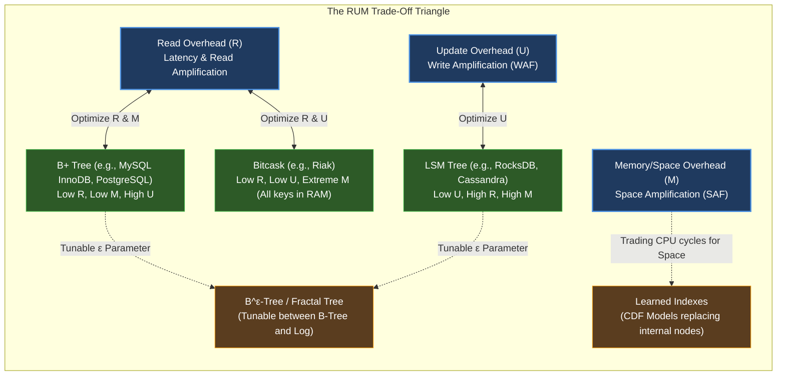

# The RUM Conjecture & Storage Engine Trade-off Space

When designing or evaluating database storage engines, engineers face fundamental limitations dictated by hardware physics and data structure mathematics. The definitive model for understanding these trade-offs is the **RUM Conjecture**.

Proposed by Athanassoulis et al. (Harvard DASlab, EDBT 2016), the RUM Conjecture formalizes the three primary overheads in database storage systems:

1. **R**ead Overhead (Read Amplification): The ratio between the total amount of data read from storage and the actual amount of data requested by the user.
2. **U**pdate Overhead (Write Amplification): The ratio between the total amount of data written to storage and the actual amount of new/updated data provided by the user.
3. **M**emory/Space Overhead (Space Amplification): The ratio between the total space occupied on disk (including indexes, metadata, and fragmentation) and the theoretical minimum space needed to store the raw data.

> **The RUM Conjecture states:**
> An access method can optimize at most two of the R, U, and M overheads at the expense of the third.

---

## 📐 Mathematical Intuition & Proof

Consider a storage universe of size $N$ items. We want to design an access method that achieves perfect efficiency in all three dimensions:
- **Perfect U ($U=1$)**: We append data purely sequentially (an append-only log). This requires $O(1)$ write time and 1x write amplification.
- **Perfect M ($M=1$)**: We store exactly the data, with no duplicate versions, no padding, and no auxiliary index pointers.
- **Perfect R ($R=1$)**: We locate any point read in exactly 1 I/O operation.

**The Contradiction:**
To achieve $U=1$ (sequential append) and $M=1$ (no indexes, no duplicated state), data must be stored purely in the chronological order of arrival.
If data is ordered chronologically, finding a specific key requires a linear scan: an $O(N)$ read overhead.
To achieve $R=1$ (or even $O(\log_b N)$), we *must* either:
1. Keep the data strictly sorted by key (which violates $U=1$ because an insert in the middle of an array requires shifting $O(N)$ elements, driving $U \to \infty$).
2. Maintain auxiliary index structures like B+ Trees or Hash Tables (which violates $M=1$ because these structures require extra space, pointer overhead, and fragmentation padding).

Therefore, it is mathematically impossible to simultaneously optimize R, U, and M.

---

## 🗺️ Mapping Storage Architectures in RUM Space

Different storage architectures target different points in the RUM trade-off space to serve specific workloads.

### 1. B+ Trees
*Optimized for **R** and **M**, Penalized on **U**.*

- **Architectural Positioning**: High U, Low R, Low M.
- **Architecture:** Data is maintained in strict sorted order in fixed-size pages (typically 4KB to 16KB).
- **Read (R):** Excellent. $O(\log_b N)$ I/Os for point reads. Range scans are optimal because leaf nodes are linked sequentially and data is contiguous.
- **Memory (M):** Good. Pages are typically kept 67% to 100% full. Space overhead is limited to internal node pointers and minor page fragmentation.
- **Update (U):** Poor. A 100-byte insert requires reading a 4KB page, modifying it in-memory, and writing back the entire 4KB page (along with WAL logging). This leads to high Write Amplification Factors (WAF often 10x–40x).

### 2. LSM Trees (Log-Structured Merge Trees)
*Optimized for **U**, Penalized on **R** and **M**.*

- **Architectural Positioning**: Low U, High R, High M.
- **Architecture:** Writes are appended sequentially to an in-memory memtable (backed by WAL) and flushed sequentially to immutable Sorted String Tables (SSTables) on disk. Background compaction merges these files.
- **Update (U):** Excellent. Writes are purely sequential batch I/O, achieving low write amplification during ingestion.
- **Read (R):** Penalized. Point reads may need to check multiple levels/files (Read Amplification), mitigated using Bloom Filters and block caches.
- **Memory (M):** Penalized. Old versions and tombstones persist until compaction cascades through all levels (Space Amplification 1.5x–4x).

### 3. Bitcask (Log-Structured Hash)
*Extreme **U** and Extreme **R** (Point), Extreme penalty on **M**.*

- **Architectural Positioning**: Low U, Low R, Extreme M.
- **Architecture:** Data is appended strictly sequentially to an append-only log file. An in-memory hash table (keydir) maps every key to its file identifier, record size, and exact byte offset.
- **Update (U):** Perfect. $O(1)$ sequential append.
- **Read (R):** Perfect for point reads. $O(1)$ I/O, exactly 1 disk seek via the in-memory hash table. Range scans are unsupported.
- **Memory (M):** Terrible. Every single key in the dataset must reside continuously in RAM. Disk space also suffers from high Space Amplification until merge/compaction runs.

### 4. Fractal Trees / B-epsilon Trees ($\text{B}^\varepsilon$-Trees)
*Tunable trade-off between **U** and **R**.*

- **Architectural Positioning**: Tunable parameter $\varepsilon$ ($0 \le \varepsilon \le 1$) trade-off.
- **Architecture:** Similar to a B+ Tree, but internal nodes contain large "message buffers." Inserts and updates are written directly to node buffers and lazily cascaded down the tree in batches.
- **Trade-off:**
  - $\varepsilon = 1$: Standard B-Tree (Optimized R, Poor U).
  - $\varepsilon = 0$: Pure Log (Optimized U, Poor R).
  - Intermediate $\varepsilon$ values (e.g., $\varepsilon = 0.5$) provide a sweet spot: batching writes reduces write amplification by an order of magnitude compared to B+ Trees while maintaining logarithmic point read performance.

### 5. Learned Index Structures
*Trading **CPU** for **M**.*

- **Architectural Positioning**: Trading CPU cycles for M reduction.
- **Architecture:** Uses cumulative distribution function (CDF) models (e.g., piecewise linear regression, shallow neural networks) to predict the position of a key within a sorted array, replacing traditional B-Tree internal nodes.
- **Memory (M):** Extreme optimization. Compact model parameters consume up to 70% less memory than B+ Tree page pointers.
- **RUM Impact:** Expands the classic trade-off triangle into a 4-dimensional space (R, U, M, and Compute/CPU).

---

## 📊 Quantitative Comparison Table

The following table summarizes the theoretical and practical performance of the dominant storage engines:

| Architecture | Point Read Complexity | Range Scan Efficiency | Write Amplification Factor (WAF) | Space Amplification Factor (SAF) |
| :--- | :--- | :--- | :--- | :--- |
| **B+ Tree** | $O(\log_b N)$ | **Excellent** (Sequential I/O) | **High** (10x - 40x due to page rewrites) | **Low** (~1.2x - 1.5x for padding/fragmentation) |
| **LSM Tree** | $O(\text{Levels}) \times O(\log_b M)$ | **Moderate** (Requires merge-sort across levels) | **Low to Moderate** (1x - 10x depending on compaction) | **High** (1.5x - 4x due to stale versions) |
| **Bitcask** | **$O(1)$** | **N/A** (Unsupported) | **1x** (Pure append) | **Very High** (Requires RAM for all keys) |
| **B$^\varepsilon$ Tree** | $O(\frac{1}{\varepsilon} \log_b N)$ | **Good** | **Low** (Buffered writes) | **Low** (Similar to B-Tree) |

> **Interview Tip:** In a System Design interview (e.g., designing a time-series database or high-throughput event store), explicitly stating: *"We are prioritizing Update Overhead over Read Overhead in the RUM trade-off space, so an LSM-tree based engine like RocksDB or Cassandra is preferred over a B+ Tree"* demonstrates deep storage intuition.
