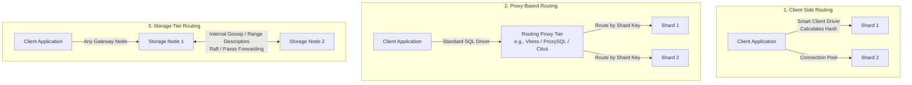
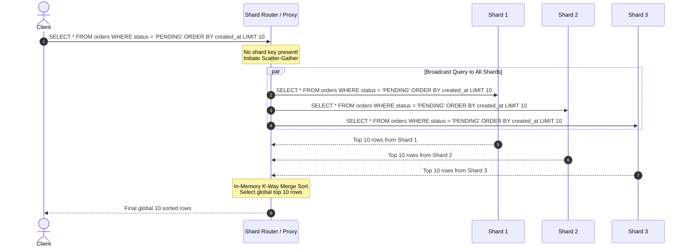
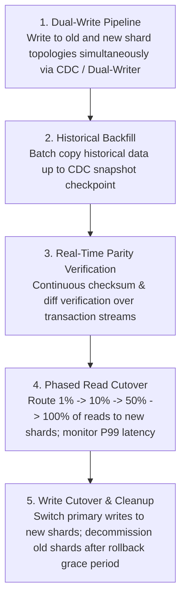

# Database Sharding

Sharding is a horizontal scaling architecture where one logical dataset is split across multiple independent database nodes. Each physical node (shard) owns a disjoint subset of rows governed by shard-key routing rules.

---

## 1. What is Sharding?

A shard owns a subset of rows based on shard-key routing. This increases total storage capacity and write throughput linearly at the cost of operational complexity, distributed query penalties, and cross-shard transaction overhead.

### Partitioning vs Sharding
- **Partitioning (Vertical/Horizontal in-engine):** Splits tables within a single database instance (e.g., PostgreSQL declarative range/hash partitioning). The underlying server still shares CPU, memory, and disk I/O.
- **Sharding (Horizontal across instances):** Distributes data across independent physical or virtual machines, each with its own CPU, memory, buffer pool, and storage volumes.

> **Production Rule:** Always exhaust query indexing, connection pooling, read replicas, caching (Redis), and vertical scaling before introducing sharding. Sharding introduces irreversible operational boundaries.

---

## 2. Shard Routing Architectures

How a client query discovers which shard holds the requested row depends on the routing layer topology:



### Architecture Comparison

| Dimension | Client-Side Routing | Proxy-Based Routing | Storage-Tier Routing |
|---|---|---|---|
| **Examples** | LinkedIn Espresso client, Twitter Gizzard, custom SDKs | Vitess (MySQL VTGate), ProxySQL, Citus coordinator, CockroachDB gateway | Apache Cassandra (token ring), CockroachDB (range descriptors), Google Spanner |
| **Network Hops** | Single hop directly to target shard ($O(1)$) | Two hops: Client $\to$ Proxy $\to$ Shard (+0.5–2ms latency) | One or two hops (direct to coordinator, forward to range leader) |
| **Language Portability** | Low: requires porting routing logic & connection pools across languages | High: standard MySQL/PostgreSQL protocol exposed to clients | High: standard SQL/CQL drivers without client topology awareness |
| **Topology Changes** | Client restart or dynamic config poll (Zookeeper/etcd) required | Centralized proxy config reload; clients completely decoupled | Internal consensus-driven range rebalancing (Split/Merge Raft groups) |
| **Connection Overhead** | $N$ clients $\times M$ shards connections (connection explosion risk) | Proxies multiplex thousands of client conns to small pool per shard | Nodes maintain peer-to-peer mesh pools internally |

---

## 3. Sharding Strategies & Key Selection

### Range Sharding
Data is partitioned based on contiguous ranges of a key (e.g., `user_id` 1–1,000,000 $\to$ Shard 1, 1,000,001–2,000,000 $\to$ Shard 2; or timestamps like `2026-01` $\to$ Shard 1).
- **Pros:** Fast range scans (`BETWEEN '2026-01-01' AND '2026-01-15'`) execute on a single shard.
- **Cons:** Hotspots on monotonically increasing keys (all new writes hit the highest range shard).

### Hash Sharding
The shard is determined by computing `hash(shard_key) % num_shards`.
- **Pros:** Uniform distribution of writes and storage across all nodes.
- **Cons:** Range queries become Scatter-Gather across all shards; resizing the cluster with naive modulo invalidates nearly all key placements.

### Consistent Hashing
Keys and shard nodes map onto a 128-bit circular integer ring (e.g., MurmurHash3 / MD5). Each node owns multiple **virtual nodes (vnodes)** distributed around the ring.

#### Key Movement Math on Cluster Resize
Suppose a cluster holds $K$ total keys distributed across $N$ shards:
- **Naive Modulo ($N \to N+1$):**
  When changing the modulus from $N$ to $N+1$, the fraction of keys that must move is:
  $$\text{Moved Fraction} = \frac{N}{N+1} \approx 100\%$$
  For $N = 9$ shards growing to 10, **90% of all data** must be transferred across the network, causing catastrophic cache invalidation and I/O storms.
- **Consistent Hashing ($N \to N+1$):**
  When adding 1 node to an $N$-node cluster with virtual nodes, only the newly added node takes ownership of a fraction of the ring:
  $$\text{Moved Keys} = \frac{K}{N+1}$$
  Only $\frac{1}{N+1}$ of keys are transferred, while $\frac{N}{N+1}$ remain entirely untouched on their existing shards.

---

## 4. Distributed Query Execution: Scatter-Gather (Scatter-gather)

When a query specifies the shard key (e.g., `WHERE user_id = 42`), the routing tier routes the request directly to the single owning shard (Point Lookup).

However, when a query filters on a non-shard key (e.g., `WHERE email = 'user@example.com'` when sharded on `user_id`), the database must execute a **Scatter-Gather** (Scatter-gather) pattern:



### Scatter-Gather Mechanics
1. **Scatter Phase:** The coordinator broadcasts sub-queries in parallel to all $M$ shards.
2. **Local Execution:** Each shard executes the query against its local data and local B+ Tree indexes, returning its local top $K$ results.
3. **Gather Phase:** The coordinator receives partial results from all $M$ shards.
4. **Merge-Sort:** The coordinator uses a min-heap ($K$-way merge sort) to merge the sorted streams and extract the global top $K$.

### The Deep Pagination Problem in Sharded Databases
Consider a pagination query:
```sql
SELECT * FROM orders WHERE status = 'PENDING' ORDER BY created_at LIMIT 100 OFFSET 10000;
```
Across a 10-shard cluster:
- To guarantee correctness, **every single shard** must fetch and sort $10,000 + 100 = 10,100$ rows.
- The router must gather $10 \times 10,100 = 101,000$ rows over the network into coordinator memory, sort them, skip the first 10,000, and return 100 rows.
- **Production Solution (Keyset Pagination):** Never use `OFFSET` across shards. Use cursor-based keyset pagination:
  ```sql
  SELECT * FROM orders WHERE status = 'PENDING' AND (created_at, order_id) < (:last_created_at, :last_order_id) ORDER BY created_at DESC, order_id DESC LIMIT 100;
  ```

---

## 5. Cross-Shard Transactions

When a business operation touches rows residing on different shards (e.g., transferring funds from User A on Shard 1 to User B on Shard 2), distributed consensus is required.

### Two-Phase Commit (2PC)
- **Phase 1 (Prepare):** The coordinator asks all participant shards: *"Can you commit this transaction?"* Each shard acquires row locks, writes undo/redo logs to disk, and votes `PREPARED`.
- **Phase 2 (Commit):** If all voted yes, the coordinator writes a `COMMIT` record to its WAL and broadcasts `COMMIT` to all shards.
- **Failure Mode & Latency Penalty:**
  - 2PC is a blocking protocol. If the coordinator crashes while shards are prepared, participant shards hold row locks indefinitely, blocking subsequent writes.
  - Latency is bounded by the slowest shard ($P99$ network round-trips).

### Saga Pattern with Compensating Transactions
For high-scale internet architectures, 2PC is often avoided in favor of the **Saga Pattern**:
- Break the workflow into local ACID transactions on individual shards.
- Coordinate via an asynchronous event bus (Kafka) or workflow orchestrator (Temporal).
- If step $N$ fails, trigger compensating transactions on steps $1 \dots N-1$ to undo state changes semantically (e.g., refund credit).

---

## 6. Hotspot Mitigation Techniques

Uneven data distribution creates hot shards that bottleneck cluster throughput:

1. **Compound Key Salting:**  
   If a celebrity account receives 100,000 writes/sec, hashing `celebrity_user_id` lands all writes on one shard.  
   *Fix:* Append a random salt integer:
   ```text
   shard_key = hash(user_id) + "_" + rand(0, 9)
   ```
   Writes spread across 10 shards. Reads query all 10 salted keys in parallel (scatter-gather across 10 shards) and aggregate.
2. **Virtual Shards (vnodes):**  
   Assigning 128 or 256 virtual nodes per physical host smooths out hash variance and enables gradual host decommissioning.
3. **Dynamic Range Splitting (Spanner / CockroachDB):**  
   Storage engines automatically detect ranges exceeding 64MB or high QPS thresholds and split the range into two child ranges, migrating one child to an underutilized node via Raft rebalancing.

---

## 7. Operational Playbook: Zero-Downtime Online Re-Sharding

Migrating from $N$ to $M$ shards without service interruption follows a 5-stage migration lifecycle:



### Pre-Sharding Checklist
- [ ] Critical queries are indexed and query plans verified with `EXPLAIN ANALYZE`.
- [ ] Read replicas and Redis caching layer are fully saturated.
- [ ] Data archival / cold storage policies are active.
- [ ] The shard key has high cardinality ($>10^6$ distinct values) and matches $>90\%$ of query filters.
- [ ] Rollback criteria and automated health gates are deployed.

---

## 8. Interview-Grade Summary & Evaluation Skeleton

> *"I treat sharding as an architectural measure of last resort due to the loss of single-node ACID guarantees, distributed join penalties, and operational complexity. When write scale necessitates sharding, I select a high-cardinality shard key aligned to the primary access pattern. For routing, I utilize a proxy-based or storage-coordinated architecture. Queries lacking the shard key employ Scatter-Gather with keyset pagination to avoid deep offset overhead. Cross-shard transactions favor Sagas with compensating actions over blocking 2PC. Resharding is executed via dual-writes, CDC backfill, and phased read cutovers."*

---

## Cross-References

- [Consistent Hashing Internals](../../03-hld-concepts/consistent-hashing/)
- [Database Replication & CDC](./replication.md)
- [CAP & PACELC Theorems](../system-design-fundamentals/cap-theorem.md)
- [HLD System: Ad Click Aggregator](../../04-hld-projects/ad-click-aggregator/)
