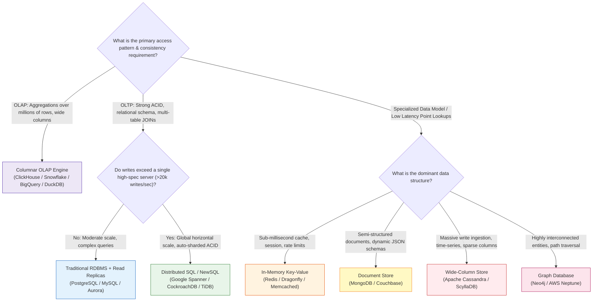
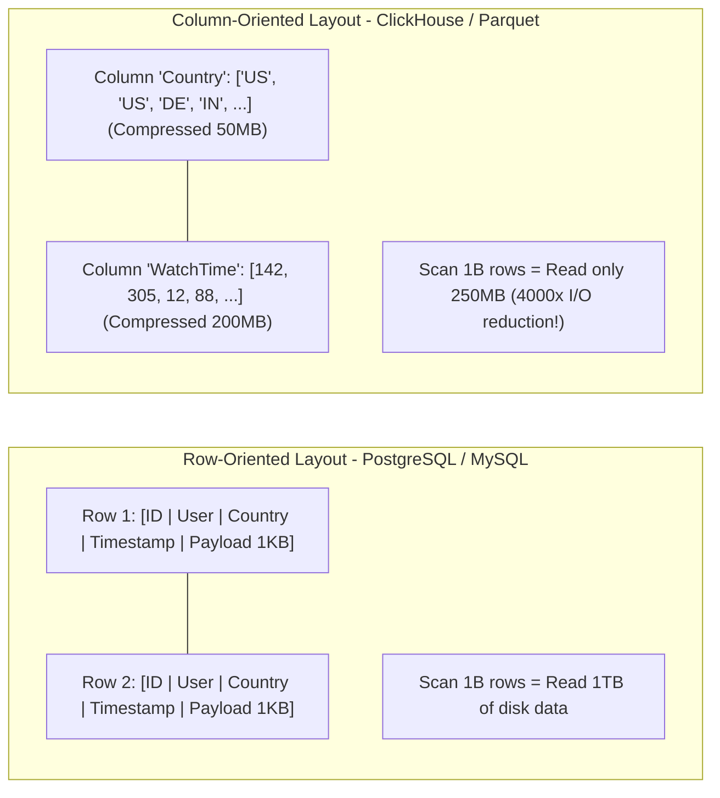
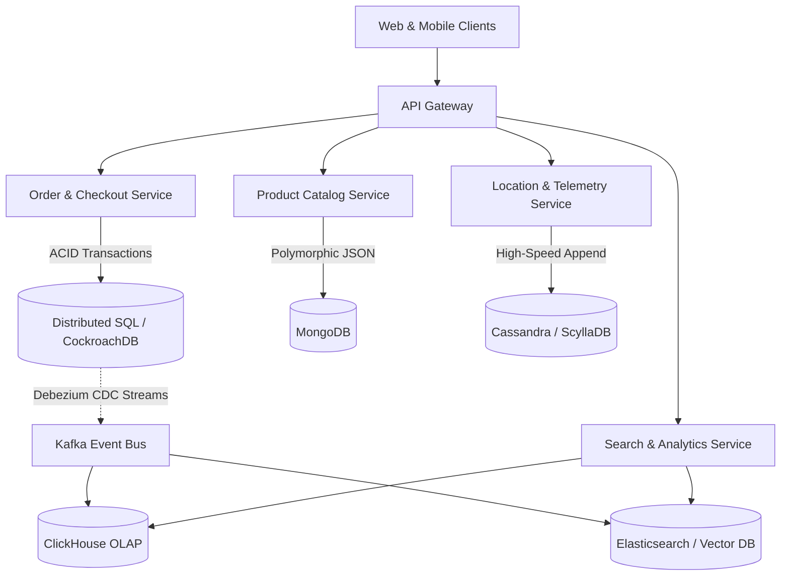

# Modern Database Paradigms: SQL, NoSQL, NewSQL & Columnar OLAP

Selecting a data store is one of the highest-stakes decisions in system design. Historically, interview candidates were taught simplistic dichotomies like *"SQL doesn't scale horizontally"* or *"NoSQL doesn't support transactions."* In modern cloud architectures, these simplifications are demonstrably false.

Today's landscape spans **Traditional Relational OLTP**, **Distributed SQL (NewSQL)**, **Specialized NoSQL**, and **Columnar OLAP Engines**.

---

## 1. Debunking Outdated Scaling & Transaction Myths

### Myth 1: "SQL Only Scales Vertically" (FALSE)
- **Reality:** While traditional single-node RDBMS engines (Postgres, MySQL) natively scale writes vertically, **Distributed SQL / NewSQL** engines (Google Spanner, CockroachDB, TiDB, YugabyteDB) scale horizontally across hundreds of nodes.
- **How they achieve this:**
  - Data is partitioned into ordered continuous chunks called **ranges** or **tablets** (typically 64MB).
  - Each range is replicated across multiple nodes via consensus algorithms (**Raft** or **Multi-Paxos**).
  - Distributed multi-version concurrency control (MVCC) combined with TrueTime (hardware atomic clocks + GPS) or Hybrid Logical Clocks (HLC) provides **Strict Serializable ACID** across geographic regions with linear write scalability.

### Myth 2: "NoSQL Cannot Support ACID Transactions" (FALSE)
- **Reality:** Modern document and key-value stores have evolved beyond pure eventual consistency (BASE):
  - **MongoDB** supports multi-document ACID transactions with snapshot isolation since version 4.0.
  - **Amazon DynamoDB** provides `TransactWriteItems` and `TransactGetItems` with 2PC atomic guarantees across up to 100 items.
  - **Apple FoundationDB** provides multi-model distributed ACID transactions backed by an ordered key-value core.

---

## 2. Comprehensive Storage Engine Taxonomy



---

## 3. Storage Engine Deep Dives

### 1. Traditional Relational OLTP (PostgreSQL, MySQL)
- **Architecture:** B+ Tree page-based storage (8KB pages). Clustered indexes on primary keys, secondary indexes with record pointers.
- **Transactions:** Full ACID via Write-Ahead Logging (WAL) and MVCC.
- **When to Use:** Standard business entities (accounts, e-commerce checkouts, billing). Single-node primary handles up to ~15,000–30,000 writes/sec with NVMe SSDs.
- **Scaling Limit:** Writes bottleneck on single primary. Read replicas scale reads but introduce replication lag.

---

### 2. Distributed SQL / NewSQL (Google Spanner, CockroachDB, TiDB)
- **Architecture:** Range-based sharding with Raft/Paxos consensus per range. Storage engine is typically an LSM-Tree (RocksDB / Pebble) underneath.
- **Transactions:** Global Serializable ACID using Two-Phase Locking (2PL), Two-Phase Commit (2PC), and Hybrid Logical Clocks (HLC) or Google TrueTime.
- **When to Use:** Global payments, ledger balances, high-scale SaaS where relational integrity and zero data loss are non-negotiable.
- **Trade-off:** Higher commit latency (P99 ~10–30ms) due to cross-node network roundtrips during Raft consensus and 2PC.

---

### 3. Columnar OLAP Engines (ClickHouse, Snowflake, DuckDB, BigQuery)

Traditional row-oriented databases (PostgreSQL) fail catastrophically at analytical queries like:
```sql
SELECT country, AVG(watch_time_seconds) 
FROM video_events 
WHERE event_date >= '2026-01-01' 
GROUP BY country;
```

#### Why Row-Stores Fail at Analytics
In row-oriented databases, all attributes of a single row are stored contiguously on disk pages:
`[row1: user_id, ip, country, device, payload, watch_time, timestamp], [row2: ...]`
To compute the average `watch_time`, the disk must read **100% of all bytes** off disk and load entire 500-byte tuples into RAM, wasting 95% of memory bandwidth on unused columns (`ip`, `device`, `payload`).

#### Why Columnar OLAP Engines Excel
Columnar storage stores values of the same column contiguously in dedicated compressed blocks:
- `country`: `['US', 'US', 'DE', 'IN', 'IN', 'IN', ...]`
- `watch_time`: `[142, 305, 12, 88, 45, 910, ...]`



#### Analytical Optimizations
1. **Extreme Compression Ratios (5x to 20x):** Because all values in a block have the same data type, algorithms like Run-Length Encoding (RLE), Dictionary Encoding, and Gorilla Delta-of-Deltas compress data drastically.
2. **SIMD Vectorized Execution:** CPUs process column arrays using AVX-512 / NEON instructions, evaluating filter predicates on 16 or 32 values per single CPU cycle.

---

### 4. NoSQL Specializations

| Engine Type | Representative Technologies | Core Data Model | Concurrency & Consistency | Primary Production Sweet Spot |
|---|---|---|---|---|
| **Document Store** | MongoDB, Couchbase | Hierarchical BSON/JSON | Tunable (`w: "majority"`, causal consistency) | Catalogs, polymorphic user profiles, CMS |
| **In-Memory Key-Value** | Redis, Dragonfly, Memcached | Strings, Hashes, Sorted Sets | In-memory single-threaded or thread-per-core | Caching, session storage, distributed rate limiting |
| **Wide-Column Store** | Apache Cassandra, ScyllaDB | Sparse rows indexed by Partition Key + Clustering Key | Tunable Quorums ($R + W > N$), Eventual Consistency | High-throughput write ingestion ($>500\text{k wps}$), sensor telemetry |
| **Graph Database** | Neo4j, Amazon Neptune | Nodes, Edges, Properties | Index-free adjacency ($O(1)$ pointer-hop traversal) | Fraud detection rings, knowledge graphs, social networks |

---

## 4. Modern Architectural Comparison Matrix

| Evaluation Dimension | Traditional SQL (Postgres/MySQL) | Distributed SQL (Spanner/Cockroach) | Document NoSQL (MongoDB) | Wide-Column (Cassandra/Scylla) | Columnar OLAP (ClickHouse) |
|---|---|---|---|---|---|
| **Write Scalability** | Single node ($<30\text{k ops/s}$) | Linear horizontal ($100\text{k}+$) | Sharded horizontal | Massive linear horizontal ($1\text{M}+$) | Batch appended ($>1\text{M rows/s}$) |
| **P99 Read Latency** | $<2\text{ms}$ (B+ Tree point read) | $5–20\text{ms}$ (consensus hop) | $<3\text{ms}$ | $<5\text{ms}$ (LSM bloom filter) | Fast for aggregations, slow for point writes |
| **Transactions** | Strict ACID (Local) | Strict Serializable ACID (Global) | Multi-document ACID | Light-weight Paxos (LWT) / None | Non-transactional batch inserts |
| **JOIN Performance** | Highly optimized | Distributed hash/merge joins | Application-level or `$lookup` | Prohibited (requires denormalization) | Fast hash joins on dimensions |
| **Schema Evolution** | `ALTER TABLE` locks (or pg-online) | Online schema changes | Schema-free / polymorphic | Online schema changes | Fast column additions |

---

## 5. Polyglot Persistence: Real-World Uber / E-Commerce Pattern

High-scale production architectures never rely on a single database engine. They compose specialized engines in a **Polyglot Persistence** pipeline:



---

## 6. Interview Evaluation Framework

When an interviewer asks: *"Would you use SQL or NoSQL for this system?"*

1. **Avoid Immediate Absolutes:** Frame the answer around workload access patterns:
   - *"What is the read/write ratio?"*
   - *"Do we require multi-entity ACID consistency or can we tolerate eventual consistency?"*
   - *"Is the query model point-lookup by primary key, relational JOINs, or aggregate analytics?"*
2. **Differentiate OLTP vs OLAP:** State upfront whether the database serves interactive user transactions ($<10\text{ms}$ point reads) or analytical batch queries.
3. **Propose Polyglot Persistence:** Assign relational/NewSQL to transactional financial flows, in-memory Redis to caches/rate-limits, and wide-column or columnar OLAP to high-volume events.

---

## Cross-References

- [ACID Properties Deep Dive](./acid-properties.md)
- [B+ Tree Indexing & Physical Pages](./b-plus-tree-indexing-and-latch-crabbing.md)
- [Database Sharding & Scatter-Gather](./sharding.md)
- [CAP & PACELC Theorems](../system-design-fundamentals/cap-theorem.md)
- [HLD System: Ad Click Aggregator (OLAP + Stream)](../../04-hld-projects/ad-click-aggregator/)
