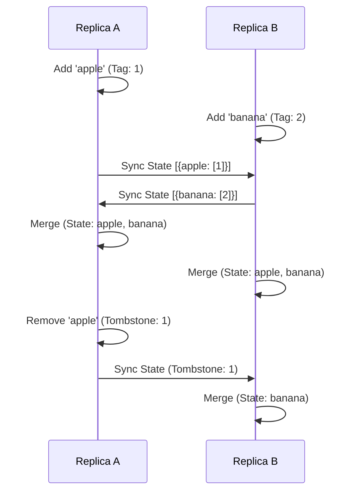

# Conflict-Free Replicated Data Types (CRDTs)

## The Problem of Eventual Consistency without Consensus

In distributed systems, maintaining consistency across replicas without sacrificing availability or introducing high latency is a significant challenge. Traditional consensus protocols like Paxos or Raft require synchronous coordination, which introduces network overhead, increases latency, and makes the system vulnerable to network partitions.

Eventual consistency allows systems to be highly available by accepting writes locally and resolving conflicts later. However, resolving conflicts often requires complex ad-hoc logic, timestamps, or manual intervention, leading to lost updates or divergent states if not handled perfectly.

Conflict-Free Replicated Data Types (CRDTs) solve this by mathematically guaranteeing convergence. By designing data structures where concurrent updates automatically resolve in a predictable way, CRDTs provide Strong Eventual Consistency (SEC). SEC guarantees that any two nodes that have received the same set of updates will have identical state, entirely eliminating the need for synchronous consensus or complex conflict resolution logic.

## Taxonomy of CRDTs

CRDTs are fundamentally divided into two main categories based on how state is propagated between replicas.

### State-based CRDTs (CvRDT)

Also known as Convergent Replicated Data Types. In CvRDTs, a replica propagates its entire state to other replicas. When a node receives a state from a peer, it combines it with its own state using a mathematical `merge` operator. 

Because transmitting the entire state can be bandwidth-intensive for large datasets, delta-state CRDTs have been developed to only transmit recent changes while preserving the convergent properties.

### Operation-based CRDTs (CmRDT)

Also known as Commutative Replicated Data Types. Instead of sending the full state, CmRDTs propagate only the specific update operations (e.g., "add element X"). For this to work correctly without strict ordering, all concurrent operations must be mathematically commutative.

CmRDTs consume much less network bandwidth but place heavier requirements on the communication layer. They typically require an exactly-once causal broadcast middleware to ensure operations are not lost or applied out of causal order.

## Mathematical Foundations: Join-Semilattices

The magic of state-based CRDTs lies in a mathematical concept called a join-semilattice. A join-semilattice defines a framework for how different states relate to one another and how they can be combined.

### Partial Order and Least Upper Bound

A join-semilattice requires a set of states equipped with a partial order, often denoted as `<=`. This partial order defines which states have progressed further than others. 

Additionally, any two states must have a least upper bound (LUB), also known as a join or supremum, denoted by `\sqcup`. The `merge` operator in a CRDT is exactly this join operation. It computes the smallest state that encompasses both input states.

### Formal Proof Requirements

For a data structure to qualify as a valid state-based CRDT, its `merge` operator (the join) must satisfy three critical algebraic properties:

1. **Commutativity:** `a \sqcup b = b \sqcup a`. The order in which states are merged does not matter.
2. **Associativity:** `(a \sqcup b) \sqcup c = a \sqcup (b \sqcup c)`. Merging can be grouped arbitrarily, allowing multi-node synchronization in any topology.
3. **Idempotence:** `a \sqcup a = a`. Merging the same state multiple times has no additional effect, making it robust to message duplication.

Furthermore, state updates must exhibit **Monotonicity**. As operations occur, the state must only advance upward along the lattice partial order. It can never go backwards, which guarantees that progress is permanent and convergence is inevitable.

## Detailed CRDT Implementations

### G-Counter and PN-Counter

A **G-Counter (Grow-Only Counter)** is an array or vector of counts, where each replica owns a specific index. A replica only increments its own index. To merge two G-Counters, the system takes the element-wise maximum across all indices.

A **PN-Counter (Positive-Negative Counter)** supports both increments and decrements. It is constructed internally using two G-Counters: one for additions (P) and one for subtractions (N). The current value is calculated as the sum of all elements in P minus the sum of all elements in N.

### Sets: G-Set and 2P-Set

A **G-Set (Grow-Only Set)** allows elements to be added but never removed. The merge operation is simply a set union.

A **2P-Set (Two-Phase Set)** introduces removals by using two separate G-Sets: an `adds` set and a `tombstones` set. Elements are added to the `adds` set, and removing an element places it in the `tombstones` set. An element is considered present if it is in the `adds` set and not in the `tombstones` set. Once removed, an element can never be re-added.

### Advanced Sets: LWW-Element-Set and OR-Set

The **LWW-Element-Set (Last-Write-Wins)** extends the 2P-Set by attaching timestamps (wall-clock or hybrid logical clocks) to both additions and removals. If an element exists in both sets, the timestamp decides the outcome, allowing re-additions.

An **OR-Set (Observed-Remove Set)** handles re-additions more elegantly. Each time an element is added, it is assigned a globally unique tag. Removing an element means observing its current tags and adding them to a tombstone set. If a concurrent addition creates a new tag, the element survives the removal.

### Sequence CRDTs

Sequence CRDTs are used for collaborative text editing, where maintaining the relative order of elements is essential. Algorithms like RGA (Replicated Growable Array) use a linked list structure where new characters are inserted relative to existing ones.

Frameworks like Yjs and Automerge are built on sophisticated sequence CRDT implementations, optimizing metadata overhead to provide real-time concurrent editing with performance comparable to local text editors.

## Code Parity Implementation

Below are pure language implementations of a PN-Counter and an OR-Set demonstrating the core principles of CRDTs.

### Python Implementation

```python
import uuid

class PNCounter:
    def __init__(self, node_id):
        self.node_id = node_id
        self.p_counter = {}
        self.n_counter = {}

    def increment(self, amount=1):
        self.p_counter[self.node_id] = self.p_counter.get(self.node_id, 0) + amount

    def decrement(self, amount=1):
        self.n_counter[self.node_id] = self.n_counter.get(self.node_id, 0) + amount

    def value(self):
        return sum(self.p_counter.values()) - sum(self.n_counter.values())

    def merge(self, other):
        for node, count in other.p_counter.items():
            self.p_counter[node] = max(self.p_counter.get(node, 0), count)
        for node, count in other.n_counter.items():
            self.n_counter[node] = max(self.n_counter.get(node, 0), count)


class ORSet:
    def __init__(self):
        self.adds = {}
        self.removes = set()

    def add(self, element):
        tag = str(uuid.uuid4())
        if element not in self.adds:
            self.adds[element] = set()
        self.adds[element].add(tag)

    def remove(self, element):
        if element in self.adds:
            self.removes.update(self.adds[element])

    def value(self):
        result = set()
        for element, tags in self.adds.items():
            if tags - self.removes:
                result.add(element)
        return result

    def merge(self, other):
        for element, tags in other.adds.items():
            if element not in self.adds:
                self.adds[element] = set()
            self.adds[element].update(tags)
        self.removes.update(other.removes)
```

### Java Implementation

```java
import java.util.*;

public class CRDTs {

    public static class PNCounter {
        private final String nodeId;
        private final Map<String, Integer> pCounter;
        private final Map<String, Integer> nCounter;

        public PNCounter(String nodeId) {
            this.nodeId = nodeId;
            this.pCounter = new HashMap<>();
            this.nCounter = new HashMap<>();
        }

        public void increment(int amount) {
            pCounter.put(nodeId, pCounter.getOrDefault(nodeId, 0) + amount);
        }

        public void decrement(int amount) {
            nCounter.put(nodeId, nCounter.getOrDefault(nodeId, 0) + amount);
        }

        public int value() {
            int pSum = pCounter.values().stream().mapToInt(Integer::intValue).sum();
            int nSum = nCounter.values().stream().mapToInt(Integer::intValue).sum();
            return pSum - nSum;
        }

        public void merge(PNCounter other) {
            for (Map.Entry<String, Integer> entry : other.pCounter.entrySet()) {
                this.pCounter.merge(entry.getKey(), entry.getValue(), Math::max);
            }
            for (Map.Entry<String, Integer> entry : other.nCounter.entrySet()) {
                this.nCounter.merge(entry.getKey(), entry.getValue(), Math::max);
            }
        }
    }

    public static class ORSet<T> {
        private final Map<T, Set<String>> adds;
        private final Set<String> removes;

        public ORSet() {
            this.adds = new HashMap<>();
            this.removes = new HashSet<>();
        }

        public void add(T element) {
            String tag = UUID.randomUUID().toString();
            adds.computeIfAbsent(element, k -> new HashSet<>()).add(tag);
        }

        public void remove(T element) {
            Set<String> tags = adds.get(element);
            if (tags != null) {
                removes.addAll(tags);
            }
        }

        public Set<T> value() {
            Set<T> result = new HashSet<>();
            for (Map.Entry<T, Set<String>> entry : adds.entrySet()) {
                Set<String> activeTags = new HashSet<>(entry.getValue());
                activeTags.removeAll(removes);
                if (!activeTags.isEmpty()) {
                    result.add(entry.getKey());
                }
            }
            return result;
        }

        public void merge(ORSet<T> other) {
            for (Map.Entry<T, Set<String>> entry : other.adds.entrySet()) {
                this.adds.computeIfAbsent(entry.getKey(), k -> new HashSet<>()).addAll(entry.getValue());
            }
            this.removes.addAll(other.removes);
        }
    }
}
```

## Diagrams

### Join-Semilattice State Graph

```mermaid
graph TD
    A[State A: {x}] --> C[Merged State: {x, y}]
    B[State B: {y}] --> C
    C --> E[Final State: {x, y, z}]
    D[State C: {z}] --> E
    
    style C stroke:#333,stroke-width:2px
    style E stroke:#333,stroke-width:2px
```

### Concurrent Edit Convergence

