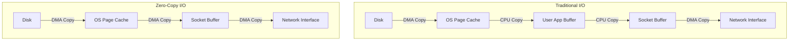
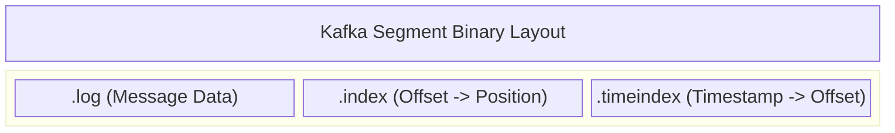
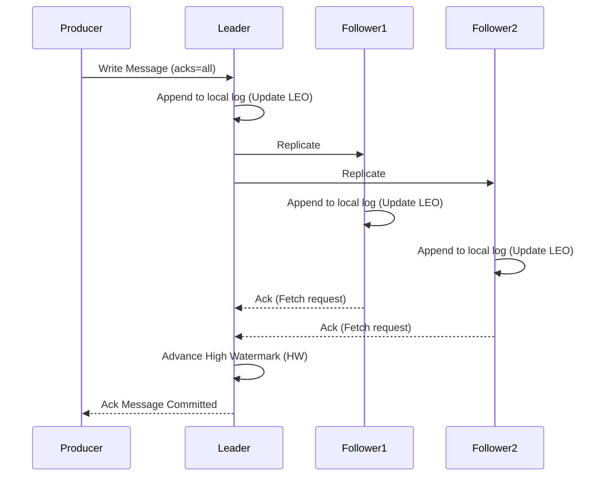

# Apache Kafka Storage Internals

A comprehensive deep-dive into Apache Kafka's low-level distributed log storage mechanics.

## Linux Kernel & Zero-Copy Architecture

Traditional I/O operations introduce significant overhead when transferring data from a disk to a network socket. A standard read and send sequence requires four context switches between user space and kernel space, along with four data buffer copies. Data moves from the disk to the OS page cache, then to the application buffer in user space, down to the socket buffer in kernel space, and finally to the network interface controller buffer. 

Kafka circumvents this inefficiency by leveraging the Linux `sendfile()` system call, which enables zero-copy data transfer. With zero-copy, Direct Memory Access engines transfer bytes directly from the OS page cache to the network socket buffer. This approach reduces context switches and eliminates intermediate buffer copies through user space, maximizing throughput and minimizing CPU utilization.

Furthermore, Kafka intentionally avoids relying heavily on the JVM heap for caching message data. By leaning on the Linux OS page cache, Kafka sidesteps garbage collection pauses and memory overhead associated with managing large numbers of objects in the JVM. The OS page cache automatically manages memory efficiently, keeping hot data in memory and seamlessly evacting cold data to disk, allowing Kafka brokers to handle massive datasets with consistent low-latency performance.

## Partition Log Anatomy

A Kafka partition is an ordered, immutable sequence of records. To prevent the partition from growing into an unmanageable monolith, it is broken down into smaller files called segments.

### Segment Files

Each segment consists of multiple components:

- **`.log` (Data File)**: Contains the actual message payload, offsets, and metadata.
- **`.index` (Offset Index)**: A sparse index mapping logical message offsets to their physical byte positions within the `.log` file. Because it is sparse, it doesn't store an entry for every message, but rather one entry for every few kilobytes, allowing for fast binary search lookups without excessive memory usage.
- **`.timeindex` (Time Index)**: Maps timestamps to offsets. This index enables time-based queries, allowing consumers to seek to a specific point in time rather than an offset.

### Retention and Rolling Policies

Kafka manages log growth through rolling and retention policies.

- **Log Rolling**: A segment is rolled when it reaches a predefined size limit or after a configured time period has elapsed. Once rolled, the segment becomes read-only, and a new active segment is created for incoming writes.
- **Retention Policies**: Kafka supports two primary mechanisms for managing old data. The delete policy discards entire segments once they exceed retention time or size thresholds. The compact policy, also known as log compaction, retains only the latest known value for each unique message key. Tombstone markers are used in compacted topics to indicate that a specific key should be deleted, ensuring eventual removal of stale data.

## Replication Protocol

Kafka achieves fault tolerance through a robust replication protocol. Each partition has a designated leader broker that handles all read and write requests, while follower brokers passively replicate the leader's log.

### Consistency Mechanics

- **Leader Epochs**: A monotonically increasing integer representing the leadership term. It resolves split-brain scenarios and ensures log consistency when a follower is elected as the new leader, preventing data truncation issues.
- **Log End Offset**: The LEO indicates the offset of the last message written to a broker's local log. Each replica maintains its own LEO.
- **High Watermark**: The HW represents the offset up to which all replicas in the In-Sync Replicas list have successfully replicated the data. Consumers can only read messages up to the HW, ensuring they do not consume uncommitted data.

### In-Sync Replicas

The In-Sync Replicas (ISR) list is a dynamic membership set comprising the leader and followers that are fully caught up with the leader's log. If a follower falls too far behind, it is removed from the ISR until it catches up again.

The `min.insync.replicas` configuration dictates the minimum number of replicas that must acknowledge a write before it is considered successful. When a producer sets `acks=all`, it guarantees maximum durability, as the leader waits for all ISR members to acknowledge the write. However, this comes with trade-offs. Waiting for multiple acknowledgments increases latency and slightly decreases throughput compared to `acks=1` or `acks=0`.

## Consumer Group Protocols

Consumers in Kafka coordinate to share the workload of processing a topic. The group coordinator broker handles partition assignment.

- **Eager Rebalance**: In older Kafka versions, when a consumer joined or left the group, the Eager Rebalance protocol was triggered. All consumers would stop processing, revoke their partition assignments, and wait for the coordinator to issue new assignments. This "stop-the-world" approach caused significant processing pauses.
- **Cooperative Sticky Rebalance Protocol**: Modern Kafka employs the Cooperative Sticky Rebalance Protocol. Instead of revoking all partitions simultaneously, consumers only revoke partitions that need to be reassigned. They continue processing their retained partitions throughout the rebalance. This incremental approach eliminates the stop-the-world pause, minimizing disruption and maintaining steady throughput during consumer group changes.
