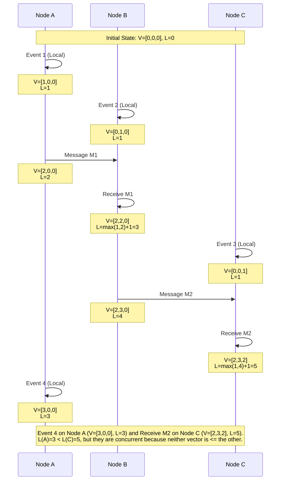

# Logical Time and Vector Clocks in Distributed Systems

Time is a fundamental concept in computing, but in distributed systems, achieving a common understanding of time is notoriously difficult. This guide explores the limitations of physical clocks and the theoretical mechanisms—specifically Lamport and Vector clocks—used to establish causality and order across disparate nodes.

## 1. Physical Clocks & Limitations

### Clock Drift and Skew
Every computer contains a hardware oscillator (typically quartz) that drives its local clock. Because these oscillators are imperfect, they run at slightly different frequencies depending on temperature, age, and manufacturing variance. This inaccuracy causes **clock drift**, where a clock gradually diverges from the true global time. The absolute difference between two clocks at any given instant is known as **clock skew**.

### NTP Limitations and Leap Seconds
The Network Time Protocol (NTP) is widely used to synchronize clocks across the internet. NTP clients periodically query servers to adjust their local time. However, due to variable network latencies, NTP can typically only guarantee accuracy within a few milliseconds. Furthermore, NTP handles phenomena like **leap seconds** by either abruptly stepping the clock or "smearing" the second over a longer period, both of which can cause anomalies in systems that rely on strict monotonic time.

### TrueTime (Google Spanner)
Google Spanner addresses these limitations with **TrueTime**, an API that explicitly exposes time uncertainty. TrueTime relies on a highly redundant architecture of GPS receivers and atomic clocks. Instead of returning a single timestamp, TrueTime returns a bounded uncertainty interval `[earliest, latest]`. Spanner enforces a **commit wait rule**: a transaction must wait until the `latest` time of its commit timestamp is guaranteed to have passed in real time. This ensures strict serializability across global datacenters.

### Hybrid Logical Clocks (HLC)
**Hybrid Logical Clocks (HLC)** attempt to combine the best of both worlds. They capture the happens-before relationship like logical clocks while remaining close to the physical time. An HLC timestamp consists of a physical time component and a logical tick counter. The logical component only increments when events occur faster than the physical clock's resolution or during periods of clock backward jumps.

## 2. Lamport Logical Clocks

Introduced by Leslie Lamport in 1978, Lamport clocks provide a way to order events in a distributed system without relying on synchronized physical clocks.

### The Happens-Before Relation
The foundation of logical time is the **happens-before relation (->)**. If event `a` happens before event `b` (`a -> b`), then `a` must causally affect `b`. 

* If `a` and `b` occur in the same process and `a` comes first, `a -> b`.
* If `a` is sending a message and `b` is receiving that same message, `a -> b`.
* The relation is transitive: if `a -> b` and `b -> c`, then `a -> c`.

### Algorithm
A Lamport clock is simply an integer counter maintained by each process. The rules are:

1. **Local Event:** Before executing an event, the process increments its counter: `L = L + 1`.
2. **Send Event:** When sending a message, the process increments its counter (`L = L + 1`) and attaches the new value to the message.
3. **Receive Event:** Upon receiving a message with timestamp `L_msg`, the process updates its clock to be greater than both its current time and the message's time: `L_local = max(L_local, L_msg) + 1`.

### Total Ordering and Limitations
Lamport clocks provide a partial order. To achieve a **total ordering**, ties are broken using arbitrary but consistent criteria, such as process IDs. If `L(a) == L(b)`, the event from the process with the smaller ID is considered to have happened first.

**Fundamental limitation:** While `a -> b` implies `L(a) < L(b)`, the reverse is **not true**. If `L(a) < L(b)`, it does NOT imply `a -> b`. The events `a` and `b` could be completely concurrent. Lamport clocks cannot detect concurrent events.

## 3. Vector Clocks

Developed independently by Mattern and Fidge in 1988, Vector Clocks solve the limitation of Lamport clocks by capturing strict causality and identifying concurrent events.

### Vector Definition and Update Rules
Instead of a single integer, a Vector Clock is an array (or vector) of size `N`, where `N` is the number of nodes in the system. Each node tracks its own progress and its knowledge of every other node's progress.

The update rules are:

1. **Local Event:** A node increments its own position in the vector: `V[local_id] = V[local_id] + 1`.
2. **Send Event:** The node increments its own position and sends the entire vector along with the message.
3. **Receive Event:** Upon receiving a message with vector `V_msg`, the node increments its own position and merges the incoming vector by taking the element-wise maximum: `V_local[k] = max(V_local[k], V_msg[k])` for all `k`.

### Causality Comparison
Vector clocks allow exact determination of causality:

* **Less Than or Equal:** `V(a) <= V(b)` iff for all `k`, `V(a)[k] <= V(b)[k]`.
* **Strictly Less Than (Happens-Before):** `V(a) < V(b)` iff `V(a) <= V(b)` and there exists at least one `k` such that `V(a)[k] < V(b)[k]`.
* **Concurrent:** Events are concurrent (`V(a) || V(b)`) iff neither `V(a) <= V(b)` nor `V(b) <= V(a)`. This means one vector has a strictly greater value in one dimension, while the other has a strictly greater value in a different dimension.

### Write Conflicts and Scalability
Vector clocks are extensively used in multi-leader and leaderless replication systems (e.g., Amazon Dynamo, Riak) to detect **write conflicts**. When two clients update the same data concurrently, the system detects divergent vector clocks and asks the application or client to resolve the conflict.

**Scalability challenges:** In systems with high node churn, the vector size grows continuously, consuming significant metadata storage and bandwidth. Modern systems use **Version Vectors** (which track updates rather than all events) and **Dotted Version Vectors** to aggressively prune historical metadata while maintaining causal accuracy.

## 4. Code Parity Implementation

Below are equivalent implementations of a Vector Clock in Python and Java. Both implementations provide methods to increment the clock, prepare a send, merge a received clock, and compare causality.

### Python Implementation

```python
from enum import Enum
from typing import Dict

class Causality(Enum):
    CAUSAL_PAST = -1
    CONCURRENT = 0
    CAUSAL_FUTURE = 1
    IDENTICAL = 2

class VectorClock:
    def __init__(self, node_id: str):
        self.node_id = node_id
        self.vector: Dict[str, int] = {node_id: 0}

    def increment(self) -> None:
        self.vector[self.node_id] += 1

    def send(self) -> Dict[str, int]:
        self.increment()
        return self.vector.copy()

    def receive_and_merge(self, incoming_vector: Dict[str, int]) -> None:
        for node, count in incoming_vector.items():
            self.vector[node] = max(self.vector.get(node, 0), count)
        self.increment()

    def compare(self, other_vector: Dict[str, int]) -> Causality:
        all_nodes = set(self.vector.keys()).union(other_vector.keys())
        
        is_less_or_equal = True
        is_greater_or_equal = True
        
        for node in all_nodes:
            self_val = self.vector.get(node, 0)
            other_val = other_vector.get(node, 0)
            
            if self_val > other_val:
                is_less_or_equal = False
            if self_val < other_val:
                is_greater_or_equal = False
                
        if is_less_or_equal and is_greater_or_equal:
            return Causality.IDENTICAL
        elif is_less_or_equal:
            return Causality.CAUSAL_PAST
        elif is_greater_or_equal:
            return Causality.CAUSAL_FUTURE
        else:
            return Causality.CONCURRENT
```

### Java Implementation

```java
import java.util.HashMap;
import java.util.HashSet;
import java.util.Map;
import java.util.Set;

public class VectorClock {
    
    public enum Causality {
        CAUSAL_PAST,
        CONCURRENT,
        CAUSAL_FUTURE,
        IDENTICAL
    }

    private final String nodeId;
    private final Map<String, Integer> vector;

    public VectorClock(String nodeId) {
        this.nodeId = nodeId;
        this.vector = new HashMap<>();
        this.vector.put(nodeId, 0);
    }

    public synchronized void increment() {
        vector.put(nodeId, vector.getOrDefault(nodeId, 0) + 1);
    }

    public synchronized Map<String, Integer> send() {
        increment();
        return new HashMap<>(vector);
    }

    public synchronized void receiveAndMerge(Map<String, Integer> incomingVector) {
        for (Map.Entry<String, Integer> entry : incomingVector.entrySet()) {
            String node = entry.getKey();
            int incomingCount = entry.getValue();
            int currentCount = vector.getOrDefault(node, 0);
            vector.put(node, Math.max(currentCount, incomingCount));
        }
        increment();
    }

    public synchronized Causality compare(Map<String, Integer> otherVector) {
        Set<String> allNodes = new HashSet<>();
        allNodes.addAll(this.vector.keySet());
        allNodes.addAll(otherVector.keySet());

        boolean isLessOrEqual = true;
        boolean isGreaterOrEqual = true;

        for (String node : allNodes) {
            int selfVal = this.vector.getOrDefault(node, 0);
            int otherVal = otherVector.getOrDefault(node, 0);

            if (selfVal > otherVal) {
                isLessOrEqual = false;
            }
            if (selfVal < otherVal) {
                isGreaterOrEqual = false;
            }
        }

        if (isLessOrEqual && isGreaterOrEqual) {
            return Causality.IDENTICAL;
        } else if (isLessOrEqual) {
            return Causality.CAUSAL_PAST;
        } else if (isGreaterOrEqual) {
            return Causality.CAUSAL_FUTURE;
        } else {
            return Causality.CONCURRENT;
        }
    }
}
```

## 5. Diagrams

The following space-time sequence diagram illustrates how messages update both Lamport Clocks (L) and Vector Clocks (V). It explicitly shows how vector clocks can identify concurrent events that Lamport clocks cannot.


