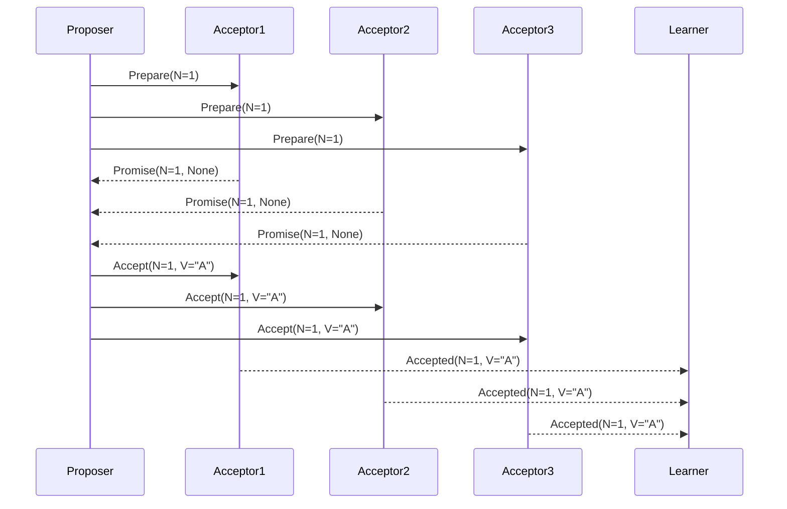

# Paxos Consensus Family

The Paxos consensus family is a set of protocols used to reach consensus on a single value or a sequence of values in a distributed network of computers, where nodes or communication links may fail. Introduced by Leslie Lamport, Paxos has become fundamental in building highly available and strongly consistent distributed systems. It guarantees safety under asynchronous network conditions and arbitrary crash failures, provided a majority quorum is available.

Over the years, the original Basic Paxos protocol has been extended and optimized to handle various operational requirements, leading to variations like Multi-Paxos, Flexible Paxos, and Egalitarian Paxos (EPaxos).

## 1. Basic Paxos

Basic Paxos is the foundational algorithm designed to agree on a single value. It operates in two main phases: Prepare/Promise and Accept/Accepted. 

### Roles
- **Proposers**: Advocate for a client request, attempting to convince Acceptors to agree on it.
- **Acceptors**: The fault-tolerant memory of the system. They vote on proposals and guarantee that conflicting proposals are not chosen.
- **Learners**: Actors that learn the chosen value once consensus is reached.

### The Algorithm

#### Phase 1: Prepare
A Proposer selects a unique proposal number $N$ and sends a `Prepare(N)` request to a majority of Acceptors.

If an Acceptor receives a `Prepare(N)` where $N$ is strictly greater than any proposal number it has previously responded to, it promises not to accept any proposals numbered less than $N$. It responds with a `Promise(N, v, N_v)`, where `v` is the value of the highest-numbered proposal it has already accepted, if any.

#### Phase 2: Accept
If the Proposer receives promises from a majority of Acceptors, it issues an `Accept(N, V)` request. $V$ is the value associated with the highest-numbered proposal among the promises. If no previous value was returned, the Proposer can choose its own value.

An Acceptor accepts `Accept(N, V)` unless it has already promised to ignore proposals numbered $N$ (because it responded to a `Prepare` with a higher number).

### Basic Paxos Sequence Diagram

## 2. Multi-Paxos

Basic Paxos is inefficient for agreeing on a continuous stream of values (e.g., a replicated log) because each value requires two round-trips (Prepare and Accept). Multi-Paxos optimizes this by electing a distinguished Proposer, or "Leader". 

Once a Leader is elected, it can skip Phase 1 (Prepare) for subsequent values as long as it remains the leader. It binds a lease to its leadership, allowing it to directly issue `Accept` messages for a sequence of log entries. This reduces the consensus latency from two round-trips to one round-trip under stable conditions.

### Leader Election
The leader election itself can be handled via a single instance of Basic Paxos or specialized leased-based protocols. If the current leader fails, another node will eventually timeout, elect itself as the new leader by running a Prepare phase, and take over.

## 3. Flexible Paxos

Flexible Paxos challenges the long-held assumption that all Paxos quorums (Phase 1 and Phase 2) must intersect. Traditionally, both phases require a majority quorum, ensuring that any Phase 1 quorum intersects with any Phase 2 quorum.

Flexible Paxos observes that safety only requires that Phase 1 quorums intersect with Phase 2 quorums. It is not necessary for two Phase 1 quorums to intersect, nor for two Phase 2 quorums to intersect.

This insight allows system designers to configure quorum sizes based on operational needs. For example:
- Make Phase 2 quorums smaller (e.g., 2 out of 5 nodes) to improve the latency and throughput of steady-state replication (since Phase 2 happens on every write).
- Compensate by making Phase 1 quorums larger (e.g., 4 out of 5 nodes). Since Phase 1 only happens during leader election, the increased cost is rarely paid.

## 4. Egalitarian Paxos (EPaxos)

EPaxos is a leaderless consensus protocol designed for wide-area networks (WANs) where clients are geographically distributed. In Multi-Paxos, all writes must be routed to the single leader, causing high latency for clients far from the leader.

EPaxos allows any replica to propose a command. It dynamically establishes dependencies between concurrent commands to ensure they are applied in a consistent order across all replicas.
- **Fast Path:** If a command doesn't conflict with concurrent proposals, it can be committed in a single round-trip to a fast-path quorum.
- **Slow Path:** If conflicts are detected, EPaxos falls back to an additional round-trip (similar to traditional Paxos) to establish a total order among the conflicting commands.

This provides near-optimal commit latency across WANs and eliminates the single-leader bottleneck, at the cost of higher complexity in handling command dependencies.

## Conclusion

The Paxos family of protocols provides a robust toolkit for state machine replication and distributed consensus. Basic Paxos provides the safety invariants. Multi-Paxos optimizes for throughput via stable leadership. Flexible Paxos allows quorum tuning for steady-state performance. EPaxos offers decentralized, low-latency consensus for geographically distributed systems. Understanding these variants is crucial for designing modern, resilient infrastructure.
