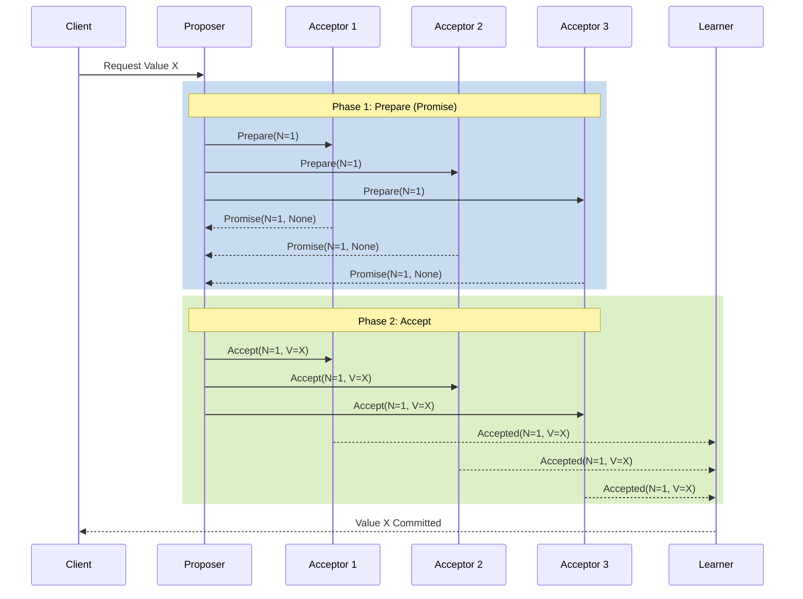
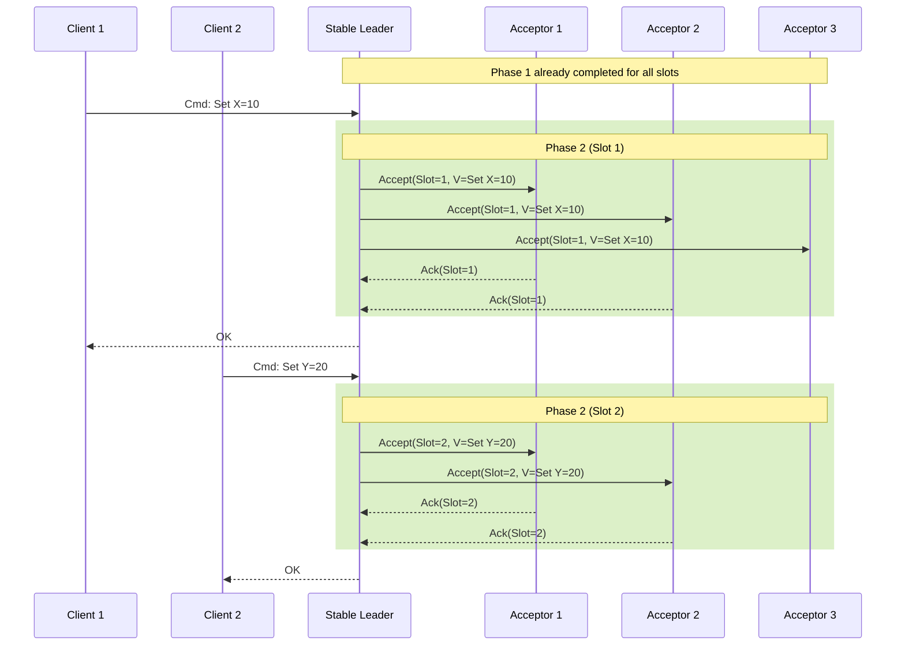
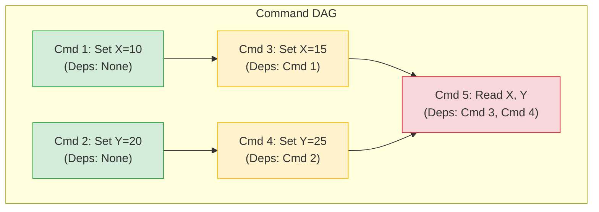

# 🏛️ Paxos Consensus Variants

This deep dive covers the Paxos consensus family, an essential set of theoretical and practical algorithms used to achieve distributed agreement across unreliable networks with crash-prone nodes.

## 1. The Consensus Problem & Safety Invariants

Distributed consensus fundamentally requires multiple independent nodes to agree on a single, permanent value or state, even in the presence of network partitions, message loss, and node crashes. This agreement mechanism forms the foundation for reliable state machine replication, leader election, and distributed coordination.

The network model assumed by Paxos is fully asynchronous with crash-recovery failures. Messages can take arbitrarily long to deliver, can be duplicated, and can be lost entirely. Nodes can crash and restart at any time, but Byzantine failures (where nodes act maliciously or return corrupted data) are strictly out of scope.

### Fundamental Invariants

Any valid consensus algorithm must mathematically guarantee three core properties.

**Agreement (Safety)**: No two nodes can decide on different values. Once a value is chosen by the system, no other value can ever be chosen, guaranteeing consistency.

**Validity (Safety)**: Any value decided upon must have been proposed by a participating node. The system cannot invent values out of thin air.

**Liveness**: If a value is proposed, the system will eventually decide on a value, provided a majority quorum of nodes remains non-faulty and can communicate. Due to the FLP Impossibility Result, purely asynchronous consensus cannot guarantee liveness deterministically; Paxos relies on periods of synchrony and randomized backoffs to ensure progress.

## 2. Single-Decree (Classic) Paxos

Classic Paxos forms the bedrock of the algorithm, solving the problem of agreeing on exactly one value among a set of participants.

### Node Roles

Participants in Paxos take on one or more distinct logical roles. A single physical server often runs all three roles simultaneously.

**Proposers**: Nodes that advocate for a specific value to be chosen. They drive the protocol forward by sending proposals to the acceptors.

**Acceptors (Voters)**: Nodes that act as the fault-tolerant memory of the system. They collectively decide which proposal to accept. A value is considered permanently chosen once a majority quorum (floor(N/2) + 1) of acceptors accept it.

**Learners**: Nodes that simply learn which value was ultimately chosen by the acceptors, without actively participating in the voting process.

### Phase 1a (Prepare)

The proposer initiates the protocol by selecting a globally unique, monotonically increasing proposal number (e.g., using a combination of a local counter and the server ID to break ties).

The proposer sends a `PREPARE(N)` message containing this number to a majority quorum of acceptors. The proposer is asking the acceptors to promise not to accept any future proposals numbered less than `N`.

### Phase 1b (Promise)

When an acceptor receives a `PREPARE(N)` message, it compares `N` to the highest proposal number it has ever seen.

If `N` is higher than any previously seen proposal number, the acceptor records `N` and replies with a `PROMISE` message. Crucially, if the acceptor has already accepted a value in a previous interaction, it must include that highest-numbered accepted value in its `PROMISE` response.

If `N` is lower than a previously seen proposal number, the acceptor can safely ignore the message or return a `NACK` to help the proposer back off.

### Phase 2a (Accept)

If a proposer receives `PROMISE` responses from a majority quorum, it proceeds to the accept phase. It must now choose a value `V` to propose.

**The Value Selection Rule**: If any acceptors returned previously accepted values in Phase 1b, the proposer must adopt the value associated with the highest proposal number from those responses.

If none of the acceptors had previously accepted a value, the proposer is free to choose any value it wishes. The proposer then sends an `ACCEPT(N, V)` request to a quorum of acceptors.

### Phase 2b (Accepted)

Upon receiving an `ACCEPT(N, V)` message, an acceptor will accept the value `V` unless it has already responded to a newer `PREPARE` message with a number greater than `N`.

If it accepts the value, it records it and broadcasts an `ACCEPTED(N, V)` message to the learners. Once a learner receives matching `ACCEPTED` messages from a majority quorum, the value is officially chosen and committed.

### Formal Proof of Quorum Intersection

The mathematical safety of Paxos hinges entirely on the properties of majority quorums.

By definition, any two majority subsets drawn from the same overall set of nodes must intersect by at least one node. If Quorum A accepts a value, and Quorum B is later queried during a new Phase 1, the intersection node guarantees that the proposer of Quorum B will see the value accepted by Quorum A.

This intersection forces the new proposer to adopt the already-chosen value, preventing the system from ever deciding on a different value and thus preserving safety invariants across network partitions.

### Failure Edge Cases

A major vulnerability in Classic Paxos is the potential for **Proposer Dueling**, which leads to a livelock condition.

If Proposer 1 sends `PREPARE(1)` and gets promises, but before it can send `ACCEPT`, Proposer 2 sends `PREPARE(2)`. The acceptors promise Proposer 2, rejecting Proposer 1's `ACCEPT(1)`. Proposer 1 then retries with `PREPARE(3)`, blocking Proposer 2's `ACCEPT(2)`, and so on infinitely.

This livelock is mitigated by introducing randomized exponential backoffs before proposers retry, breaking the synchronization and allowing one proposer to complete Phase 2.

## 3. Multi-Paxos

Running Classic Paxos for every single decision requires at least two network round trips, which is highly inefficient for a replicated state machine that processes a continuous stream of commands. Multi-Paxos optimizes this by electing a stable leader.

### Eliminating Phase 1

Multi-Paxos chains multiple instances of Classic Paxos together to build a continuous distributed log. The key optimization is electing a designated stable leader to act as the sole proposer.

Once a leader is established via a successful Phase 1 that covers all future log slots, Phase 1 can be entirely skipped for subsequent commands. The leader can immediately issue Phase 2a `ACCEPT` messages for new commands, cutting the latency of steady-state operation from two round trips down to just one.

Leader stability is typically maintained via lease heartbeats. If the leader crashes, the lease expires, and a new node initiates a Phase 1 election to take over.

### Log Management

Multi-Paxos requires mechanisms for managing the continuous log of commands.

Slots are allocated sequentially. Because network messages can arrive out of order, the protocol supports pipelining, where the leader proposes multiple commands concurrently without waiting for previous slots to commit.

This pipelining can result in log gaps if a command fails to commit while subsequent commands succeed. The system must implement background mechanisms to detect and fill these gaps, often by proposing no-op commands to forcefully commit empty slots and allow the state machine to advance its apply index.

## 4. Fast Paxos

Fast Paxos, introduced by Leslie Lamport, attempts to further reduce latency by bypassing the leader entirely under favorable conditions.

### Bypassing the Leader

In standard Multi-Paxos, a client must send its command to the leader, which then coordinates with the acceptors. This requires two network hops (Client -> Leader -> Acceptors).

Fast Paxos allows clients to send proposals directly to the acceptors, completing the commit in a single network hop from the client's perspective when there is no contention.

### Fast Quorums

To maintain safety without a serializing leader, Fast Paxos requires larger "fast quorums."

Instead of a simple majority, a fast quorum requires ceil(3N/4) acceptors. The math behind this larger quorum ensures that even if concurrent clients propose different values, the intersection of any two fast quorums and any classic majority quorum is large enough to guarantee that at least one acceptor in the intersection retains the winning value, enabling recovery.

### Collision Detection

Because clients propose directly, concurrent proposals can easily collide at the acceptors, resulting in no single value securing a fast quorum.

When a collision occurs, the system must detect it and fall back to a recovery phase. A designated leader typically handles this recovery, gathering the conflicting state from the acceptors and running a classic Paxos round to deterministically choose one of the competing values, adding latency and complexity.

## 5. Egalitarian Paxos (EPaxos)

Egalitarian Paxos takes a radically different approach to optimize for geo-distributed deployments.

### Leaderless Architecture

EPaxos completely eliminates the concept of a dedicated leader, allowing any node (replica) to independently accept and commit commands from clients.

This leaderless design eliminates the single bottleneck of a leader and provides optimal, uniform latency regardless of which geographic region the client connects to, making it ideal for globally distributed databases.

### Dependency Graphs

To handle concurrent commands safely without a central coordinator, EPaxos tracks command dependencies dynamically.

When a node receives a command, it assigns it a sequence number and attaches a list of dependencies—other concurrent commands that conflict with it (e.g., commands modifying the same keys). These dependencies form a directed graph across the cluster.

### Fast Path Commit

If a command does not conflict with any concurrent commands (meaning the dependency graphs perfectly align across nodes), EPaxos can commit it via a single-round "fast path" using a simple majority quorum.

If conflicts are detected, EPaxos falls back to a slow path, executing an additional round of communication to agree on a deterministic ordering for the conflicting commands before they are applied to the state machine.

## 6. Diagrams

### Classic Paxos Sequence

### Multi-Paxos Steady State

### EPaxos Dependency Graph Resolution

## 7. Interview Checklist & Pitfalls

When discussing Paxos and Raft in Staff+ engineering interviews, candidates frequently make several critical conceptual errors.

### Common Pitfalls

- **Confusing Paxos with Raft Leader Election**: Candidates often claim Paxos has strong leader election built-in by default. Classic Paxos is inherently leaderless for safety; Multi-Paxos adds a distinguished proposer as a performance optimization, whereas Raft relies on strong leadership for both safety and performance.
- **Misunderstanding the Value Selection Rule**: A common failure is not realizing that a proposer *must* adopt a previously accepted value during Phase 2. Candidates incorrectly assume the proposer can always force its own original value through.
- **Ignoring the FLP Impossibility Result**: Failing to acknowledge that Paxos cannot guarantee liveness in purely asynchronous networks. Understanding that randomized backoffs or timeout-based leader elections are required to break livelock is crucial.
- **Misstating Quorum Intersection Math**: Simply saying "majority" isn't enough. Candidates must be able to articulate *why* quorums intersect (pigeonhole principle) and how that intersection preserves safety across network partitions.
- **Overlooking Log Gaps in Multi-Paxos**: Assuming log slots are strictly linear and contiguous. Staff+ candidates should recognize that out-of-order message delivery in Multi-Paxos pipelining requires explicit mechanisms to detect and fill empty log slots.
