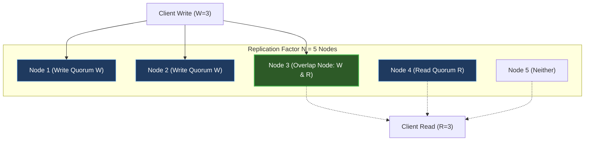
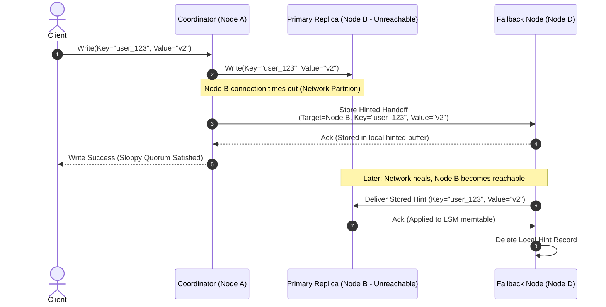
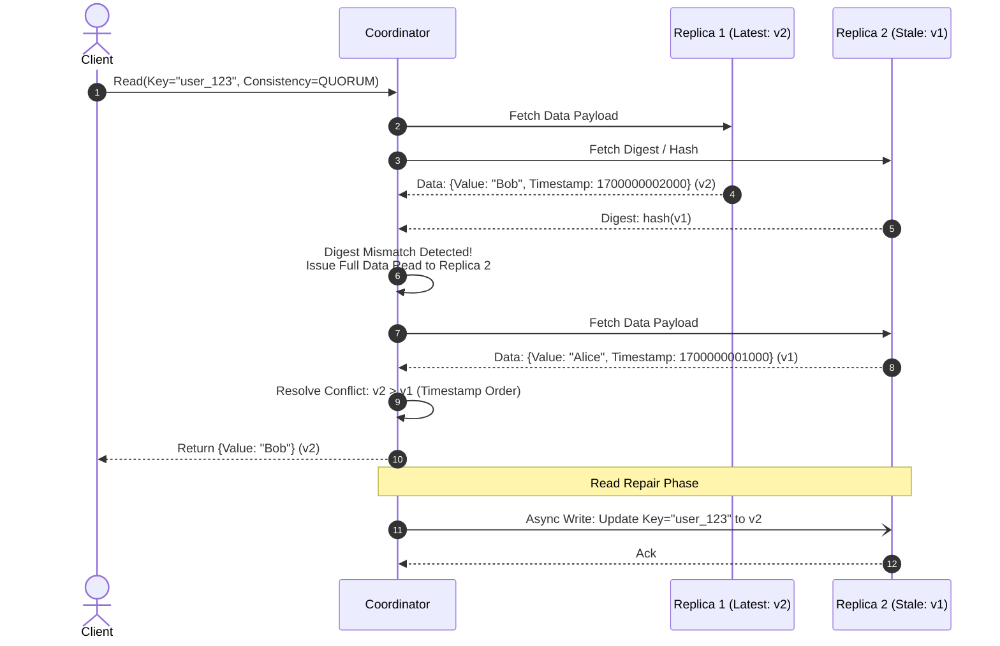
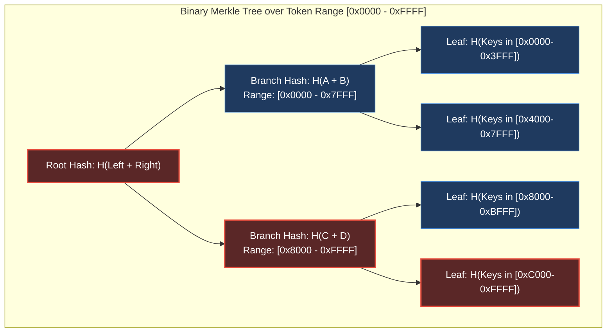

# Quorum Consistency, Hinted Handoff, and Anti-Entropy

In leaderless (Dynamo-style) distributed storage architectures—such as Amazon DynamoDB, Apache Cassandra, and ScyllaDB—there is no fixed master or primary node designated to coordinate all writes. Instead, any replica can accept read and write operations, or a lightweight stateless coordinator node routes requests to a set of replica nodes responsible for a given partition key.

To maintain correctness, durability, and availability without centralized coordination, these systems rely on three foundational mechanisms:
1. **Quorum Mathematics ($N, W, R$)**: Governing probabilistic vs. strong read-after-write guarantees.
2. **Sloppy Quorums & Hinted Handoff**: Preserving write availability during severe network partitions or hardware faults.
3. **Entropy Resolution via Read Repair & Merkle Trees**: Continuously detecting and repairing data divergence across replicas.

---

## 1. Strict Quorum Mathematics

In a leaderless system, data is partitioned using consistent hashing and replicated across $N$ physical storage nodes (the **Replication Factor**).

When clients interact with the cluster:
* **$N$ (Replication Factor)**: Total number of distinct physical nodes designated to store replicas of a partition key range.
* **$W$ (Write Quorum)**: The minimum number of replica nodes that must successfully process and acknowledge a write request before the coordinator reports success to the client.
* **$R$ (Read Quorum)**: The minimum number of replica nodes that must respond to a read request before the coordinator returns the result to the client.

### The Pigeonhole Principle: $R + W > N$

By the pigeonhole principle, if the sum of the read quorum size and write quorum size strictly exceeds the total replication factor ($R + W > N$), the set of nodes written to and the set of nodes read from **must overlap by at least one node**:

$$\text{Overlap} = (R + W) - N \ge 1$$

Because at least one node in the read set observed the latest write, the coordinator can inspect version timestamps (or vector clocks) across all $R$ responses and return the latest version to the client.

| Configuration ($N=3$) | Guarantee | Read Latency | Write Latency | Typical Use Case |
|:---|:---|:---|:---|:---|
| $W=1, R=3$ | Strong read-after-write ($R+W > N$) | High (waits for all 3) | Lowest (waits for 1) | Write-heavy, infrequent reads |
| $W=3, R=1$ | Strong read-after-write ($R+W > N$) | Lowest (waits for 1) | High (vulnerable to 1 node failure) | Read-heavy, rare critical writes |
| $W=2, R=2$ | Strong read-after-write ($R+W > N$) | Balanced (majority) | Balanced (majority) | Standard balanced transactional storage |
| $W=1, R=1$ | Eventual consistency ($R+W \le N$) | Lowest | Lowest | High-throughput telemetry, analytics counters |

---

### Why Strict Quorums Fail Strong Consistency in Practice

While $R + W > N$ provides theoretical quorum intersection, standard leaderless Dynamo-style systems do not provide true serializability or linearizability out of the box due to practical edge cases:

#### 1. Concurrent Writes Racing on Different Nodes
If two clients concurrently write distinct values for the same key with $W=2, N=3$:
* Client A writes to Node 1 and Node 2.
* Client B writes to Node 2 and Node 3.
Both writes achieve quorum ($W=2$). Node 2 receives both writes, while Node 1 only sees A and Node 3 only sees B. If resolution relies on wall-clock timestamps (Last-Write-Wins), unsynchronized NTP clock skew can cause the older write to silently overwrite the newer write.

#### 2. Phantom Reads During Partial Write Failures
Suppose Client A sends a write with $W=2$.
* Node 1 accepts the write.
* Node 2 and Node 3 drop the packet or time out.
* The coordinator returns an error (`WriteTimeoutException`) to Client A because $W=2$ was not satisfied.
However, **Node 1 already committed the write locally**. Subsequent reads with $R=2$ that include Node 1 may observe the value from the "failed" write. Leaderless storage does not automatically roll back writes on nodes that succeeded.

#### 3. Concurrent Read and Write Racing
While a write is propagating to $W$ replicas, a concurrent reader querying $R$ nodes may hit a subset of replicas that haven't received the write yet, or receive mixed versions. Without multi-version consensus (like Paxos or Raft), read operations are not linearizable.

---

## 2. Sloppy Quorums and Hinted Handoff

In a strict quorum, the $W$ and $R$ operations must be satisfied exclusively by nodes within the key's designated **preference list** (the first $N$ healthy nodes encountered when traversing the consistent hash ring clockwise). If a network partition isolates 2 out of 3 nodes in the preference list, writes configured with $W=2$ will fail.

To prioritize **high availability for writes** (AP in the CAP theorem), systems like Dynamo and Cassandra offer **Sloppy Quorums**.

### Mechanics of Hinted Handoff
1. **Fallback Selection**: If a node in the top-$N$ preference list is dead or unreachable, the coordinator routes the write to a healthy node outside the preference list (e.g., node $N+1$).
2. **Hint Metadata**: The fallback node stores the payload in a dedicated local hints directory along with metadata:
   $$\text{Hint} = \{ \text{target\_node\_uuid}, \text{partition\_key}, \text{timestamp}, \text{data\_payload} \}$$
3. **Re-delivery**: The fallback periodically gossips or heartbeats the primary node. Once the primary recovers, the fallback streams the buffered hints to it.
4. **Pruning**: Once acknowledged by the primary, the fallback purges the hint.

### Trade-offs: Availability vs. Staleness
* **Advantage**: The cluster accepts writes even during massive network splits or rolling restarts.
* **Material Trade-off**: A sloppy quorum does **not** guarantee $R + W > N$ intersection on the true preference list. A client performing a strict quorum read ($R=2$) on the preference list will miss the write stored temporarily on the fallback node until hinted handoff delivery completes.

---

## 3. Read Repair

Read repair is an opportunistic anti-entropy mechanism executed during user-initiated read operations.

### Synchronous vs. Asynchronous Read Repair
* **Digest Reads**: To conserve network bandwidth, the coordinator requests the full data payload from only one replica and cryptographic digests (e.g., SHA-256) from the remaining $R-1$ replicas.
* **Mismatch Handling**: If digests match, the coordinator returns immediately. If hashes differ, the coordinator fetches full records from all divergent nodes, reconciles the value using timestamps or vector clocks, and:
  * **Synchronous Read Repair**: Blocks returning the response to the client until divergent replicas are patched. This guarantees monotonic read consistency at the expense of tail latency ($p99$).
  * **Asynchronous Read Repair**: Returns the resolved value to the client immediately and dispatches asynchronous background writes to repair stale replicas.

---

## 4. Background Anti-Entropy with Merkle Trees

While Read Repair continuously heals frequently accessed data, cold data (keys that are rarely or never read) can remain stale indefinitely if hinted handoffs expire or get dropped.

To repair cold data without scanning billions of keys across the network, distributed databases run **Background Anti-Entropy** using **Merkle Trees**.

### Merkle Tree Synchronization Algorithm
1. **Tree Generation**: Each node independently constructs a Merkle tree for a specific token range. Leaf nodes contain the cryptographic hash of all keys and values within that bucket range. Internal nodes contain hashes of their combined children:
   $$H_{\text{parent}} = \text{Hash}(H_{\text{left\_child}} \,||\, H_{\text{right\_child}})$$
2. **Top-Down Comparison**:
   * Replica A sends its Root Hash to Replica B.
   * If $\text{Root}_A == \text{Root}_B$, the entire dataset is identical; synchronization terminates in $O(1)$ network operations.
   * If $\text{Root}_A \ne \text{Root}_B$, Replica B requests child hashes $H_1$ and $H_2$.
3. **Subtree Traversal**: The nodes compare hashes down the tree. Subtrees with matching hashes are immediately skipped.
4. **Bounded Range Repair**: Traversal isolates the exact divergent leaf buckets in $O(\log M)$ steps (where $M$ is the number of leaves). Replicas only transmit the delta keys within the divergent buckets.

---

## 5. Architectural Summary & Trade-offs

| Mechanism | Frequency / Trigger | Latency Impact | Network Overhead | Primary Failure Addressed |
|:---|:---|:---|:---|:---|
| **Strict Quorum ($R+W > N$)** | Every request | Moderate ($R, W$ round trips) | Proportional to $R + W$ | Inconsistent reads of active data |
| **Sloppy Quorum & Hints** | On primary node failure | Zero added latency | Deferred hint streaming | Unavailability during network partitions |
| **Read Repair** | On read divergence | Low to medium | Full payload read on mismatch | Stale reads of hot/warm keys |
| **Anti-Entropy (Merkle Trees)**| Scheduled / Manual repair | Zero client impact | High disk I/O, low network | Cold data divergence & dropped hints |

By combining strict or tunable quorums with opportunistic read repair, graceful hinted handoffs, and background Merkle tree syncs, Dynamo-style databases achieve bounded staleness and continuous high availability across distributed clusters.
