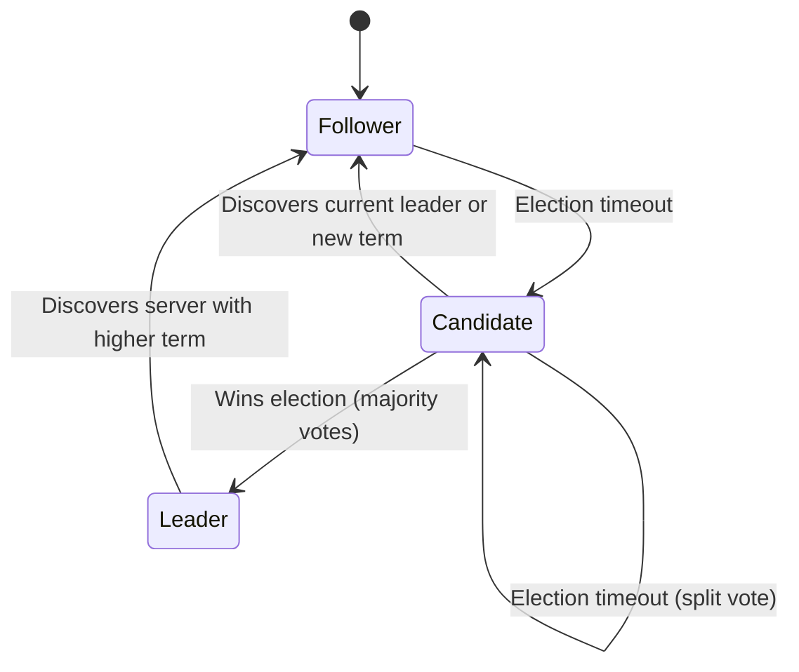
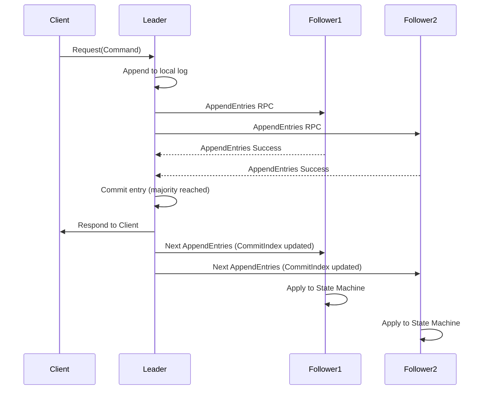
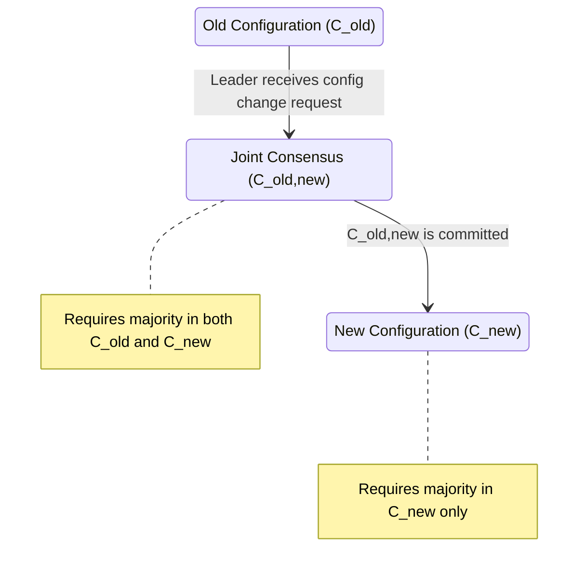

# Raft Consensus Protocol

Raft is a distributed consensus algorithm designed by Diego Ongaro and John Ousterhout. It was created as an alternative to Paxos, prioritizing understandability while providing the same fault-tolerance and performance guarantees.

Raft decomposes the consensus problem into three relatively independent subproblems: Leader Election, Log Replication, and Safety. By electing a single strong leader, Raft simplifies the management of the replicated log.

## 1. Core Architecture & Node States

A Raft cluster typically contains five servers, allowing the system to tolerate two failures. At any given time, each server operates in one of three states: Follower, Candidate, or Leader. 

**Follower:** All servers start as followers. They are passive, issuing no requests on their own but simply responding to requests from leaders and candidates.

**Candidate:** If a follower receives no communication (heartbeat) over a certain period, it transitions to a candidate and initiates an election to become the new leader.

**Leader:** The cluster has at most one leader at a time. The leader handles all client requests and manages the replication of log entries to the followers.

Raft uses **Term numbers** as logical clocks. Time is divided into terms of arbitrary length, each beginning with an election. Terms ensure that stale information from previous leaders can be detected and discarded.

## 2. Leader Election

Raft uses a heartbeat mechanism to trigger leader election. The leader periodically sends heartbeats (empty AppendEntries RPCs) to maintain authority.

If a follower receives no heartbeat within its **election timeout**, it assumes the leader has failed. The follower increments its current term, transitions to candidate state, votes for itself, and sends **RequestVote RPCs** to all other servers.

To prevent split votes where multiple followers become candidates simultaneously, Raft employs **election timeout randomization**. Timeouts are randomly chosen from a fixed interval (e.g., 150ms-300ms). This ensures that candidates time out at different times, allowing one candidate to win the election before others time out.

The RequestVote RPC enforces strict candidate restrictions to guarantee safety. A candidate's log must be at least as up-to-date as the receiver's log. Raft determines this by comparing the index and term of the last entries. If the logs have last entries with different terms, the log with the higher term is more up-to-date. If the terms are identical, the longer log is more up-to-date.

## 3. Log Replication & Commit Invariants

Once a leader is elected, it begins servicing client requests. Each request contains a command to be executed by the replicated state machines.

The leader appends the command to its log and issues **AppendEntries RPCs** in parallel to all followers. The AppendEntries RPC includes a consistency check: it contains the `prevLogIndex` and `prevLogTerm` of the entry immediately preceding the new ones. If the follower does not find an entry in its log with the same index and term, it refuses the new entries.

In case of inconsistencies, Raft implements **Follower log repair**. The leader maintains a `nextIndex` for each follower. If a follower's log is inconsistent, the AppendEntries consistency check fails. The leader then decrements `nextIndex` and retries. This process continues until a `matchIndex` is found, at which point the leader overwrites all conflicting entries in the follower's log.

A critical safety invariant is that a **leader never commits log entries from previous terms by counting replicas**. A leader can only safely commit entries from its *current term* by counting a majority. Older entries are committed indirectly when a current-term entry is committed.

## 4. Formal Raft Safety Invariants & Proofs

Raft guarantees five fundamental safety properties at all times:

**Election Safety:** At most one leader can be elected in a given term. This is enforced by the requirement that a candidate must secure votes from a majority of the cluster, and each server can vote for at most one candidate per term.

**Leader Append-Only:** A leader never overwrites or truncates its own log; it only appends new entries. This ensures the leader's log is always the source of truth.

**Log Matching Property:** If two logs contain an entry with the same index and term, they are identical in all entries up to that given index. This is enforced by the AppendEntries consistency check.

**Leader Completeness:** If a log entry is committed in a given term, that entry will be present in the logs of the leaders for all higher terms. The RequestVote restriction ensures that only candidates with all committed entries can win an election.

**State Machine Safety:** If a server has applied a log entry at a given index to its state machine, no other server will ever apply a different log entry for that same index.

## 5. Cluster Membership Changes

In production systems, it is sometimes necessary to change the cluster configuration, such as replacing a failed server or changing the degree of replication.

Raft addresses this using a two-phase **Joint Consensus** transition. The cluster first transitions from the old configuration (`Cold`) to a joint configuration (`Cold,new`). Once `Cold,new` is committed, it transitions to the new configuration (`Cnew`).

During the joint consensus phase, log entries are replicated to both the old and new configurations, and majorities must be achieved in *both* configurations.

A simplified **single-server membership change optimization** was later introduced. By adding or removing only one server at a time, it is mathematically impossible for two disjoint majorities to exist concurrently. This optimization avoids the complexity of the full two-phase joint consensus.

## 6. Log Compaction & Snapshotting

A practical distributed log cannot grow indefinitely without exhausting storage capacity or making startup times prohibitively long.

Raft uses **snapshotting** for log compaction. Each server independently takes a snapshot of its state machine's current state and writes it to stable storage.

The snapshot includes the last included index and term. After snapshotting, the server can **truncate the prefix of the log** up to that index, freeing up memory and disk space.

If a follower falls too far behind (e.g., it was offline) and the leader has already discarded the log entries the follower needs, the leader sends an **InstallSnapshot RPC**. This RPC transmits the leader's current snapshot to the follower, allowing it to catch up.

## 7. Diagrams

### Raft Node State Machine

### AppendEntries Log Replication

### Joint Consensus Configuration Switch

## 8. Interview Tradeoffs: Raft vs Multi-Paxos

When discussing consensus in system design interviews, you will often need to compare Raft against Multi-Paxos. Raft has become the preferred choice for modern industry systems like etcd, Consul, CockroachDB, and TiKV.

The primary advantage of Raft is its **understandability**. Paxos is notoriously difficult to comprehend and even harder to implement correctly in a production environment. The original Paxos paper describes a single-decree protocol; building a practical continuous log (Multi-Paxos) requires significant custom engineering.

Raft decomposes the problem into distinct, manageable components: leader election, log replication, and safety. This clear separation of concerns makes it much easier to reason about, implement, and maintain.

Furthermore, Raft enforces a stronger leadership model. While Multi-Paxos allows any node to propose entries, Raft restricts log replication to flow strictly from the leader to the followers. This simplified data flow reduces edge cases and makes log reconciliation much more straightforward.

Finally, Raft explicitly addresses practical concerns that Paxos left as exercises for the reader, such as cluster membership changes and log compaction. This comprehensive specification is why the industry has largely converged on Raft for modern distributed systems.

