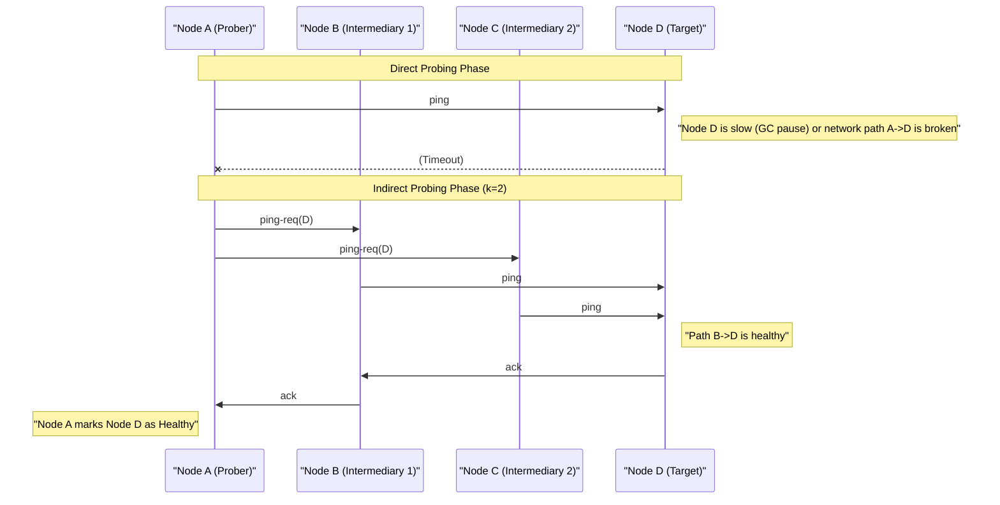
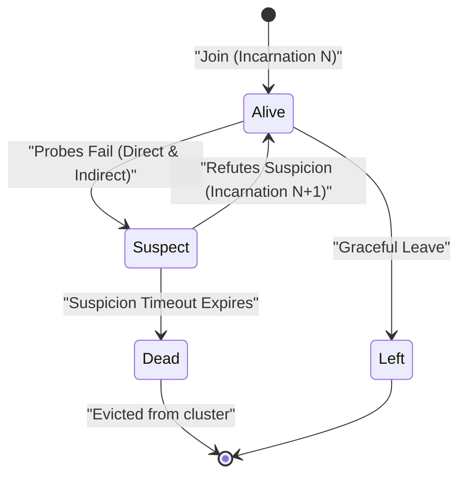

# SWIM Gossip Protocol: Structured Weakly-Consistent Infection-Style Group Membership

## 🔍 The Group Membership Problem

In any distributed system, knowing which nodes are currently active, failed, or joining the cluster is a fundamental requirement. This is formally known as the **Group Membership Problem**. A membership protocol must provide a consistent view of the cluster state to all participating nodes. 

Traditionally, systems employed one of two primary strategies to solve this problem, both of which suffer from severe scalability limitations as the cluster grows:

1. **All-to-All Heartbeating:** Every node periodically broadcasts a heartbeat message to every other node in the cluster. While simple and providing strong time-bounds on failure detection, the network overhead grows quadratically $O(N^2)$. In a cluster of 1,000 nodes, heartbeating every second requires 1,000,000 messages per second, quickly overwhelming network bandwidth and CPU.
2. **Hierarchical Coordinators:** A centralized coordinator (or a small set of coordinators like Apache ZooKeeper) is responsible for pinging worker nodes and maintaining the membership list. While this reduces message complexity to $O(N)$, it introduces a severe single point of failure and a scalability bottleneck at the coordinator layer. If the coordinator goes down, the cluster loses membership visibility until a new leader is elected.

The **SWIM Protocol** (Structured Weakly-Consistent Infection-Style Process Group Membership Protocol), introduced by Das, Gupta, and Motivala, solves these limitations. SWIM provides a decentralized, highly scalable membership protocol that guarantees a constant expected network load per node $O(1)$, while ensuring an expected failure detection time that scales logarithmically $O(\log N)$ with the cluster size.

---

## 📡 SWIM Failure Detector Component

The core innovation of SWIM is separating the Failure Detection and the Dissemination components. 
The Failure Detector uses a randomized, dual-phase probing mechanism to determine node health without relying on global heartbeats.

### Direct Probing
During every protocol period $T$, a node (let's call it $M_i$) randomly selects another node ($M_j$) from its local membership list and sends a direct `ping` message. $M_i$ then waits for an `ack` (acknowledgment) from $M_j$. 
- If the `ack` is received within the specified timeout, $M_j$ is considered healthy.
- If the `ack` is not received (due to network congestion, GC pause, or actual failure), $M_i$ does not immediately declare $M_j$ dead. Instead, it initiates the indirect probing phase.

### Indirect Probing (Ping-Req)
To eliminate false positives caused by transient network path issues (e.g., a broken router between $M_i$ and $M_j$), $M_i$ selects $k$ random intermediary peers from its membership list. It sends a `ping-req` (ping request) to these $k$ peers, instructing them to ping $M_j$ on its behalf.
- The intermediaries send a direct `ping` to $M_j$.
- If $M_j$ responds to any of the intermediaries with an `ack`, the intermediary forwards the `ack` back to $M_i$.
- If $M_i$ receives at least one `ack` via the indirect paths, it considers $M_j$ healthy.
- Only if all $k$ indirect probes also time out does the failure detector consider $M_j$ to be failed.

This localized probing approach guarantees $O(1)$ network overhead per node (constant number of messages per period), regardless of the cluster size.

---

## ⚠️ The Suspicion Mechanism (SWIM Enhancement)

While indirect probing mitigates false positives from localized network partitions, it does not solve false positives caused by temporary node unresponsiveness (e.g., severe CPU starvation, Stop-The-World Garbage Collection pauses in Java/Go, or transient packet drops). 

If a node is erroneously marked as Dead and removed from the cluster, it will later realize it was evicted and must undergo an expensive cluster re-join process. To solve this, modern SWIM implementations introduce the **Suspicion Mechanism**.

Instead of a binary Alive/Dead state, nodes transition through an intermediate `Suspect` state.

### Suspicion Lifecycle
1. **Alive to Suspect:** When direct and indirect probes fail, a node is not declared Dead. Instead, the prober marks the target as `Suspect` and gossips this state to the rest of the cluster.
2. **Suspicion Window:** The suspected node remains on the membership lists of all peers. A timer is started. During this window, the suspected node is still considered a valid routing destination.
3. **Refutation (Alive):** If the suspected node receives a gossip message indicating it is suspected, and it is actually alive, it can refute the suspicion. It broadcasts an `Alive` message with an incremented **Incarnation Number**. The incarnation number acts as a logical clock; a higher incarnation number always overrides older states (e.g., `Alive(Incarnation=2)` overrides `Suspect(Incarnation=1)`).
4. **Suspect to Dead:** If the suspicion timeout window expires without the cluster receiving a valid refutation, the node is officially marked as `Dead` and evicted from the membership list.

---

## 🦠 Dissemination Component

Once a node detects a state change (e.g., a new node Joins, a node Gracefully Leaves, or a node transitions to Suspect/Dead), this information must be disseminated to the entire cluster.

Instead of relying on reliable multicast or separate broadcast messages—which would introduce additional network overhead—SWIM utilizes **Piggybacking**. 

### Piggybacking
Membership updates are appended (piggybacked) onto the existing `ping`, `ping-req`, and `ack` messages sent by the Failure Detector. Because these probes are sent to randomly chosen nodes every period, the state changes spread through the cluster in an infection-style (epidemic) manner.

### Infection Mathematics
Gossip protocols behave mathematically like the spread of a virus. 
- During each protocol period, a node shares its state with $c$ random peers.
- In the next period, those peers share the state with $c$ more peers.
- The number of nodes aware of the update grows exponentially.

This guarantees that a membership update will reach all $N$ nodes in expected $O(\log N)$ time. By bounding the number of times a specific update is piggybacked (using a local counter), SWIM ensures the network overhead per node remains strictly $O(1)$. 

---

## 🏭 Production Implementations

The elegant scalability of SWIM has made it the de facto standard for decentralized cluster coordination in modern distributed systems.

### HashiCorp Memberlist / Serf / Consul
HashiCorp heavily utilizes SWIM for cluster management.
- **Memberlist:** A Go library implementing the SWIM protocol with the Suspicion enhancement. It manages cluster membership and failure detection.
- **Serf:** Built on top of Memberlist, Serf adds a decentralized event delivery mechanism and orchestrates cluster-wide tasks (e.g., rolling deployments).
- **Consul:** HashiCorp's flagship service mesh and discovery tool uses Serf (and by extension, SWIM) for its internal LAN and WAN gossip pools. This allows Consul agents to detect failures of other agents globally in seconds, without overloading the centralized Consul servers.

### Other Notable Uses
- **Uber Ringpop:** Uses a SWIM-like gossip protocol at the application layer to maintain a consistent hash ring for routing requests to stateful actors.
- **Riak / Cassandra:** While they utilize bespoke Dynamo-style gossip variants rather than pure SWIM, the underlying principles of infection-style dissemination and failure detection state machines are heavily influenced by the SWIM paper.

---

## 📚 Summary

The SWIM protocol elegantly solves the Group Membership Problem by decoupling failure detection from state dissemination. By utilizing randomized direct/indirect probing and infection-style piggybacking, it achieves what traditional heartbeats cannot: a highly scalable, decentralized membership system where the network load per node remains constant $O(1)$ regardless of how large the cluster grows.
