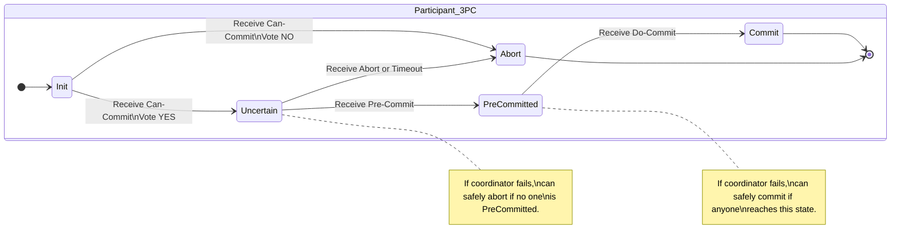

# Two-Phase and Three-Phase Commit Protocols

When data is partitioned across multiple nodes in a distributed database, executing a transaction that spans these partitions requires a mechanism to ensure atomicity. The system must guarantee that all participating nodes either entirely commit the transaction or entirely abort it.

This document explores the fundamental atomic commitment protocols used to solve this problem, specifically focusing on Two-Phase Commit (2PC) and Three-Phase Commit (3PC), along with modern alternatives and real-world implementations.

## 1. The Distributed Atomic Commitment Problem

In a single-node database, transaction atomicity is relatively straightforward to achieve using a Write-Ahead Log (WAL). If the system crashes mid-transaction, recovery processes can simply use the WAL to roll back uncommitted changes. 

However, in a distributed system, a single transaction might write to partitions located on entirely different servers. We cannot rely on local WALs alone because one node might successfully write to its disk while another node crashes or experiences a disk failure before its write completes. 

If this happens, the system is left in a partially committed state, violating the fundamental ACID atomicity guarantee. Network partitions, where nodes are alive but unable to communicate, further complicate this issue by preventing nodes from knowing the status of their peers.

The distributed atomic commitment problem asks: How do we coordinate a set of independent, potentially failing nodes to unanimously agree on whether to commit or abort a transaction, even in the presence of network partitions and node crashes?

## 2. Two-Phase Commit (2PC)

Two-Phase Commit (2PC) is the most widely known algorithm for distributed atomic commitment. It introduces a central coordinator that orchestrates the transaction across multiple participant nodes. As the name suggests, the protocol operates in two distinct phases.

### Phase 1: Prepare Phase

The first phase is the voting phase. The coordinator asks all participants if they are prepared to commit the transaction.

1. The coordinator sends a `Prepare` message to all participant nodes.
2. Each participant receives the request and executes the transaction up to the point of committing. Crucially, the participant acquires necessary locks and flushes its undo and redo logs to stable storage.
3. If the participant can guarantee it will commit if asked, it responds with a `YES` vote. If any issue occurs (e.g., lock conflict, integrity violation), it replies with a `NO` vote and immediately aborts locally.

### Phase 2: Commit/Abort Phase

The second phase is the decision phase. The coordinator collects the votes and dictates the final outcome.

1. If the coordinator receives a `YES` vote from every single participant, it definitively decides to commit. It records this `Global-Commit` decision to its own WAL.
2. If even one participant votes `NO`, or if a participant times out, the coordinator decides to abort. It records a `Global-Abort` decision to its WAL.
3. The coordinator then multicasts the final decision (`Commit` or `Abort`) to all participants.
4. Participants apply the decision, release their locks, and send an acknowledgment to the coordinator. The transaction is then complete.

### Failure Scenarios & In-Doubt States

The vulnerability of 2PC lies in how it handles failures, particularly the crash of the coordinator.

*   **Participant crash before voting:** If a participant crash before voting `YES`, the coordinator will time out waiting for its vote and simply abort the transaction.
*   **Participant crash after voting YES:** If a participant crash after voting `YES`, it has promised to commit. Upon recovery, it must check its WAL. It finds it is in a "prepared" state but does not know the final decision. It must query the coordinator or other participants to resolve this in-doubt state.

**Why 2PC is fundamentally a BLOCKING protocol:**
The most critical flaw in 2PC occurs if the coordinator crashes during Phase 2. Suppose the coordinator collects all `YES` votes, decides to commit, but crashes before sending the `Global-Commit` message to the participants. 

The participants are now in a "prepared" state. They have locked resources and voted `YES`. They cannot unilaterally decide to abort because the coordinator might have already told some other participant to commit. They cannot unilaterally decide to commit because another participant might have voted `NO`.

The participants are blocked. They must hold their locks indefinitely until the coordinator recovers, causing severe system degradation.

## 3. Three-Phase Commit (3PC)

Three-Phase Commit (3PC) was designed explicitly to solve the blocking problem of 2PC. It relies on a synchronous network assumption—meaning there are known, strict upper bounds on network latency. 

3PC eliminates the blocking state by splitting the second phase of 2PC, adding an intermediate "pre-commit" phase. This ensures that no node can commit before all other nodes know that a commit decision is imminent.

### The Three Phases

1.  **Phase 1: Can-Commit:** Similar to the 2PC Prepare phase, the coordinator asks participants if they can commit. They vote Yes or No.
2.  **Phase 2: Pre-Commit:** If all participants vote Yes, the coordinator sends a `Pre-Commit` message. Participants acknowledge this message, transitioning from an "uncertain" state to a "prepared-to-commit" state. Crucially, they still do not apply the changes.
3.  **Phase 3: Do-Commit:** Once the coordinator receives acknowledgments for the Pre-Commit from all participants, it sends the final `Do-Commit` message, and participants apply the changes.

### Termination Protocol and Non-Blocking Recovery

By separating the intention to commit from the actual commit, 3PC enables non-blocking state recovery. If the coordinator crashes, a new coordinator can be elected. 

The new coordinator queries the participants. If any participant has received a `Pre-Commit`, the new coordinator knows everyone voted Yes, and it can safely push the system forward to a `Commit`. If no participant has received a `Pre-Commit`, the transaction can be safely aborted. No single failure can leave the system in an unresolvable blocking state.

### Why 3PC Fails in the Real World

Despite solving the blocking problem in theory, 3PC is almost never used in modern distributed databases. The reason is its fundamental assumption of a synchronous network.

In the real world, networks are asynchronous. Messages can be delayed indefinitely without being lost (network partitions). Under a network partition, a timeout cannot reliably distinguish between a crashed node and a delayed message.

If a partition separates the coordinator from some participants during 3PC, the participants might timeout and elect a new coordinator, while the old coordinator continues to operate on the other side of the partition. This leads to a split-brain scenario where different parts of the system make contradictory commit/abort decisions, completely violating consistency. 

Consequently, the industry generally avoids 3PC, favoring either Paxos/Raft-backed distributed commits or Saga patterns.

## 4. 2PC vs Saga Pattern

When architecting distributed transactions, engineers generally choose between strict ACID compliance (often using 2PC) and eventual consistency (using the Saga pattern).

**2PC with XA Protocol:**
2PC provides strict ACID guarantees. It is heavily used in traditional relational databases and enterprise messaging systems via the XA (eXtended Architecture) standard. However, because it holds locks across network boundaries, it severely limits throughput and latency.

**Saga Pattern:**
Sagas abandon the attempt to execute a transaction atomically across all services simultaneously. Instead, a Saga is a sequence of local transactions. Each local transaction updates the database and publishes an event to trigger the next transaction in the saga.

If a local transaction fails, the saga executes a series of compensating transactions that undo the changes made by the preceding local transactions. 

*   **Choreography:** Services listen to each other's events and act independently.
*   **Orchestration:** A central orchestrator service commands the participants to execute their local transactions or compensations.

Sagas provide eventual consistency and high availability without holding distributed locks, making them the preferred choice for microservices architectures.

## 5. State Machine Diagrams

These diagrams illustrate the state transitions and potential failure points for both protocols.

### 2PC State Machine

```mermaid
stateDiagram-v2
    direction LR
    
    %% Coordinator
    state Coordinator {
        [*] --> C_Init
        C_Init --> C_Wait: Send Prepare
        C_Wait --> C_Commit: All YES votes\nLog Commit
        C_Wait --> C_Abort: Any NO or Timeout\nLog Abort
        C_Commit --> [*]: Send Commit
        C_Abort --> [*]: Send Abort
    }
    
    %% Participant
    state Participant {
        [*] --> P_Init
        P_Init --> P_Ready: Receive Prepare\nVote YES
        P_Init --> P_Abort: Receive Prepare\nVote NO
        P_Ready --> P_Commit: Receive Commit
        P_Ready --> P_Abort: Receive Abort
        P_Commit --> [*]
        P_Abort --> [*]
    }
    
    %% Highlight blocking state
    note right of P_Ready: BLOCKING STATE:\nIf Coordinator crashes here,\nParticipant must wait indefinitely.
```

### 3PC State Machine



## 6. Real-World Engineering Context

Given the blocking nature of 2PC and the theoretical impracticality of 3PC in asynchronous networks, modern distributed SQL databases like Google Spanner and CockroachDB take a hybrid approach.

They do not abandon 2PC; instead, they make the coordinator highly available. They achieve this by combining 2PC with consensus protocols like Paxos or Raft.

In these systems, data is partitioned, and each partition is replicated using Raft. When a distributed transaction spans partitions, the system still uses 2PC. 

However, the "coordinator" and "participants" are not single nodes. They are entire Raft replication groups. The coordinator's state (e.g., waiting for votes, deciding to commit) is replicated via Raft. 

If the node acting as the coordinator leader crashes, Raft immediately elects a new leader for that partition. The new leader seamlessly resumes the 2PC protocol from the replicated state. This practically eliminates the traditional 2PC blocking problem by preventing the coordinator from becoming a single point of failure, all without relying on the synchronous network assumptions of 3PC.
