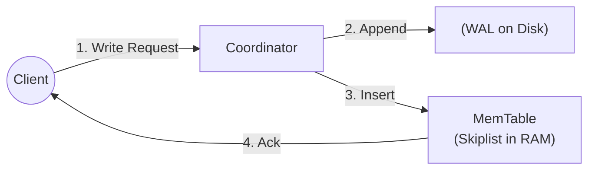
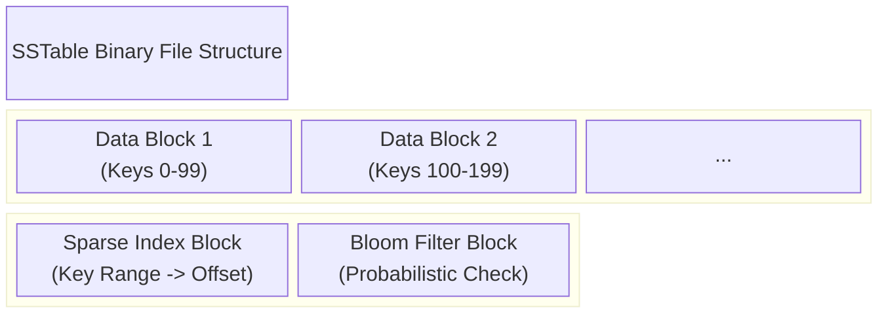
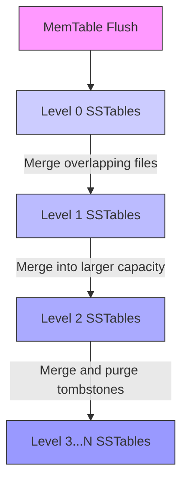

# Write-Ahead Logs (WAL) and LSM-Trees

This guide covers the theoretical internals of Write-Ahead Logs (WAL) and Log-Structured Merge-Trees (LSM-Trees), focusing on storage engine mechanics, crash recovery, and performance trade-offs.

## 1. Write-Ahead Logging (WAL)

A Write-Ahead Log (WAL) is an append-only file that records database modifications before they are applied to the primary storage structures (like MemTables or B-Trees). This ensures durability and atomic crash recovery.

### ARIES Recovery Algorithm Principles

The standard for WAL-based recovery is the ARIES (Algorithms for Recovery and Isolation Exploiting Semantics) algorithm. It guarantees ACID properties upon crash recovery through a three-phase process:

1. **Analysis Phase:**
   - Scans the WAL forward from the last successful checkpoint to identify all active transactions and dirty pages at the time of the crash.
   - Builds the Transaction Table and Dirty Page Table to determine exactly what needs to be redone and undone.

2. **Redo Phase (Repeating History):**
   - Scans the WAL forward from the earliest unwritten dirty page identified in the analysis phase.
   - Re-applies all logged operations (both committed and uncommitted) to bring the database back to the exact state it was in right before the crash.

3. **Undo Phase:**
   - Scans the WAL backward to rollback the effects of any transactions that were active (uncommitted) at the time of the crash.
   - Writes Compensation Log Records (CLRs) for undone actions to ensure rollbacks are not repeated if another crash occurs during recovery.

### Fsync Guarantees and Sequential I/O

WAL performance relies heavily on **fsync guarantees** and sequential I/O:
- **fsync():** Modern storage engines invoke `fsync()` to force the OS to flush WAL buffers directly to the physical disk. Since a transaction cannot return "success" until its commit record is fsynced, this operation is on the critical latency path.
- **Group Commit Batching:** To avoid the latency penalty of calling `fsync()` for every individual transaction, engines use *group commit*. Multiple concurrent transactions append to an in-memory WAL buffer, and a single `fsync()` persists the entire batch at once, amortizing the disk I/O cost.
- **Sequential Throughput:** By strictly appending to the end of a file, the WAL converts all random writes into purely sequential I/O. On HDDs, this eliminates physical disk head seeks. Even on SSDs, sequential writes bypass write-amplification penalties and achieve maximum device throughput, making WAL ingestion incredibly fast.

---

## 2. LSM-Tree Architecture

The Log-Structured Merge-Tree (LSM-Tree) optimizes for write-heavy workloads by eliminating random in-place updates. Instead, all modifications (inserts, updates, deletes) are appended and merged sequentially.

### The Write Path

The LSM-Tree write path minimizes latency by operating entirely in memory for the active state:

1. **Append to WAL:** The write is first synchronously appended to the WAL for durability.
2. **Insert into MemTable:** The key-value pair is inserted into an in-memory sorted data structure called the MemTable. Common implementations use a **Skiplist** or **ConcurrentSkipListMap**, allowing $O(\log N)$ concurrent insertions while keeping keys in strictly sorted order.
3. **Return to Client:** Once the data is in the MemTable and the WAL is synced, the write is acknowledged as successful.

### Flush to Disk: Immutable SSTables

When the MemTable reaches a size threshold (e.g., 64MB), it is frozen and an active flush occurs:
- A new, empty MemTable and WAL are created to accept new writes.
- The frozen MemTable is sequentially flushed to disk as an **SSTable (Sorted String Table)**.
- The old WAL file is subsequently deleted, as the data is now durably stored in the SSTable.

**SSTable Internal Structure:**
SSTables are fundamentally immutable. Once written, they are never modified in place. They consist of:
- Data Blocks containing the actual sorted key-value pairs.
- Sparse Block Indices mapping the first key of a block to its file offset, enabling binary search without loading the whole file into RAM.
- **Bloom Filters** to probabilistically skip the entire file during point lookups if the key is definitely not present.

### The Read Path

Because data is distributed across memory and multiple disk files, reads must check structures in chronological order (newest to oldest):

1. **MemTable:** Check the active MemTable first.
2. **Active Flush (Immutable MemTables):** Check any MemTables currently in the process of flushing.
3. **Leveled SSTables:** Query the SSTables on disk, starting from the newest level (L0) to the oldest.
   - **Optimization:** To prevent scanning every SSTable, the engine first queries the **Bloom Filter**. If it returns "definitely not present", the SSTable is completely skipped. If it returns "possibly present", the sparse index is used to load and check the exact data block.

---

## 3. Compaction Strategies & RUM Conjecture

Over time, immutable SSTables accumulate. Deletes are implemented as "tombstones" (special markers indicating deletion), and updates simply append a newer version of a key. To reclaim space and improve read performance, background **Compaction** merges these files.

This trade-off space is governed by the **RUM Conjecture**, which posits that a database engine can optimize at most two of the following at the expense of the third: **R**ead Amplification, **U**pdate (Write) Amplification, and **M**emory (Space) Amplification.

### Compaction Flowchart

### Leveled Compaction (RocksDB, LevelDB)

Files are organized into hierarchical levels with exponentially increasing capacities (e.g., L1 is 10x larger than L0). Each level (except L0) contains mutually exclusive key ranges.
- **Mechanism:** When a level reaches its capacity limit, a file is picked and merged with all overlapping files in the next level down.
- **Trade-offs:** 
  - **Optimizes:** Read Amplification (data is tightly sorted, only 1 file to check per level) and Space Amplification (minimal duplicate keys).
  - **Penalizes:** Write Amplification (the same data is repeatedly read and written as it cascades down levels).

### Size-Tiered Compaction (Cassandra, ScyllaDB)

Files are grouped into "tiers" based on their size.
- **Mechanism:** When a sufficient number of files of similar size exist (e.g., 4 files of 100MB), they are merged into a single larger file (e.g., 1 file of 400MB). Files in the same tier can have overlapping key ranges.
- **Trade-offs:**
  - **Optimizes:** Write Amplification (fewer total merges, data is written to disk less frequently).
  - **Penalizes:** Read Amplification (must check multiple files per tier since keys overlap) and Space Amplification (multiple versions of the same key and tombstones persist longer, requiring up to 50% temporary disk headroom during massive merges).

---

## 4. Comparison Table: B-Tree vs LSM-Tree

| Feature | B-Tree (PostgreSQL/MySQL) | LSM-Tree (RocksDB/Cassandra) |
| :--- | :--- | :--- |
| **Write Optimization** | Random in-place updates. Slower write throughput (penalized by page-flush write amplification). | Sequential append-only writes. Extremely high write throughput. |
| **Random Writes** | Slow. Modifying a 100-byte row requires rewriting a 4KB to 16KB page. | Fast. Written sequentially to WAL and MemTable in memory. |
| **Range Scans** | Fast. Data is perfectly clustered and ordered on disk. | Moderate. Requires merging cursors across multiple SSTables simultaneously. |
| **Point Lookups** | Fast. Constant $O(\log N)$ disk seeks. | Variable. Bloom filters help, but may still require reading multiple levels. |
| **Space Management** | Fixed pages with fragmentation (typically 67-80% full). Updates modify in place. | Files are tightly packed (100% full), but multiple versions and tombstones consume space until compacted. |
| **SSD Wear & Tear** | High write amplification from page rewrites degrades SSD longevity faster. | Sequential writes and large block compactions are highly friendly to SSD lifecycle limits. |
| **Primary Workload** | Read-heavy, complex ad-hoc queries, general-purpose OLTP. | Write-heavy ingestion, time-series data, high-velocity event stores. |
