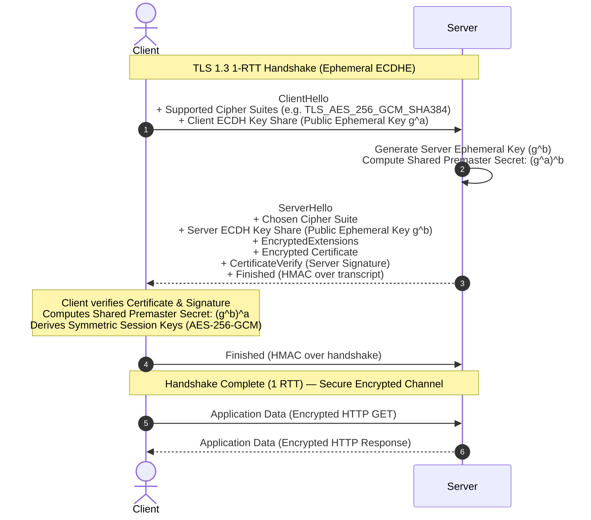
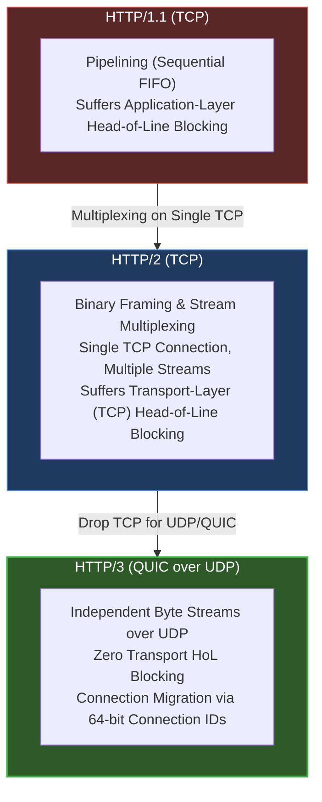

# HTTP & HTTPS Protocols

Understanding HTTP and HTTPS is fundamental for distributed systems and API architecture. Almost all web and microservice platforms communicate using HTTP dialects.

## 💡 Beginner Intuition

Imagine HTTP as the standardized grammar used to write a business letter, while TCP (or QUIC) is the postal service that guarantees delivery. HTTP dictates how the letter is formatted (headers) and its actual message (body). **HTTPS** means placing that letter inside an indestructible, tamper-proof locked box (TLS) before handing it to the postal service, ensuring only the intended recipient can read or alter it.

---

## 📖 What is HTTP?

> **HyperText Transfer Protocol (HTTP) is an application-layer request-response protocol running over reliable transport (TCP or QUIC/UDP) for exchanging hypermedia and data payloads.**

```
Client (Browser / App)                    Server (API Gateway)
     │                                           │
     │──────── HTTP Request ────────────────────▶│
     │         GET /api/v1/users/42              │
     │         Headers: Authorization, Accept    │
     │                                           │
     │◀─────── HTTP Response ───────────────────│
     │         200 OK                            │
     │         Body: {"id": 42, "role": "admin"} │
```

---

## 🔧 HTTP Request Structure

```
┌──────────────────────────────────────────────────┐
│ GET /api/v1/users?status=active HTTP/1.1        │  ← Request Line (Method, URI, Protocol)
├──────────────────────────────────────────────────┤
│ Host: api.example.com                            │  ← Request Headers (Metadata)
│ Authorization: Bearer eyJhbGciOi...              │
│ Content-Type: application/json                   │
│ Accept: application/json                         │
├──────────────────────────────────────────────────┤
│                                                  │  ← Empty CRLF Separator
├──────────────────────────────────────────────────┤
│ {"filter": "engineering"}                        │  ← Body / Payload (Optional)
└──────────────────────────────────────────────────┘
```

---

## 📋 HTTP Methods: Safety & Idempotency

| Method | Purpose | Idempotent | Safe | Request Body | RFC 9110 Semantics |
|:---|:---|:---|:---|:---|:---|
| **GET** | Retrieve resource | **Yes** | **Yes** | No | Read-only; cacheable |
| **HEAD** | Headers only (identical to GET) | **Yes** | **Yes** | No | Bandwidth checking, cache validation |
| **POST** | Create subordinate resource / Action | **No** | **No** | Yes | Non-idempotent; triggers mutations |
| **PUT** | Replace / Create resource at exact URI | **Yes** | **No** | Yes | Full replacement of target entity |
| **PATCH** | Apply partial modifications | **No** | **No** | Yes | Delta update (can be made idempotent) |
| **DELETE** | Remove targeted resource | **Yes** | **No** | Optional | Subsequent calls return 404 or 204 |
| **OPTIONS**| Inspect server CORS / allowed methods | **Yes** | **Yes** | No | Pre-flight CORS negotiation |

* **Safe**: Invoking the method does not alter server state.
* **Idempotent**: Making $N$ identical requests yields the exact same server state as a single request ($f(f(x)) = f(x)$).

---

## 🔒 HTTPS & Modern TLS 1.3 Cryptography

HTTPS layers HTTP semantics over TLS (Transport Layer Security).

Older protocols (TLS 1.0, 1.1, and basic RSA key transport in TLS 1.2) were vulnerable to downgrade attacks and lacked Forward Secrecy. **TLS 1.3 (RFC 8446)** deprecated static RSA and non-ephemeral Diffie-Hellman, mandating **Ephemeral Elliptic-Curve Diffie-Hellman (ECDHE)** for strict **Forward Secrecy**.

### 🔍 Worked Trace: TLS 1.3 ECDHE Handshake

**Stated Premises:**
1. Both the Client and Server support TLS 1.3.
2. The Client possesses the necessary Root CA certificates to validate the Server's identity.
3. This is a fresh connection with no prior session state (no 0-RTT resumption available).



**Trace Steps:**
1. **ClientHello (1st Leg):** Client generates an ephemeral ECDH private/public key pair. It sends `ClientHello` containing supported cipher suites and its public key share ($g^a$).
2. **Server Processing:** Server selects a cipher suite, generates its own ephemeral key pair, and calculates the shared premaster secret ($ (g^a)^b $). It then derives symmetric session keys.
3. **ServerHello (2nd Leg):** Server responds with `ServerHello` (containing its public key share $g^b$), its certificate, and a `Finished` message (MAC over the transcript). These are encrypted using the derived session keys.
4. **Client Processing & Finished (3rd Leg):** Client receives the response, verifies the server's certificate signature against its Root CAs, computes the same shared secret ($ (g^b)^a $), and derives the session keys. It replies with its own encrypted `Finished` message.
5. **Secure Channel Established:** Encrypted HTTP application data can now flow securely over the 1-RTT connection.

### Key TLS 1.3 Advancements
1. **1-RTT Handshake**: Reduced from 2 full round trips in TLS 1.2 to 1 round trip by combining the cipher negotiation and key share exchange into the first packet.
2. **0-RTT Resumption (Early Data)**: Returning clients can send encrypted application data in the very first packet using a pre-shared key (PSK) from the previous session (note: 0-RTT is vulnerable to replay attacks and must only be used for idempotent GETs).
3. **Perfect Forward Secrecy (PFS)**: Because key pairs ($g^a, g^b$) are ephemeral, compromising the server's long-term private RSA/ECDSA signing key in the future does not allow decrypting historical recorded traffic.

---

## 🔄 HTTP Evolution: HTTP/1.1 vs HTTP/2 vs HTTP/3 (QUIC)



### Detailed Protocol Comparison

| Dimension | HTTP/1.1 | HTTP/2 | HTTP/3 |
|:---|:---|:---|:---|
| **Transport Layer** | TCP | TCP | **QUIC (over UDP)** |
| **Framing Format** | Plaintext ASCII | Binary Frames | Binary Frames |
| **Multiplexing** | No (6 TCP conns/domain) | Yes (1 TCP connection) | Yes (Streams over UDP) |
| **Head-of-Line Blocking**| Application layer (FIFO responses)| **TCP layer** (1 dropped packet stalls all streams)| **None** (Loss in Stream A does not stall Stream B) |
| **Connection Handshake**| 1 RTT (TCP) + 1-2 RTT (TLS)| 1 RTT (TCP) + 1 RTT (TLS)| **Combined 1-RTT** (Transport + Crypto in 1 handshake) |
| **Connection Migration**| Broken on IP/Network change | Broken on IP/Network change | **Seamless** (Tracks 64-bit Connection ID, not IP:Port) |
| **Header Compression** | None | HPACK (Static/Dynamic tables)| QPACK (Non-blocking across streams) |

### ⚠️ Counterexample / Boundary: TCP Head-of-Line Blocking in HTTP/2

**Scenario:** A client requests three images over a single multiplexed HTTP/2 connection (running over one TCP connection).
- **Normal Operation:** Packets for Image A, Image B, and Image C are interleaved and sent sequentially. The client application reassembles them concurrently.
- **Boundary Failure:** Packet 2 (belonging to Image A) is lost in transit due to network jitter. 
- **The Result:** Even if Packets 3, 4, and 5 (belonging to Images B and C) arrive perfectly intact at the client's operating system, the kernel TCP receiver buffer *must* hold them and hide them from the application layer until Packet 2 is retransmitted and acknowledged.
- **Conclusion:** A failure in one HTTP stream artificially stalls all other independent streams on the same connection. This violates the assumption that HTTP multiplexing guarantees parallel progress under lossy network conditions, necessitating the shift to QUIC (HTTP/3).

### How HTTP/3 and QUIC Solve Head-of-Line Blocking
* QUIC implements its own congestion control and packet loss recovery on top of UDP.
* Each HTTP/3 stream is an independent byte stream inside the QUIC layer. If a packet belonging to Stream 1 is lost, only Stream 1 pauses; Stream 2 and Stream 3 continue processing uninterrupted.
* **Connection Migration**: When a mobile device switches from Wi-Fi to 5G cellular, its IP address and port change. TCP connections break immediately. QUIC identifies connections by a random 64-bit **Connection ID (CID)**, allowing the mobile device to migrate networks with zero reconnection latency or TLS renegotiation.

---

## 🎯 Interview Deep Dive Questions

### Q1: "What exact steps occur when typing `https://api.example.com` into a browser?"
1. **HSTS Check**: Browser checks local HTTP Strict Transport Security (HSTS) preload list to enforce HTTPS without redirect.
2. **DNS Resolution**: Client checks browser cache -> OS cache (`/etc/hosts`) -> Local DNS resolver -> Root/TLD/Authoritative nameservers (using UDP 53 or DoH).
3. **Transport Handshake**:
   - For HTTP/1.1 & HTTP/2: TCP 3-way handshake (`SYN` -> `SYN-ACK` -> `ACK`).
   - For TLS 1.3: Ephemeral ECDHE exchange in 1 RTT.
   - For HTTP/3: QUIC Initial packet combines transport and TLS 1.3 cryptographic parameters in a single RTT.
4. **HTTP Request / Response**: Client sends HTTP binary or ASCII request; receives HTTP headers, status code, and payload.

### Q2: "When should an API use PUT vs PATCH?"
* **PUT**: Idempotent full replacement. The client sends the complete representation of the entity. Any fields omitted by the client are overwritten with null or default values.
* **PATCH**: Partial modification. The client sends only the fields to be updated (e.g., `{"status": "archived"}`). Usually not idempotent unless designed with deterministic patch formats (e.g., JSON Merge Patch RFC 7396).

---

## 🏗️ Standard Library Implementations

Below is a demonstration of making an HTTP GET request and parsing the response asynchronously using strictly the standard libraries in Python and Java. Both implementations demonstrate proper connection timeouts and header management.

### Python 3.8+ Parity (`asyncio`)

```python
import asyncio
import ssl
import json
from urllib.parse import urlparse

async def fetch_data(url: str) -> dict:
    parsed = urlparse(url)
    host = parsed.hostname
    port = parsed.port or (443 if parsed.scheme == 'https' else 80)
    path = parsed.path or '/'
    if parsed.query:
        path += '?' + parsed.query

    ssl_context = ssl.create_default_context() if parsed.scheme == 'https' else None

    try:
        reader, writer = await asyncio.wait_for(
            asyncio.open_connection(host, port, ssl=ssl_context),
            timeout=5.0
        )

        request = (
            f"GET {path} HTTP/1.1\r\n"
            f"Host: {host}\r\n"
            f"User-Agent: Python-asyncio/3.8+\r\n"
            f"Accept: application/json\r\n"
            f"Connection: close\r\n\r\n"
        )
        
        writer.write(request.encode('utf-8'))
        await writer.drain()

        response = await asyncio.wait_for(reader.read(), timeout=5.0)
        writer.close()
        await writer.wait_closed()

        response_str = response.decode('utf-8')
        headers_str, body_str = response_str.split('\r\n\r\n', 1)
        
        status_line = headers_str.split('\r\n')[0]
        status_code = int(status_line.split(' ')[1])
        
        if status_code == 200:
            return json.loads(body_str)
        else:
            print(f"Failed with status: {status_code}")
            return {}

    except Exception as e:
        print(f"Network error: {e}")
        return {}

async def main():
    print(await fetch_data("https://jsonplaceholder.typicode.com/todos/1"))

if __name__ == "__main__":
    asyncio.run(main())
```

### Java 11+ Parity (`HttpClient` Async)

```java
import java.net.URI;
import java.net.http.HttpClient;
import java.net.http.HttpRequest;
import java.net.http.HttpResponse;
import java.time.Duration;
import java.util.concurrent.CompletableFuture;
import java.util.concurrent.TimeUnit;

public class HttpFetcherAsync {
    public static void main(String[] args) {
        HttpClient client = HttpClient.newBuilder()
                .connectTimeout(Duration.ofSeconds(5))
                .build();

        HttpRequest request = HttpRequest.newBuilder()
                .uri(URI.create("https://jsonplaceholder.typicode.com/todos/1"))
                .header("User-Agent", "Java-HttpClient-Async/11+")
                .header("Accept", "application/json")
                .timeout(Duration.ofSeconds(5))
                .GET()
                .build();

        CompletableFuture<HttpResponse<String>> future = client.sendAsync(request, HttpResponse.BodyHandlers.ofString());

        future.thenAccept(response -> {
            if (response.statusCode() == 200) {
                System.out.println(response.body());
            } else {
                System.out.println("Failed with status: " + response.statusCode());
            }
        }).exceptionally(e -> {
            System.out.println("Network error: " + e.getMessage());
            return null;
        });

        // Wait for async task to complete in this example
        try {
            future.get(10, TimeUnit.SECONDS);
        } catch (Exception e) {
            e.printStackTrace();
        }
    }
}
```

---

## 🎓 Optional Staff Extension: ALPN & mTLS

**Application-Layer Protocol Negotiation (ALPN):**
During the TLS handshake, how does the server know whether the client wants to speak HTTP/1.1, HTTP/2, or HTTP/3? ALPN is a TLS extension where the client sends a list of supported application protocols in its `ClientHello`. The server picks one and includes it in its `ServerHello`. This effectively avoids an extra round trip of protocol negotiation *after* the TLS tunnel is established.

**Mutual TLS (mTLS):**
Standard TLS only authenticates the server to the client. In Zero Trust internal microservice architectures, **mTLS** requires the client to also present an x509 certificate to the server during the handshake. This cryptographically enforces that only authorized services (e.g., Service A) can invoke a specific endpoint on Service B, securely bypassing the need for application-layer tokens (like JWTs) for machine-to-machine authentication.

---

## 📚 Versioned Primary Citations

* **RFC 9110:** HTTP Semantics (June 2022) — Defines standard methods, status codes, and headers.
* **RFC 8446:** The Transport Layer Security (TLS) Protocol Version 1.3 (August 2018).
* **RFC 9000:** QUIC: A UDP-Based Multiplexed and Secure Transport (May 2021).
* **RFC 9114:** HTTP/3 (June 2022) — Mapping of HTTP semantics over QUIC.
