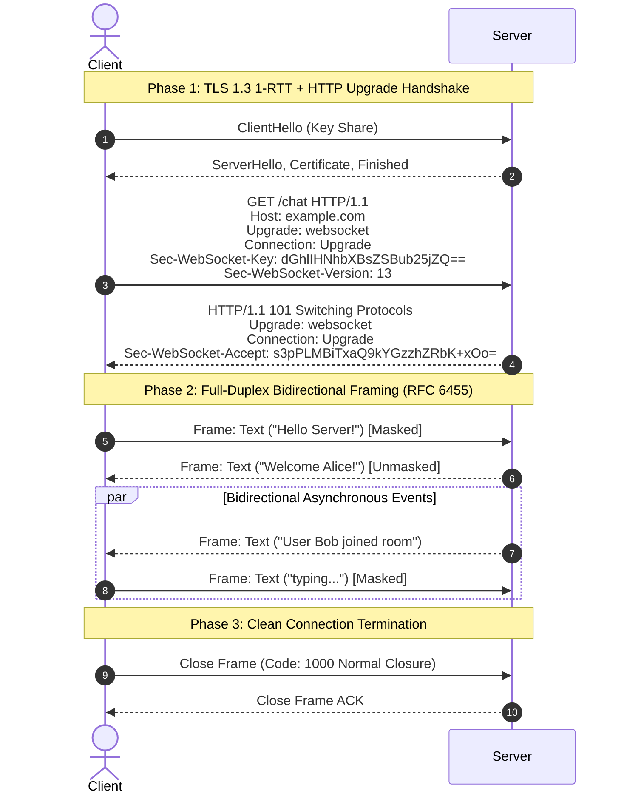
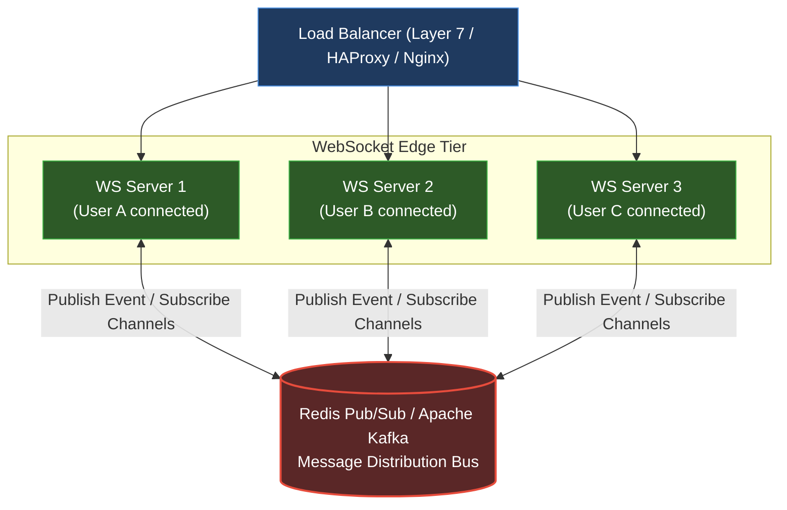

# WebSockets

Real-time bidirectional communication between client and server. Essential for chat applications, live financial tickers, collaborative editing, and gaming platforms.

---

## 📖 What are WebSockets?

> **The WebSocket protocol (RFC 6455) provides full-duplex, persistent communication channels over a single TCP connection.**

**Beginner Intuition:** Imagine calling a friend on the phone instead of writing letters. With HTTP (letters), you have to send a message, wait for a reply, and then start a new letter for the next message. With WebSockets (a phone call), once the connection is established, either of you can speak at any time without having to redial.

### HTTP vs WebSocket Protocol Contrast

```
HTTP (Half-duplex / Request-Response):
Client ──HTTP Request──▶ Server
Client ◀─HTTP Response── Server
(Connection closed or kept idle)

WebSocket (Full-duplex / Event-driven):
Client ◀═══════════════════════▶ Server
(Persistent TCP connection)
(Either endpoint can push messages asynchronously at any time)
```

---

## 🔧 WebSocket Protocol Handshake & Framing

A WebSocket connection initiates as a standard HTTP/1.1 request bearing an **Upgrade** header, and is switched to the binary WebSocket framing protocol with status code `101 Switching Protocols`.

### TLS 1.3 ECDHE Handshake (Modern Transport)

Modern WebSockets over WSS (WebSocket Secure) use TLS 1.3 for encryption.
- **Premise (TLS 1.3 ECDHE):** The client and server agree on an ephemeral elliptic curve (ECDHE) key exchange in a single round trip (1-RTT).
- **Trace:**
  1. **ClientHello:** Sends supported cipher suites and key shares (e.g., X25519).
  2. **ServerHello + EncryptedExtensions + Finished:** Server chooses a key share, computes the shared secret, and sends its certificate (all encrypted after ServerHello).
  3. **Client Finished:** Connection is secure; WebSocket HTTP upgrade begins immediately.
- **Counterexample/Boundary (0-RTT Replay):** In TLS 1.3 0-RTT, early data can be replayed by an attacker. For WebSockets, never allow state-mutating handshake data in 0-RTT; require the full 1-RTT handshake before accepting the Upgrade.

### HTTP/3 Transport Evolution

While WebSockets traditionally run over TCP/TLS, HTTP/3 (QUIC) introduces **WebTransport** as its successor.
- **Premise (WebTransport / QUIC):** QUIC uses UDP, avoiding TCP Head-of-Line (HoL) blocking.
- **Trace:** If a packet containing stream 1 is lost, stream 2 can still be delivered immediately.
- **Staff Extension:** WebTransport over HTTP/3 allows both reliable streams (like WebSockets) and unreliable datagrams (like WebRTC), entirely multiplexed over a single UDP QUIC connection without the HTTP/1.1 upgrade overhead.
- **Primary Citations:** RFC 6455 (WebSocket), RFC 8446 (TLS 1.3), RFC 9114 (HTTP/3).



### Key Handshake Headers
* **`Sec-WebSocket-Key`**: A random 16-byte base64-encoded nonce generated by the client to prevent caching proxies from returning cached responses.
* **`Sec-WebSocket-Accept`**: Computed by the server via `Base64(SHA-1(Key + "258EAFA5-E914-47DA-95CA-C5AB0DC85B11"))`. Proves the server understands RFC 6455.
* **Masking**: All frames sent from client to server **must** be masked using a 32-bit masking key to protect against cache poisoning on intermediate proxies. Server-to-client frames are unmasked.

---

## ⚖️ Real-Time Communication Strategies

| Strategy | Mechanism | Latency | Server Resource Cost | Directionality |
|:---|:---|:---|:---|:---|
| **Short Polling** | Client repeatedly calls `GET /api` on a timer (e.g. 1s) | High ($O(	ext{interval})$) | Extremely high (thousands of idle HTTP handshakes) | Unidirectional |
| **Long Polling** | Server holds HTTP request open until data arrives or timeout | Moderate | High (thread/connection pool exhaustion) | Unidirectional |
| **Server-Sent Events (SSE)**| Persistent HTTP connection streaming `text/event-stream` | Low | Moderate (HTTP/2 multiplexed) | **Server-to-client only** |
| **WebSocket** | Persistent, lightweight full-duplex TCP framing | **Lowest** (sub-millisecond) | Low (minimal 2–10 byte frame overhead) | **Bidirectional** |

---

## 🏗️ Implementation Examples

### 1. Standard Library Parity Implementation

To strictly avoid external dependencies (`websockets` package in Python or frameworks in Java), we implement the RFC 6455 handshake and a single masked/unmasked echo frame using only standard library socket operations.

#### Java 11+ Server (Standard Library)
```java
import java.io.InputStream;
import java.io.OutputStream;
import java.net.ServerSocket;
import java.net.Socket;
import java.security.MessageDigest;
import java.util.Base64;
import java.util.Scanner;
import java.util.regex.Matcher;
import java.util.regex.Pattern;

public class WsServerPure {
    public static void main(String[] args) throws Exception {
        try (ServerSocket server = new ServerSocket(8080)) {
            System.out.println("Java WebSocket Server running on port 8080");
            Socket client = server.accept();
            InputStream in = client.getInputStream();
            OutputStream out = client.getOutputStream();

            // Handshake
            Scanner scanner = new Scanner(in, "UTF-8");
            String data = scanner.useDelimiter("\\r\\n\\r\\n").next();
            Matcher get = Pattern.compile("^GET").matcher(data);
            if (get.find()) {
                Matcher match = Pattern.compile("Sec-WebSocket-Key: (.*)").matcher(data);
                match.find();
                byte[] response = ("HTTP/1.1 101 Switching Protocols\r\n"
                    + "Connection: Upgrade\r\n"
                    + "Upgrade: websocket\r\n"
                    + "Sec-WebSocket-Accept: "
                    + Base64.getEncoder().encodeToString(
                        MessageDigest.getInstance("SHA-1").digest((match.group(1) + "258EAFA5-E914-47DA-95CA-C5AB0DC85B11").getBytes("UTF-8"))
                    )
                    + "\r\n\r\n").getBytes("UTF-8");
                out.write(response);
            }

            // Read masked frame (assumes text < 126 bytes)
            byte[] header = new byte[2];
            in.read(header);
            int len = header[1] & 127;
            byte[] mask = new byte[4];
            in.read(mask);
            byte[] payload = new byte[len];
            in.read(payload);
            for (int i = 0; i < payload.length; i++) {
                payload[i] = (byte) (payload[i] ^ mask[i % 4]);
            }
            System.out.println("Java Server received: " + new String(payload));

            // Echo unmasked frame back
            out.write(new byte[] { (byte) 129, (byte) payload.length });
            out.write(payload);
            
            client.close();
        }
    }
}
```

#### Python 3.8+ Server (`asyncio` Standard Library)
```python
import asyncio
import base64
import hashlib
import struct

async def handle_client(reader, writer):
    # Handshake
    request = b""
    while True:
        line = await reader.readline()
        request += line
        if line == b"\r\n": break

    headers = request.decode("utf-8", errors="ignore").split("\r\n")
    key = next((h.split(": ")[1] for h in headers if h.lower().startswith("sec-websocket-key")), None)
    
    if key:
        magic = b"258EAFA5-E914-47DA-95CA-C5AB0DC85B11"
        accept_key = base64.b64encode(hashlib.sha1(key.encode() + magic).digest()).decode()
        writer.write(f"HTTP/1.1 101 Switching Protocols\r\nUpgrade: websocket\r\nConnection: Upgrade\r\nSec-WebSocket-Accept: {accept_key}\r\n\r\n".encode())
        await writer.drain()

        # Read masked frame (assumes text < 126 bytes)
        header = await reader.readexactly(2)
        payload_len = header[1] & 0x7F
        mask = await reader.readexactly(4)
        data = await reader.readexactly(payload_len)
        unmasked = bytes(b ^ mask[i % 4] for i, b in enumerate(data))
        print(f"Python Server received: {unmasked.decode()}")

        # Echo unmasked frame back
        writer.write(struct.pack("!BB", 0x81, len(unmasked)) + unmasked)
        await writer.drain()

    writer.close()
    await writer.wait_closed()

async def main():
    server = await asyncio.start_server(handle_client, "127.0.0.1", 8080)
    print("Python asyncio WebSocket Server running on ws://127.0.0.1:8080")
    async with server:
        await server.serve_forever()

if __name__ == "__main__":
    asyncio.run(main())
```

---

## 🏗️ Scaling WebSockets Horizontally

Because WebSocket connections are stateful and persistent, scaling beyond a single server requires a distributed pub/sub messaging tier.



### Scale Architecture
1. **Connection Termination**: The Layer 7 load balancer terminates TLS and establishes WebSocket connections to edge servers using least-connections balancing.
2. **Inter-Server Pub/Sub**: When User A (on Server 1) sends a message to User B (on Server 2), Server 1 publishes the event to Redis: `PUBLISH room_42 '{"sender":"A", "body":"hi"}'`.
3. **Local Delivery**: Server 2, which is subscribed to `room_42`, receives the event from Redis and writes it directly to User B's open socket.

---

## 🔒 Security Best Practices

1. **Enforce WSS (WebSocket Secure)**: Always use `wss://` (TLS encrypted) to prevent eavesdropping and stop aggressive corporate firewalls/proxies from stripping the `Upgrade` header.
2. **Ticket / Token-Based Authentication**: Browsers do not allow custom headers during the standard JavaScript `new WebSocket(url)` call. Authenticate by obtaining a short-lived single-use ticket via standard REST `POST /api/ws-token` and passing it as a query parameter or subprotocol: `wss://api.example.com/chat?ticket=tmp_token_123`.
3. **Cross-Origin Handshake Validation**: Validate the `Origin` header during the HTTP Upgrade request to prevent Cross-Site WebSocket Hijacking (CSWSH).
4. **Heartbeats & Dead Connection Detection**: Periodic application-level Ping/Pong frames detect ghost connections caused by silent network disconnections or NAT timeouts.
