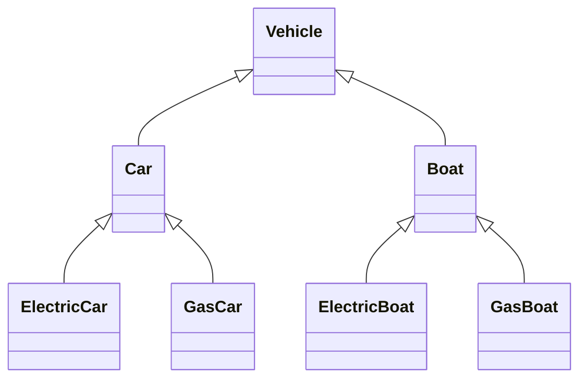
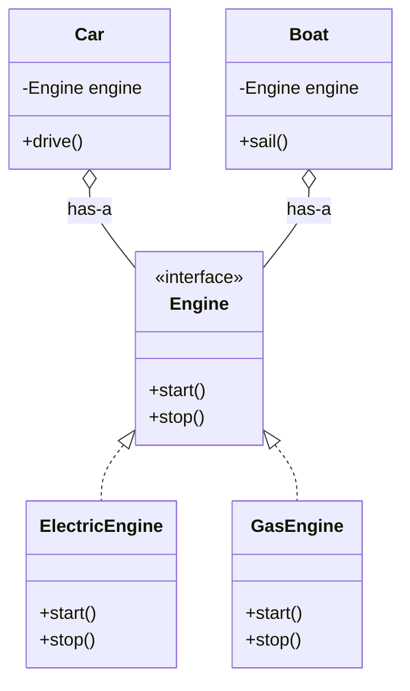
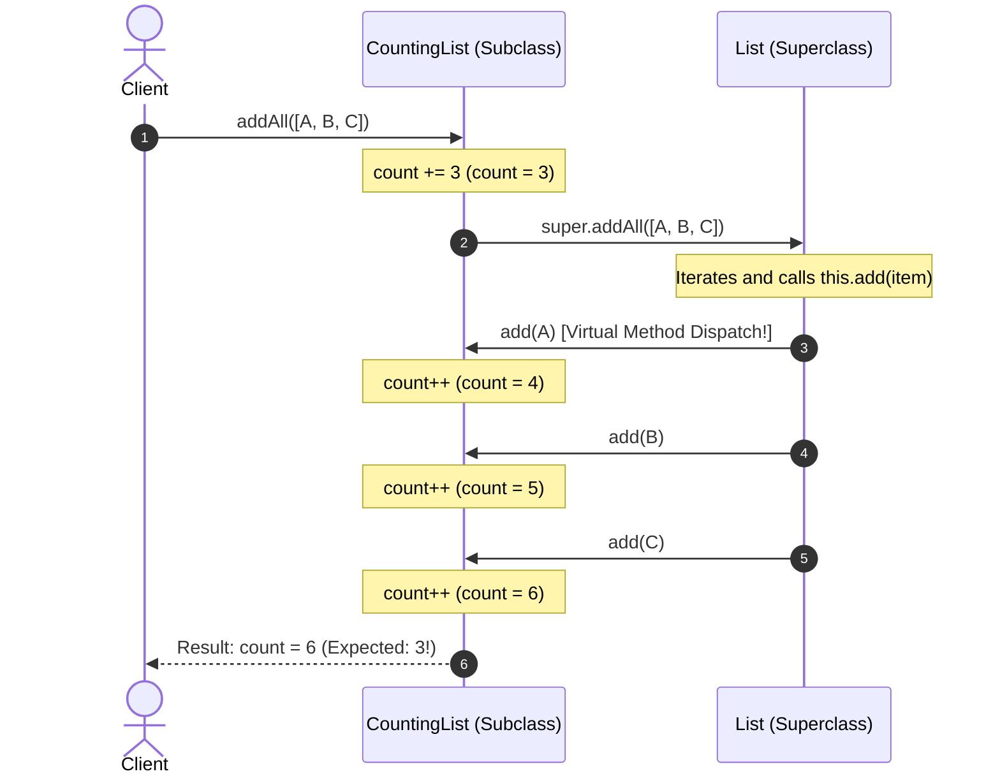
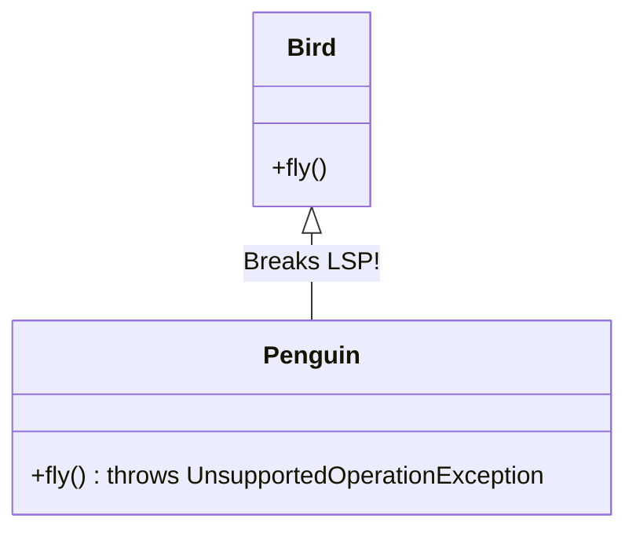

# Composition vs Inheritance

Understanding when to choose composition over inheritance is a foundational architectural principle and a high-frequency system design interview topic. While inheritance creates tight compile-time coupling across an IS-A taxonomy, composition favors loose runtime delegation across HAS-A components.

---

## 📖 Core Concepts

### Inheritance (IS-A Relationship)

Inheritance creates a parent-child relationship where the derived class **is a** specialized type of the base class, inheriting its state and behavior.

#### Java
```java
class Animal {
    void eat() { System.out.println("Eating..."); }
}

class Dog extends Animal {  // Dog IS-A Animal
    void bark() { System.out.println("Barking..."); }
}
```

#### Python
```python
class Animal:
    def eat(self) -> None:
        print("Eating...")


class Dog(Animal):  # Dog IS-A Animal
    def bark(self) -> None:
        print("Barking...")
```

---

### Composition (HAS-A Relationship)

Composition creates a relationship where a container class **has** an instance of another class as a private collaborator, delegating responsibilities to it.

#### Java
```java
class Engine {
    void start() { System.out.println("Engine starting..."); }
}

class Car {
    private final Engine engine;  // Car HAS-A Engine
    
    public Car(Engine engine) {
        this.engine = engine;
    }
    
    public void start() {
        engine.start();
    }
}
```

#### Python
```python
class Engine:
    def start(self) -> None:
        print("Engine starting...")


class Car:
    def __init__(self, engine: Engine) -> None:
        self._engine = engine  # Car HAS-A Engine

    def start(self) -> None:
        self._engine.start()
```

---

## ⚖️ Architectural Comparison Table

| Aspect | Inheritance | Composition |
|---|---|---|
| **Relationship** | **IS-A** (Specialization) | **HAS-A** (Aggregation / Collaboration) |
| **Coupling** | Tight (compile-time, white-box reuse) | Loose (runtime, black-box reuse) |
| **Flexibility** | Rigid — hierarchy is fixed at compile time | High — dynamic injection and runtime replacement |
| **Encapsulation** | Weak — subclasses depend on base internal implementation | Strong — interaction restricted to public interfaces |
| **Testing** | Difficult — cannot easily stub base class methods | Trivial — inject mock or fake collaborator instances |
| **Evolution** | Fragile — changes to base classes ripple down the tree | Safe — internal changes to components do not leak |

---

## 🚗 Real-World Example: Vehicle Power System

### ❌ Inheritance Approach (Hierarchy Explosion)



**Structural Flaws:**
- **Combinatorial Explosion:** 3 vehicle types $\times$ 3 propulsion types = 9 distinct classes.
- **Redundant Code:** `ElectricCar` and `ElectricBoat` duplicate battery management logic because they reside in disparate inheritance branches.

---

### ✅ Composition Approach (Decoupled Strategy Injection)



#### Java
```java
// Component Interface
interface Engine {
    void start();
    void stop();
}

class ElectricEngine implements Engine {
    public void start() { System.out.println("Electric motor engaged silently."); }
    public void stop() { System.out.println("Electric motor powered down."); }
}

class GasEngine implements Engine {
    public void start() { System.out.println("Combustion engine roaring to life."); }
    public void stop() { System.out.println("Combustion engine shut down."); }
}

// Client vehicle delegates propulsion
class Car {
    private final Engine engine;
    
    public Car(Engine engine) {
        this.engine = engine;
    }
    
    public void drive() {
        engine.start();
        System.out.println("Car is moving forward.");
    }
}
```

#### Python
```python
from abc import ABC, abstractmethod


class Engine(ABC):
    @abstractmethod
    def start(self) -> None:
        pass

    @abstractmethod
    def stop(self) -> None:
        pass


class ElectricEngine(Engine):
    def start(self) -> None:
        print("Electric motor engaged silently.")

    def stop(self) -> None:
        print("Electric motor powered down.")


class GasEngine(Engine):
    def start(self) -> None:
        print("Combustion engine roaring to life.")

    def stop(self) -> None:
        print("Combustion engine shut down.")


class Car:
    def __init__(self, engine: Engine) -> None:
        self._engine = engine

    def drive(self) -> None:
        self._engine.start()
        print("Car is moving forward.")
```

---

## 🔴 The Fragile Base Class Problem

The **Fragile Base Class Problem** occurs when seemingly benign changes to a superclass inadvertently break the behavioral invariants of derived subclasses.

### The Double-Counting Anomaly (Joshua Bloch's Classic Problem)



#### Java (Broken Inheritance)
```java
import java.util.*;

class BaseList<E> {
    public void add(E element) {
        // Appends single element
    }
    
    public void addAll(Collection<? extends E> elements) {
        for (E element : elements) {
            add(element); // Self-use of overrideable method!
        }
    }
}

class CountingList<E> extends BaseList<E> {
    private int count = 0;
    
    @Override
    public void add(E element) {
        count++;
        super.add(element);
    }
    
    @Override
    public void addAll(Collection<? extends E> elements) {
        count += elements.size();
        super.addAll(elements); // BUG: super.addAll calls add() internally -> double counts!
    }
    
    public int getCount() { return count; }
}
```

#### Python (Broken Inheritance)
```python
from typing import Generic, Iterable, List, TypeVar

T = TypeVar("T")


class BaseList(Generic[T]):
    def __init__(self) -> None:
        self._items: List[T] = []

    def add(self, item: T) -> None:
        self._items.append(item)

    def add_all(self, items: Iterable[T]) -> None:
        for item in items:
            self.add(item)  # Self-use: dynamic dispatch calls subclass override!


class CountingList(BaseList[T]):
    def __init__(self) -> None:
        super().__init__()
        self.count = 0

    def add(self, item: T) -> None:
        self.count += 1
        super().add(item)

    def add_all(self, items: Iterable[T]) -> None:
        items_list = list(items)
        self.count += len(items_list)
        super().add_all(items_list)  # Double-counts because super().add_all calls self.add()
```

---

### Fixing the Anomaly: Forwarding / Delegation Pattern

Instead of extending the concrete collection, wrap it and delegate all calls explicitly.

#### Java (Clean Composition & Forwarding)
```java
import java.util.*;

class InstrumentedSet<E> {
    private final Set<E> set;
    private int addCount = 0;
    
    public InstrumentedSet(Set<E> set) {
        this.set = set;
    }
    
    public boolean add(E element) {
        addCount++;
        return set.add(element);
    }
    
    public boolean addAll(Collection<? extends E> elements) {
        addCount += elements.size();
        return set.addAll(elements); // Directly delegates to inner set
    }
    
    public int getAddCount() { return addCount; }
}
```

#### Python (Clean Composition & Forwarding)
```python
from typing import Generic, Iterable, Set, TypeVar

T = TypeVar("T")


class InstrumentedSet(Generic[T]):
    def __init__(self, backing_set: Set[T]) -> None:
        self._set = backing_set
        self.add_count = 0

    def add(self, element: T) -> None:
        self.add_count += 1
        self._set.add(element)

    def add_all(self, elements: Iterable[T]) -> None:
        elements_list = list(elements)
        self.add_count += len(elements_list)
        self._set.update(elements_list)  # Direct delegation, zero double-counting

    def get_add_count(self) -> int:
        return self.add_count
```

---

## 🎯 Refactoring Violations: The Liskov Fly Example

### ❌ The LSP Violation
A `Penguin` forced into a `Bird` inheritance tree must throw an exception on `fly()`, violating the Liskov Substitution Principle.



---

### ✅ The Composed Solution (Strategy Pattern)

#### Java
```java
interface FlyBehavior {
    void fly();
}

class WingsFlying implements FlyBehavior {
    public void fly() { System.out.println("Soaring through the clouds."); }
}

class NoFlying implements FlyBehavior {
    public void fly() { System.out.println("(Cannot fly - waddling instead)"); }
}

class Bird {
    private final FlyBehavior flyBehavior;
    
    public Bird(FlyBehavior flyBehavior) {
        this.flyBehavior = flyBehavior;
    }
    
    public void performFly() {
        flyBehavior.fly();
    }
}
```

#### Python
```python
from abc import ABC, abstractmethod


class FlyBehavior(ABC):
    @abstractmethod
    def fly(self) -> None:
        pass


class WingsFlying(FlyBehavior):
    def fly(self) -> None:
        print("Soaring through the clouds.")


class NoFlying(FlyBehavior):
    def fly(self) -> None:
        print("(Cannot fly - waddling instead)")


class Bird:
    def __init__(self, fly_behavior: FlyBehavior) -> None:
        self._fly_behavior = fly_behavior

    def perform_fly(self) -> None:
        self._fly_behavior.fly()
```

---

## 📋 Interview Decision Framework

```
Need to share functionality?
├── Is there a genuine IS-A taxonomy that will NEVER change?
│   ├── Is the subclass 100% substitutable for the base (LSP)?
│   │   ├── YES → Inheritance is permissible.
│   │   └── NO  → Use Composition.
│   └── NO  → Use Composition.
└── Do you need runtime swappability, mocks, or multiple behaviors?
    └── YES → Use Composition (HAS-A).
```

### Interview Evaluation Checklist
1. **Explain the Fragile Base Class Problem:** Point out self-use of overrideable methods (like `addAll` calling `add`) causing double counting.
2. **Defend Composition with Testing:** Explain how constructor injection makes mocking dependencies in unit tests effortless.
3. **Acknowledge the Boilerplate Trade-off:** Composition requires writing forwarding methods, whereas inheritance provides them implicitly.

---

## 🔗 Cross-References

- [SOLID Principles: Liskov Substitution Principle (LSP)](./solid-principles.md)
- [Design Patterns: Strategy Pattern](../../01-design-patterns/behavioral/strategy/)
- [Design Patterns: Decorator Pattern](../../01-design-patterns/structural/decorator/)
