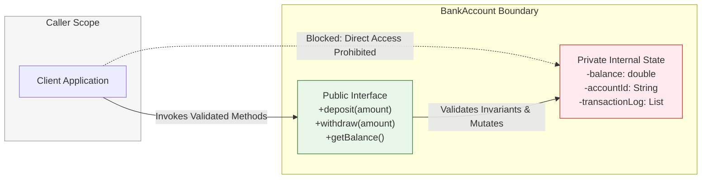

# Encapsulation & Abstraction

Encapsulation and abstraction are two foundational pillars of Object-Oriented Programming (OOP) and high-frequency evaluation criteria in Low-Level Design (LLD) interviews.

---

## 🔒 Encapsulation

> **Bundling data and methods that operate on that data within a single class, and restricting direct access to the object's internal representation.**

### Core Idea
- Hide internal state behind private/protected access boundaries.
- Expose controlled, validated mutators and accessors.
- Protect class invariants against invalid states.



### ✅ Good Example: Encapsulated State

#### Java
```java
public class BankAccount {
    private double balance;  // Hidden internal state
    private final String accountId;
    
    public BankAccount(String accountId, double initialBalance) {
        if (initialBalance < 0) {
            throw new IllegalArgumentException("Initial balance cannot be negative");
        }
        this.accountId = accountId;
        this.balance = initialBalance;
    }
    
    // Controlled mutation with business validation
    public void deposit(double amount) {
        if (amount > 0) {
            balance += amount;
        }
    }
    
    public boolean withdraw(double amount) {
        if (amount > 0 && balance >= amount) {
            balance -= amount;
            return true;
        }
        return false;  // Prevents overdraft
    }
    
    public double getBalance() {
        return balance;  // Read-only accessor
    }
}
```

#### Python
```python
class BankAccount:
    def __init__(self, account_id: str, initial_balance: float) -> None:
        if initial_balance < 0:
            raise ValueError("Initial balance cannot be negative")
        self._account_id = account_id
        self._balance = initial_balance  # Encapsulated state (leading underscore convention)

    @property
    def balance(self) -> float:
        """Read-only property accessor."""
        return self._balance

    def deposit(self, amount: float) -> None:
        """Controlled mutation with validation."""
        if amount > 0:
            self._balance += amount

    def withdraw(self, amount: float) -> bool:
        """Guarantees account balance invariant never drops below 0."""
        if amount > 0 and self._balance >= amount:
            self._balance -= amount
            return True
        return False
```

---

### ❌ Bad Example: Leaky Mutable State

#### Java
```java
public class BankAccount {
    public double balance;  // Anyone can modify directly!
}

// Dangerous usage
account.balance = -1000;  // Corrupt state!
account.balance = account.balance * 1000;
```

#### Python
```python
class LeakyBankAccount:
    def __init__(self) -> None:
        self.balance = 0.0  # Public mutable attribute without invariants


account = LeakyBankAccount()
account.balance = -999999.0  # Invariant broken: negative balance permitted
```

---

## 🎭 Abstraction & The Abstraction Barrier

> **Hiding complex implementation mechanics and exposing only essential behavioral capabilities through a well-defined contract.**

```mermaid
flowchart TD
    subgraph ClientLayer [Consumer / Client Layer]
        OrderSvc["Order Processing Service"]
    end

    subgraph AbstractionBarrier [Abstraction Barrier]
        Interface["PaymentProcessor (Interface / ABC)\n+process_payment(amount: float) -> bool\n+get_status() -> PaymentStatus"]
    end

    subgraph ConcreteImplementations [Hidden Implementation Mechanics]
        Stripe["StripeProcessor\n-token_manager\n-fraud_detector\n-http_client"]
        PayPal["PayPalProcessor\n-oauth_client\n-ipn_verifier"]
        Mock["MockPaymentProcessor\n(In-Memory Test Double)"]
    end

    OrderSvc -->|Depends Exclusively On| Interface
    Interface <|.. Stripe
    Interface <|.. PayPal
    Interface <|.. Mock

    style ClientLayer fill:#e3f2fd,stroke:#1565c0
    style AbstractionBarrier fill:#fff3e0,stroke:#e65100
    style ConcreteImplementations fill:#f3e5f5,stroke:#7b1fa2
```

### ✅ Good Example: Behavioral Abstraction

#### Java
```java
// User only sees simple interface
public interface PaymentProcessor {
    boolean processPayment(double amount);
    PaymentStatus getStatus();
}

// Complex implementation mechanics hidden behind the contract
public class StripePaymentProcessor implements PaymentProcessor {
    private final StripeClient client;
    private final FraudDetector fraudDetector;

    public StripePaymentProcessor(StripeClient client, FraudDetector fraudDetector) {
        this.client = client;
        this.fraudDetector = fraudDetector;
    }

    @Override
    public boolean processPayment(double amount) {
        if (!fraudDetector.isSafe(amount)) return false;
        return client.charge(amount);
    }

    @Override
    public PaymentStatus getStatus() {
        return PaymentStatus.SUCCESS;
    }
}
```

#### Python
```python
from abc import ABC, abstractmethod
from enum import Enum


class PaymentStatus(Enum):
    PENDING = "PENDING"
    SUCCESS = "SUCCESS"
    FAILED = "FAILED"


# Public abstraction contract
class PaymentProcessor(ABC):
    @abstractmethod
    def process_payment(self, amount: float) -> bool:
        pass

    @abstractmethod
    def get_status(self) -> PaymentStatus:
        pass


# Concrete engine hidden behind interface
class StripePaymentProcessor(PaymentProcessor):
    def __init__(self, api_key: str) -> None:
        self._api_key = api_key  # Internal detail

    def process_payment(self, amount: float) -> bool:
        # Complex tokenization, network retry, idempotency keys
        return True

    def get_status(self) -> PaymentStatus:
        return PaymentStatus.SUCCESS
```

---

## 📚 Standard Library Abstraction Examples

### Collections Abstraction: Programming to an Interface

#### Java
```java
// Abstraction: List interface hides underlying backing store
List<String> names = new ArrayList<>();  // Could seamlessly swap to LinkedList
names.add("Alice");
String first = names.get(0);
```

#### Python
```python
from collections.abc import Sequence, MutableSequence
from typing import List

# Abstraction: Client depends on abstract Sequence protocol
def print_first_item(items: Sequence[str]) -> str:
    # Caller can supply list, tuple, or custom array without code changes
    return items[0]


names: List[str] = ["Alice", "Bob"]
print(print_first_item(names))
```

---

## 🔒 Access Modifiers & Scoping Conventions

### Java vs Python Access Conventions

| Access Scope | Java Keyword | Python Idiomatic Convention |
|---|---|---|
| **Public** | `public` | `field` (standard public attribute) |
| **Protected / Internal** | `protected` | `_field` (single leading underscore: package/subclass internal) |
| **Private** | `private` | `__field` (double leading underscore: triggers name mangling `_Class__field`) |
| **Package-Private** | *(no modifier)* | Module-level naming / `__all__` exported symbols |

#### Python Idiomatic Property Pattern
```python
class User:
    def __init__(self, email: str, raw_password: str) -> None:
        self._email = email                  # Protected attribute
        self.__password_hash = hash(raw_password)  # Private (name-mangled)

    @property
    def email(self) -> str:
        return self._email

    @email.setter
    def email(self, new_email: str) -> None:
        if "@" not in new_email:
            raise ValueError("Invalid email format")
        self._email = new_email
```

---

## ⚖️ Comparison: Encapsulation vs Abstraction

| Dimension | Encapsulation | Abstraction |
|---|---|---|
| **Primary Goal** | **Data Protection:** Hides *state* and enforces business invariants | **Complexity Reduction:** Hides *implementation mechanics* |
| **Mechanism** | Access modifiers (`private`, `_`, `@property`, getters/setters) | Interfaces, Abstract Base Classes (`abc.ABC`), Protocols |
| **Level** | Object / Implementation boundary | Architectural / System boundary |
| **Analogy** | Medical pill capsule keeping chemical powders contained | Car dashboard exposing pedals and steering wheel, hiding combustion engine |

---

## Cross-References

- [SOLID Principles: Interface Segregation & Single Responsibility](./solid-principles.md)
- [Design Patterns: Facade Pattern](../../01-design-patterns/structural/facade/)
- [Design Patterns: Strategy Pattern](../../01-design-patterns/behavioral/strategy/)
