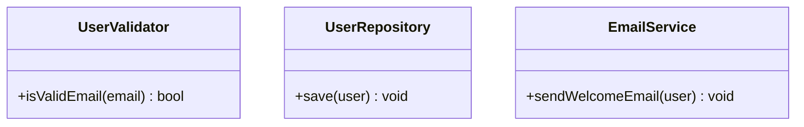
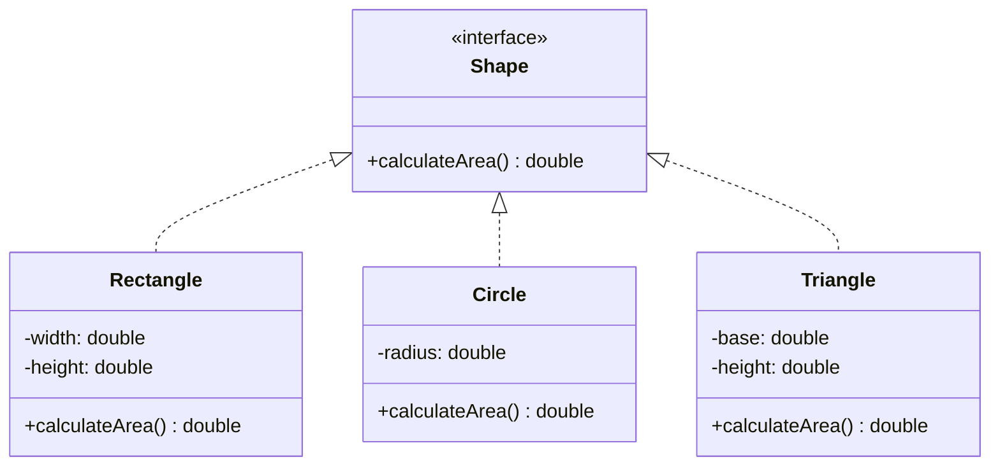
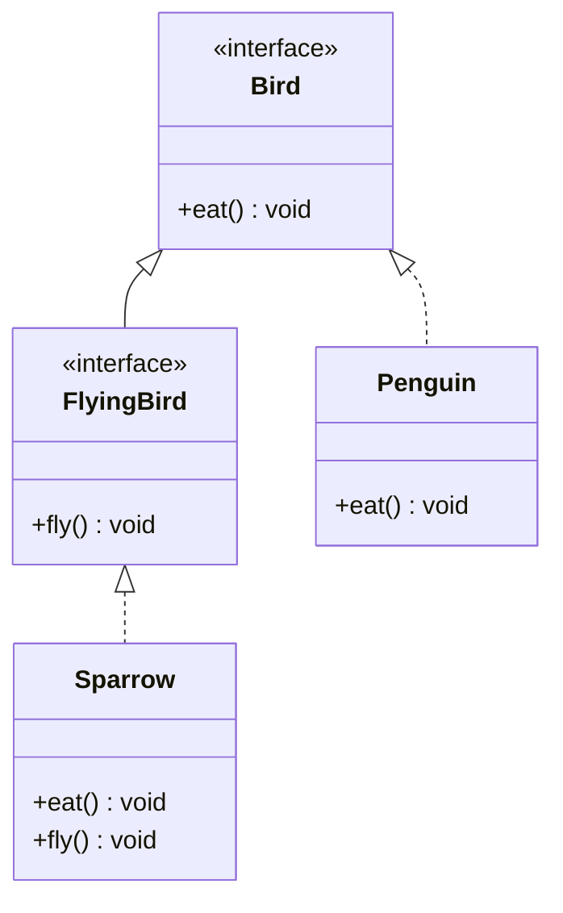
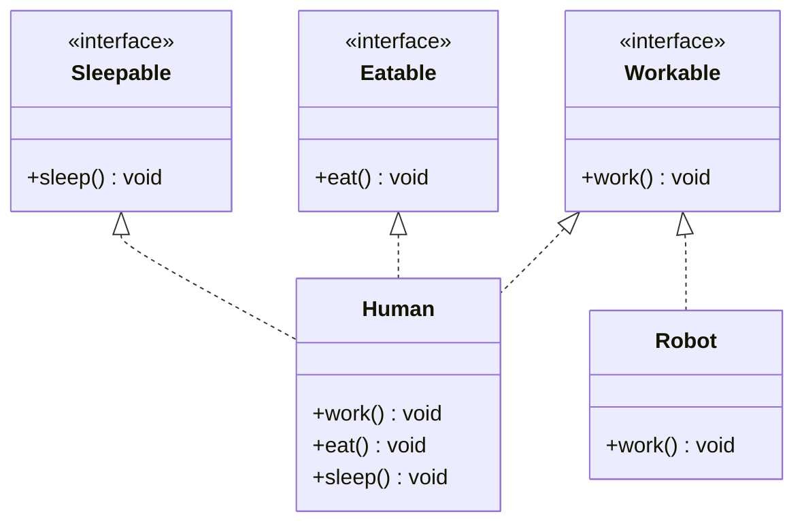
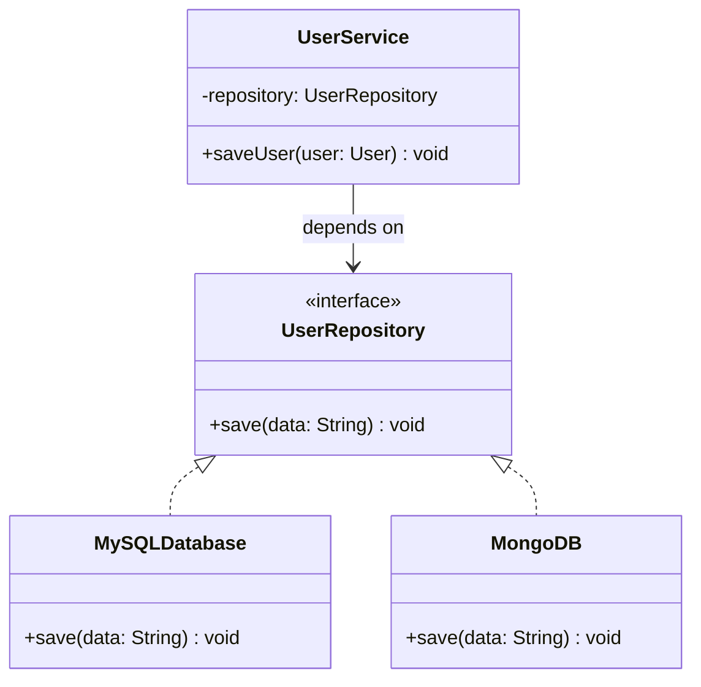

# SOLID Principles

The SOLID principles are five design principles that help developers create maintainable, scalable, and flexible software. These are fundamental for LLD interviews.

---

## S - Single Responsibility Principle (SRP)

> **A class should have only one reason to change.**

A class should do one thing and do it well. If a class has multiple responsibilities, changes to one responsibility might break the other.

### 📐 Class Diagram



### ✅ Good Example

```java
// Separate responsibilities
class UserValidator {
    public boolean isValidEmail(String email) { /* validation logic */ return email.contains("@"); }
}

class UserRepository {
    public void save(User user) { /* database logic */ }
}

class EmailService {
    public void sendWelcomeEmail(User user) { /* email logic */ }
}
```

```python
# Python - Separate responsibilities
class UserValidator:
    def is_valid_email(self, email: str) -> bool:
        return "@" in email  # validation logic

class UserRepository:
    def save(self, user) -> None:
        pass  # database logic

class EmailService:
    def send_welcome_email(self, user) -> None:
        pass  # email logic
```

### ❌ Bad Example

```java
// God class - too many responsibilities
class UserManager {
    public void validateUser(User user) { /* ... */ }
    public void saveToDatabase(User user) { /* ... */ }
    public void sendEmail(User user) { /* ... */ }
    public void generateReport(User user) { /* ... */ }
}
```

```python
# Python - God class - too many responsibilities
class UserManager:
    def validate_user(self, user) -> None:
        pass
    def save_to_database(self, user) -> None:
        pass
    def send_email(self, user) -> None:
        pass
    def generate_report(self, user) -> None:
        pass
```

### 🎯 Interview Question
*"How would you explain SRP to a junior developer?"*

**Answer**: "Imagine a Swiss Army knife vs a chef's knife. The Swiss knife does many things but none perfectly. A chef's knife does one thing excellently. Each class should be like a chef's knife—specialized and focused."

---

## O - Open/Closed Principle (OCP)

> **Software entities should be open for extension but closed for modification.**

You should be able to add new functionality without changing existing code.

### 📐 Class Diagram



### ✅ Good Example

```java
// Open for extension via new shapes
interface Shape {
    double calculateArea();
}

class Rectangle implements Shape {
    private double width;
    private double height;
    public double calculateArea() { return width * height; }
}

class Circle implements Shape {
    private double radius;
    public double calculateArea() { return Math.PI * radius * radius; }
}

// Adding Triangle doesn't require modifying existing code
class Triangle implements Shape {
    private double base;
    private double height;
    public double calculateArea() { return 0.5 * base * height; }
}
```

```python
# Python - Open for extension via new shapes
from abc import ABC, abstractmethod
import math

class Shape(ABC):
    @abstractmethod
    def calculate_area(self) -> float:
        pass

class Rectangle(Shape):
    def __init__(self, width: float, height: float):
        self.width = width
        self.height = height

    def calculate_area(self) -> float:
        return self.width * self.height

class Circle(Shape):
    def __init__(self, radius: float):
        self.radius = radius

    def calculate_area(self) -> float:
        return math.pi * self.radius * self.radius

# Adding Triangle doesn't require modifying existing code
class Triangle(Shape):
    def __init__(self, base: float, height: float):
        self.base = base
        self.height = height

    def calculate_area(self) -> float:
        return 0.5 * self.base * self.height
```

### ❌ Bad Example

```java
// Must modify this method for every new shape
class AreaCalculator {
    public double calculate(Object shape) {
        if (shape instanceof Rectangle) { /* ... */ return 0; }
        else if (shape instanceof Circle) { /* ... */ return 0; }
        // Must add new else-if for every shape!
        return 0;
    }
}
```

```python
# Python - Must modify this method for every new shape
class AreaCalculator:
    def calculate(self, shape) -> float:
        if isinstance(shape, Rectangle):
            pass # ...
            return 0.0
        elif isinstance(shape, Circle):
            pass # ...
            return 0.0
        # Must add new elif for every shape!
        return 0.0
```

### 🎯 Interview Question
*"When have you applied OCP in your projects?"*

**Answer**: Use strategy pattern, plugins, or abstract factories to allow extension without modification.

---

## L - Liskov Substitution Principle (LSP)

> **Objects of a superclass should be replaceable with objects of its subclasses without breaking the application.**

If class B extends class A, you should be able to use B anywhere A is expected.

### 📐 Class Diagram



### ✅ Good Example

```java
class Bird {
    public void eat() { /* eating logic */ }
}

class Sparrow extends Bird {
    public void fly() { /* flying logic */ }
}

// Sparrow can substitute Bird without issues
// Bird bird = new Sparrow();
// bird.eat(); // Works perfectly
```

```python
# Python - Good Example
class Bird:
    def eat(self) -> None:
        pass  # eating logic

class Sparrow(Bird):
    def fly(self) -> None:
        pass  # flying logic

# Sparrow can substitute Bird without issues
# bird: Bird = Sparrow()
# bird.eat()  # Works perfectly
```

### ❌ Bad Example

```java
class Bird {
    public void fly() { /* flying logic */ }
}

class Penguin extends Bird {
    @Override
    public void fly() {
        throw new UnsupportedOperationException("Penguins can't fly!");
    }
}

// Breaks when substituted!
// Bird bird = new Penguin();
// bird.fly(); // Throws exception - violates LSP
```

```python
# Python - Bad Example
class Bird:
    def fly(self) -> None:
        pass  # flying logic

class Penguin(Bird):
    def fly(self) -> None:
        raise NotImplementedError("Penguins can't fly!")

# Breaks when substituted!
# bird: Bird = Penguin()
# bird.fly()  # Throws exception - violates LSP
```

### 🎯 Fix the Violation

```java
interface Bird { void eat(); }
interface FlyingBird extends Bird { void fly(); }

class Sparrow implements FlyingBird {
    public void eat() { System.out.println("Sparrow eating seeds"); }
    public void fly() { System.out.println("Sparrow flying"); }
}
class Penguin implements Bird {
    public void eat() { System.out.println("Penguin eating fish"); }
}
```

```python
# Python - Fix LSP Violation with Protocol/ABC
from abc import ABC, abstractmethod

class Bird(ABC):
    @abstractmethod
    def eat(self) -> None:
        pass

class FlyingBird(Bird):
    @abstractmethod
    def fly(self) -> None:
        pass

class Sparrow(FlyingBird):
    def eat(self) -> None:
        print("Sparrow eating seeds")
    
    def fly(self) -> None:
        print("Sparrow flying")

class Penguin(Bird):  # Cannot fly, only implements Bird
    def eat(self) -> None:
        print("Penguin eating fish")
```

---

## I - Interface Segregation Principle (ISP)

> **Clients should not be forced to depend on interfaces they don't use.**

Many specific interfaces are better than one general-purpose interface.

### 📐 Class Diagram



### ❌ Fat Interface Problem

```java
interface Worker {
    void work();
    void eat();
    void sleep();
}

class Robot implements Worker {
    public void work() { /* works */ }
    public void eat() { /* Robots don't eat! */ }
    public void sleep() { /* Robots don't sleep! */ }
}
```

```python
# Python - Fat Interface Problem
from abc import ABC, abstractmethod

class Worker(ABC):
    @abstractmethod
    def work(self) -> None:
        pass
    
    @abstractmethod
    def eat(self) -> None:
        pass
    
    @abstractmethod
    def sleep(self) -> None:
        pass

class Robot(Worker):
    def work(self) -> None:
        pass  # works
        
    def eat(self) -> None:
        pass  # Robots don't eat!
        
    def sleep(self) -> None:
        pass  # Robots don't sleep!
```

### ✅ Segregated Interfaces

```java
interface Workable { void work(); }
interface Eatable { void eat(); }
interface Sleepable { void sleep(); }

class Human implements Workable, Eatable, Sleepable {
    public void work() { /* ... */ }
    public void eat() { /* ... */ }
    public void sleep() { /* ... */ }
}
class Robot implements Workable {
    public void work() { /* Only what it needs */ }
}
```

```python
# Python - Segregated Interfaces
from abc import ABC, abstractmethod

class Workable(ABC):
    @abstractmethod
    def work(self) -> None:
        pass

class Eatable(ABC):
    @abstractmethod
    def eat(self) -> None:
        pass

class Sleepable(ABC):
    @abstractmethod
    def sleep(self) -> None:
        pass

class Human(Workable, Eatable, Sleepable):
    def work(self) -> None:
        pass
    def eat(self) -> None:
        pass
    def sleep(self) -> None:
        pass

class Robot(Workable):
    def work(self) -> None:
        pass  # Only what it needs
```

### 🎯 Interview Question
*"How do you decide when to split an interface?"*

**Answer**: "If implementers frequently leave methods empty or throw `UnsupportedOperationException`, the interface is too fat and should be split."

---

## D - Dependency Inversion Principle (DIP)

> **High-level modules should not depend on low-level modules. Both should depend on abstractions.**

Depend on interfaces, not concrete implementations.

### 📐 Class Diagram



### ❌ Bad Example

```java
class MySQLDatabase {
    public void save(String data) { /* MySQL specific */ }
}

class UserService {
    private MySQLDatabase database = new MySQLDatabase(); // Tight coupling!
    
    public void saveUser(User user) {
        database.save(user.toString());
    }
}
```

```python
# Python - Bad Example
class MySQLDatabase:
    def save(self, data: str) -> None:
        pass  # MySQL specific

class UserService:
    def __init__(self):
        self.database = MySQLDatabase()  # Tight coupling!
        
    def save_user(self, user) -> None:
        self.database.save(str(user))
```

### ✅ Good Example

```java
interface UserRepository {
    void save(String data);
}

class MySQLDatabase implements UserRepository {
    public void save(String data) { /* ... */ }
}
class MongoDB implements UserRepository {
    public void save(String data) { /* ... */ }
}

class UserService {
    private UserRepository repository; // Depends on abstraction
    
    public UserService(UserRepository repository) { // Injected
        this.repository = repository;
    }
    
    public void saveUser(User user) {
        this.repository.save(user.toString());
    }
}
```

```python
# Python - Dependency Inversion
from abc import ABC, abstractmethod

class UserRepository(ABC):
    @abstractmethod
    def save(self, data: str) -> None:
        pass

class MySQLDatabase(UserRepository):
    def save(self, data: str) -> None:
        print(f"Saving to MySQL: {data}")

class MongoDB(UserRepository):
    def save(self, data: str) -> None:
        print(f"Saving to MongoDB: {data}")

class UserService:
    def __init__(self, repository: UserRepository):  # Injected abstraction
        self.repository = repository
    
    def save_user(self, user) -> None:
        self.repository.save(str(user))

# Usage - easy to swap implementations
service = UserService(MySQLDatabase())
test_service = UserService(MongoDB())  # Or mock for testing
```

### 🎯 Interview Question
*"How does DIP enable testing?"*

**Answer**: "By depending on abstractions, we can inject mock implementations during testing instead of real databases or external services."

---

## 📋 Quick Reference Table

| Principle | One-Liner | Violation Sign |
|-----------|-----------|----------------|
| **SRP** | One class, one job | Class has multiple reasons to change |
| **OCP** | Extend, don't modify | Adding features requires changing existing code |
| **LSP** | Subtypes must be substitutable | Subclass throws exceptions or behaves differently |
| **ISP** | Small, focused interfaces | Classes implement methods they don't need |
| **DIP** | Depend on abstractions | Using `new` for dependencies inside classes |

---

## 🔗 Cross-References

- **Design Patterns using SOLID**: Factory, Strategy, Observer, Decorator
- **LLD Projects**: All projects should follow SOLID principles
- **Related**: [Composition vs Inheritance](./composition-vs-inheritance.md)

---

## Interview Lens

### Requirements and constraints
- Prioritize SRP and DIP for maintainability under follow-up changes.
- Apply OCP where requirements explicitly expect new variants.
- Avoid forcing abstractions if no change axis is present yet.

### Common pitfalls
- Using interfaces everywhere without concrete motivation.
- Treating SOLID as a checklist instead of design pressure-response.
- Missing LSP contracts (subtypes violating base assumptions).

### Follow-up questions
1. Which SOLID principle gives the biggest payoff in this problem?
2. Where is your most important abstraction boundary and why?
3. Which class is most likely to violate SRP at 10x feature growth?

### Variants and extensions
- Add pluggable policy engines (OCP + DIP).
- Separate write-path and read-path responsibilities (SRP).

---

*💡 Pro Tip: In interviews, always explain WHY a principle matters, not just WHAT it is.*
