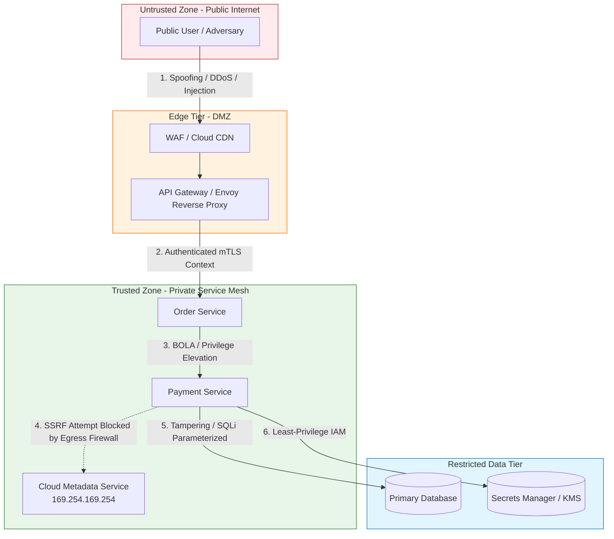
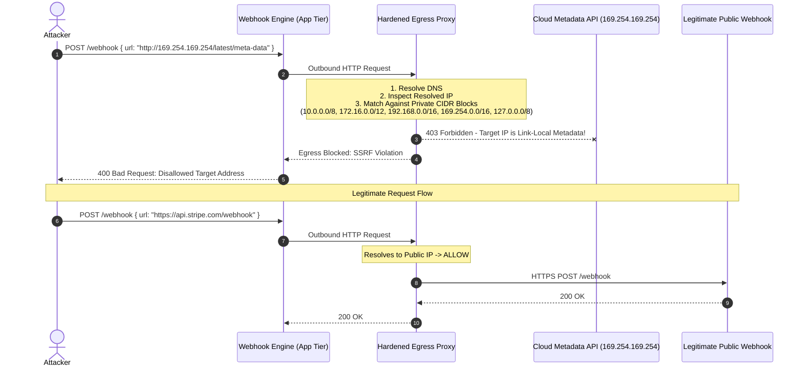
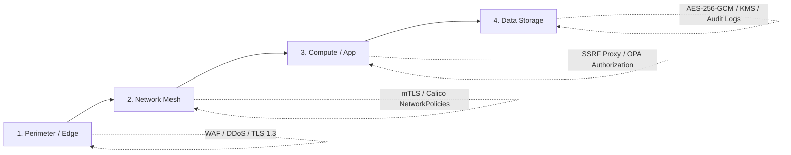

# Application Security, Threat Modeling & Defensive Engineering

In modern distributed system design, security cannot be retrofitted as an afterthought. Designing robust, defensible systems requires identifying trust boundaries, threat modeling components using formal frameworks, and implementing concrete engineering controls against common attack vectors.

---

## 1. Threat Modeling Frameworks

### The STRIDE Framework
Developed by Microsoft, STRIDE categorizes threats based on the security property violated:

| Threat Category | Security Property Violated | Definition | Real-World Attack Example | Engineering Defense Control |
|---|---|---|---|---|
| **S**poofing | **A**uthenticity | An adversary pretends to be another user, system, or component. | Forging JWT claims, API token replay, IP spoofing. | Cryptographic signatures (mTLS, asymmetric JWT with EdDSA/RS256), WebAuthn/FIDO2. |
| **T**ampering | **I**ntegrity | Unauthorized modification of code, configuration, or data in transit/rest. | Parameter tampering in shopping carts, altering database records via SQLi. | TLS 1.3, message authentication codes (HMAC-SHA256), database row check hashes, immutable audit ledgers. |
| **R**epudiation | **N**on-Repudiation | An actor denies having performed an action without the ability to disprove them. | "I never initiated this bank transfer." | Write-once append-only audit logs with cryptographic signing (e.g., AWS CloudTrail, tamper-proof WAL). |
| **I**nformation Disclosure | **C**onfidentiality | Exposing sensitive data to unauthorized individuals or processes. | Leaking PII in stack traces, S3 bucket misconfiguration, cache poisoning. | Field-level encryption (AES-256-GCM), data masking, envelope encryption (KMS), strict egress filtering. |
| **D**enial of Service | **A**vailability | Degrading or crashing services to make them unavailable to legitimate users. | Volumetric SYN floods, algorithmic complexity attacks (ReDoS), GraphQL deep nesting. | Multi-tier rate limiting (Token Bucket in Envoy), CDN DDoS mitigation (Cloudflare), query depth/cost limits. |
| **E**levation of Privilege | **A**uthorization | An unauthorized user gains privileged capabilities or administrative access. | BOLA/IDOR, path traversal, container breakout via root daemon. | Principle of Least Privilege, fine-grained ABAC/ReBAC, non-root containers, read-only root filesystems. |

---

### Trust Boundaries & Architecture Modeling

A **Trust Boundary** exists wherever data, execution control, or network traffic transitions between different levels of trust (e.g., public internet $\to$ DMZ, DMZ $\to$ internal service mesh, application layer $\to$ database cluster).



---

## 2. OWASP Top 10 Engineering Defenses

### 1. Injection Attacks (SQLi, NoSQLi, Command Injection)
- **Vulnerability:** Unsanitized user input is concatenated into an execution interpreter.
  ```sql
  -- VULNERABLE: Direct string interpolation
  SELECT * FROM users WHERE username = 'admin' AND password = '' OR '1'='1';
  ```
- **Engineering Mitigation:**
  1. **Strict Parameterized Queries / Prepared Statements:** The database driver separates SQL command tokens from literal parameter data via pre-compilation.
     ```python
     # SECURE: Parameterized execution
     cursor.execute("SELECT * FROM users WHERE username = %s AND password_hash = %s", (username, pwd_hash))
     ```
  2. **ORM Safety Invariants:** Enforce ORM abstract query builders (Hibernate, SQLAlchemy, Prisma) that automatically parameterize inputs.
  3. **Least-Privilege Database Accounts:** Applications connect using scoped database users without `DROP`, `ALTER`, or `SUPERUSER` privileges.

---

### 2. Server-Side Request Forgery (SSRF)
- **Vulnerability:** The application accepts a URL from a user and fetches remote content (e.g., webhooks, avatar upload via URL, link preview generator). An attacker provides internal URLs:
  - AWS/GCP Instance Metadata: `http://169.254.169.254/latest/meta-data/iam/security-credentials/`
  - Internal administrative endpoints: `http://10.0.0.1:8080/admin/delete-database`
  - Loopback services: `http://localhost:6379/` (Redis unauthenticated commands)



- **SSRF Engineering Defenses:**
  1. **Network-Level Metadata Blocking:** Disable IMDSv1 on AWS and enforce IMDSv2 (requires session token headers). Enforce hypervisor packet filtering rejecting requests to `169.254.169.254` from application pods.
  2. **Dedicated Isolated Egress Proxy:** Route all outbound fetch requests through an Envoy or Squid proxy running in an isolated DMZ VPC with zero access to internal subnets.
  3. **DNS Rebinding Prevention:** Resolve the domain to an IP address *before* connection, verify that the IP is not in private/link-local/loopback CIDRs, and initiate the socket directly to the validated IP.

---

### 3. Broken Object-Level Authorization (BOLA / IDOR)
- **Vulnerability:** The application uses client-supplied identifiers to access resources without validating that the authenticated session owns or is authorized for that specific resource:
  ```http
  GET /api/v1/invoices/98421
  ```
  Attacker changes `98421` to `98422` and views another customer's financial statement.
- **Engineering Mitigation:**
  1. **Enforce Tenant Scoping in Data Layer:** Never rely on ID lookup alone. Always join against the authenticated user's organization or user ID:
     ```sql
     -- SECURE: Ownership invariant enforced at query level
     SELECT * FROM invoices WHERE id = :invoice_id AND tenant_id = :authenticated_tenant_id;
     ```
  2. **Cryptographically Opaque or UUIDv4 Identifiers:** Replace sequential integer auto-increment IDs (`1, 2, 3`) with high-entropy UUIDs (`UUIDv7` or `NanoID`) to prevent enumeration attacks.
  3. **Centralized Policy Enforcement (OPA / Cedar):** Decouple authorization logic from business handlers using Open Policy Agent (OPA) middleware.

---

### 4. Cross-Site Scripting (XSS) & Content Security Policy (CSP)
- **Stored XSS:** Malicious JavaScript is persisted in a database (e.g., in a comment body) and served to other users.
- **Reflected XSS:** Malicious payload is reflected off a URL query parameter into the rendered HTML without escaping.
- **Defenses:**
  - **Context-Aware Output Encoding:** Use modern component frameworks (React, Vue, Angular) that treat props as string literals by default. Never use `dangerouslySetInnerHTML` without DOMPurify sanitization.
  - **Content Security Policy (CSP) HTTP Header:** Restrict origins from which scripts, styles, and workers can execute:
    ```http
    Content-Security-Policy: default-src 'self'; script-src 'self' https://trusted-cdn.com; object-src 'none'; frame-ancestors 'none';
    ```

---

### 5. Cross-Site Request Forgery (CSRF)
- **Vulnerability:** A malicious third-party website induces a user's browser to execute an unwanted action on an authenticated application by leveraging automatic cookie transmission.
- **Defenses:**
  - **SameSite Cookies:** Set `SameSite=Lax` or `SameSite=Strict` on session cookies. The browser will not attach the session cookie to cross-origin requests.
  - **Synchronizer Token Pattern (Anti-CSRF Tokens):** Inject a cryptographically secure random token in forms and state-changing headers (`X-CSRF-Token`), verified server-side against the user session.

---

### 6. Rate Limiting, Credential Stuffing & DoS Protection
- **Vulnerability:** Automated bots submit millions of username/password pairs obtained from third-party breaches.
- **Defenses:**
  - **Multi-Dimensional Rate Limiting:**
    - Global per-IP rate limit: e.g., 50 req/min per IP.
    - Sensitive endpoint limit: e.g., 5 login attempts per 15 minutes per username.
  - **Token Bucket / Leaky Bucket in Redis:** Fast, atomic sliding-window counters via Redis Lua scripts or Envoy rate limit service.
  - **Proof-of-Work / CAPTCHA Verification:** Trigger Cloudflare Turnstile when suspicious velocity or bot reputation flags are detected.
  - **Argon2id Password Hashing:** Enforce high memory-cost and time-cost hashing algorithms (Argon2id, bcrypt work factor 12) to make offline cracking computationally infeasible.

---

## 3. Defense-in-Depth Checklist for System Design Interviews

When presenting architecture in system design interviews, apply the **Defense-in-Depth** principle across every tier:



1. **Perimeter (Edge):** Cloudflare WAF, AWS Shield DDoS mitigation, TLS 1.3 termination, IP reputation filtering.
2. **Network (Service Mesh):** Mutual TLS (mTLS) with SPIFFE/SPIRE identity certificates between microservices; Kubernetes NetworkPolicies blocking cross-namespace ingress.
3. **Application Tier:** Strict input validation (Pydantic/Zod schemas), parameterized queries, opaque IDs, automated egress SSRF proxying.
4. **Data Tier:** Encryption at rest with customer-managed keys (CMK in AWS KMS), envelope encryption for sensitive fields, read-only DB replicas for reporting.
5. **Observability:** Centralized audit logging (SIEM), anomaly detection on elevated error spikes, and automated secret scanners (git-secrets, Trufflehog).

---

## Cross-References

- [Authentication, Sessions & JWTs](./authentication-sessions-and-jwts.md)
- [Authorization: RBAC, ABAC & ReBAC](./authorization-rbac-abac-rebac.md)
- [Cryptography, TLS & Password Hashing](./cryptography-tls-and-password-hashing.md)
- [OAuth 2.0 & OIDC Protocols](./oauth2-and-oidc-protocols.md)
- [HLD: Bot Detection Platform](../../04-hld-projects/bot-detection-platform/)
