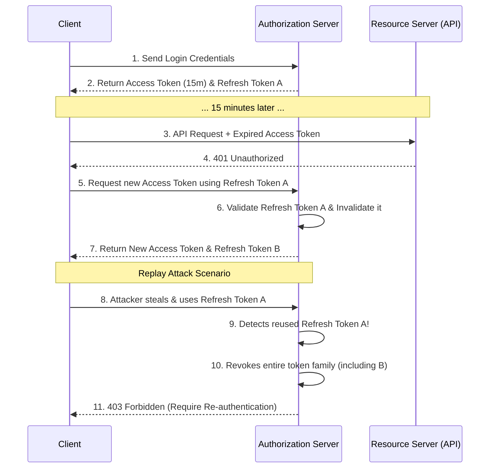

# User Authentication, Session State, and Tokens in Distributed Systems

Authentication and session management are foundational components of secure distributed systems. This guide provides a comprehensive overview of stateful sessions, stateless JSON Web Tokens (JWT), the challenges of token revocation, and the scale and performance tradeoffs between these approaches.

## 1. Stateful Sessions

Stateful session management relies on the server maintaining the state of authenticated users. When a user successfully authenticates, the server creates a session and returns a session identifier to the client, typically stored in a cookie.

### Session Identifier (Session ID) and Encrypted Cookies
The Session ID is a unique, unguessable random string that maps the client to a session record stored on the server. To enhance security, cookies containing the Session ID can be encrypted, ensuring that even if intercepted, the contents cannot be read or tampered with by unauthorized parties.

### Cookie Security Flags
To protect session cookies from common web vulnerabilities, developers must employ several critical security flags:
- **`HttpOnly`**: This flag prevents client-side scripts (like JavaScript) from accessing the cookie. It is a primary defense against Cross-Site Scripting (XSS) attacks.
- **`Secure`**: This flag ensures the cookie is only transmitted over encrypted connections (HTTPS), preventing eavesdropping over unsecured networks.
- **`SameSite=Strict|Lax|None`**: This attribute governs when cookies are sent with cross-origin requests, serving as a robust defense against Cross-Site Request Forgery (CSRF). `Strict` prevents the cookie from being sent in any cross-site request, while `Lax` allows it for top-level navigations (e.g., following a link). `None` allows it for all cross-site requests but requires the `Secure` flag.

### Centralized Session Stores vs. Sticky Sessions
In distributed environments, a single server cannot hold session state locally without causing issues when requests are routed to other servers.
- **Centralized Session Stores (Redis, Memcached)**: The preferred approach. All application servers query a high-performance in-memory datastore (like Redis or Memcached) to validate the Session ID. This ensures stateless application servers and seamless horizontal scaling.
- **Sticky Sessions at Load Balancer**: The load balancer uses a cookie or IP hash to route a specific user to the same backend server consistently. While simpler, this approach creates uneven load distribution and complicates server deployments or failures, as session state is lost if the designated server goes down.

## 2. Stateless JSON Web Tokens (JWT)

Stateless authentication shifts the burden of state from the server to the client using JSON Web Tokens (JWT). The token itself contains all necessary information to verify the user's identity.

### JWT Structure
A JWT consists of three parts separated by dots (`.`):
- **Header**: Contains metadata about the token, including the type (JWT) and the signing algorithm used.
- **Payload**: Contains the claims, which are statements about an entity (typically, the user) and additional data. Common standard claims include:
  - `sub` (Subject): Identifies the principal that is the subject of the JWT.
  - `iss` (Issuer): Identifies the principal that issued the JWT.
  - `aud` (Audience): Identifies the recipients that the JWT is intended for.
  - `exp` (Expiration Time): The time after which the JWT must not be accepted.
  - `iat` (Issued At): The time at which the JWT was issued.
  - `jti` (JWT ID): A unique identifier for the token.
- **Cryptographic Signature**: Created by taking the encoded header, encoded payload, a secret, and the algorithm specified in the header to ensure the token hasn't been tampered with.

### Signing Algorithms
- **Symmetric (HMAC-SHA256 / HS256)**: Uses a single shared secret key to both sign and verify the token. It is fast but requires all validating parties to securely possess the secret, which is risky in a microservices architecture.
- **Asymmetric (RSA / RS256, ECDSA / ES256)**: Uses a private key to sign the token and a public key to verify it. Microservices can fetch the public key from a central Identity Provider via JWKS (JSON Web Key Set) endpoints, allowing them to verify tokens without access to the signing key.

### Common Attack Vectors
- **The `alg: none` Vulnerability**: Historically, some JWT libraries accepted tokens with the algorithm set to `none`, bypassing signature verification. Modern libraries explicitly require the algorithm to be specified and verified.
- **Token Tampering**: Attackers may try to modify the payload (e.g., escalating privileges). A robust cryptographic signature prevents this, as any change invalidates the signature.
- **Secret Key Brute-Forcing**: If a weak symmetric secret is used, attackers can guess the key offline and forge valid tokens. Strong, long, and random keys are essential.

## 3. The Token Revocation Dilemma in Distributed Systems

One of the primary challenges of stateless JWTs is revocation. Because the token is self-contained and verified locally by microservices without querying a central authority, pure stateless JWTs cannot be revoked immediately upon logout, password reset, or account suspension.

### Revocation Strategies
To mitigate this dilemma, systems employ several strategies:
- **Short-lived Access Tokens (5-15 min) + Refresh Token Rotation**: The Access Token has a very brief lifespan. Once it expires, the client uses a long-lived Refresh Token to obtain a new Access Token. If a user logs out, the Refresh Token is invalidated. This minimizes the window of vulnerability.
- **Distributed Token Blacklist / Denylist**: A centralized datastore (like Redis) maintains a list of revoked tokens. Microservices check this list during verification. The token is stored in the blacklist with a TTL (Time To Live) equal to the token's remaining expiration time, preventing the blacklist from growing indefinitely.
- **User Version / Token Generation Counter**: A counter (`token_version`) is stored in the user's database record and cached in Redis. The JWT payload includes this counter. When validating the JWT, the service compares the token's counter against the current database value. Incrementing the counter globally invalidates all previously issued tokens for that user.

## 4. Scale & Performance Tradeoffs

When designing authentication systems, engineers must weigh the tradeoffs between latency, compute cost, and scalability.

- **Redis Session Lookup Latency**: Centralized session stores introduce a network hop for every authenticated request. However, Redis operations typically complete in less than 1 millisecond (~1ms). While network latency is added, the compute overhead on the application server is negligible.
- **Cryptographic JWT Verification CPU Cost**: Verifying a JWT (especially with asymmetric algorithms like RS256) is CPU-intensive. At massive scale (e.g., 100k requests per second), cryptographic validation can consume significant CPU resources across the application fleet. This requires robust CPU profiling and potentially horizontal scaling of the microservices performing the verification to prevent CPU bottlenecks.

## 5. Diagrams

### Sequence Diagram: Refresh Token Rotation with Replay Attack Detection



### Architecture Diagram: Centralized Session Store vs. Stateless JWT Verification

```mermaid
flowchart TD
    subgraph Client [Client Applications]
        Browser
        MobileApp
    end

    subgraph LB [Load Balancer / API Gateway]
        Gateway
    end

    subgraph Stateful [Stateful Session Architecture]
        AppServer1[App Server 1]
        AppServer2[App Server 2]
        Redis[(Redis Session Store)]
        
        AppServer1 -->|Network call ~1ms| Redis
        AppServer2 -->|Network call ~1ms| Redis
    end

    subgraph Stateless [Stateless JWT Architecture]
        MicroserviceA[Microservice A\n(CPU Verification)]
        MicroserviceB[Microservice B\n(CPU Verification)]
        JWKS[JWKS Endpoint\n(Identity Provider)]
        
        MicroserviceA -->|Periodic Fetch| JWKS
        MicroserviceB -->|Periodic Fetch| JWKS
    end

    Browser -->|Session Cookie| Gateway
    MobileApp -->|JWT Bearer| Gateway
    
    Gateway -->|Route| AppServer1
    Gateway -->|Route| MicroserviceA

    classDef store fill:#f9f,stroke:#333,stroke-width:2px;
    class Redis store;
```
