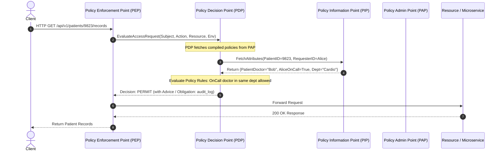
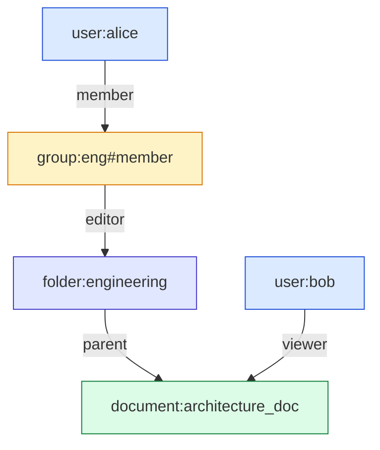
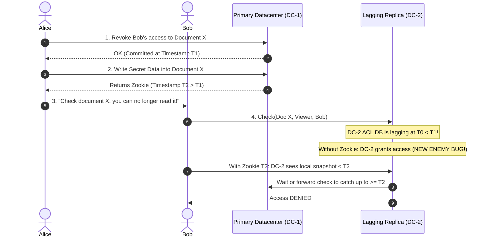

# Authorization Architectures: RBAC, ABAC, and ReBAC (Google Zanzibar)

Access control and authorization are central to distributed systems security. While authentication determines *who* a principal is, authorization determines *what* actions that principal can execute on specific resources. As systems scale from monolithic departmental apps to multi-tenant distributed microservices, authorization architectures have evolved from static roles to fine-grained, globally distributed relationship graphs.

This deep dive covers the three dominant access control paradigms: Role-Based Access Control (RBAC), Attribute-Based Access Control (ABAC), and Relationship-Based Access Control (ReBAC / Google Zanzibar), analyzing their architectural models, performance characteristics, and distributed scaling trade-offs.

---

## 1. Role-Based Access Control (RBAC)

Role-Based Access Control (RBAC) maps access rights to roles rather than directly to individual users. Users are assigned one or more roles, and permissions to perform actions on resources are assigned to roles.

```
+-------+       +-------+       +------------+       +----------+
| User  | ----> | Role  | ----> | Permission | ----> | Resource |
+-------+       +-------+       +------------+       +----------+
```

### Core RBAC Models
NIST formalized RBAC into four hierarchical models (NIST RBAC Standard / ANSI INCITS 359-2004):
- **RBAC0 (Core RBAC)**: Flat model consisting of Users, Roles, Permissions (Operations on Objects), and Many-to-Many user-role and permission-role assignment relations.
- **RBAC1 (Hierarchical RBAC)**: Introduces role inheritance via a Directed Acyclic Graph (DAG) of roles. For example, `Admin` inherits all permissions of `Editor`, which in turn inherits all permissions of `Viewer`.
- **RBAC2 (Constraint RBAC)**: Enforces separation of duties (SoD).
  - *Static Separation of Duty (SSOD)*: A user cannot be assigned mutually exclusive roles (e.g., cannot be both `Purchaser` and `PaymentApprover`).
  - *Dynamic Separation of Duty (DSOD)*: A user may possess both roles, but cannot activate both in the same active session.
- **RBAC3 (Unified RBAC)**: Combines Hierarchical RBAC (RBAC1) with Constraints (RBAC2).

### The "Role Explosion" Antipattern
While RBAC is simple to implement and fast to evaluate (often cached as a bitmask in the user's JWT or session token), it struggles with fine-grained multi-tenancy and contextual boundaries:
1. **Per-Resource Roles**: When permissions depend on specific object instances (e.g., "Alice is Editor of Document 42, but Viewer of Document 99"), organizations create instance-specific roles (`Editor_Doc_42`, `Viewer_Doc_99`), multiplying the role count by the resource count.
2. **Context Proliferation**: When authorization depends on organization, team, project, or geography, roles multiply exponentially: `BillingAdmin_USEast_Tier2_Tenant42`.
3. **Operational Drag**: As employees change responsibilities, stale role memberships accumulate (privilege creep), making governance audits nearly impossible.

---

## 2. Attribute-Based Access Control (ABAC)

Attribute-Based Access Control (ABAC) evaluates boolean policies that dynamically inspect attributes of the subject, resource, action, and environment at the moment of request execution.

```
Decision = Evaluate(PolicySet, {
    Subject:     { id, department, title, clearance, tenant_id },
    Resource:    { id, owner_id, classification, status, tenant_id },
    Action:      { name: "read" | "write" | "delete" },
    Environment: { timestamp, client_ip, device_posture, geo_ip }
})
```

### Architectural Components (XACML / OPA Standard)

ABAC architectures follow the XACML (eXtensible Access Control Markup Language) reference architecture:



- **Policy Enforcement Point (PEP)**: Intercepts incoming user requests (e.g., API Gateway, Envoy sidecar, web framework middleware) and enforces the PDP's decision.
- **Policy Decision Point (PDP)**: The stateless policy evaluation engine (e.g., Open Policy Agent - OPA, AWS Verified Permissions). Evaluates rules against gathered attributes.
- **Policy Information Point (PIP)**: External databases, directories (LDAP, Active Directory), or microservices queried by the PDP to enrich missing attributes in real-time.
- **Policy Administration Point (PAP)**: The control plane where security teams author, version, and distribute policy definitions (e.g., Rego or Cedar files).

### Trade-offs: Flexibility vs. Latency
- **Advantages**: Extreme expressiveness. Can express policies like: *"Allow access if user department equals resource department, device is managed, and request is during local business hours (09:00 - 18:00)"*.
- **Latency & Scalability Penalty**:
  - PDP policy evaluation is CPU-intensive compared to static bitmask lookups.
  - PIP attribute enrichment requires synchronous network roundtrips to external datastores, adding 10–50ms to request latency on the critical path.
  - Complex boolean policies are difficult to index or invert (e.g., answering *"List all resources Alice can view"* requires a full table scan evaluating every resource through the PDP).

---

## 3. Relationship-Based Access Control (ReBAC) & Google Zanzibar

Google Zanzibar (published in USENIX ATC 2019) introduced **Relationship-Based Access Control (ReBAC)** to power global authorization across Google Drive, YouTube, Google Cloud, Calendar, and Photos, scaling to billions of users, trillions of access control lists (ACLs), and millions of QPS with single-digit millisecond latency.

In ReBAC, permissions are not static attributes or global roles; they are derived from a **directed graph of relationships** between objects and subjects.



### Zanzibar Relational Tuples
All authorization data in Zanzibar is stored as an immutable set of relational tuples following the canonical grammar:

$$\text{tuple} = \langle \text{object} \rangle \# \langle \text{relation} \rangle @ \langle \text{user} \rangle$$

Where:
- $\text{object} = \text{namespace} : \text{object\_id}$ (e.g., `document:budget_2026`, `folder:finance`)
- $\text{relation}$ is a defined relation in that namespace (e.g., `owner`, `editor`, `viewer`, `parent`)
- $\text{user}$ is either:
  - A concrete principal: `user:alice`
  - A userset (set of users): `group:finance_team#member` (indirection / nested groups)

#### Concrete Tuple Examples:
```text
document:budget_2026#parent@folder:finance
folder:finance#viewer@group:finance_team#member
group:finance_team#member@user:alice
group:finance_team#member@user:bob
```

### Namespace Configuration and Userset Rewrite Rules
Namespaces define how relations compose and inherit permissions through **Userset Rewrite Rules**:

```protobuf
name: "document"
relation {
  name: "owner"
}
relation {
  name: "editor"
  userset_rewrite {
    union {
      child { _this {} }
      child { computed_userset { relation: "owner" } }
    }
  }
}
relation {
  name: "viewer"
  userset_rewrite {
    union {
      child { _this {} }
      child { computed_userset { relation: "editor" } }
      child {
        tuple_to_userset {
          tupleset { relation: "parent" }
          computed_userset { relation: "viewer" }
        }
      }
    }
  }
}
```

- `_this`: Direct tuple matches (e.g., `document:1#viewer@user:alice`).
- `computed_userset`: Inherit from another relation on the same object (e.g., any `editor` is automatically a `viewer`).
- `tuple_to_userset`: Graph traversal across relationships (e.g., anyone who is a `viewer` of the document's `parent` folder is a `viewer` of the document).

### Graph Traversal: The `Check` and `Expand` APIs
- **`Check(object, relation, user)`**: Recursively traverses the relationship graph to evaluate whether the directed path from `object#relation` reaches `user`. Zanzibar evaluates sub-problems concurrently with distributed caching and dead-cycle detection.
- **`Expand(object, relation)`**: Returns the full userset tree for an object, allowing applications to display who has access (e.g., Google Drive "Share" dialog).

### The "New Enemy" Problem & Zookies

In distributed systems with multi-datacenter replication, read replicas lag behind primary writes. This causes the **New Enemy Problem** (causal reverse order / ACL race condition):

```
Time T1: Alice removes Bob from access to confidential document X (ACL mutation in Spanner DC-1).
Time T2: Alice posts top-secret message M into document X (Storage mutation in Spanner DC-1).
Time T3: Alice calls Bob on the phone: "Haha, you cannot read my secret document anymore!".
Time T4: Bob immediately calls `Check(document:X, viewer, Bob)` in DC-2.
Problem: If DC-2 has replicated Alice's document write (T2) but its ACL replica is lagging behind T1,
         Bob reads the stale ACL and gains unauthorized access to secret message M!
```



#### The Solution: Zookies (Consistency Tokens)
Zanzibar solves this using **Zookies**:
1. When content is updated, Zanzibar issues an opaque, cryptographically signed token called a **Zookie** containing the Google Spanner TrueTime commit timestamp $T_{\text{snapshot}}$.
2. Subsequent client requests must supply the Zookie alongside their access check.
3. Zanzibar evaluates the ACL check against a snapshot of the relation tuples at a timestamp $\ge T_{\text{snapshot}}$.
4. If a local replica's snapshot is older than $T_{\text{snapshot}}$, the check either waits for replication to catch up or routes to a fresh replica, provably preventing the New Enemy bug without requiring global distributed locks.

---

## 4. Architectural Comparison & Industry Implementations

| Dimension | RBAC | ABAC | ReBAC (Zanzibar) |
| :--- | :--- | :--- | :--- |
| **Primary Model** | Users $\to$ Roles $\to$ Permissions | Boolean predicates on attributes | Directed Graph of Relational Tuples |
| **Granularity** | Coarse / Medium | Extreme (Fine-grained) | Deep Fine-grained (Hierarchical & Object-level) |
| **Evaluation Latency** | $< 1$ ms (often in-token bitmask) | $5 - 50$ ms (PIP lookups + rule parse) | $2 - 10$ ms (distributed graph memoization) |
| **Reverse Query ("List All Accessible")** | Easy (scan roles) | Extremely hard (requires full scan) | Solvable via reverse graph indices (Leopard) |
| **Multi-Tenancy Scaling** | Poor (role explosion) | Good (tenant as attribute) | Native (tenant/workspace embedded in graph) |
| **Leading Implementations** | Spring Security, AWS IAM Roles, Keycloak | Open Policy Agent (OPA/Rego), AWS Cedar | OpenFGA, Ory Keto, Auth0 FGA, SpiceDB |

### Major Open Source & Cloud Implementations
- **OpenFGA (CNCF Sandbox)**: Auth0's open-source implementation of Zanzibar. Provides a human-readable DSL (`model`) and gRPC/REST SDKs.
- **SpiceDB (Authzed)**: Production-grade Zanzibar implementation backed by CockroachDB, PostgreSQL, or Spanner with native Zookie support.
- **Ory Keto**: High-performance Go implementation of Google Zanzibar, integrating with Ory Kratos (identities) and Ory Oathkeeper (proxy).
- **Open Policy Agent (OPA)**: General-purpose ABAC policy engine using the declarative query language **Rego**. Best for Kubernetes admission control and infrastructure guardrails.

---

## 5. Python Reference Implementation: ReBAC Evaluator

Below is a complete, self-contained Python implementation of an in-memory ReBAC evaluator demonstrating relational tuples, nested group expansion, and computed userset rewrites.

```python
"""
In-memory Relationship-Based Access Control (ReBAC) Evaluator
Illustrates Google Zanzibar tuple evaluation with userset rewrites and recursion guards.
"""
from dataclasses import dataclass
from typing import Dict, List, Optional, Set, Tuple


@dataclass(frozen=True)
class TupleRecord:
    object_namespace: str
    object_id: str
    relation: str
    user_namespace: str
    user_id: str
    user_relation: Optional[str] = None  # None for direct users, "member" for usersets

    @property
    def object_str(self) -> str:
        return f"{self.object_namespace}:{self.object_id}"

    @property
    def user_str(self) -> str:
        if self.user_relation:
            return f"{self.user_namespace}:{self.user_id}#{self.user_relation}"
        return f"{self.user_namespace}:{self.user_id}"


class ReBACStore:
    def __init__(self):
        # Index: (object_str, relation) -> list of TupleRecords
        self._tuples: Dict[Tuple[str, str], List[TupleRecord]] = {}

    def write_tuple(self, record: TupleRecord) -> None:
        key = (record.object_str, record.relation)
        self._tuples.setdefault(key, []).append(record)

    def read_tuples(self, object_str: str, relation: str) -> List[TupleRecord]:
        return self._tuples.get((object_str, relation), [])


class ReBACEvaluator:
    def __init__(self, store: ReBACStore):
        self.store = store

    def check(
        self,
        object_str: str,
        relation: str,
        user_str: str,
        visited: Optional[Set[Tuple[str, str]]] = None
    ) -> bool:
        """
        Recursively checks if user_str has relation on object_str.
        Includes cycle detection to guard against circular group memberships.
        """
        if visited is None:
            visited = set()

        call_key = (object_str, relation)
        if call_key in visited:
            return False  # Prevent infinite recursion cycles
        visited.add(call_key)

        records = self.store.read_tuples(object_str, relation)

        for rec in records:
            # 1. Direct match: object#relation@user
            if not rec.user_relation and rec.user_str == user_str:
                return True

            # 2. Userset indirection: object#relation@group:xyz#member
            if rec.user_relation:
                userset_obj = f"{rec.user_namespace}:{rec.user_id}"
                if self.check(userset_obj, rec.user_relation, user_str, visited.copy()):
                    return True

        # 3. Hierarchical Userset Rewrites:
        # e.g., on a document: viewer implies editor, and inherits from parent folder
        if ":" in object_str:
            ns, _ = object_str.split(":", 1)
            if ns == "document":
                # Rewrite rule 1: editor implies viewer
                if relation == "viewer":
                    if self.check(object_str, "editor", user_str, visited.copy()):
                        return True

                # Rewrite rule 2: parent folder's viewer implies document viewer
                for parent_rec in self.store.read_tuples(object_str, "parent"):
                    parent_obj = parent_rec.user_str  # e.g., folder:finance
                    if self.check(parent_obj, relation, user_str, visited.copy()):
                        return True

            elif ns == "folder":
                # Rewrite rule: editor implies viewer
                if relation == "viewer":
                    if self.check(object_str, "editor", user_str, visited.copy()):
                        return True

        return False


# =====================================================================
# Demonstration & Self-Verification
# =====================================================================
if __name__ == "__main__":
    store = ReBACStore()
    evaluator = ReBACEvaluator(store)

    # 1. Build Relationships:
    # Alice is member of group:engineering
    store.write_tuple(TupleRecord("group", "engineering", "member", "user", "alice"))

    # group:engineering is editor of folder:architecture
    store.write_tuple(TupleRecord("folder", "architecture", "editor", "group", "engineering", "member"))

    # document:hld_spec belongs to folder:architecture
    store.write_tuple(TupleRecord("document", "hld_spec", "parent", "folder", "architecture"))

    # Bob is direct viewer of document:hld_spec
    store.write_tuple(TupleRecord("document", "hld_spec", "viewer", "user", "bob"))

    # Charlie is an external contractor with no access
    print("--- Running Access Checks ---")
    
    # Alice checks:
    alice_can_view_doc = evaluator.check("document:hld_spec", "viewer", "user:alice")
    alice_can_edit_doc = evaluator.check("document:hld_spec", "editor", "user:alice")
    print(f"Alice can VIEW doc: {alice_can_view_doc} (Expected: True via group -> folder -> parent rewrite)")
    print(f"Alice can EDIT folder: {evaluator.check('folder:architecture', 'editor', 'user:alice')} (Expected: True)")

    # Bob checks:
    bob_can_view_doc = evaluator.check("document:hld_spec", "viewer", "user:bob")
    bob_can_edit_doc = evaluator.check("document:hld_spec", "editor", "user:bob")
    print(f"Bob can VIEW doc: {bob_can_view_doc} (Expected: True via direct tuple)")
    print(f"Bob can EDIT doc: {bob_can_edit_doc} (Expected: False)")

    # Charlie checks:
    charlie_can_view = evaluator.check("document:hld_spec", "viewer", "user:charlie")
    print(f"Charlie can VIEW doc: {charlie_can_view} (Expected: False)")

    assert alice_can_view_doc is True
    assert bob_can_view_doc is True
    assert bob_can_edit_doc is False
    assert charlie_can_view is False
    print("All Access Assertions Passed Successfully!")
```
