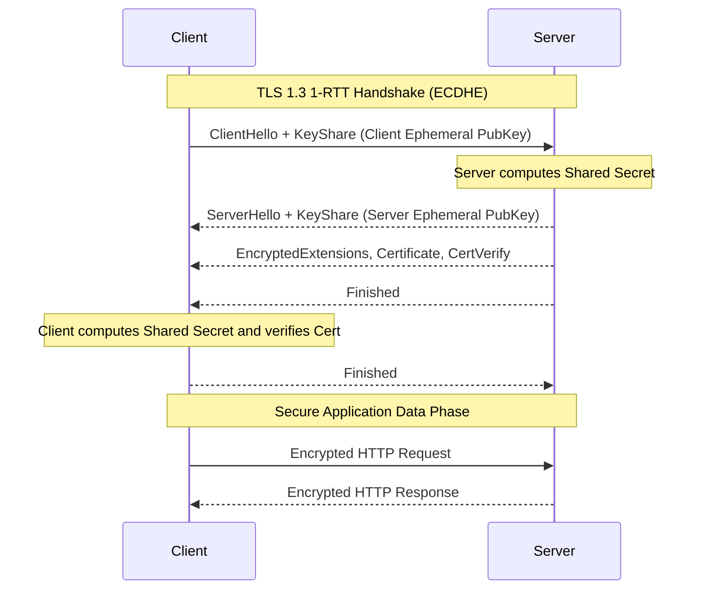
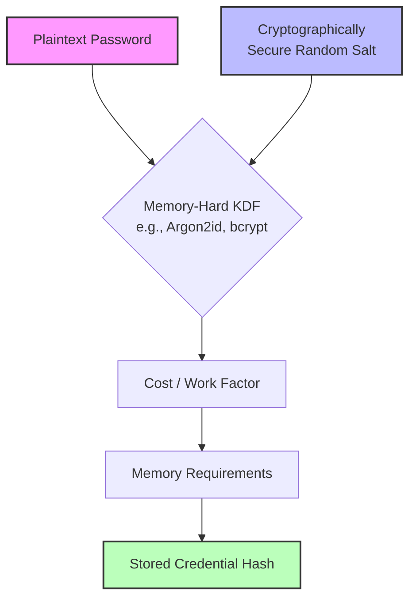

# Practical Cryptography, Modern Transport Security, and Credential Storage

This guide covers the critical theoretical foundations of modern application security, focusing on cryptography, transport layer security (TLS 1.3), and secure credential storage.

## 1. Symmetric vs Asymmetric Cryptography

Modern systems rely on a combination of symmetric and asymmetric cryptography to achieve both performance and secure key exchange.

### Symmetric Cryptography

Symmetric cryptography uses the same key for both encryption and decryption. This approach is highly performant and used for bulk data encryption. Modern symmetric encryption relies on Authenticated Encryption with Associated Data (AEAD), which guarantees both confidentiality and authenticity.

AES-GCM (Advanced Encryption Standard with Galois/Counter Mode) is the industry standard for AEAD. It uses hardware acceleration (AES-NI) on modern CPUs to achieve massive throughput.

ChaCha20-Poly1305 is a software-optimized stream cipher alternative. It provides excellent performance on mobile devices or hardware lacking dedicated AES instructions.

### Asymmetric Cryptography

Asymmetric cryptography uses a key pair: a public key for encryption or signature verification, and a private key for decryption or signing. It solves the key distribution problem but is computationally expensive.

RSA is the legacy standard. It relies on the difficulty of factoring large prime numbers. However, it requires very large key sizes (e.g., 2048-bit or 4096-bit) to maintain security, which degrades performance.

Elliptic Curve Cryptography (ECC) relies on the algebraic structure of elliptic curves over finite fields. ECC provides equivalent security to RSA at much smaller key sizes (e.g., 256-bit). Modern curves like Curve25519 and secp256r1 offer significant performance advantages and lower bandwidth overhead.

### Digital Signatures and PKI

Digital signatures ensure non-repudiation and data integrity. ECDSA and Ed25519 are modern elliptic curve signature algorithms providing fast, secure signing operations.

Public Key Infrastructure (PKI) binds public keys to identities via Certificate Authorities (CAs). A CA digitally signs an X.509 certificate to verify domain ownership.

Certificate Transparency logs are public, append-only cryptographic ledgers. They allow domains to monitor and audit CA behavior, preventing rogue certificates from going undetected.

## 2. The TLS 1.3 Protocol & Handshake

TLS 1.3 represents a massive overhaul of transport security, prioritizing speed and eliminating obsolete cryptography.

### Forward Secrecy and Key Exchange

TLS 1.3 enforces Forward Secrecy by deprecating static RSA key exchange. If an attacker compromises a server's long-term private key, they cannot decrypt past captured traffic.

Instead, TLS 1.3 mandates Ephemeral Diffie-Hellman (ECDHE) for key exchange. New, temporary session keys are generated for every connection, ensuring that past sessions remain secure even if future keys are compromised.

### The 1-RTT Full Handshake

TLS 1.3 reduces the standard handshake from two round trips to just one (1-RTT). The client aggressively guesses the server's preferred key exchange parameters.

The client sends a `ClientHello` containing a `KeyShare` (its ephemeral public key). If the server supports the curve, it responds with a `ServerHello`, its own `KeyShare`, `EncryptedExtensions`, `Certificate`, and a `Finished` message.

The client then replies with its `Finished` message and can immediately begin sending encrypted Application Data.

### 0-RTT Early Data

For returning clients, TLS 1.3 supports a 0-RTT handshake. Clients can send encrypted application data in the very first flight alongside the `ClientHello`, using a pre-shared key (PSK) established in a previous session.

While 0-RTT significantly reduces latency, it introduces a Replay Attack risk. Attackers can intercept the 0-RTT payload and replay it to the server.

To mitigate this, servers must restrict 0-RTT data to idempotent operations (like HTTP GET requests) and reject early data for state-changing endpoints.

## 3. Password Storage & Key Derivation Functions

Storing plaintext passwords or using outdated hashing algorithms is a critical security failure. Modern credential storage requires specialized algorithms.

### The Failure of Simple Hashes

Simple cryptographic hashes like MD5, SHA-1, and SHA-256 are designed to be fast. This speed is disastrous for password storage.

Attackers use GPU clusters and ASIC hardware to compute billions of hashes per second. They build massive rainbow tables (precomputed hash chains) to crack weak or unsalted passwords almost instantly.

### Adaptive Memory-Hard Hashing

To defend against offline brute-force attacks, systems must use Key Derivation Functions (KDFs) that are intentionally slow and resource-intensive.

Argon2, specifically the Argon2id variant, is the winner of the Password Hashing Competition. It is memory-hard, meaning it requires significant RAM to compute. This thwarts GPU and ASIC attacks, which have limited fast memory per core.

bcrypt utilizes the Eksblowfish algorithm. It features a configurable work factor that scales the exponential cost of the hash, keeping pace with hardware advancements.

PBKDF2 is a NIST standard that applies a pseudorandom function (like HMAC-SHA256) repeatedly. While secure, it lacks the memory-hardness of Argon2.

### Salt Generation and Constant-Time Comparison

Every password must be hashed with a unique, cryptographically secure random salt. This prevents the use of rainbow tables and ensures identical passwords result in different hashes.

When verifying a password, the system must use constant-time string comparison algorithms. Standard string equality checks return early upon the first character mismatch.

Early returns allow attackers to measure the response time and infer the correct hash character by character, leading to timing side-channel attacks. Constant-time comparisons check the entire string regardless of mismatches.

## 4. Architectural Diagrams

### TLS 1.3 1-RTT Handshake

### Password Hashing Pipeline

