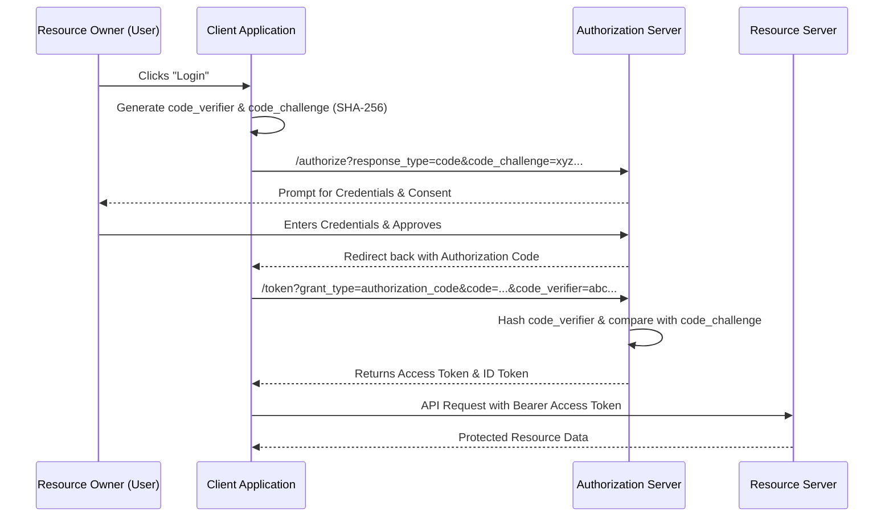
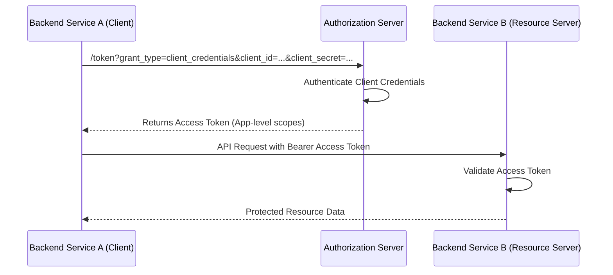

# Delegated Authorization and Identity Protocols

Delegated authorization and identity protocols are foundational for modern distributed systems and microservices. They enable secure access to resources and verify user identity without sharing sensitive credentials like passwords directly with third-party applications. This guide details the theory and mechanics of OAuth 2.0 and OpenID Connect (OIDC).

## Core Roles

Understanding the actors involved in these protocols is critical to grasping how tokens are issued and consumed.

- **Resource Owner**: Typically the end-user. This is the entity that grants a client access to their protected resources.
- **Client**: The application (web, mobile, or server-side) attempting to access the protected resource on behalf of the Resource Owner. It must be authorized by the Resource Owner to do so.
- **Authorization Server**: The server responsible for authenticating the Resource Owner and obtaining their consent. Once consent is granted, it issues access tokens to the Client.
- **Resource Server**: The API or service hosting the protected resources. It accepts and validates the access token presented by the Client before serving the request.

## OAuth 2.0 vs OpenID Connect (OIDC)

While frequently used together, OAuth 2.0 and OIDC serve distinctly different purposes in the identity architecture.

- **OAuth 2.0 = Authorization**: It is an authorization framework designed to grant delegated API access. The Authorization Server issues an Access Token, which the Client uses to prove it has permission to access specific resources on the Resource Server. The Access Token itself is opaque to the Client; the Client should not attempt to parse or understand its contents.
- **OpenID Connect (OIDC) = Authentication & Identity**: Built on top of OAuth 2.0, OIDC adds an identity layer. It introduces the ID Token, an encoded JSON Web Token (JWT) containing authenticated user profile claims (e.g., email, name). The ID Token is intended specifically for the Client to parse, allowing the Client to authenticate the user and understand who is logging in.

## OAuth 2.0 Grant Types & Flows

Different application architectures require different methods (grants) for securely obtaining tokens.

### Authorization Code Grant with PKCE

This is the standard and most secure flow for authenticating users in modern applications, including Single Page Applications (SPAs) and mobile apps.

It uses PKCE (Proof Key for Code Exchange) to mitigate the risk of authorization code interception. The flow involves a cryptographic exchange:
- `code_verifier`: A high-entropy cryptographic random string generated by the Client.
- `code_challenge`: A SHA-256 hash of the `code_verifier`, sent in the initial authorization request.

**Why PKCE is mandatory:** PKCE is required for all public clients (like SPAs and mobile apps) because they cannot securely store a static client secret. If a malicious app on a device intercepts the authorization code, it cannot exchange it for an Access Token without the original `code_verifier`, which is securely held in the legitimate Client's memory.

### Client Credentials Grant

This flow is used for service-to-service or machine-to-machine authentication, where there is no human user (Resource Owner) involved. The Client authenticates directly with the Authorization Server using its own credentials (e.g., client ID and secret, or mutual TLS) to obtain an Access Token.

### Refresh Token Grant

Access Tokens are intentionally short-lived to minimize the risk of a stolen token being used indefinitely. The Refresh Token Grant allows a Client to exchange a long-lived Refresh Token for a new Access Token when the original expires, avoiding the need for the user to re-authenticate repeatedly.

### Deprecated and Insecure Flows

- **Implicit Grant**: Previously used for SPAs, it returned the Access Token directly in the URL fragment without a backend exchange. This is highly vulnerable to token leakage and interception and is now considered insecure. It is entirely replaced by Authorization Code with PKCE.
- **Resource Owner Password Credentials (ROPC)**: The Client collects the user's username and password directly and exchanges them for a token. This violates the core principle of delegated authorization (never sharing credentials with the Client) and should be avoided entirely.

## OIDC Identity Layer

OIDC extends OAuth 2.0 to provide standardized identity information to the Client.

### ID Token Verification

The ID Token is a signed JWT. Before trusting its contents, the Client must rigorously verify it:
- **`iss` (Issuer)**: Must exactly match the expected Authorization Server URL.
- **`aud` (Audience)**: Must contain the Client's specific ID.
- **`exp` (Expiration)**: The token must not be expired.
- **Signature Validation**: The Client must cryptographically verify the signature using the Authorization Server's public keys, typically fetched via a JWKS (JSON Web Key Set) endpoint.

### Endpoints

- **UserInfo Endpoint**: An OAuth 2.0 protected API defined by OIDC. The Client can send the Access Token to this endpoint to retrieve additional user profile claims not included in the ID Token.
- **Discovery Endpoint**: Hosted at `/.well-known/openid-configuration`, this endpoint provides a JSON document detailing the Authorization Server's configuration, including supported scopes, algorithms, and the location of the JWKS endpoint, enabling automated client configuration.

## Security Invariants

Robust protocol implementations rely on specific parameters to prevent common attacks.

- **CSRF Defense via `state` parameter**: The Client generates a random, unguessable string and passes it in the authorization request. The Authorization Server echoes it back. The Client validates that the returned state matches the generated state, preventing Cross-Site Request Forgery (CSRF) attacks where an attacker tricks a user's browser into executing an authorization flow on their behalf.
- **Replay Defense via `nonce` parameter**: Used specifically in OIDC. The Client generates a random nonce and includes it in the authorization request. The Authorization Server embeds this nonce inside the resulting ID Token. The Client verifies the nonce in the ID Token matches its original value, mitigating replay attacks where an attacker attempts to reuse a previously captured ID Token.

## Diagrams

### Sequence diagram of OAuth 2.0 Authorization Code Flow with PKCE

### Sequence diagram of Client Credentials machine-to-machine flow

