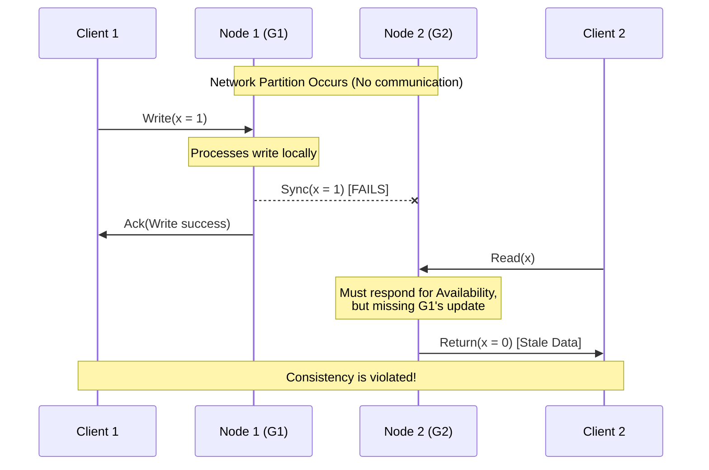

# CAP Theorem & Consistency Trade-offs

CAP states that under a network partition, a distributed system must choose between:
- **Consistency (C)**: every read gets the latest write
- **Availability (A)**: every request gets a non-error response
- **Partition Tolerance (P)**: system continues despite network splits

In practice, production distributed systems assume partitions can happen, so the real decision is usually **CP vs AP** during partition events.

---

## CP vs AP in Interviews

| Choice | Prioritizes | Typical Use Cases | Trade-off |
|--------|-------------|-------------------|-----------|
| **CP** | correctness | payments, inventory, core ledgers | may reject/timeout requests during partition |
| **AP** | uptime/latency | feeds, social reactions, non-critical counters | may serve stale/conflicting data temporarily |

---

## Consistency Models (Practical Spectrum)

Consistency is not binary. Common models:
- **Strong consistency**: latest write always visible
- **Read-after-write consistency**: writer sees own writes
- **Monotonic reads**: reads never go backward in time
- **Eventual consistency**: replicas converge over time
- **Session consistency**: guarantees scoped to a client session
- **Causal consistency**: preserves causality ordering

Interview tip: explicitly tie model to product behavior.

---

## Formal Proof of CAP Theorem

While Brewer introduced CAP as a conjecture in 2000, it was formally proven by Seth Gilbert and Nancy Lynch in 2002. Their proof relies on precise definitions of Consistency, Availability, and Partition Tolerance within an asynchronous network model.

### Formal Definitions

- **Consistency (Linearizability/Atomic Data Objects):** There must exist a total order on all operations such that each operation looks as if it were completed at a single instant. Every read must receive the value of the most recent write.
- **Availability:** Every request received by a non-failing node in the system must result in a response. It is not sufficient to simply ignore the request or run infinitely.
- **Partition Tolerance:** The system must continue to operate even if arbitrary messages are lost or delayed (a network partition).

### Proof by Contradiction

Consider a distributed system with two nodes, G1 and G2. Assume the system is in a network partition where all messages between G1 and G2 are lost. 

1. A client writes a new value `v1` to node G1. Because the system is **Available**, G1 must process the write and return a success response, even though it cannot communicate with G2.
2. Next, another client reads from node G2. Because the system is **Available**, G2 must respond to the read request.
3. Since G2 never received any communication from G1 about the write of `v1` (due to the partition), G2 can only return its previous value `v0`.

## Split-Brain Execution Diagram

The following sequence diagram illustrates the split-brain scenario during a partition, highlighting the impossibility of achieving both consistency and availability.


This violates **Consistency** because the read at G2 did not return the most recent write (which was at G1). Therefore, it is impossible to guarantee both Consistency and Availability when a Partition occurs. The system must either fail the read at G2 (violating Availability) or return the stale value `v0` (violating Consistency).

---

## Simulating CP vs AP Behavior

Here are code snippets demonstrating how a node might handle requests under a partition, depending on whether the system is configured for CP (Consistency) or AP (Availability).

### Python 3 Simulation

```python
class Node:
    def __init__(self, node_id: str, is_ap: bool):
        self.node_id = node_id
        self.data = {}
        self.is_ap = is_ap
        self.partitioned_from_peers = False

    def set_partition(self, is_partitioned: bool):
        self.partitioned_from_peers = is_partitioned

    def read(self, key: str):
        if self.partitioned_from_peers:
            if self.is_ap:
                # Availability favored: return possibly stale local data
                return self.data.get(key, None)
            else:
                # Consistency favored: fail the request rather than return stale data
                raise Exception("CP Error: Cannot guarantee strong consistency due to partition.")
        
        # Normal operation: fetch from peer or return local
        return self.data.get(key, None)

    def write(self, key: str, value: str):
        self.data[key] = value
        # In a real system, we'd replicate to peers here
        return True

# Example Usage
node_ap = Node("Node1", is_ap=True)
node_cp = Node("Node2", is_ap=False)

node_ap.set_partition(True)
node_cp.set_partition(True)

# AP returns stale data
print(node_ap.read("balance"))  # Returns None (or stale value)

# CP raises an error
try:
    node_cp.read("balance")
except Exception as e:
    print(e)  # Prints CP Error
```

### Java Simulation

```java
import java.util.HashMap;
import java.util.Map;

public class ClusterNode {
    private final String nodeId;
    private final Map<String, String> data;
    private final boolean isAp;
    private boolean partitionedFromPeers;

    public ClusterNode(String nodeId, boolean isAp) {
        this.nodeId = nodeId;
        this.data = new HashMap<>();
        this.isAp = isAp;
        this.partitionedFromPeers = false;
    }

    public void setPartition(boolean isPartitioned) {
        this.partitionedFromPeers = isPartitioned;
    }

    public String read(String key) throws Exception {
        if (partitionedFromPeers) {
            if (isAp) {
                // AP: return local (possibly stale) data
                return data.get(key);
            } else {
                // CP: fail rather than return stale data
                throw new Exception("CP Error: Cannot guarantee strong consistency due to partition.");
            }
        }
        return data.get(key);
    }

    public void write(String key, String value) {
        data.put(key, value);
        // Sync with peers logic would go here
    }

    public static void main(String[] args) {
        ClusterNode nodeAp = new ClusterNode("Node1", true);
        ClusterNode nodeCp = new ClusterNode("Node2", false);

        nodeAp.setPartition(true);
        nodeCp.setPartition(true);

        try {
            System.out.println("AP Read: " + nodeAp.read("balance")); // prints null (or stale data)
            nodeCp.read("balance"); // throws Exception
        } catch (Exception e) {
            System.out.println(e.getMessage());
        }
    }
}
```

## PACELC Extension

CAP talks about behavior **when partition happens**.  
PACELC extends this:
- **If P** (partition): choose **A or C**
- **Else** (normal state): choose **L or C** (latency vs consistency)

This helps explain real-world systems that are eventually consistent for latency even when no partition exists.

---

## How to Present CAP in a System Design Interview

1. State user-facing correctness needs.
2. Classify operations:
   - must be strict (CP-like path)
   - can be relaxed (AP-like path)
3. Mention mitigation:
   - idempotency
   - retries with backoff
   - conflict resolution
   - compensation workflows

---

## Mini Scenarios

### Banking Transfer
- Balance updates should be strongly consistent.
- Prefer CP behavior for core ledger operations.

### Social Feed Likes
- Slight delay in like count is acceptable.
- Prefer AP/eventual consistency for responsiveness.

### Ride Matching
- Matching availability must stay high.
- Often AP-leaning control plane with careful conflict handling on assignment.

---

## Advanced Conflict Resolution

When a system chooses Availability (AP) during a partition, nodes may accept writes that conflict with each other. When the partition heals, these conflicts must be resolved to restore consistency.

### Last-Write-Wins (LWW)
A simple approach where the system relies on timestamps to resolve conflicts. The write with the latest timestamp is preserved, and others are discarded. While easy to implement, it can lead to data loss if clocks are not perfectly synchronized or if concurrent updates are logically independent.

### Vector Clocks
Vector clocks track causality between events. Instead of a single timestamp, each node maintains a vector of logical counters. This allows the system to detect if two updates are concurrent or if one causal update strictly follows another, helping to resolve conflicts more accurately.

### Conflict-free Replicated Data Types (CRDTs)
CRDTs are specialized data structures that inherently handle concurrent updates without conflicts. They achieve this by ensuring that the order of operations does not matter (commutativity). Examples include grow-only counters, observed-remove sets, and sequence CRDTs for collaborative editing.

---

## Consensus Algorithms

To achieve strong consistency (CP), distributed systems often rely on consensus algorithms to ensure all nodes agree on the system's state, even in the presence of failures.

### Paxos
A foundational consensus algorithm that guarantees safety (no two nodes agree on different values) and liveness (eventually, some value is agreed upon). However, Paxos is famously difficult to understand and implement correctly in practice.

### Raft
Designed as a more understandable alternative to Paxos, Raft relies on a strong leader. All writes go to the leader, which replicates them to followers. If the leader fails, a new leader is elected. Raft provides the same safety guarantees as Paxos but is widely adopted in modern systems like etcd and Consul.

---

## Real-world Case Studies

### Cassandra and DynamoDB
Both are heavily inspired by the original Amazon Dynamo paper and are often configured as AP systems. They prioritize high availability and low latency, relying on tunable consistency levels (e.g., quorum reads/writes) and eventual consistency mechanisms like anti-entropy repair and read repair.

### Google Spanner
Spanner provides strong consistency on a global scale (CP). It achieves this by using TrueTime, a globally synchronized clock infrastructure relying on GPS and atomic clocks, to ensure strict linearizability across geographically distributed data centers.

---

## Common Mistakes

- Saying "you can pick only two of C, A, P" without mentioning partition context.
- Ignoring that partition tolerance is mandatory in distributed systems.
- Not connecting CAP decisions to user-visible impact.

---

## Worked Numeric Examples

Let's explore numeric examples of the CAP theorem in a distributed database system.

### Scenario: Network Partition

Imagine a system with two nodes, Node A and Node B. A network partition occurs, severing the link between them. 
Before the partition, the database holds a record for user balance: `Balance = 100`.

*   **Client 1 connects to Node A** and issues a write: `UPDATE Balance SET Amount = 150`. Node A processes the write locally.
*   **Client 2 connects to Node B** and issues a read: `SELECT Amount FROM Balance`.

What should Node B do?

*   **CP (Consistency chosen over Availability):** Node B cannot guarantee consistency because it cannot communicate with Node A to get the latest value (150). It will refuse the read request, prioritizing consistency and thus sacrificing availability.
*   **AP (Availability chosen over Consistency):** Node B prioritizes serving the request and returns the stale value (100). It sacrifices consistency for availability.

### Scenario: PACELC (Normal Operation)

Imagine the same system under normal operation (no partition).

*   **Client 1 issues a write** to Node A. The write must be replicated to Node B for durability and consistency.
*   **Client 2 issues a read** to Node B.

What is the trade-off?

*   **Latency (L):** If the system prioritizes latency, Node A acknowledges the write to Client 1 *before* waiting for Node B to acknowledge the replication. This is fast, but if Node A crashes immediately after acknowledging, the data might be lost (or Client 2 might read stale data).
*   **Consistency (C):** If the system prioritizes consistency, Node A waits for Node B to acknowledge the replication before acknowledging the write to Client 1. This ensures consistency but increases latency.

---

## Interview Q&A

### Junior Level Questions

**Q1: What does CAP stand for in the CAP theorem?**
**A1:** Consistency, Availability, and Partition Tolerance.

**Q2: What does 'Partition Tolerance' mean in practice?**
**A2:** It means the system continues to operate even if there are network failures that drop or delay messages between nodes. In distributed systems, this is a given; you can't build a system immune to network issues.

### Senior Level Questions

**Q3: Why is 'pick two out of three' a misleading way to explain CAP?**
**A3:** Because partition tolerance (P) is unavoidable in distributed networks. You can't 'choose' not to have network failures. The real choice is what to do *when* a partition happens: prioritize Consistency (CP) or Availability (AP).

**Q4: How does the PACELC theorem extend the CAP theorem?**
**A4:** CAP only describes behavior during a network partition. PACELC extends this to describe behavior during normal operations. It states that even when there's no partition (E), a system must trade off Latency (L) against Consistency (C).

### Staff Level Questions

**Q5: In a microservices architecture, how do you handle cross-service transactions given CAP constraints?**
**A5:** You avoid distributed transactions (like 2PC) because they reduce availability (CP behavior). Instead, you use the Saga pattern, relying on eventual consistency and asynchronous messaging, with compensating transactions to handle failures (AP behavior).

**Q6: Discuss the implications of choosing AP for a high-volume financial trading platform.**
**A6:** An AP choice would allow trades to be processed even during partitions, but it could lead to severe consistency issues (e.g., overdrafts, duplicate trades). Financial systems typically require strong consistency (CP) to ensure exact correctness, using techniques like consensus algorithms (Raft/Paxos) and distributed ledgers, accepting that some requests might fail during a partition to prevent incorrect state.

---

## Related Reading

- [Back-of-Envelope Estimation](./back-of-envelope.md)
- [Replication](../database-concepts/replication.md)
- [Sharding](../database-concepts/sharding.md)
- [Synchronous vs Asynchronous](./sync-vs-async.md)
- [CONCEPTS.md CAP section](../../CONCEPTS.md#cap-theorem)

