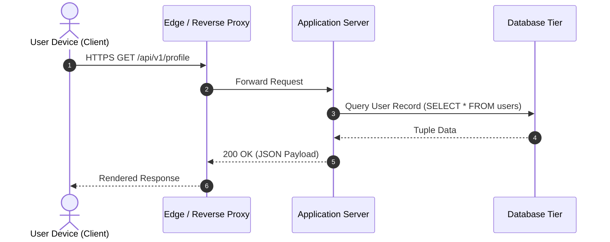

# Client-Server Architecture

The foundational pattern for most distributed systems. Understanding this is essential for any HLD interview.

---

## 📖 Core Concept

### Beginner Intuition
Think of a restaurant:
- **Client (Customer)**: Sits at the table, reads the menu, and places an order.
- **Server (Kitchen/Waiter)**: Takes the order, prepares the food, and brings it back.
The customer doesn't need to know how to cook (business logic/data storage), they just need to know how to order (API request).



### Normal Worked Trace

**Premises:**
- **Client:** Mobile app requesting user profile data.
- **Server:** REST API providing the data.
- **State:** User is authenticated (auth token provided in header).

**Trace:**
1. **Client Request:** Mobile app constructs an HTTP GET request to `/api/v1/profile` with an `Authorization` header.
2. **Network Transport:** The request travels over the internet via TCP/IP and is received by the server's ingress (e.g., API Gateway).
3. **Server Processing:**
   - Server validates the auth token.
   - Server queries the database for the profile data.
   - Database returns the profile fields.
   - Server formats the data into JSON.
4. **Server Response:** Server sends an HTTP 200 OK response with the JSON payload.
5. **Client Rendering:** Mobile app receives the JSON, parses it, and updates the UI.

### Counterexample / Boundary

**Peer-to-Peer (P2P)**
- **Concept:** Every node is both a client and a server.
- **Why it breaks Client-Server:** In P2P (like BitTorrent), a node downloading a file (acting as a client) is simultaneously uploading pieces of that file to other nodes (acting as a server). There is no centralized "Server" providing the service to distinct "Clients".
- **Limitation of Client-Server:** Client-Server can struggle with bandwidth costs for large file distribution compared to P2P, as the central server bears the full upload burden.

### Key Characteristics

| Aspect | Client | Server |
|--------|--------|--------|
| **Role** | Requests services | Provides services |
| **Initiation** | Initiates communication | Waits for requests |
| **Instances** | Many | Few (often one logical) |
| **Location** | User's device | Data center/Cloud |
| **Examples** | Browser, Mobile App | Web Server, Database |

---

## 🏗️ Architecture Layers

### Typical 3-Tier Architecture

```
┌─────────────────────────────────────────────────────────┐
│                  PRESENTATION TIER                       │
│              (Client - Browser/Mobile App)               │
└──────────────────────────┬──────────────────────────────┘
                           │ HTTP/HTTPS
                           ▼
┌─────────────────────────────────────────────────────────┐
│                   APPLICATION TIER                       │
│                (Server - Business Logic)                 │
└──────────────────────────┬──────────────────────────────┘
                           │ SQL/Protocol
                           ▼
┌─────────────────────────────────────────────────────────┐
│                      DATA TIER                          │
│                    (Database Server)                     │
└─────────────────────────────────────────────────────────┘
```

### N-Tier Architecture (Microservices Era)

```
Client → Load Balancer → API Gateway → Service A → Database A
                                    → Service B → Database B
                                    → Service C → Cache
```

---

## 🔄 Communication Patterns

### 1. Request-Response (Synchronous)

#### Java
```java
import java.net.ServerSocket;
import java.net.Socket;
import java.io.InputStream;
import java.io.OutputStream;
import java.net.http.HttpClient;
import java.net.http.HttpRequest;
import java.net.http.HttpResponse;
import java.net.URI;

public class SyncExample {
    // Minimal low-level socket server
    public static void runServer(int port) throws Exception {
        try (ServerSocket serverSocket = new ServerSocket(port)) {
            try (Socket clientSocket = serverSocket.accept();
                 InputStream in = clientSocket.getInputStream();
                 OutputStream out = clientSocket.getOutputStream()) {
                byte[] buffer = new byte[1024];
                int bytesRead = in.read(buffer); // Read request
                String response = "HTTP/1.1 200 OK\r\nContent-Length: 2\r\n\r\nOK";
                out.write(response.getBytes()); // Send response
                out.flush();
            }
        }
    }

    // Synchronous client request
    public static String fetchData(String url) throws Exception {
        HttpClient client = HttpClient.newHttpClient();
        HttpRequest request = HttpRequest.newBuilder()
                .uri(URI.create(url))
                .build();
        // Blocks until response received
        HttpResponse<String> response = client.send(request, HttpResponse.BodyHandlers.ofString());
        return response.body();
    }
}
```

#### Python
```python
import socket
import urllib.request

# Minimal low-level socket server
def run_server(port: int = 8080) -> None:
    with socket.socket(socket.AF_INET, socket.SOCK_STREAM) as s:
        s.setsockopt(socket.SOL_SOCKET, socket.SO_REUSEADDR, 1)
        s.bind(("0.0.0.0", port))
        s.listen(5)
        conn, addr = s.accept()
        with conn:
            req = conn.recv(1024) # Read request
            conn.sendall(b"HTTP/1.1 200 OK\r\nContent-Length: 2\r\n\r\nOK") # Send response

# Synchronous client request
def fetch_data(url: str) -> str:
    with urllib.request.urlopen(url) as response:
        return response.read().decode("utf-8")  # Blocks until response received
```

**Use when:** Need immediate response (user queries, form submissions)

### 2. Publish-Subscribe (Asynchronous)

```
Client → Message Queue → Consumer Services
```

**Use when:** Fire-and-forget, event notifications

### 3. Long Polling

```
Client: "Any updates?"
Server: *waits until update available*
Server: "Here's an update!"
Client: "Any updates?" (repeat)
```

**Use when:** Near real-time updates without WebSocket support

### 4. WebSockets (Bidirectional)

```
Client ←→ Server (persistent connection)
```

**Use when:** Real-time features (chat, live updates)

---

## ⚖️ Trade-offs

| Aspect | Advantage | Disadvantage |
|--------|-----------|--------------|
| **Centralization** | Easy to update/maintain server | Single point of failure |
| **Security** | Centralized security control | Server is attack target |
| **Scalability** | Can scale server independently | Server can become bottleneck |
| **Data Management** | Consistent data on server | Network latency for access |

---

## 🎯 Interview Questions

### Q1: "What happens when you type a URL in the browser?"

**Answer** (High-level):
1. DNS resolution (domain → IP address)
2. TCP connection established (3-way handshake)
3. TLS handshake (if HTTPS)
4. HTTP request sent to server
5. Server processes request
6. HTTP response returned
7. Browser renders content

### Q2: "How would you handle server failures?"

**Answer**:
- **Redundancy**: Multiple server instances
- **Load Balancer**: Distributes traffic, detects failures
- **Health Checks**: Monitor server health
- **Failover**: Automatic switch to backup
- **Graceful Degradation**: Reduce functionality vs complete failure

### Q3: "Compare thick client vs thin client"

| Thick Client | Thin Client |
|--------------|-------------|
| More logic on client | Minimal client logic |
| Desktop apps | Web browsers |
| Works offline | Requires connection |
| Complex deployment | Easy updates (server-side) |
| Higher security risk | Centralized security |

---

## 🔗 Cross-References

- **Scaling**: See [Horizontal vs Vertical Scaling](./horizontal-vs-vertical-scaling.md)
- **Patterns**: Monolith vs Microservices
- **HLD**: All system designs use client-server

---

## 🌟 Optional Staff Extension

**Backend for Frontend (BFF)**
Instead of mobile and web clients talking directly to a monolithic API or dozens of microservices, each client type gets its own dedicated server (BFF).
- **Mobile BFF:** Aggregates data, formats it specifically for small screens, and optimizes for low bandwidth.
- **Web BFF:** Provides richer data structures suitable for desktop dashboards.
This preserves the client-server separation but specializes the server per client capability.

---

## 📚 Versioned Primary Citations

- **RFC 7230:** Hypertext Transfer Protocol (HTTP/1.1): Message Syntax and Routing (June 2014)
- **Architectural Styles and the Design of Network-based Software Architectures:** Roy Thomas Fielding's PhD Dissertation (2000) - Defines REST and the Client-Server architectural constraint.

---

*💡 Pro Tip: In HLD interviews, always clarify client types (web, mobile, API) as they impact caching, authentication, and API design decisions.*
