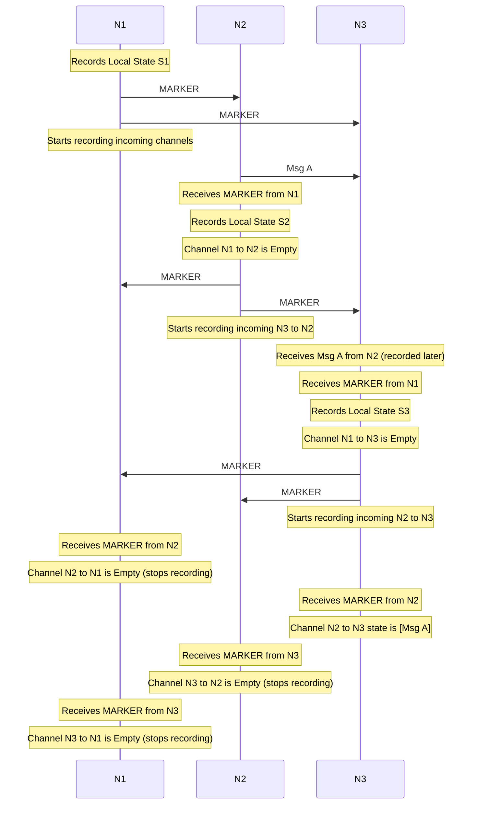

# Chandy-Lamport Distributed Snapshot Protocol & Consistent Cuts

## The Global State Problem

In distributed systems, determining the "global state" (the state of all processes and communication channels at a specific instant) is fundamentally difficult. This arises due to the characteristics of asynchronous networks:
- **No Shared Physical Clock:** Processes rely on local clocks, making it impossible to agree on a universal "now."
- **No Global Freeze:** Stopping all processes to take a snapshot would require perfect synchronization and unacceptably halt the system.
- **In-Flight Messages:** Messages that are sent but not yet received exist in the network channels and are part of the global state.

The challenge is to record a state that *could have* occurred, representing a coherent and valid snapshot of the system without freezing it. This is essential for distributed deadlocks detection, garbage collection, and checkpointing for fault tolerance.

## Cuts and Formal Invariants

A distributed system's execution can be modeled as a set of events across processes. A **Cut** is a boundary that partitions the events of each process into "past" (recorded in the snapshot) and "future" (not recorded).

### 1. Inconsistent Cuts
A cut is inconsistent if it includes the receipt of a message but not its sending.
- **Invariant Violation:** $e_{receive} \in Cut \implies e_{send} \notin Cut$
- **Meaning:** The snapshot records an effect without its cause (a message materialized out of nowhere), making the state logically impossible.

### 2. Consistent Cuts
A consistent cut guarantees that if a message is recorded as received, it must also be recorded as sent.
- **Formal Invariant:** For any two events $a$ and $b$, if $b$ is in the cut and $a \rightarrow b$ ($a$ causal-happens-before $b$), then $a$ must also be in the cut.
- **Meaning:** The snapshot represents a state that could legally happen during execution. In-flight messages (sent in the past, received in the future) are permitted and must be captured as part of the channel state.

### 3. Strongly Causal Cuts
A strongly causal cut is an advanced consistent cut where all messages that cross the cut are explicitly accounted for, ensuring causal consistency across all interactions without relying purely on logical clocks, often requiring strict channel ordering and deterministic causal tracking.

## The Chandy-Lamport Marker Passing Algorithm

The Chandy-Lamport algorithm elegantly constructs a consistent global snapshot over FIFO (First-In-First-Out) channels without freezing the underlying computation.

### Core Assumptions
- The network is connected and heavily relies on point-to-point connections.
- Channels are reliable, point-to-point, and strictly FIFO.
- Any process can initiate the snapshot.

### Algorithm Rules

#### 1. Initiator Rule
When a process $P$ decides to initiate a snapshot:
1. $P$ records its own local state.
2. For each outgoing channel $C_{out}$, $P$ sends a special `MARKER` message before sending any further application messages.
3. $P$ starts recording incoming messages on all its incoming channels.

#### 2. Marker Arrival on Channel Rule
When a process $Q$ receives a `MARKER` on an incoming channel $C_{in}$ from process $P$:

**Case A: If $Q$ has NOT yet recorded its state:**
1. $Q$ records its own local state.
2. $Q$ marks the state of the incoming channel $C_{in}$ from $P$ as *empty*.
3. $Q$ sends a `MARKER` on all of its outgoing channels.
4. $Q$ starts recording incoming messages on all other incoming channels (excluding $C_{in}$).

**Case B: If $Q$ HAS already recorded its state:**
1. $Q$ stops recording messages on the incoming channel $C_{in}$ from $P$.
2. The state of channel $C_{in}$ is recorded as the sequence of all messages received on $C_{in}$ between when $Q$ recorded its local state and when $Q$ received the `MARKER` on $C_{in}$.

#### 3. Termination
The snapshot algorithm terminates locally at a process when it has received a `MARKER` on all of its incoming channels. The global snapshot is complete when all processes have recorded their local states and all channel states are recorded.

## Step-by-Step Trace Diagram

Consider a system with 3 nodes: N1, N2, and N3.

In this trace:
- `N1` initiates the snapshot.
- `N2` sends `Msg A` to `N3` *after* `N2` records its state (meaning `Msg A` is not in $S2$).
- `N3` receives `Msg A` *before* it receives the marker from `N2`. Thus, `N3` records `Msg A` as part of the channel state `N2` to `N3`.
- This satisfies the consistent cut invariant: the message was in-flight across the cut.

## Modern Evolution: Apache Flink Asynchronous Barrier Snapshotting (ABS)

The Chandy-Lamport algorithm forms the theoretical foundation for checkpointing in modern stream processing engines like Apache Flink.

### Asynchronous Barrier Snapshotting (ABS)
Flink models stream processing as a Directed Acyclic Graph (DAG) of operators. ABS adapts Chandy-Lamport for this environment:
- **Barriers instead of Markers:** Flink injects "barriers" into the data streams at the sources. Barriers flow through the DAG like water.
- **State Checkpointing:** When an operator receives a barrier from all its upstream input channels, it takes a snapshot of its local state (e.g., aggregations, window states) and forwards the barrier downstream.
- **Alignment:** Because streams can move at different speeds, operators must "align" barriers. If an operator receives a barrier from input A but not B, it pauses processing events from A (buffering them) until the barrier from B arrives. This avoids recording "future" events in the snapshot.
- **Exactly-Once Semantics:** By periodically taking these consistent global snapshots to durable storage (like HDFS or S3), Flink can recover from node failures. On failure, the system rolls back to the last consistent snapshot and replays the stream from that point, guaranteeing exactly-once state semantics.
- **Unaligned Checkpoints (Modern Flink):** To avoid the latency of alignment backpressure, modern Flink can snapshot the in-flight channel buffers alongside the operator state (closer to pure Chandy-Lamport), allowing barriers to overtake data and reducing checkpoint latency.

