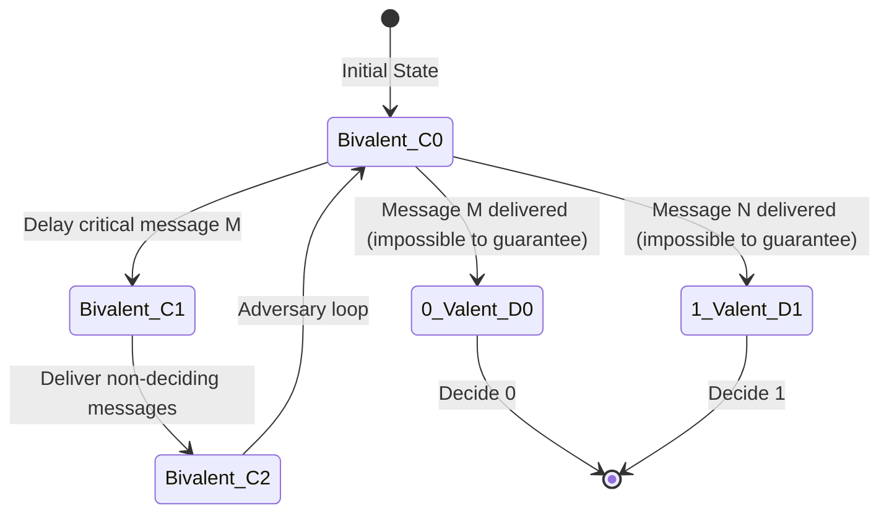

# FLP Impossibility Result & Distributed Consensus Foundations

The **FLP Impossibility Result** (Fischer, Lynch, Paterson, 1985) is arguably the most famous theoretical result in distributed computing. It formally proves that in an asynchronous network where even a single node can crash, no deterministic consensus algorithm can guarantee both safety and liveness.

Understanding FLP is critical for senior engineers, as it explains why real-world systems (like Raft, Paxos, and ZooKeeper) must compromise on either strict timing assumptions, liveness under certain conditions, or pure determinism.

---

## The Formal Asynchronous Model

To understand the impossibility, we must first define the strict constraints of the theoretical model in which it was proven:

1. **Unbounded Latency:** Messages can be delayed arbitrarily long. There is no upper bound on message delivery time.
2. **Lack of Synchronized Clocks:** Nodes have no access to synchronized physical clocks to measure timeouts.
3. **Fail-Stop Crash Failure:** At most one node may halt completely and permanently without warning. (No Byzantine/malicious behavior is assumed).
4. **Deterministic Protocol:** The algorithm behaves deterministically based on its local state and received messages.

Under these conditions, a consensus protocol must achieve:
- **Agreement (Safety):** No two non-faulty nodes decide on different values.
- **Validity:** The decided value must have been proposed by some node.
- **Termination (Liveness):** Every non-faulty node eventually decides on a value.

**FLP Theorem states:** In this model, no algorithm can guarantee all three. Specifically, liveness (Termination) cannot be guaranteed if safety (Agreement and Validity) is maintained.

---

## Formal Proof Walkthrough

The proof relies on the concept of system configurations and the inability to distinguish a slow node from a crashed node.

### 1. Bivalent vs. Univalent Configurations

A **configuration** is the global state of the system (all node states and in-flight messages).

- **Bivalent Configuration:** The system state is undecided. Depending on the order of future message deliveries, the final decision could be `0` or `1`.
- **Univalent Configuration:** The system is "locked in." Regardless of future message order, the final decision is guaranteed to be a specific value (e.g., `0`-valent or `1`-valent).

### 2. Initial Bivalence Lemma

The proof first establishes that there must exist at least one **initial bivalent configuration**. If we construct an initial state where half the nodes propose `0` and half propose `1`, the system's outcome depends strictly on which nodes' messages are delivered first. Thus, the system starts in a bivalent state.

### 3. Step Commutativity and Inability to Decide

If the system is in a bivalent configuration, any deterministic algorithm must eventually take a step that transitions it into a univalent configuration to achieve consensus. 

However, suppose node $P$ receives a message $e$ that transitions the system from a bivalent state $C$ to a `0`-valent state $D$. 
Because the network is asynchronous, $P$ might be extremely slow or crashed. If $P$ is delayed indefinitely, the remaining nodes must still reach a decision (to satisfy liveness, tolerating one crash). They might proceed to a `1`-valent state without $P$.

If $P$ is merely slow and later delivers $e$, the algorithm must reconcile this. The proof mathematically demonstrates that for any sequence of events attempting to force a decision, an adversarial network schedule can always deliver messages in an order that keeps the system bivalent.

### 4. Infinite Bivalent Execution Loop

By continuously delaying the "deciding" message and delivering other messages that maintain the balance, an adversary can force the system into an infinite loop of bivalent states. The system never terminates.

```text
       Adversarial Network Delay
      ┌─────────────────────────┐
      ▼                         │
[ Bivalent ] ─── message ───> [ Bivalent ] ─── message ───> ... (never reaches Univalent)
   State 0                       State 1
```



---

## Engineering Evasions: How We Build Systems Anyway

Since we use consensus algorithms every day, how do we bypass the FLP Impossibility? We change the model assumptions.

### 1. Partial Synchrony (DLS, GST)
*Dwork, Lynch, and Stockmeyer (1988)*

Real networks are not purely asynchronous. We introduce **Partial Synchrony**, assuming there is some Global Stabilization Time (GST). After GST, message delays and relative clock drifts are bounded.
- **Implementation:** We use timeouts to detect failures.
- **Result:** Safety is always guaranteed. Liveness is only guaranteed *after* the network stabilizes. If the network is continuously unstable, the system stalls (sacrificing liveness temporarily).
- **Used by:** Paxos, Raft, Multi-Paxos.

### 2. Randomized Consensus
*Ben-Or's Algorithm (1983)*

FLP assumes a *deterministic* algorithm. If we introduce randomness (e.g., flipping a coin when deadlocked), we can break the symmetry.
- **Result:** Consensus is achieved with probability 1 as time goes to infinity. The infinite bivalent loop becomes highly improbable.
- **Used by:** Certain Byzantine Fault Tolerant (BFT) protocols and blockchain consensus mechanisms.

### 3. Failure Detectors
*Chandra-Toueg (1996)*

We augment the asynchronous model with an external "Failure Detector" oracle. Even if the oracle is occasionally wrong (suspecting a live node), as long as it exhibits certain properties (e.g., Eventually Strong Failure Detector $\Diamond S$), consensus becomes solvable.
- **Implementation:** Heartbeats and leader leases.
- **Used by:** ZooKeeper (ZAB protocol), Raft (leader election heartbeats).

### 4. Sacrificing Liveness Under Partitions
In practice, algorithms prioritize Safety over Liveness. When a network partition occurs (or nodes are too slow), systems like Raft will simply stop accepting new writes until a quorum is re-established and a leader is elected.
- **Trade-off:** We accept downtime (loss of liveness) to prevent data corruption (split-brain). This maps directly to choosing **CP** (Consistency and Partition Tolerance) in the [CAP Theorem](./cap-theorem.md).

---

## Interview Application

In a system design or deep-dive interview, mentioning FLP demonstrates profound architectural understanding.

**Say:** "Because of the FLP impossibility result, we know pure asynchronous consensus is impossible if nodes can crash. Therefore, we use Raft/Paxos, which rely on partial synchrony and timeouts. This means our system guarantees safety (no split-brain) but will sacrifice liveness (become unavailable for writes) during severe network degradation or if a majority quorum is lost."
