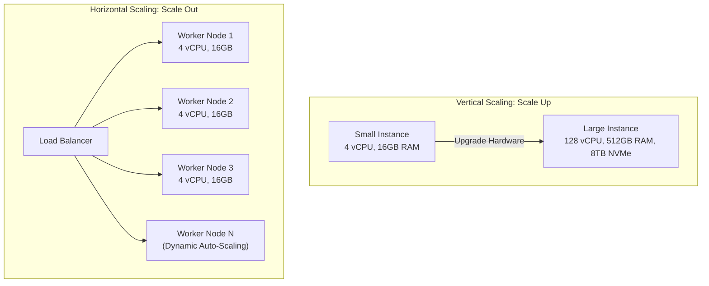

# Horizontal vs Vertical Scaling

Understanding scaling strategies is critical for HLD interviews. This is often the first question when designing systems.

---

## 📈 Vertical Scaling (Scale Up)

> **Add more power to an existing machine.**

```
BEFORE                AFTER
┌──────────┐         ┌──────────────────┐
│ 4 CPU    │  ──▶    │ 32 CPU           │
│ 8GB RAM  │         │ 128GB RAM        │
│ 100GB SSD│         │ 2TB NVMe SSD     │
└──────────┘         └──────────────────┘
```

### Characteristics

| Aspect | Description |
|--------|-------------|
| **How** | Upgrade CPU, RAM, Storage, Network |
| **Complexity** | Low - no code changes |
| **Limit** | Hardware ceiling |
| **Downtime** | Usually required |
| **Cost** | Exponential (high-end hardware is expensive) |

### When to Use

- ✅ Database servers (often easier than sharding)
- ✅ Quick fix for growing traffic
- ✅ Simple applications
- ✅ When horizontal scaling is complex

---

## 📊 Horizontal Scaling (Scale Out)

> **Add more machines to the pool.**



### Characteristics

| Aspect | Description |
|--------|-------------|
| **How** | Add more server instances |
| **Complexity** | Higher - requires stateless design |
| **Limit** | Theoretically unlimited |
| **Downtime** | Zero (rolling updates) |
| **Cost** | Linear (commodity hardware) |

### Requirements for Horizontal Scaling

1. **Stateless Services** - No local state
2. **Load Balancer** - Distribute traffic
3. **Shared Storage** - Sessions, files externalized
4. **Database Scaling** - Replication or sharding

---

## ⚖️ Comparison Table

| Aspect | Vertical | Horizontal |
|--------|----------|------------|
| **Complexity** | Low | Higher |
| **Max Capacity** | Limited by hardware | Virtually unlimited |
| **Cost at Scale** | Exponential | Linear |
| **Downtime for Scaling** | Usually yes | No |
| **Single Point of Failure** | Yes | No (distributed) |
| **Application Changes** | None | May need redesign |
| **Best For** | Databases, quick fixes | Web/app servers, stateless services |

---

## 🏗️ Practical Implementation

### Vertical Scaling

```yaml
# AWS Example - Upgrade instance type
# Before: t2.medium (2 vCPU, 4GB)
# After: t2.xlarge (4 vCPU, 16GB)

instance_type: t2.xlarge  # Just change this
```

### Horizontal Scaling

```yaml
# AWS Auto Scaling Group
min_instances: 2
max_instances: 10
target_cpu_utilization: 70%

# Load Balancer distributes traffic
# Instances added/removed automatically
```

#### Python (Worker Pool / Scale Out)
```python
import multiprocessing
import time
from typing import List

# Worker process function
def process_task(task_id: int) -> str:
    # Simulate CPU-bound work
    time.sleep(0.1)
    return f"Task {task_id} completed by worker"

class WorkerPool:
    def __init__(self, num_workers: int = multiprocessing.cpu_count()) -> None:
        # Scale out horizontally across multiple CPU cores
        self.pool = multiprocessing.Pool(processes=num_workers)

    def execute_tasks(self, tasks: List[int]) -> List[str]:
        # Distribute work across the worker pool
        return self.pool.map(process_task, tasks)

    def close(self) -> None:
        self.pool.close()
        self.pool.join()
```

### Making Applications Horizontally Scalable

#### Java
```java
// ❌ Stateful - Can't scale horizontally
class UserController {
    private Map<String, Session> sessions = new HashMap<>();  // Local state!
    
    public void login(User user) {
        sessions.put(user.getId(), new Session());
    }
}

// ✅ Stateless - Ready for horizontal scaling
class UserController {
    @Autowired
    private RedisSessionStore sessionStore;  // External shared state
    
    public void login(User user) {
        sessionStore.save(user.getId(), new Session());
    }
}
```

#### Python
```python
# ❌ Stateful - Local dictionary in process memory
class StatefulUserController:
    def __init__(self) -> None:
        self._sessions: dict[str, dict] = {}

    def login(self, user_id: str, session_data: dict) -> None:
        self._sessions[user_id] = session_data


# ✅ Stateless - Externalized to distributed Redis store
import redis

class StatelessUserController:
    def __init__(self, redis_client: redis.Redis) -> None:
        self._redis = redis_client

    def login(self, user_id: str, session_data: dict) -> None:
        self._redis.set(f"session:{user_id}", str(session_data), ex=3600)

    def get_session(self, user_id: str) -> str | None:
        val = self._redis.get(f"session:{user_id}")
        return val.decode("utf-8") if val else None
```

---

## 📊 Scaling Strategies by Component

| Component | Vertical | Horizontal |
|-----------|----------|------------|
| **Web Servers** | ✅ Quick fix | ✅✅ Preferred |
| **App Servers** | ✅ Works | ✅✅ Preferred |
| **Databases** | ✅✅ Often easier | ✅ Complex (sharding) |
| **Cache (Redis)** | ✅ Works | ✅✅ Clustering |
| **Message Queues** | ✅ Limited | ✅✅ Partitioning |

---

## 🎯 Interview Questions

### Q1: "Your application is slow. How do you decide between vertical and horizontal scaling?"

**Answer**:
"I'd analyze the bottleneck first:
1. **CPU bound?** → Both work, horizontal for long-term
2. **Memory bound?** → Vertical might be faster
3. **I/O bound?** → Horizontal with more instances
4. **Database bound?** → Vertical first, then read replicas

Quick fix: Vertical (less complexity)
Long-term: Horizontal (better fault tolerance, linear cost)"

### Q2: "How would you make a stateful application horizontally scalable?"

**Answer**:
"Externalize all state:
1. **Sessions** → Redis/Memcached
2. **File uploads** → S3/Cloud Storage
3. **Caches** → Distributed cache
4. **Configuration** → Config server

Ensure requests can go to any instance and work correctly."

### Q3: "What are the limits of vertical scaling?"

**Answer**:
"Several limits:
1. **Hardware ceiling** - Biggest server maxes out
2. **Cost** - Exponential pricing for high-end hardware
3. **Single point of failure** - One machine dies, service down
4. **Downtime** - Usually needed for upgrades

This is why cloud-native apps prefer horizontal scaling."

---

## 📋 Hybrid Approach

Most real systems use **both**:

```
┌─────────────────────────────────────────────────────┐
│                   LOAD BALANCER                     │
└─────────────────────┬───────────────────────────────┘
                      │
    ┌─────────────────┼─────────────────┐
    ▼                 ▼                 ▼
┌────────┐       ┌────────┐       ┌────────┐
│Server 1│       │Server 2│       │Server 3│  ← Horizontal
└────────┘       └────────┘       └────────┘
    │                 │                 │
    └─────────────────┼─────────────────┘
                      ▼
              ┌──────────────┐
              │   Database   │  ← Vertical (primary)
              │  (Powerful)  │
              └──────────────┘
                      │
              ┌───────┼───────┐
              ▼       ▼       ▼
           Replica Replica Replica  ← Horizontal (read)
```

---

## 🔗 Cross-References

- **Load Balancing**: Essential for horizontal scaling
- **Database Scaling**: Replication, Sharding
- **Stateless vs Stateful**: Prerequisite for horizontal scaling
- **CAP Theorem**: Trade-offs in distributed systems

---

*💡 Pro Tip: In interviews, always consider BOTH options. Show you understand the trade-offs rather than defaulting to one approach.*
