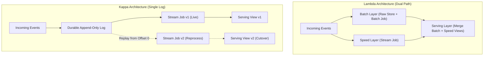

# Lambda vs. Kappa Architecture

Lambda and Kappa are two architectural blueprints for building scalable data-processing systems that serve both low-latency real-time views and accurate historical analytics over large event streams.

---

## 📚 Theory

### Lambda Architecture: Batch + Speed Layers

Proposed to handle unreliable or early-generation stream processors, **Lambda Architecture** splits incoming immutable events into two parallel pipelines that converge in a serving layer:

1. **Batch Layer**: Appends every raw event to an immutable master store (such as object storage or HDFS). Periodic batch jobs (e.g., hourly or nightly) recompute exact, comprehensive views from scratch or across historical partitions.
2. **Speed Layer**: Processes recent events with a stream processor to produce low-latency incremental views covering only the time window not yet finalized by the batch layer. These views may use approximate algorithms or simpler logic to stay fast.
3. **Serving Layer**: Indexes batch views for fast reads and merges them at query time with the speed layer's recent delta so users see up-to-date results. Once a batch run finishes covering a time range, the corresponding speed-layer state is discarded.

### Kappa Architecture: Single Log, Single Pipeline

**Kappa Architecture** simplifies Lambda by removing the separate batch codebase. It treats batch processing as a special case of streaming over a bounded slice of an immutable, append-only log (such as Apache Kafka with long retention or tiered object storage):

1. **Immutable Event Log**: All raw events land in a durable, partitioned log configured with sufficient retention (days, years, or infinite via tiered storage) to support full replay.
2. **Unified Stream Processing Layer**: One stream processing engine (such as Apache Flink) runs a single codebase for both live processing and historical recomputation using event-time semantics and watermarks.
3. **Serving Layer**: The stream job materializes queryable views directly into serving stores (key-value, search, or OLAP databases).

### Reprocessing

When business logic changes or a bug corrupts derived metrics, the two architectures recover very differently:
- **Lambda Reprocessing**: Fix the batch code and rerun the batch job over the immutable raw archive. Because the batch layer already exists to overwrite serving views, reprocessing is routine and isolated from live speed-layer traffic.
- **Kappa Reprocessing**: Deploy a second, parallel instance of the updated stream job (`v2`) reading from the earliest required offset in the immutable log and writing into a new serving table (`View v2`). Once `v2` catches up to the live head of the log, atomically switch application reads from `v1` to `v2` and retire `v1`.

### Cost

- **Lambda Cost**: Pays for two separate compute engines, duplicated storage (raw archive plus speed-layer state plus merged serving views), and higher engineering cost to build, test, and operate two pipelines.
- **Kappa Cost**: Eliminates dual-pipeline maintenance, but retaining long histories in a streaming log requires tiered storage (offloading older segments to object storage) to keep broker disk costs manageable. Full replays also require temporary burst compute and dual serving-table capacity during blue/green cutovers.

### Correctness Drift

Lambda's most persistent weakness is **correctness drift** (semantic skew) between the batch and speed layers. Even when both teams intend to implement the same metric, subtle differences creep in: late-arriving events handled differently, distinct timezone or session-window boundaries, floating-point ordering, or different null-handling semantics across two frameworks. Users notice numbers "jumping" when the batch view replaces the speed view.

Kappa eliminates dual-engine drift because one codebase computes both live and historical results. However, Kappa still requires strict discipline: stream jobs must use **event-time processing** (not wall-clock processing time) and deterministic logic without mutable external lookups, or replaying old events will produce different results than the original live run.

---

## 🎯 When to Use

**When Lambda Wins:**
- **Heavy historical workloads that do not fit streaming**: Iterative ML model training, large multi-way historical joins, or complex graph algorithms where batch engines are far more efficient and cheaper than maintaining huge streaming state.
- **Strict regulatory or financial audits**: When an independent, auditable batch reconciliation job is mandated to certify end-of-day balances while a lightweight speed layer powers approximate intraday dashboards.
- **Existing mature batch lakehouse**: When an organization already has a vast batch SQL ecosystem and only needs a narrow real-time delta for a few metrics.

**When Kappa Wins:**
- **Event-driven operational analytics and real-time views**: Fraud scoring, live leaderboards, materialized microservice views, and monitoring where a single low-latency pipeline keeps logic unified.
- **Teams prioritizing low maintenance and consistency**: Avoiding two codebases, two query semantics, and complex serving-layer merge logic.
- **Bounded or tiered replay windows**: When reprocessing spans days or months (or uses tiered log storage) and modern unified engines can replay at high throughput.

---

## ⚖️ Trade-offs

| Dimension | Lambda Architecture | Kappa Architecture |
| :--- | :--- | :--- |
| **Pipelines & Codebases** | Two (batch + speed) plus merge logic | One unified streaming codebase |
| **Correctness Drift** | High risk of batch vs. speed semantic skew | Eliminated across engines (if event-time deterministic) |
| **Reprocessing Model** | Rerun batch jobs over raw archive | Parallel replay job (`v2`) + atomic serving cutover |
| **Serving Query Complexity** | Must merge batch and speed views at read time | Direct read from one materialized view |
| **Complex Historical Joins / ML** | Strong fit (native batch engines) | Harder (large stateful joins can blow up stream state) |
| **Storage & Compute Cost** | Dual infrastructure + continuous batch runs | Lower steady-state; burst compute + tiered log for replay |

---

## ⚠️ Failure Modes & Pitfalls

- **Lambda Cutoff Boundary Gaps**: If the serving layer's merge boundary between the latest completed batch window and the speed layer is misaligned, queries either double-count or drop events during the handoff window.
- **Lambda Batch SLA Misses**: If a nightly batch job fails or runs longer than expected, the speed layer must retain state past its planned window, risking state explosion or stale gaps.
- **Kappa Log Retention Expiry**: If the event log's retention window expires before a bug is discovered, older events are gone and cannot be replayed unless cold segments are archived in tiered object storage.
- **Non-Deterministic Replay in Kappa**: Calling a live external API, reading `System.currentTimeMillis()`, or joining against a mutable dimension table during replay produces different outputs than the original run, breaking reproducibility.
- **Replay Contention**: Running a high-throughput historical replay directly against the same broker cluster or serving database as live traffic can saturate disk I/O and starve real-time latency SLAs.

---

## ❓ Interview Follow-ups

**Q: Why did Lambda Architecture emerge in the first place, and why has Kappa gained popularity?**  
A: Early stream processors offered only at-least-once delivery and weak state management, so teams needed a batch layer to guarantee accuracy. Modern stream engines with checkpointed state, event-time watermarks, and tiered log storage made a single accurate streaming pipeline practical for many workloads.

**Q: How do you perform a zero-downtime reprocessing cutover in Kappa Architecture?**  
A: Start the updated stream job (`v2`) with a new consumer group reading from the target start offset and writing to a fresh serving table (`View v2`). Monitor consumer lag until `v2` catches up to live traffic, validate parity on sample keys, atomically swap the read alias from `View v1` to `View v2`, and then shut down `v1`.

**Q: How does a Kappa pipeline handle late-arriving events without a batch layer?**  
A: It uses event-time watermarks with an allowed lateness window to update emitted aggregates when late records arrive, and routes extremely late events to a side output for alerting or targeted backfill.

**Q: Can you avoid storing years of raw events on expensive Kafka broker disks in Kappa?**  
A: Yes. Use Kafka tiered storage (which offloads closed log segments to cheap object storage while exposing a single log API) or bootstrap a unified engine from an object-storage lakehouse table before seamlessly switching to the live log tail.

**Q: If a system needs both real-time fraud alerts and nightly ML feature training over two years of data, which architecture fits better?**  
A: A Lambda-style or hybrid lakehouse architecture fits better: the stream pipeline handles sub-second fraud scoring, while raw events land in columnar object storage so batch engines can run massive multi-year joins and iterative training without inflating streaming state.

**Q: How do you test for correctness drift in a Lambda Architecture?**  
A: Run shadow reconciliation jobs that compare finalized batch outputs against speed-layer outputs over identical closed time windows, alerting whenever divergence exceeds a defined tolerance threshold.

---

## 🔗 Cross-References

- **[Stream Processing Theory](../../03-hld-concepts/stream-processing/THEORY.md)**: Unbounded vs. bounded streams, stateful operators, and unified streaming engines.
- **[Watermarks & Event Time](../../03-hld-concepts/stream-processing/watermarks-and-event-time.md)**: Handling out-of-order and late-arriving events deterministically.
- **[Exactly-Once Semantics](../../03-hld-concepts/stream-processing/exactly-once-semantics.md)**: Checkpointing, idempotent sinks, and end-to-end delivery guarantees.
- **[Kafka Theory](../../03-hld-concepts/kafka/THEORY.md)** and **[Kafka Storage Internals](../distributed-systems/kafka-storage-internals.md)**: Log retention, segments, and tiered storage that power Kappa replays.
- **[Change Data Capture (CDC)](../database-concepts/change-data-capture.md)**: Feeding operational database changes into Lambda or Kappa pipelines.
- **[Columnar Storage](../database-concepts/columnar-storage.md)**: Underlying storage format for batch layers and analytical serving views.
