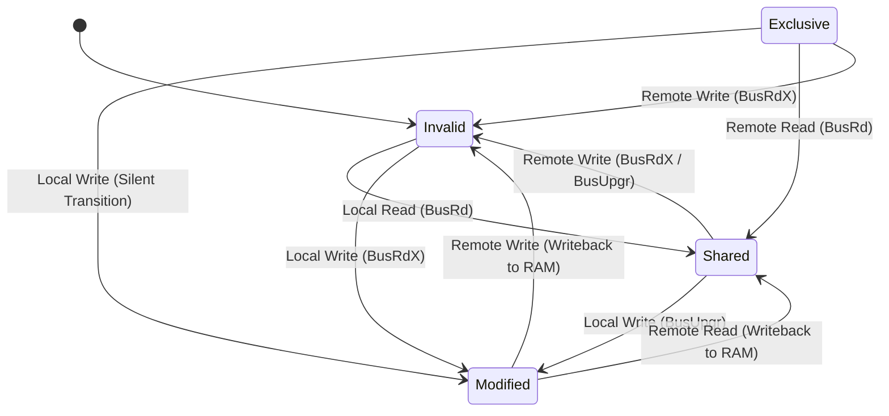
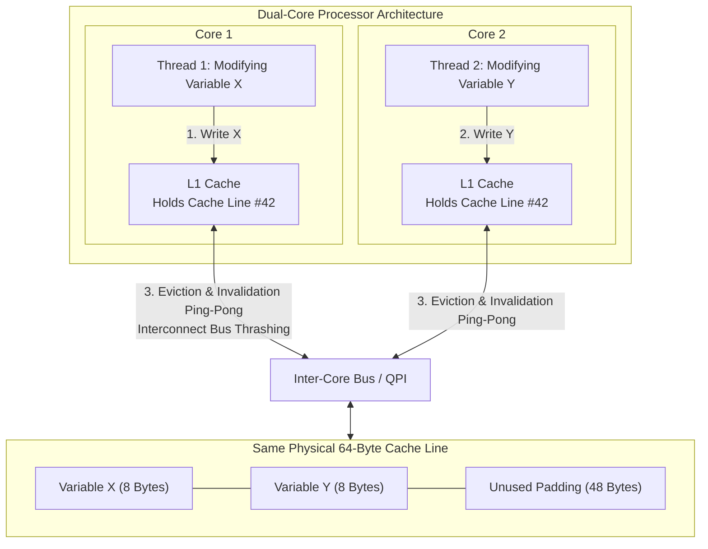

# Hardware Memory Models, Cache Coherence, and Non-Blocking Concurrency

Understanding how modern hardware manages memory is crucial for writing high-performance, concurrent software. This guide explores the depths of hardware memory architectures, cache coherence protocols, and non-blocking concurrency techniques (often discussed in advanced systems courses like CMU 15-445 or by Herlihy & Shavit).

---

## 1. Hardware Memory Hierarchy

Modern CPUs operate orders of magnitude faster than main memory (RAM). To bridge this latency gulf, hardware architectures implement a hierarchical cache topology:

| Memory Tier | Typical Size | Typical Latency | Sharing Scope |
|---|---|---|---|
| **L1d / L1i Cache** | 32KB – 64KB | ~1 ns (4–5 cycles) | Private to single core |
| **L2 Cache** | 512KB – 1MB | ~3–4 ns (12–14 cycles) | Private to single core (or pair) |
| **L3 Cache** | 16MB – 64MB | ~10–20 ns (40–60 cycles) | Shared across all cores on die |
| **Main Memory (RAM)** | 32GB – 512GB | ~60–100 ns (200+ cycles) | Shared system-wide via memory bus |

### Cache Lines
Data is transferred between RAM and caches in fixed-size atomic chunks called **cache lines** (typically **64 bytes** on modern x86-64 and ARM64 architectures). When a CPU core accesses a single 8-byte integer, the hardware pulls the surrounding 64-byte aligned block into its L1 cache.

### Store Buffers and Invalidate Queues
To avoid stalling the CPU execution pipeline during memory writes:
- **Store Buffers:** Writes are placed into a FIFO store buffer immediately, allowing the core to continue executing subsequent instructions without waiting for cache invalidation acknowledgments from other cores.
- **Invalidate Queues:** Invalidation messages from peer cores are buffered in an invalidate queue and acknowledged immediately, while cache line eviction occurs asynchronously.

---

## 2. Cache Coherence Protocols

Because multiple cores maintain private L1/L2 caches containing copies of the same physical memory addresses, hardware must enforce a **Cache Coherence Protocol** to guarantee memory consistency across cores.

### The MESI Protocol
The MESI protocol governs cache lines through a 4-state state machine:



- **M (Modified):** The cache line is dirty (present only in this core's cache and differs from main memory). The core has exclusive write permission.
- **E (Exclusive):** The cache line is clean (matches main memory) and present only in this core's cache.
- **S (Shared):** The cache line is clean and present in one or more cores' caches. Reads are allowed; writes require an invalidation broadcast.
- **I (Invalid):** The cache line does not contain valid data. Reads trigger a cache miss (`BusRd`).

### The MOESI Protocol
MOESI adds an **Owner (O)** state to optimize inter-core transfers. The Owner core holds dirty data but shares read access with other cores (`Shared` state) without forcing an expensive writeback to main RAM until eviction.

---

## 3. False Sharing: The Silent Concurrency Killer

**False Sharing** occurs when two or more threads running on separate CPU cores modify independent variables that happen to reside within the **same 64-byte cache line**.



### The Ping-Pong Anomaly
Even though Thread 1 never accesses Variable Y and Thread 2 never accesses Variable X:
1. Core 1 writes Variable X, transitioning its cache line to `Modified (M)` and broadcasting an invalidation to Core 2.
2. Core 2's cache line is marked `Invalid (I)`.
3. When Core 2 writes Variable Y, it suffers a cache miss, stalls, forces Core 1 to writeback, and invalidates Core 1's cache line.
4. The cache line continuously **ping-pongs** across the CPU interconnect bus, degrading throughput by up to **20x–50x**.

---

## 4. Code Parity: Cache Line Padding & Isolation

### Java 11+ Implementation

#### Approach A: The `@Contended` Annotation
In Java, `@jdk.internal.vm.annotation.Contended` isolates fields onto their own 64-byte (or 128-byte) cache lines automatically:

```java
package concurrency;

import jdk.internal.vm.annotation.Contended;

public class ContendedCounters {
    // Isolated on distinct cache lines to eradicate false sharing
    @Contended
    public volatile long counterA = 0L;

    @Contended
    public volatile long counterB = 0L;
}
```

#### Approach B: Manual Cache Line Padding
For portable environments or production code avoiding internal flags:

```java
package concurrency;

// 64-byte aligned padded counter
public class PaddedAtomicCounter {
    // 7 dummy long fields (7 * 8 bytes = 56 bytes) + value (8 bytes) = 64 bytes
    public volatile long value = 0L;
    public long p1, p2, p3, p4, p5, p6, p7;

    public void increment() {
        // Safe from neighboring cache line interference
        value++;
    }
}
```

---

### Python 3.8+ Implementation

In Python, the Global Interpreter Lock (GIL) serializes bytecode execution in CPython, but false sharing directly impacts multi-threaded C-extensions, Cython, `ctypes`, and shared multiprocessing memory arrays.

```python
import ctypes
import numpy as np

CACHE_LINE_BYTES = 64

# Approach A: Ctypes structure with explicit byte padding
class PaddedCounter(ctypes.Structure):
    _fields_ = [
        ("value", ctypes.c_int64),
        ("_pad", ctypes.c_char * (CACHE_LINE_BYTES - 8)),  # 56 bytes padding
    ]


# Approach B: Strided NumPy buffer for concurrent worker threads
def create_isolated_worker_array(num_workers: int) -> np.ndarray:
    """
    Creates an int64 array where each worker element is separated by 
    a full 64-byte stride (8 elements * 8 bytes = 64 bytes).
    """
    # Allocate padded buffer: stride by 8 int64 values
    raw_buffer = np.zeros(num_workers * 8, dtype=np.int64)
    return raw_buffer


def worker_increment(buffer: np.ndarray, worker_id: int) -> None:
    # Each worker writes exclusively to index worker_id * 8
    # Eliminates false sharing across worker cores
    target_idx = worker_id * (CACHE_LINE_BYTES // 8)
    buffer[target_idx] += 1
```

---

## 5. Hardware Memory Models & Reordering

CPUs dynamically reorder instructions to maximize out-of-order execution efficiency:

- **Sequential Consistency (SC):** Strictest model. Program order is globally preserved. Rarely implemented in hardware due to heavy performance penalties.
- **Total Store Order (TSO / x86):** Loads are not reordered with other loads; stores are not reordered with other stores. However, a Load may be reordered before an earlier Store (due to FIFO store buffers).
- **Weak Ordering (ARM64 / POWER):** Loads and stores can be reordered aggressively. Requires explicit memory barriers (`dmb`, `isb`).
- **Java Memory Model (JMM):** Uses **Happens-Before** semantics. Unlocking a monitor happens-before subsequent locks; writes to a `volatile` variable happen-before subsequent reads.

---

## 6. Herlihy's Non-Blocking Progress Hierarchy

1. **Obstruction-Free:** A thread makes progress if all other threads are paused (guarantees freedom from deadlock).
2. **Lock-Free:** At least one thread in the system makes progress in a finite number of steps (system-wide progress, starvation possible).
3. **Wait-Free:** Every thread completes its operation in a bounded number of steps (per-thread progress guarantee).

---

## Cross-References

- [Lock-Free Data Structures & ABA Problem](../concurrency/lock-free-data-structures-and-aba.md)
- [Deadlock Theory & Coffman Conditions](../concurrency/deadlock-theory-and-coffman-conditions.md)
- [LMAX Disruptor Ring Buffer Architecture](../concurrency/ring-buffers.md)
