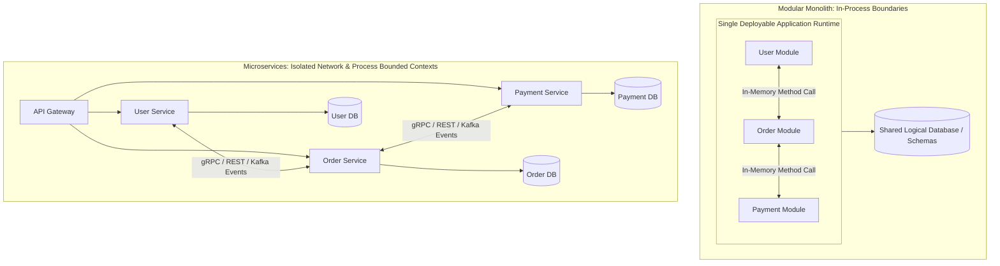
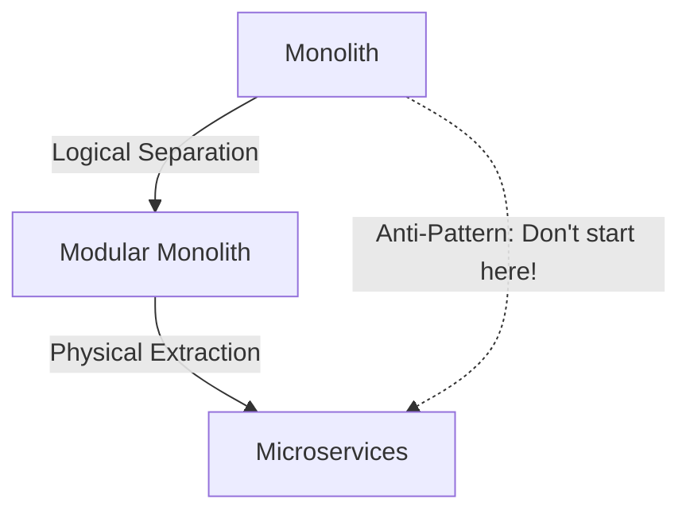
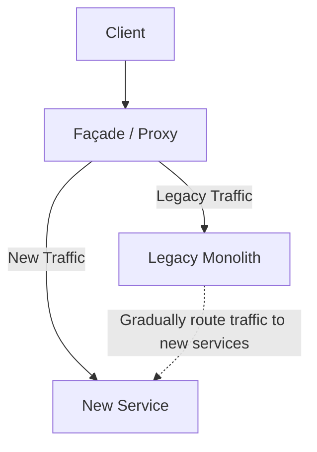
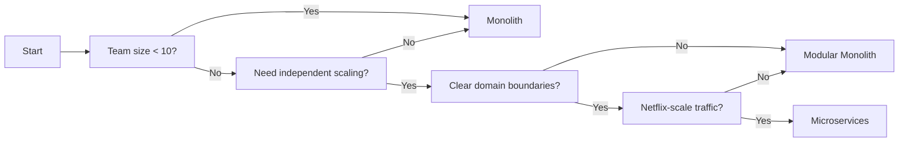

# Monolith vs Microservices

One of the most common HLD interview discussion topics. Know the trade-offs deeply.

---

## 💡 Beginner Intuition

Imagine opening a restaurant. A **Monolith** is like having one giant, highly efficient kitchen where the chef, prep cooks, and dishwashers all share the same space, ingredients, and tools. Communication is instant, and it's easy to manage initially. However, if you need to scale up just the prep station, you must rent an entirely new, equally giant kitchen.

**Microservices**, on the other hand, are like a food court. There is a separate stall for drinks, one for appetizers, and another for main courses. Each stall (service) operates independently, manages its own ingredients (database), and scales on its own. The downside? You now need a complex delivery system (network/API gateway) to coordinate getting a complete meal to the customer.

---

## 🔍 Worked Trace: Distributed Data Management (Order Placement)

**Premise**: A user places an order. The system must deduct inventory and charge a payment. We compare how this is handled in both architectures.

- **Monolithic Trace**:
  1. Open a single database transaction.
  2. Insert Order, Update Inventory, Insert Payment.
  3. If payment fails, rollback the entire transaction.
  4. **Result**: Guaranteed atomic consistency (ACID).

- **Microservices Trace (Saga Pattern)**:
  1. `Order Service` creates a "Pending" order and emits an `OrderCreated` event to Kafka.
  2. `Inventory Service` receives the event, reserves the item, and emits `InventoryReserved`.
  3. `Payment Service` receives the event and attempts the charge. The charge fails! It emits `PaymentFailed`.
  4. `Order Service` receives the failure event, executes a compensating transaction, and updates the order to "Cancelled".
  5. **Result**: Eventual consistency requiring explicit compensating transactions.

---

## 🚧 Counterexample & Boundary

**Counterexample**: An early-stage startup with a small team (e.g., 5 developers) building a new product with unclear product-market fit.

**Why Microservices Fail Here (Boundary Violation)**:
1. **Unknown Domain Boundaries**: Product requirements are evolving rapidly. Extracting microservices too early creates a tightly coupled "distributed monolith", where changes require coordinating deployments across multiple services.
2. **Operational Overhead**: The team spends a significant portion of their time managing Kubernetes, CI/CD pipelines, and network configuration instead of shipping business features.

**Boundary Limit**: Start with a well-structured **Modular Monolith**. Enforce strict logical boundaries using namespaces and interfaces. Extract into microservices *only* when independent scaling, differing technical requirements, or team autonomy becomes an explicit bottleneck.

---

## 📊 Architecture Diagrams: Modular Monolith vs Microservices Bounded Contexts



---

## 🏢 Monolithic Architecture

> **A single deployable unit containing all application functionality.**

### Characteristics

| Aspect | Description |
|--------|-------------|
| **Deployment** | Single unit (one WAR/JAR/binary) |
| **Database** | Typically shared |
| **Communication** | In-process function calls |
| **Scaling** | Scale entire application |
| **Development** | All code in one repository |

---

## 🔲 Microservices Architecture

> **Application as a collection of small, independent services, each running in its own process.**

> *(Refer to the Modular Monolith vs Microservices Bounded Contexts diagram above)*

### Characteristics

| Aspect | Description |
|--------|-------------|
| **Deployment** | Independent per service |
| **Database** | Separate per service (ideally) |
| **Communication** | Network calls (HTTP, gRPC, messaging) |
| **Scaling** | Scale individual services |
| **Development** | Can be multiple repos/teams |

---

## ⚖️ Comparison Table

| Aspect | Monolith | Microservices |
|--------|----------|---------------|
| **Complexity** | Simple initially | Complex infrastructure |
| **Deployment** | All-or-nothing | Independent |
| **Scaling** | Vertical or replicate all | Scale what you need |
| **Tech Stack** | Uniform | Polyglot possible |
| **Data Consistency** | Easy (shared DB) | Challenging (distributed) |
| **Latency** | Low (in-process) | Higher (network calls) |
| **Team Structure** | Single team works | Multiple independent teams |
| **Debugging** | Easier | Distributed tracing needed |
| **Failure Impact** | Entire app affected | Isolated failures |

---

## 🎯 When to Use Each

### Choose Monolith When:

1. **Small team** (< 10 developers)
2. **Early stage startup** - need to move fast
3. **Simple domain** - not many bounded contexts
4. **Unknown requirements** - easier to refactor
5. **Tight deadlines** - less operational overhead

### Choose Microservices When:

1. **Large organization** - multiple teams need autonomy
2. **Independent scaling** - some services need more resources
3. **Different tech requirements** - ML in Python, API in Go
4. **High availability** - isolated failures
5. **Clear domain boundaries** - well-understood bounded contexts

---

## 🔄 Migration Path



### Strangler Fig Pattern



---

## 🔴 Microservices Challenges

### 1. Distributed Data Management

```
Order Service: "Create order"
Payment Service: "Charge failed"
Order Service: "Need to rollback!" 

→ Solution: Saga pattern
```

### 2. Service Discovery

```
Service A: "Where is Service B?"
→ Solution: Service registry (Consul, Eureka)
```

### 3. Network Latency

```
Monolith: function call ~nanoseconds
Microservices: network call ~milliseconds

→ Solution: Caching, async where possible
```

### 4. Debugging Complexity

```
User complaint: "Order failed"
Which of 20 services caused it?

→ Solution: Distributed tracing (Jaeger, Zipkin)
```

---

## 🎯 Interview Questions

### Q1: "When would you NOT use microservices?"

**Answer**:
"I wouldn't use microservices for:
- New projects with unclear requirements (hard to get boundaries right)
- Small teams (operational overhead not justified)
- Simple CRUD applications (over-engineering)
- When team lacks distributed systems experience

I'd start with a well-structured monolith and extract services when there's clear need."

### Q2: "How do you determine service boundaries?"

**Answer**:
"I use Domain-Driven Design concepts:
1. **Bounded Contexts**: Each service owns one context
2. **Business Capabilities**: Align with business functions
3. **Data Ownership**: Each service owns its data
4. **Team Structure**: Conway's Law - align with teams
5. **Deployment Independence**: Services that change together should be together"

### Q3: "How do microservices communicate?"

**Answer**:
"Two main patterns:
1. **Synchronous** (HTTP/gRPC): For request-response, real-time needs
2. **Asynchronous** (Message queues): For events, decoupling

Choice depends on:
- Need immediate response? → Synchronous
- Can tolerate delay? → Asynchronous
- Need loose coupling? → Asynchronous"

---

## 📋 Quick Decision Framework



---

## 📚 Citations & Staff Extension

- **Primary Citation**: *Microservices Patterns* by Chris Richardson (for Saga, Strangler Fig, API Gateway).
- **Primary Citation**: *Building Microservices (2nd Ed)* by Sam Newman (for Bounded Contexts, Conway's Law).
- **Staff Extension (DOMA)**: At massive hyper-scale (e.g., Uber, Netflix), microservices often evolve into **Domain-Oriented Microservice Architectures (DOMA)** or **Macroservices**. Instead of hundreds of granular nano-services that cause excessive network chatter and cognitive overhead, services are grouped behind domain gateways. This model strikes a pragmatic balance, reducing operational complexity while maintaining the autonomy of large organizational domains.

---

## 🔗 Cross-References

- **HLD Concepts**: Load Balancing, API Gateway, Service Discovery
- **Patterns**: Saga, Circuit Breaker, CQRS
- **Related**: Stateless vs Stateful services

---

*💡 Pro Tip: In interviews, don't just advocate for microservices. Show you understand both approaches and can make informed trade-off decisions.*
