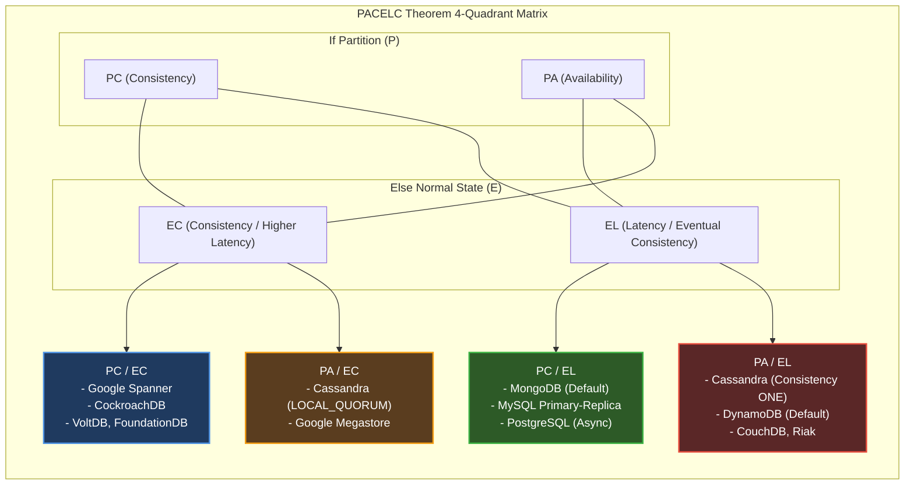
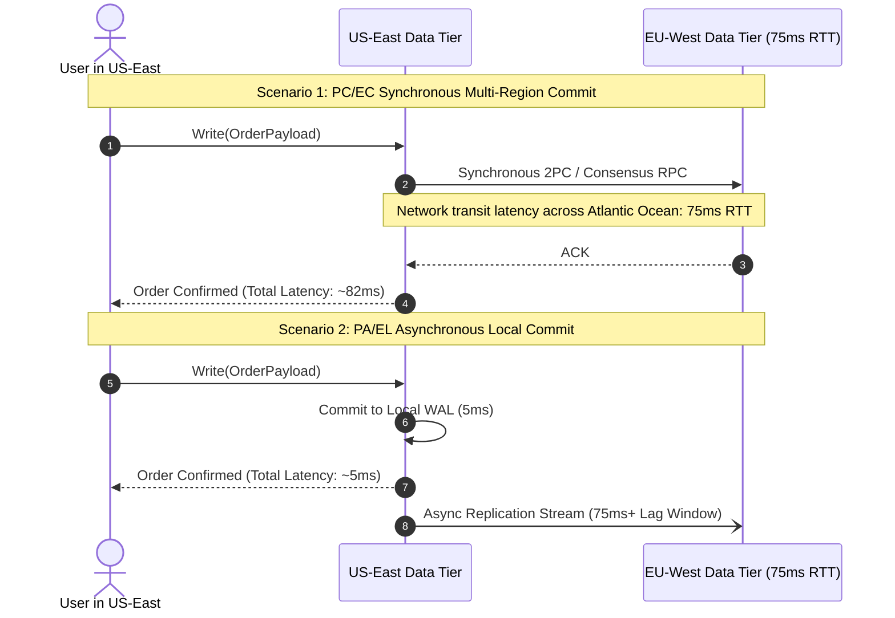

# PACELC Theorem

The **PACELC theorem** is an extension of the [CAP Theorem](./cap-theorem.md) that provides a comprehensive framework for reasoning about distributed database trade-offs. While CAP only describes how a system behaves *during a network partition* (P), PACELC formalizes the trade-offs a system makes *during normal operation* (E).

Proposed by Daniel J. Abadi in 2012, it is formalized as:
> **If there is a Partition (P):** choose between **Availability (A)** and **Consistency (C)**;  
> **Else (E):** choose between **Latency (L)** and **Consistency (C)**.



---

## Why CAP Was Insufficient

CAP focuses exclusively on the failure state (network partition). However, partitions are relatively rare in modern, well-connected datacenters. For the vast majority of time, distributed clusters operate under normal network conditions.

During normal operation, a distributed system must replicate data across nodes to guarantee durability and fault tolerance. This replication forces a fundamental latency choice:
1. **Synchronous Replication (Consistency - EC)**: The coordinator blocks and waits for multi-node round-trip replication before returning success. This guarantees strong consistency for subsequent reads, but penalizes write response time by network round-trip latency.
2. **Asynchronous Replication (Latency - EL)**: The coordinator commits locally and returns immediately (e.g., in sub-5ms), replicating to peers in the background. The user experiences ultra-low latency, but reads risk seeing stale data until replication catches up.

---

## The 4-Quadrant Matrix Analysis

PACELC categorizes distributed databases into four primary quadrants based on their architectural trade-offs:

### 1. PC/EC (Partition: Consistency, Else: Consistency)
These systems prioritize absolute consistency at all times. If a partition occurs, minority partitions reject requests rather than serve stale data. During normal operation, they wait for multi-node consensus (Paxos / Raft) before confirming writes.
- **Representative Systems**: CockroachDB, Google Cloud Spanner, VoltDB, FoundationDB.
- **Ideal Workloads**: Financial ledgers, payment transactions, inventory locks, billing accounts.

### 2. PC/EL (Partition: Consistency, Else: Latency)
These systems prioritize consistency under network splits, but optimize for low latency during normal conditions by utilizing single-primary architectures with asynchronous or semi-synchronous replication. If the primary node gets partitioned, the cluster freezes writes until a new primary is elected.
- **Representative Systems**: MongoDB (default write concern), MySQL (asynchronous replication), PostgreSQL.
- **Ideal Workloads**: General-purpose CRUD applications, user profiles, document stores.

### 3. PA/EL (Partition: Availability, Else: Latency)
These systems are built for maximum availability and throughput. They accept reads and writes on all available nodes during partitions and return instantly during normal operations by relying on background asynchronous replication and eventual consistency.
- **Representative Systems**: Apache Cassandra (with `ONE` consistency), Amazon DynamoDB (default eventual consistency), CouchDB, Riak.
- **Ideal Workloads**: High-throughput telemetry, IoT metrics, social media activity feeds, shopping cart drafts.

### 4. PA/EC (Partition: Availability, Else: Consistency)
These systems maintain availability during network splits, but enforce strict consistency when the network is healthy.
- **Representative Systems**: Cassandra (configured with `LOCAL_QUORUM` or `ALL`), Google Megastore.
- **Ideal Workloads**: Systems requiring high availability across multi-datacenter deployments that enforce read-after-write consistency within the local datacenter.

---

## Cross-Region Latency Budgeting: PC/EC vs PA/EL

When designing multi-region architectures, PACELC governs latency budgeting.

Consider a multi-region deployment spanning **US-East (Virginia)** and **EU-West (Frankfurt)** with a speed-of-light network Round Trip Time (RTT) of approximately **75ms**:



* **In a PC/EC system**: Every write must cross the transatlantic link before acknowledgment, enforcing a hard floor of $\ge 75\text{ms}$ on write latency.
* **In a PA/EL system**: Writes return in $\sim 5\text{ms}$. However, an EU-West user querying within that 75ms replication window will observe stale state.

---

## Tunable Consistency: Simulating Quorum Trade-offs

Modern distributed datastores allow developers to select their PACELC quadrant dynamically per query by adjusting the quorum parameters:

$$\text{Strong Consistency Condition: } R + W > N$$

### Python 3.8+ Simulation

```python
"""PACELC Quorum Consistency & Latency Simulation in Python 3.8+."""

from dataclasses import dataclass
from typing import Tuple


@dataclass(frozen=True)
class QuorumConfig:
    r: int  # Read quorum
    w: int  # Write quorum
    n: int  # Total replica factor


def evaluate_pacelc_mode(
    config: QuorumConfig, local_rtt_ms: float = 2.0, remote_rtt_ms: float = 75.0
) -> Tuple[str, bool, float, float]:
    """Evaluates whether the quorum config is strongly consistent and calculates estimated read/write latencies.

    Returns:
        (pacelc_quadrant, is_strongly_consistent, estimated_write_latency_ms, estimated_read_latency_ms)
    """
    is_strong = (config.r + config.w) > config.n

    if is_strong:
        quadrant = "PC/EC"
        # Must wait for majority of nodes, potentially spanning remote regions
        write_lat = remote_rtt_ms if config.w > (config.n // 2 + 1) else local_rtt_ms * 2
        read_lat = remote_rtt_ms if config.r > (config.n // 2 + 1) else local_rtt_ms * 1.5
    else:
        quadrant = "PA/EL"
        # Fast local acknowledgments
        write_lat = local_rtt_ms
        read_lat = local_rtt_ms

    return quadrant, is_strong, write_lat, read_lat


if __name__ == "__main__":
    # N=3: Strong Quorum (W=2, R=2)
    cfg_strong = QuorumConfig(r=2, w=2, n=3)
    quadrant, strong, w_lat, r_lat = evaluate_pacelc_mode(cfg_strong)
    print(f"Quorum (R=2, W=2, N=3) -> Mode: {quadrant}, Strong: {strong}, Write: {w_lat}ms, Read: {r_lat}ms")

    # N=3: Weak Quorum (W=1, R=1)
    cfg_weak = QuorumConfig(r=1, w=1, n=3)
    quadrant, strong, w_lat, r_lat = evaluate_pacelc_mode(cfg_weak)
    print(f"Quorum (R=1, W=1, N=3) -> Mode: {quadrant}, Strong: {strong}, Write: {w_lat}ms, Read: {r_lat}ms")
```

---

### Java 11+ Parity Simulation

```java
public class PacelcEvaluator {

    public static class QuorumConfig {
        public final int r;
        public final int w;
        public final int n;

        public QuorumConfig(int r, int w, int n) {
            this.r = r;
            this.w = w;
            this.n = n;
        }

        public boolean isStronglyConsistent() {
            return (r + w) > n;
        }
    }

    public static class EvaluationResult {
        public final String quadrant;
        public final boolean isStronglyConsistent;
        public final double estimatedWriteLatencyMs;
        public final double estimatedReadLatencyMs;

        public EvaluationResult(String quadrant, boolean isStronglyConsistent, double writeLat, double readLat) {
            this.quadrant = quadrant;
            this.isStronglyConsistent = isStronglyConsistent;
            this.estimatedWriteLatencyMs = writeLat;
            this.estimatedReadLatencyMs = readLat;
        }
    }

    public static EvaluationResult evaluate(QuorumConfig config, double localRttMs, double remoteRttMs) {
        boolean isStrong = config.isStronglyConsistent();
        String quadrant = isStrong ? "PC/EC" : "PA/EL";

        double writeLat = isStrong ? (config.w > (config.n / 2 + 1) ? remoteRttMs : localRttMs * 2) : localRttMs;
        double readLat = isStrong ? (config.r > (config.n / 2 + 1) ? remoteRttMs : localRttMs * 1.5) : localRttMs;

        return new EvaluationResult(quadrant, isStrong, writeLat, readLat);
    }

    public static void main(String[] args) {
        QuorumConfig strongCfg = new QuorumConfig(2, 2, 3);
        EvaluationResult res1 = evaluate(strongCfg, 2.0, 75.0);
        System.out.printf("Mode: %s | Strong: %b | Write: %.1fms | Read: %.1fms%n",
                res1.quadrant, res1.isStronglyConsistent, res1.estimatedWriteLatencyMs, res1.estimatedReadLatencyMs);

        QuorumConfig weakCfg = new QuorumConfig(1, 1, 3);
        EvaluationResult res2 = evaluate(weakCfg, 2.0, 75.0);
        System.out.printf("Mode: %s | Strong: %b | Write: %.1fms | Read: %.1fms%n",
                res2.quadrant, res2.isStronglyConsistent, res2.estimatedWriteLatencyMs, res2.estimatedReadLatencyMs);
    }
}
```

---

## Summary Checklist for System Design Interviews

1. **Clarify State**: State whether the requirement is discussing network failure partitions (CAP) or everyday steady-state operation (PACELC).
2. **Justify Latency Penalties**: When picking PC/EC (e.g., Spanner/CockroachDB), acknowledge the network RTT budget and justify why business correctness overrides latency.
3. **Propose Hybrid Models**: Show how a database can run PA/EL for high-volume telemetry while using PC/EC for critical financial operations via tunable consistency.
